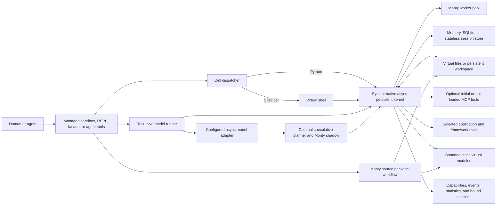
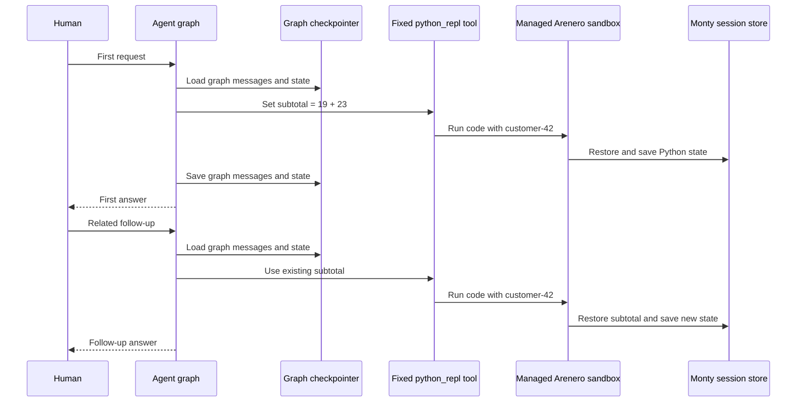
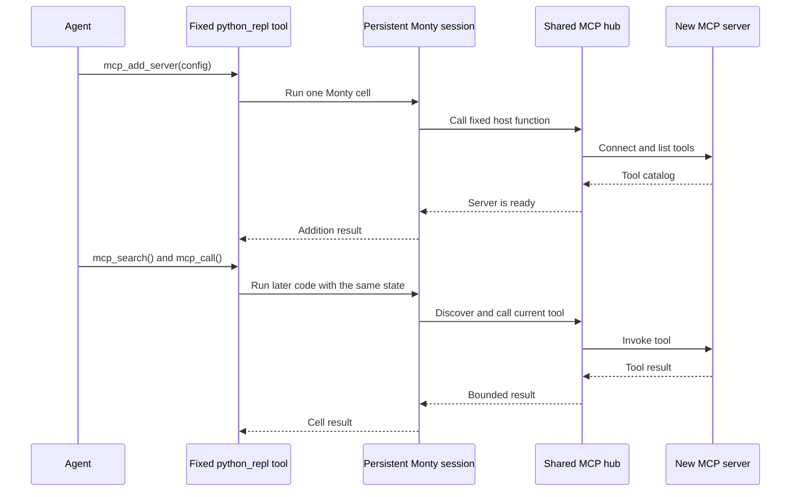

# Arenero

Arenero is a persistent Python tool built on
[Monty](https://github.com/pydantic/monty). It can run as a terminal REPL, a
LangChain and LangGraph tool, or the external environment for a Recursive
Language Model (RLM).

Each session can use in-memory, SQLite, or stateless storage. In-memory storage is
the default kernel mode. It keeps variables and functions across agent loops and
separate human turns while the application process stays active.



The kernel is the shared control point for limits, session state, and virtual
files. The virtual shell dispatches allowlisted operations. It does not start
operating-system processes.

## When to use Arenero

Arenero is a good fit when an agent needs a small, persistent computation space:

- Keep variables and helper functions between agent and human turns.
- Calculate, filter, join, and transform plain Python values.
- Read and change bounded virtual files.
- Reuse a virtual Python helper file with `execute_file()`.
- Resolve a small static graph of virtual Python files with `execute_module()`.
- Build, verify, and export a dependency-free Monty source package.
- Run short allowlisted text pipelines.
- Fetch bounded public HTTP or HTTPS data through virtual `curl`.
- Call narrow application functions without giving Python ambient host access.
- Add missing MCP servers at runtime, then discover and compose their tools from
  persistent Python without changing the outer agent tool schema.
- Keep large model input in Monty and make bounded plain or recursive model calls.
- Start selected model or hosted-tool calls while generated Monty code streams.

Use a container, VM, or managed code sandbox when the work needs full CPython,
third-party packages, Git, package installation, system test tools, compilers,
arbitrary executables, or a real shell.

## Documentation map

- [Architecture and components](docs/architecture.md) explains each layer,
  execution flow, state ownership, locks, security boundaries, and extension
  points.
- [Managed sandbox API](docs/managed-sandbox.md) explains the one-call factory,
  presets, bound relative workspace, common results, total quotas, revisions,
  tree transfer, portable checkpoints, managers, async use, and combined agent
  tools.
- [Usage and capabilities](docs/usage-and-capabilities.md) gives verified working
  examples, rejected examples, selection tables, agent guidance, and a production
  checklist.
- [Virtual shell reference](docs/virtual-shell.md) lists every command, flag,
  operator, exit code, limit, and deliberate exclusion.
- [Sandbox compatibility](docs/sandbox-compatibility.md) compares Arenero with the
  utilities expected by Deep Agents sandboxes.
- [MCP tools inside the REPL](docs/mcp.md) explains initial and hot-loaded
  servers, progressive discovery, composition, shared runtime persistence,
  stable CodeAct integration, limits, and security.
- [Hosted tools and code-mode composition](docs/hosted-tools.md) explains plain
  callables, LangChain, Pydantic AI, MCP promotion, budgets, catalogs, records,
  restart behavior, and OpenTelemetry events.
- [Deep Agents interpreter middleware](docs/deepagents.md) explains async agent
  integration, dynamic tool discovery, programmatic composition, session modes,
  subagents, and checkpoint snapshots.
- [Recursive Language Models](docs/rlm.md) explains external context, plain and
  recursive model calls, child sessions, budgets, worker needs, adapters, and
  filesystem limits.
- [Speculative programmatic tool calling](docs/speculative-tool-calling.md)
  explains streamed planning, Monty shadows, result claims, tool policies,
  statistics, limits, and standalone SpecTC-style integration.
- [Testing](docs/testing.md) explains deterministic test layers, speculative
  boundary coverage, LangChain fake models, LangGraph checkpointers, and the
  rules for future opt-in live tests.
- [Static virtual modules](docs/virtual-modules.md) explains module resolution,
  examples, limits, and differences from CPython imports.
- [Monty-compatible source packages](docs/monty-source-packages.md) defines the
  fixed layout, manifest, human and agent process, fresh-session test, archive,
  limits, and errors.
- [Quality-of-life APIs](docs/quality-of-life.md) explains capability reports,
  bound sessions, state policies, forks, bootstrap, runtime ownership, doctor,
  events, statistics, REPL commands, and MCP artifacts.
- [Design decisions](docs/design-decisions.md) records why persistence, typing,
  output, async, locking, and dependencies work as they do.

## Install and test

```console
uv sync
uv run python -m unittest discover -s tests -v
```

The core package does not require LangChain or the MCP SDK. Install only the
optional integrations that an application needs:

```console
uv add arenero
uv add "arenero[langchain]"
uv add "arenero[deepagents]"
uv add "arenero[mcp]"
uv add "arenero[pydantic-ai]"
uv add "arenero[observability]"
```

## Fast application setup

Use the managed API when an application needs a complete sandbox with few
configuration steps:

```python
from arenero import SandboxConfig, open_sandbox

config = SandboxConfig.conversation(
    max_workspace_files=250,
    max_workspace_bytes=5_000_000,
)

with open_sandbox("agent-1", config=config) as sandbox:
    sandbox.run_python("values = [2, 4, 8]")
    assert sandbox.run_python("sum(values)").value == 14
    sandbox.write("result.txt", "14")
```

Use `SandboxConfig.ephemeral()` for stateless Python, `durable(directory)` for
SQLite state and mounted files across restarts, or `batch(workers=N)` with
`open_sandbox_manager()` for concurrent Python-only agents. Add
`filesystem="memory"` to the batch preset when shared files are required and
serialized file-capable calls are acceptable. See the
[managed sandbox guide](docs/managed-sandbox.md) for limits and lifecycle rules.

## Agent developer quick start

Keep one sandbox open for the life of an agent conversation. Give the sandbox
and the agent graph the same stable conversation ID. The two state systems are
separate: LangGraph stores messages and graph state, while Arenero stores the
Monty Python session and virtual files.

This example uses one agent across two human turns. The second turn can reuse the
`subtotal` value that the first turn created in the REPL:

```python
from langchain.agents import create_agent
from langgraph.checkpoint.memory import InMemorySaver

from arenero import SandboxConfig, open_sandbox

conversation_id = "customer-42"
config = SandboxConfig.conversation(
    network="off",
    max_workspace_files=100,
    max_workspace_bytes=1_000_000,
)

with open_sandbox(conversation_id, config=config) as sandbox:
    bundle = sandbox.agent_bundle({"python", "files", "shell"})
    agent = create_agent(
        model=your_model,
        tools=list(bundle.tools),
        system_prompt=bundle.instructions,
        checkpointer=InMemorySaver(),
    )
    graph_config = {"configurable": {"thread_id": conversation_id}}

    first = agent.invoke(
        {
            "messages": [
                {
                    "role": "user",
                    "content": "Use python_repl to set subtotal = 19 + 23.",
                }
            ]
        },
        graph_config,
    )
    second = agent.invoke(
        {"messages": [{"role": "user", "content": "Multiply that subtotal by 10."}]},
        graph_config,
    )
```



The graph checkpointer does not store the REPL. Arenero does not store the graph
messages. A stable ID makes both systems follow the same conversation, but each
system keeps and restores its own state.

`SandboxConfig.conversation()` keeps REPL state and memory files until the
sandbox closes. Do not create and close a new in-memory sandbox for each HTTP
request. For process restarts, use one durable directory and reopen the same
sandbox ID:

```python
config = SandboxConfig.durable(".arenero/customer-42")

with open_sandbox("customer-42", config=config) as sandbox:
    bundle = sandbox.agent_bundle({"python", "files"})
    # Build or invoke the agent while this context is open.
```

The durable preset stores Python snapshots in SQLite and files in a mounted
workspace directory. It does not store files inside SQLite.

Use the generated instructions instead of a hand-written description. They tell
the model the active limits, shell commands, network policy, MCP functions,
session ID, and file rules:

```python
bundle = sandbox.agent_bundle({"python", "files"})
print(bundle.instructions)
print(sandbox.info().value)
```

### Add a missing MCP during an agent run

Create the kernel with an empty `McpHub` when the required MCP servers are not
known at startup. The agent can then add a stdio or Streamable HTTP server inside
`python_repl`, and it can search and call the new tools in the same cell:

```python
from arenero import open_sandbox
from arenero.mcp import McpHub

with McpHub() as mcp, open_sandbox("agent-1", mcp_hub=mcp) as sandbox:
    bundle = sandbox.agent_bundle({"python"})
    # Keep bundle.tools as the stable outer agent tool list.

    result = sandbox.run_python(
        """connected = mcp_add_server({
    "name": "late-tools",
    "transport": "streamable-http",
    "url": "https://tools.example.com/mcp",
})
matches = mcp_search("lookup order")
tool_name = matches["tools"][0]["name"]
mcp_call(tool_name, {"order_id": "order-123"})
"""
    )
```



The outer LangChain or LangGraph interface stays unchanged because the model
still calls only `python_repl`. The hub must exist when the sandbox is created.
Its live server list is shared by sessions that use that hub and is lost when the
hub closes. See [MCP tools inside the REPL](docs/mcp.md) for server configuration,
limits, and promotion rules.

### Capabilities at a glance

| Capability | Agent use | Main boundary |
| --- | --- | --- |
| Persistent Python | Keep plain values, functions, and calculations between calls. | Monty's Python subset, not CPython. |
| State modes | Select stateless, in-memory conversation, or durable SQLite state. | In-memory state ends when its runtime closes. |
| Virtual files | Read, write, edit, delete, list, glob, and grep bounded files. | Files have a separate lifecycle from Python snapshots. |
| Virtual shell | Run allowlisted text commands, variables, bounded globs, redirects, here documents, straight-line scripts, and Monty `python`. | It is a small Bash-like grammar and never starts an operating-system process. |
| Network | Fetch bounded public HTTP or HTTPS data with virtual `curl`. | No sockets; use `NetworkConfig` to narrow or disable access. |
| Hosted tools | Compose selected application, LangChain, or Pydantic AI tools in Python. | Each exposed function runs with host authority. |
| MCP | Discover, describe, compose, and hot-load stdio or HTTP MCP servers. | MCP connections and promotions are not saved in snapshots. |
| Source files | Run one helper file or a small static virtual module graph. | This is source execution, not Python import machinery. |
| Source packages | Build, check, test, and export dependency-free Monty source ZIP files. | No wheels, sdists, installers, or third-party dependencies. |
| Concurrent agents | Use separate IDs with the batch preset and one worker pool. | Shared filesystem work is serialized in one kernel. |
| Bounded results | Limit output, save larger bounded output to a file, and inspect statistics. | Hard stream, result, state, and transfer caps still apply. |

### Common workarounds

| Agent need | Arenero approach |
| --- | --- |
| Load `helper.py` | Use `run_file("helper.py", code="follow_up()")`, `%run`, or `python_repl_execute_file`. Names enter the current session. |
| Use several local Python files | Use `run_module()` or `python_repl_execute_module` for the supported static import graph. |
| Call a third-party library or service | Put the operation behind a narrow hosted function or MCP tool. Use an external CPython sandbox when arbitrary packages are required. |
| Run a shell task | Use a supported virtual command. Put a missing operation behind a hosted tool, MCP server, or external sandbox. |
| Keep work after a process restart | Use `SandboxConfig.durable()` and reopen the same sandbox ID and directory. |
| Let several agents share artifacts | Use one manager with a shared filesystem. Use separate managers when files must be isolated. |
| Return an image to a model | Read it through `read_media_file()` and add its provider content block to the model message. A path or Base64 string alone is not visible to the model. |
| Handle a large result | Ask for a summary, request a smaller `output_limit_chars`, or write bounded data to `output_file` for a later read. |
| Add an MCP later | Attach an empty `McpHub()` at startup, then use `mcp_add_server()`, `mcp_search()`, and `mcp_call()` inside the REPL. |

### Important limitations

- Monty does not provide full CPython. There is no `pip`, site-packages, native
  extension, `eval()`, `exec()`, `compile()`, or dynamic import.
- A virtual `.py` file cannot be imported in the normal CPython way. Use
  `run_file()` for one file or `run_module()` for a bounded static file graph.
- The virtual shell has a fixed command and flag set. It supports persistent
  virtual variables, bounded wildcard expansion, and straight-line `source`
  files. It does not support Git, arbitrary programs, full Bash control flow,
  background jobs, command substitution, binary pipes, or descriptor redirection.
- Python has no direct socket or process access. Virtual `curl`, MCP, and hosted
  functions are explicit host bridges with separate policies and limits.
- Python state, virtual files, MCP connections, and external side effects have
  different lifecycles. A state reset or failed state save does not undo file,
  network, MCP, or application changes.
- Monty snapshots are version-specific. Host functions, mounts, callbacks, and
  live MCP connections must be attached again after a process restart.
- One session accepts one execution at a time. Use different stable session IDs
  and enough workers for concurrent agents.
- Sessions in one managed runtime can share configured files and MCP servers.
  Use separate runtimes for isolation.
- Duration is cumulative Monty interpreter time for a session. A session that
  reaches its time or memory limit must be reset.
- Hosted functions and MCP tools run outside Monty's isolation. Validate their
  inputs and keep secrets in trusted host code.

For verified accepted and rejected examples, read
[Usage and capabilities](docs/usage-and-capabilities.md). For every shell flag and
command limit, read [Virtual shell reference](docs/virtual-shell.md).

## Terminal REPL

```console
uv run arenero
```

The CLI uses SQLite by default, with `.arenero/sessions.db` as its database. Its
default session name is `cli`.

```console
uv run arenero --session research
uv run arenero --store memory --session research
uv run arenero --store none
uv run arenero --session research --output-limit 2000
uv run arenero --workspace .arenero/workspaces/shared
uv run arenero --type-check
uv run arenero --list-sessions
uv run arenero --prune-sessions
uv run arenero --session research --reset
uv run arenero doctor
uv run arenero --doctor
```

`--workspace` mounts a persistent host directory at `/workspace` and starts new
shell sessions there. `--output-file /workspace/output.json` saves larger bounded
cell output when the normal response is trimmed.

The storage modes are:

| Mode | Survives agent calls | Survives human turns | Survives process restart |
| --- | --- | --- | --- |
| `memory` | Yes | Yes | No |
| `sqlite` | Yes | Yes | Yes |
| `none` | No | No | No |

## Kernel API

```python
from arenero import KernelConfig, PersistentMontyKernel

config = KernelConfig(
    default_output_limit_chars=8_000,
    max_output_limit_chars=50_000,
    max_shell_command_chars=20_000,
    max_shell_commands=8,
    max_stream_bytes=1_000_000,
    max_state_bytes=5_000_000,
    max_duration_seconds=5,
    max_memory_bytes=64 * 1024 * 1024,
    max_recursion_depth=100,
    request_timeout_seconds=10,
    min_worker_processes=1,
    max_worker_processes=4,
    worker_checkout_timeout_seconds=5,
    max_checkouts_per_worker=None,
    session_ttl_seconds=24 * 60 * 60,
    type_check=True,
    type_check_stubs="def lookup_price(product_id: str) -> float: ...",
)

with PersistentMontyKernel(config=config) as kernel:
    kernel.execute("thread-1", "x = 21")
    execution = kernel.execute("thread-1", "x * 2")
    print(execution["result"])
    # 42
```

### Native async batch execution

Use one `AsyncPersistentMontyKernel` for agents that run at the same time. Give
each agent its own stable session ID. Calls with different IDs can use different
workers. Calls with the same ID always run in order.

```python
import asyncio

from arenero import AsyncPersistentMontyKernel, KernelConfig


async def main() -> None:
    config = KernelConfig(
        min_worker_processes=2,
        max_worker_processes=4,
        worker_checkout_timeout_seconds=5,
    )
    async with AsyncPersistentMontyKernel(config=config) as kernel:
        results = await asyncio.gather(
            kernel.execute("agent-1", "sum(range(100))"),
            kernel.execute("agent-2", "sum(range(200))"),
        )
        print([result["result"] for result in results])


asyncio.run(main())
```

### Deep Agents interpreter middleware

The `deepagents` extra provides an async middleware with live tool declarations,
programmatic tool composition, three state lifetimes, optional checkpoint-backed
snapshots, and a limited virtual-module tool:

```python
from arenero import create_deepagents_middleware
from deepagents import create_deep_agent

interpreter = create_deepagents_middleware(
    mode="thread",
    ptc=("search", "lookup_customer"),
)
agent = create_deep_agent(
    model="openai:gpt-5.5",
    tools=[search, lookup_customer],
    middleware=[interpreter],
)

result = await agent.ainvoke(
    {"messages": [{"role": "user", "content": "Analyze these results."}]},
    {"configurable": {"thread_id": "conversation-42"}},
)
await interpreter.aclose()
```

Use `ainvoke()` or `astream()`. Programmatic calls run inside the approved outer
interpreter call, so they do not pass through the parent ToolNode or its per-tool
approval middleware. See [Deep Agents interpreter middleware](docs/deepagents.md)
before enabling tools with side effects.

### Recursive Language Models

`RLM` keeps the full input in Monty and lets generated code make bounded plain
or recursive model calls. Every recursive child gets a separate temporary REPL:

```python
from langchain.chat_models import init_chat_model

from arenero import (
    AsyncPersistentMontyKernel,
    KernelConfig,
    RLM,
    RLMConfig,
    adapt_langchain_model,
)

model = init_chat_model("openai:gpt-5.5")
rlm = RLM(
    adapt_langchain_model(model),
    config=RLMConfig(max_depth=1, max_model_calls=32),
)
kernel = AsyncPersistentMontyKernel(
    config=KernelConfig(
        max_worker_processes=4,
        worker_checkout_timeout_seconds=5,
    )
)

async with kernel:
    answer = await rlm.complete(
        kernel,
        long_text,
        "Find and explain the conflicting claims.",
    )

print(answer.response)
print(answer.usage.to_dict())
```

Pass `rlm=rlm` to `create_deepagents_middleware()` to expose `llm_query`,
`llm_query_batched`, `rlm_query`, `rlm_query_batched`, and `rlm_usage` inside the
agent interpreter. Recursive children need free Monty workers. They use inherited
hosted file tools for shared files because direct kernel filesystem mounts are
disabled in child sessions. See [Recursive Language Models](docs/rlm.md).

Monty's worker pool is the backpressure control. When no worker becomes free
before `worker_checkout_timeout_seconds`, Arenero returns a retryable
`WorkerCheckoutTimeout` result. Do not add an application semaphore unless the
application needs a lower limit than the Monty pool.

Async host functions must be called with `await` in Monty code. The async kernel
also exposes `await mcp_call(...)` when it has an `McpHub`.

The optional native async agent adapter contains four tools:

```python
from arenero import create_async_python_repl_tools

tools = create_async_python_repl_tools(kernel)
```

- `python_repl`
- `python_repl_execute_file`
- `python_repl_execute_module`
- `reset_python_repl`

This small adapter does not claim virtual shell support. Use
`AsyncAreneroSandbox` when an async application needs the full synchronous
sandbox API through worker threads. The native async kernel has bounded host-side
download support for static module resolution. It still omits upload, session
listing, and output-file offloading methods. Agents can use virtual `fs_*`
functions inside Python, run one helper with `execute_file()`, or run a bounded
static graph with `execute_module()`.

The kernel uses `InMemorySessionStore` when no store is given. Select another mode
with an explicit store:

```python
from arenero import (
    InMemorySessionStore,
    PersistentMontyKernel,
    SQLiteSessionStore,
    StatelessSessionStore,
)

# Default: state remains while this kernel process is active.
memory_kernel = PersistentMontyKernel()

# The same in-memory state can also be shared by replacement kernel objects.
memory_store = InMemorySessionStore()
memory_kernel = PersistentMontyKernel(memory_store)

# State remains after a process restart.
sqlite_kernel = PersistentMontyKernel(SQLiteSessionStore("sessions.db"))

# Every execution starts with empty state.
stateless_kernel = PersistentMontyKernel(StatelessSessionStore())
```

`execute()` returns a dictionary with these main fields:

```python
{
    "ok": True,
    "result": 42,
    "stdout": "",
    "stderr": "",
    "error": None,
    "truncated": {
        "result": False,
        "stdout": False,
        "stderr": False,
        "error": False,
    },
    "state_saved": True,
    "state_restored": True,
    "session_restarted": False,
    "stats": {"execution_id": "...", "wall_time_seconds": 0.01},
    "host_calls": {"count": 0, "items": [], "truncated": False},
}
```

Errors also include stable `code`, `hint`, `retryable`, and `recovery` fields.
See [Quality-of-life APIs](docs/quality-of-life.md) for the full result contract.

## Hosted tools inside Python

Arenero can expose selected plain functions, LangChain tools, Pydantic AI tools,
and promoted MCP tools as guarded keyword-only functions inside the REPL. It
generates a live catalog, applies per-operation call and wall-time limits, and
returns bounded `host_calls` records.

```python
from arenero import HostedToolSet, PersistentMontyKernel


def multiply(a: int, b: int) -> int:
    """Multiply two integers."""

    return a * b


hosted = HostedToolSet.from_callables([multiply])
with PersistentMontyKernel(hosted_tools=hosted) as kernel:
    print(kernel.execute("agent-1", "multiply(a=6, b=7)")["result"])
```

See [Hosted tools and code-mode composition](docs/hosted-tools.md) for framework
adapters, selection, budgets, type-check limits, MCP promotion, and telemetry.

## LangChain and LangGraph

The adapter creates these tools:

- `python_repl` runs Monty Python or notebook-style virtual shell cells in the
  current graph thread.
- `python_repl_execute_file` runs a virtual Python file and optional follow-up
  code in one tool call.
- `python_repl_execute_module` resolves a bounded static virtual module graph and
  optional follow-up code in one tool call.
- `virtual_shell` runs allowlisted commands against the virtual filesystem.
- `reset_python_repl` removes that thread's Python state.

It also creates shared virtual filesystem tools:

- `read_file`
- `write_file`
- `edit_file`
- `delete_file`
- `list_files`
- `glob_files`
- `grep_files`

An agent can use only `python_repl` and still access the virtual shell:

```text
!curl https://example.com/data | grep result
```

```text
%%shell
mkdir -p /work
curl https://example.com/data > /work/data.txt
grep result /work/data.txt
```

`!command` accepts one shell line. A `%%shell` cell preserves its complete body,
including comments, continuations, and here documents. Python and shell cells use
the same thread session, shell working
directory, Python state, and virtual filesystem. For example, a later shell cell
can run `python -c 'existing_variable'`, and a later Python cell can read a file
that the shell created.

Python and shell cells keep their existing detailed fields. Both modes also
include `mode`, `ok`, `result`, `output`, `stdout`, `stderr`, `error`, `exit_code`,
`truncation`, `retryable`, `output_file`, and `output_file_error`. Use the common
fields when one adapter handles both modes. Python and shell source cannot be
mixed in one cell.

```python
from langchain.agents import create_agent

from arenero import (
    PersistentMontyKernel,
    SQLiteSessionStore,
    create_python_repl_tools,
)

# In-memory state survives separate human turns in this running process.
kernel = PersistentMontyKernel()
tools = create_python_repl_tools(kernel)

agent = create_agent(
    model="your-model",
    tools=tools,
    system_prompt=(
        "Use python_repl for calculations, temporary data, and !COMMAND or "
        "%%shell virtual shell cells. Use "
        "python_repl_execute_file when a known virtual Python file must be loaded. "
        "Use python_repl_execute_module when a small set of virtual .py files "
        "uses supported static imports. "
        "Use virtual_shell for short virtual file pipelines. Use the file tools "
        "when a structured result is easier to use."
    ),
)

result = agent.invoke(
    {"messages": [{"role": "user", "content": "Calculate 19 * 23."}]},
    {"configurable": {"thread_id": "conversation-123"}},
)

kernel.close()
```

Use `PersistentMontyKernel(SQLiteSessionStore("sessions.db"))` when the agent must
recover its Python state after the application process restarts.

The adapter reads `thread_id` from `ToolRuntime`. The model cannot select another
thread. You can provide a custom `session_id_resolver` when a session key must also
contain a user or tenant ID.

## Configurable output limits

The application controls two limits:

- `default_output_limit_chars` is used when a tool call does not request a limit.
- `max_output_limit_chars` is the hard maximum that a tool call cannot exceed.

The `python_repl`, `python_repl_execute_file`,
`python_repl_execute_module`, and `virtual_shell` tools expose
`output_limit_chars` to the model. The model can use a smaller value when it
only needs a short answer:

```json
{
  "code": "large_result[:10]",
  "output_limit_chars": 1000
}
```

The limit applies separately to `result`, `stdout`, `stderr`, and the error message.
Set it to `0` to omit the contents of these fields. The response reports which
fields were truncated and whether the requested value was capped.

The agent can also set `output_file` to an absolute virtual path. When output is
trimmed, Arenero saves the larger bounded Python result as JSON or the larger
bounded shell output as text. The hard stream, result, and transfer limits still
apply:

```json
{
  "code": "large_result",
  "output_limit_chars": 1000,
  "output_file": "/workspace/outputs/result.json"
}
```

`max_stream_bytes` is separate. It stops code that prints too much before trimming
happens. This protects the host process.

## Approved host functions

Monty code has no direct host file, environment, or network access. You can expose
specific synchronous functions:

```python
from arenero import KernelConfig, PersistentMontyKernel


def lookup_price(product_id: str) -> float:
    return 12.50


kernel = PersistentMontyKernel(
    config=KernelConfig(
        type_check=True,
        type_check_stubs=("def lookup_price(product_id: str) -> float: ..."),
    ),
    external_lookup={"lookup_price": lookup_price},
)

kernel.execute("thread-1", 'lookup_price("item-42")')
```

Only functions in `external_lookup` are available inside the sandbox. When type
checking is enabled, declare each host function in `type_check_stubs`. Invalid
typed code returns `MontyTypingError` and does not execute or enter the accumulated
type-check context.

## Filesystem access

Filesystem access is off by default. Enable it with an in-memory filesystem, one
or more directory mounts, or both. The same filesystem settings apply when the
kernel is used through the LangChain and LangGraph tools.

### In-memory files

Pass an `OSAccess` object to `os_handler`. Keep the object alive for as long as
its files must remain available:

```python
from pydantic_monty import MemoryFile, OSAccess

from arenero import PersistentMontyKernel

filesystem = OSAccess(
    files=[MemoryFile("/data/input.txt", "21")],
)

with PersistentMontyKernel(os_handler=filesystem) as kernel:
    kernel.execute(
        "thread-1",
        "from pathlib import Path\n"
        "value = int(Path('/data/input.txt').read_text())\n"
        "Path('/data/result.txt').write_text(str(value * 2))",
    )
    result = kernel.execute("thread-1", "open('/data/result.txt').read()")
    print(result["result"])
    # 42
```

The same `OSAccess` object is shared by every session that uses that kernel. Use a
different object per user or thread when files must be isolated. These files are
not part of a Monty session dump, so SQLite does not save them.

### Persistent workspace

`WorkspaceConfig` is the simple option when Python state and files must both
survive an application restart. Arenero owns and closes the confined read-write
mount:

```python
from arenero import (
    PersistentMontyKernel,
    SQLiteSessionStore,
    WorkspaceConfig,
)

with PersistentMontyKernel(
    SQLiteSessionStore(".arenero/sessions.db"),
    workspace=WorkspaceConfig(".arenero/workspaces/shared"),
) as kernel:
    kernel.execute(
        "thread-1",
        "open('/workspace/result.txt', 'w').write('saved')",
    )
```

The workspace appears at `/workspace` by default. New shell sessions start there.
Sessions that use one kernel share the workspace. Use a different directory for
each user or tenant when files must be isolated.

### Host directory mounts

Pass one `MountDir` or a list of mounts to `mounts`. Virtual paths always use POSIX
syntax, including on Windows.

```python
from pathlib import Path

from pydantic_monty import MountDir

from arenero import PersistentMontyKernel

workspace = Path("agent-workspace")
workspace.mkdir(exist_ok=True)

with (
    MountDir(
        host_path=workspace,
        virtual_path="/workspace",
        mode="read-write",
        write_bytes_limit=1_000_000,
        memory_usage_limit=10_000_000,
    ) as mount,
    PersistentMontyKernel(mounts=mount) as kernel,
):
    kernel.execute(
        "thread-1",
        "open('/workspace/result.txt', 'w').write('saved')",
    )
```

Mount modes are:

- `read-only`: code can read host files but cannot change them.
- `read-write`: changes go directly to the host directory and survive later calls
  and process restarts.
- `overlay`: writes are temporary and are discarded when the Monty feed that made
  them ends.

`MountDir` holds a host directory open. The caller owns it and must close it, as in
the example. A read-write mount can change or delete host files. Use dedicated
directories when agents must be isolated. `write_bytes_limit` limits writes in one
call, and `memory_usage_limit` limits memory used by the mount.

`reset()` removes Python state only. It does not clear an `OSAccess` object or
delete files in a mounted directory. `WorkspaceConfig` persists files in its host
directory; it does not store file content inside SQLite.

### Filesystem helpers and agent tools

Arenero loads these bounded helper functions into every REPL session:

- `fs_read(path, offset=0, limit=None)`
- `fs_write(path, content, append=False, create_parents=False)`
- `fs_edit(path, old_text, new_text, replace_all=False)`
- `fs_mkdir(path, parents=False, exist_ok=False)`
- `fs_delete(path, recursive=False)`
- `fs_ls(path="/", recursive=False, limit=None)`
- `fs_glob(pattern, root="/", limit=None)`
- `fs_grep(query, root="/", pattern="**/*", regex=False,
  case_sensitive=True, limit=None)`

They run inside Monty and use the same `OSAccess` or `MountDir` configuration as
normal `open()` and `Path` calls. Hosted functions are not used, so these helpers
do not bypass Monty's mount path checks.

```python
with PersistentMontyKernel(mounts=mount) as kernel:
    result = kernel.execute(
        "thread-1",
        "fs_write('/workspace/notes.txt', 'Alpha\\nBeta\\n')\n"
        "fs_edit('/workspace/notes.txt', 'Beta', 'Gamma')\n"
        "fs_grep('gamma', root='/workspace', case_sensitive=False)",
    )
```

The LangChain and LangGraph file tools call these same helpers through the kernel.
The runtime thread ID selects the Python session, but files remain shared when the
kernel uses one shared `OSAccess` object or mount set.

Host application code can call the same helper path without building Python source:

```python
result = kernel.call_filesystem(
    "thread-1",
    "grep",
    {
        "query": "PersistentMontyKernel",
        "root": "/workspace",
        "pattern": "**/*.py",
        "regex": False,
        "case_sensitive": True,
        "limit": 20,
    },
)
```

Bind a session when one application flow uses the same ID many times:

```python
with PersistentMontyKernel(config=config) as kernel:
    session = kernel.session("agent-1")
    session.execute("values = [10, 20, 30]")
    result = session.execute("sum(values)", state_policy="success")
    experiment = session.fork("agent-1-experiment")

    capabilities = kernel.capabilities()
    model_text = kernel.instructions()
```

Kernel errors include stable `error.code`, `error.hint`, and `error.recovery`
fields. Python results include an execution ID, wall time, worker checkout wait,
state sizes, original output sizes in `stats`, and nested tool records in
`host_calls`. See the
[quality-of-life API reference](docs/quality-of-life.md) for full behavior and
limitations.

`edit_file` uses exact text replacement. By default, the old text must occur once.
Set `replace_all=true` to replace every occurrence. Recursive deletion is off by
default, and the virtual root `/` cannot be deleted.

Configure hard filesystem limits separately from normal kernel limits:

```python
from arenero import FilesystemConfig, PersistentMontyKernel

filesystem_config = FilesystemConfig(
    default_read_limit_chars=8_000,
    max_read_limit_chars=200_000,
    max_write_chars=1_000_000,
    default_result_limit=100,
    max_result_limit=1_000,
    max_scan_entries=5_000,
    max_grep_chars=2_000_000,
    max_depth=20,
    max_transfer_bytes=10_000_000,
)

kernel = PersistentMontyKernel(
    mounts=mount,
    filesystem_config=filesystem_config,
)
```

The model can request smaller read and result limits. The configured maximums are
hard caps. Kernel output trimming still applies after a helper returns its result.

### Execute a virtual Python file

Monty does not import Python files from the virtual filesystem and does not expose
`eval()` or `exec()`. Arenero can still read a file and submit its source directly
to the persistent Monty session:

```python
filesystem = OSAccess(
    files=[
        MemoryFile(
            "/helper.py",
            "def double(value):\n    return value * 2\n",
        )
    ],
)

with PersistentMontyKernel(os_handler=filesystem) as kernel:
    result = kernel.execute_file(
        "thread-1",
        "/helper.py",
        code="double(21)",
    )
    print(result["result"])
    # 42

    # The helper remains in the persistent Python session.
    kernel.execute("thread-1", "double(5)")
```

The optional `code` runs only after the complete file succeeds. The result and
captured output cover both the file and the follow-up code. The operation saves
the session once, after the final feed.

Agents receive the same feature as `python_repl_execute_file`:

```json
{
  "file_path": "/helper.py",
  "code": "double(21)",
  "output_limit_chars": 1000
}
```

The file source stays between Arenero and Monty. It is not returned to the model,
and the output limit does not shorten it. This is file execution, not normal Python
module importing. Names defined by the file enter the current REPL namespace.

For supported static imports between several virtual files, use
`execute_module()` or `python_repl_execute_module`. See
[Static virtual modules](docs/virtual-modules.md). Direct Monty code still cannot
import a virtual file.

## Persistence and recovery

- In-memory storage is the default and stays active between human turns.
- SQLite storage survives application restarts.
- Stateless storage starts clean for every tool call.
- In-memory and SQLite writes use revision checks.
- SQLite writes use transactions.
- Calls for one session run in order inside one process.
- Different sessions run independently when no shared filesystem is configured.
- A kernel with shared files serializes filesystem-capable executions. This
  prevents same-process read-modify-write races between sessions.
- A Monty crash, time limit, or memory limit resets the affected session.
- Code errors save valid changes made before the error.
- Old sessions expire after `session_ttl_seconds`.
- Dumps made by another Monty version require a session reset.
- Oversized session states do not replace the last saved state.

Use `kernel.list_sessions()` and `kernel.get_session_info(session_id)` to inspect
safe metadata such as revision, update time, Monty version, and snapshot size.
Snapshot bytes are not returned. Use `kernel.delete_expired()` for explicit
cleanup. The CLI provides `--list-sessions` and `--prune-sessions`.

The shared-file lock is local to one kernel process. Separate processes that write
the same host directory still need application-level coordination.

Monty supports a useful subset of Python. See the
[Monty project](https://github.com/pydantic/monty) for its current language limits.

## Binary files and model images

The text tools remain text-only. Application code can move binary files through a
separate transfer plane:

```python
from pathlib import Path

from pydantic_monty import OSAccess

from arenero import PersistentMontyKernel, read_media_file

filesystem = OSAccess()
with PersistentMontyKernel(os_handler=filesystem) as kernel:
    image = Path("ant-image.png").read_bytes()
    kernel.upload_file("/images/ant-image.png", image)

    downloaded = kernel.download_file("/images/ant-image.png")
    assert downloaded == image

    media = read_media_file(kernel, "/images/ant-image.png")
    image_block = media.as_langchain_image(detail="low")
```

`image_block` is an OpenAI-style LangChain content block for a `HumanMessage`
content list. Arenero reads the bytes from the virtual filesystem and Base64-
encodes them on the host. The model does not gain direct filesystem access.

The binary transfer hard cap is `FilesystemConfig.max_transfer_bytes`. A caller
can request a lower download cap but cannot exceed this application limit.

## Virtual shell and sandbox facade

`AreneroSandbox` groups execution, file utilities, binary transfer, and a stable
sandbox ID behind one framework-neutral object:

```python
from pydantic_monty import OSAccess

from arenero import (
    MONTY_SANDBOX_INSTRUCTIONS,
    NetworkConfig,
    PersistentMontyKernel,
    AreneroSandbox,
)

with PersistentMontyKernel(os_handler=OSAccess()) as kernel:
    sandbox = AreneroSandbox(kernel, session_id="thread-1")
    sandbox.execute("mkdir -p /work")
    sandbox.execute("cd /work")
    sandbox.execute("echo 'Alpha' > notes.txt")
    result = sandbox.execute("cat notes.txt | grep Alpha")
    print(result.output)
    # Alpha
```

Async applications that need the complete shell and file facade can use the same
sync operations through worker threads:

```python
from arenero import AsyncAreneroSandbox

sandbox = AsyncAreneroSandbox(kernel, session_id="thread-1")
result = await sandbox.execute("python -c '21 * 2'")
await sandbox.write("/workspace/result.txt", result.output)
```

The asynchronous facade uses the same kernel locks, limits, files, and persistent
state. It does not create a second Monty runtime. Use
`AsyncPersistentMontyKernel` for native concurrent Monty execution.

`execute` provides a small virtual shell. It supports:

- `.`, `[`, `help`, `which`, `pwd`, `cd`, `env`, `export`, `unset`, `true`,
  `false`, `test`, `ls`, `mkdir`, `touch`, `cat`, `head`, `tail`, `grep`,
  `find`, `glob`, `echo`, `printf`, `sort`, `uniq`, `rev`, `wc`, `basename`,
  `dirname`, `tee`, `base64`, `sha256sum`, `rm`, `cp`, `mv`, and `source`
- Default bounded public HTTP and HTTPS through policy-limited `curl`
- `python -c CODE` and `python FILE.py`
- Text pipes with `|`
- Command lists with `;`, `&&`, and `||`
- Virtual file input and output with `<`, `>`, `>>`, and `<<`
- Single and double quotes, comments, and line continuation
- Persistent virtual variables, `$?`, `PWD`, `OLDPWD`, `HOME`, and `~`
- Bounded `*`, `?`, and `**` expansion for unquoted arguments
- Straight-line virtual command files with `source FILE` or `. FILE`

```python
with PersistentMontyKernel(os_handler=OSAccess()) as kernel:
    sandbox = AreneroSandbox(kernel, session_id="agent-1")
    sandbox.execute("NAME=report; mkdir -p ~/work; touch ~/work/a.txt")
    result = sandbox.execute(
        "printf '%s\\n' ~/work/*.txt | grep -E 'a\\.txt$'"
    )
    print(result.output)
```

Use `%%shell` for multiline here documents and straight-line command source.
Use `source /script.sh` to run a saved virtual command file. `if`, `for`, `while`,
functions, command substitution, `bash FILE`, and host programs are not supported.

The working directory, previous directory, variables, and last exit status belong
to the Monty session. Memory and SQLite storage preserve them with Python state.
Stateless storage starts them again for every call. Files still follow the
separate virtual filesystem lifecycle and can be shared by sessions.

This shell never starts an operating-system process. It rejects background jobs,
full Bash control flow, command substitution, descriptor redirection, Git,
package installation, and all other executables. The virtual `curl` command allows
bounded requests to public HTTP and HTTPS URLs by default. Supply a host policy
when you want a narrower URL or method set:

```python
network = NetworkConfig(
    allowed_url_prefixes=("https://api.example.com/v1",),
    allowed_methods=frozenset({"GET", "HEAD"}),
    timeout_seconds=10,
    max_response_bytes=1_000_000,
    trusted_header_provider=lambda url: {"Authorization": "Bearer host-secret"},
)

with PersistentMontyKernel(
    os_handler=OSAccess(),
    network_config=network,
) as kernel:
    sandbox = AreneroSandbox(kernel, session_id="thread-1")
    result = sandbox.execute("curl https://api.example.com/v1/items | grep active")
```

With no `NetworkConfig`, all public HTTP and HTTPS URLs are allowed with `GET` and
`HEAD`. An empty `allowed_url_prefixes` tuple has the same meaning. A nonempty
allowlist compares the exact scheme, host, effective port, and path prefix. Set
`enabled=False` to remove `curl` from the shell.

The default lets an agent send data that it knows to a public service. Configure
narrow URL prefixes when the agent can access sensitive data.

Private, local, and reserved IP addresses are blocked by default. DNS results are
checked and the connection uses the checked address. Redirect targets are checked
again. Request-body, response-body, and redirect limits are hard caps. The network
timeout limits connection waits and idle time between reads. It is not a strict
end-to-end wall-clock cap for DNS or a server that continuously sends small data.
`curl -o FILE URL` saves raw response bytes in the virtual filesystem. Normal
output and pipes require UTF-8 response text. Monty Python code still has no
direct network access. The optional `trusted_header_provider` runs on the host
after the URL check. Its values override agent headers, so an application can add
an authorization token without putting that token in the prompt or command.
When public URLs are allowed, the provider must check the URL before it returns a
secret.

Use
`KernelConfig.allowed_shell_commands` to enable only selected virtual commands.
Per-call timeout overrides are not available; configure time and request limits
on `KernelConfig`. The supported `curl --max-time` option can only lower the
network timeout in `NetworkConfig`. It does not have every timing guarantee of
system curl.

Shell `grep` uses literal text by default and Python regular-expression syntax
with `-E`. `glob`, `find`, and automatic argument expansion support only `*`, `?`,
and `**`. Pipes and redirection are UTF-8 text only. `source` runs only the small
straight-line grammar. The `python` command runs Monty's Python subset, not
CPython, and accepts only `-c CODE` or one virtual `.py` file. Each command
supports only the documented flags.

Give `MONTY_SANDBOX_INSTRUCTIONS` to an LLM whenever it can call `execute`.
See the [virtual shell reference](docs/virtual-shell.md) for every command form,
flag, limit, exit code, and unsupported feature. See the
[sandbox compatibility report](docs/sandbox-compatibility.md) for the supported
Deep Agents concepts and remaining gaps. See
[design decisions](docs/design-decisions.md) for the persistence, typing, result,
async, locking, and dependency choices.
