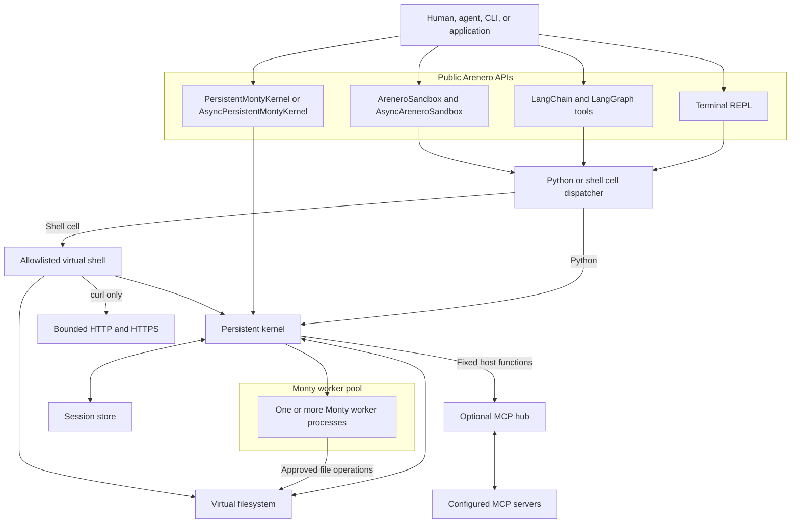
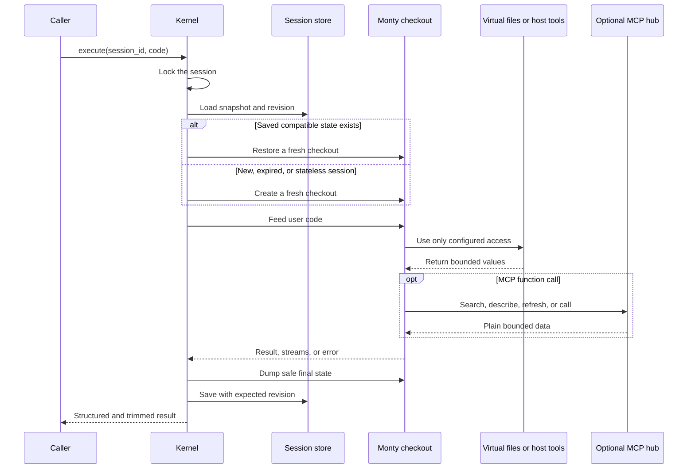
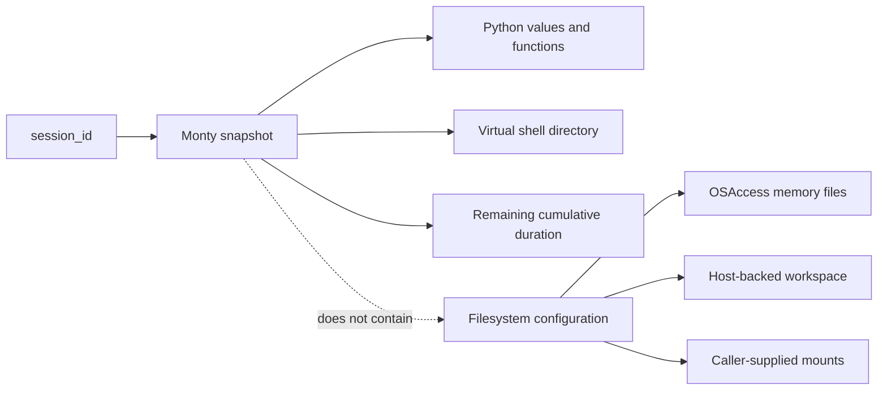
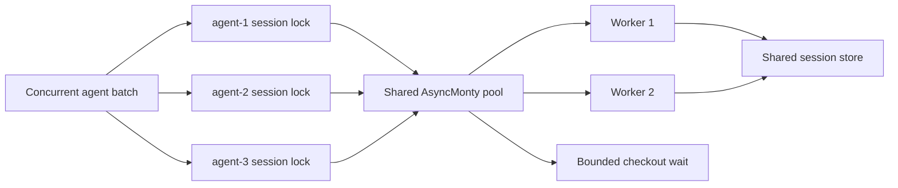

# Arenero architecture and components

Arenero gives an application one small persistent execution service. It adds
session storage, virtual files, a limited shell, agent adapters, and application
limits around Monty. Monty remains the only Python runtime.

## System map

The cell dispatcher chooses Python or virtual shell execution before a Monty feed
starts. This prevents a hosted function from entering the same persistent session
again.

## Components

| Component | Main module | Responsibility |
| --- | --- | --- |
| Terminal REPL | `cli.py` | Parse CLI options, select a store, and run or administer a session. |
| Cell dispatcher | `cell.py` | Route normal Python, `!COMMAND`, and `%%shell` cells and return common result fields. |
| Persistent sync kernel | `kernel.py` | Restore, execute, limit, save, reset, and inspect Monty sessions. |
| Persistent async kernel | `async_kernel.py` | Run persistent Python, virtual `fs_*` helpers, and `execute_file` on native `AsyncMonty` workers. |
| Session stores | `store.py` | Keep opaque snapshots in memory, SQLite, or nowhere. Apply revision checks and expiry. |
| Filesystem helpers | `filesystem.py` | Implement bounded `read`, `write`, `edit`, `mkdir`, `delete`, `ls`, `glob`, and `grep`. |
| Persistent workspace | `workspace.py` | Own one confined read-write host directory mount. |
| Virtual shell | `shell.py` | Parse and dispatch the documented command allowlist without starting host processes. |
| Network policy | `network.py` | Check URLs, addresses, methods, redirects, time, headers, and byte limits for virtual `curl`. |
| Sandbox facade | `sandbox.py` | Group execution, files, binary transfer, and a stable sandbox ID in one framework-neutral API. |
| Media bridge | `media.py` | Read virtual binary files and create data URLs or image content blocks. |
| Agent adapters | `langchain_tools.py` and `langchain_filesystem_tools.py` | Build thread-scoped LangChain and LangGraph tools. |
| Optional integration loader | `integrations.py` | Keep LangChain out of the core import path until tools are requested. |
| MCP hub | `mcp.py` | Keep configured async MCP clients on a host event loop and expose bounded sync or async host functions to Monty. |

## Python execution lifecycle

`execute_file()` reads one virtual Python file, feeds its complete source, then
feeds optional follow-up code. It saves the session once after the last successful
feed. It does not perform a Python import.

Normal code errors can leave useful changes. Arenero saves the valid state that
exists after the error. A time limit, memory limit, or worker failure makes the
session unsafe, so Arenero removes its saved state.

## State ownership

Python state and file state are intentionally separate:

| State | Owner | Persistence |
| --- | --- | --- |
| Python globals, functions, classes, and remaining duration budget | Monty snapshot in the selected `SessionStore` | Follows memory, SQLite, or stateless mode. |
| Virtual shell working directory | Reserved value in the Monty session | Follows the Python session. |
| `OSAccess` memory files | The caller-owned `OSAccess` object | Lives while that object lives. It is not in SQLite. |
| `WorkspaceConfig` files | Dedicated host directory through `MountDir` | Survives process restarts. It is not in SQLite. |
| Caller-supplied mounts | Caller-owned `MountDir` objects | Follows the selected mount mode and host directory. |
| Host functions | `external_lookup` on each kernel checkout | Never stored in a snapshot. The application supplies them again. |
| Network policy | `NetworkConfig` in the host process | Never enters Monty state. |
| MCP clients, credentials, and catalog | Caller-owned `McpHub` in the host process | Live while the hub is active. Reconnect after restart. Never enters a snapshot. |

Resetting a session removes Python state and the shell directory. It does not
delete shared files. Applications must define file cleanup separately.

## Storage modes

| Store | Later calls | Later human turns | Process restart | Main use |
| --- | --- | --- | --- | --- |
| `InMemorySessionStore` | Yes | Yes, while the application remains active | No | Services with short-lived process memory. |
| `SQLiteSessionStore` | Yes | Yes | Yes | Durable local agents and terminal sessions. |
| `StatelessSessionStore` | No | No | No | Independent calculations and low-state tasks. |

The store holds opaque Monty bytes, the Monty version, a revision, and an update
time. It does not understand user variables. Snapshots from a different Monty
version require a reset.

## Concurrency and consistency

Arenero uses these controls:

1. A per-session thread lock or async lock keeps calls for one session in order.
2. The configured Monty worker pool lets different sessions run at the same time.
3. `worker_checkout_timeout_seconds` applies bounded backpressure when all
   workers are busy.
4. A process-local filesystem lock serializes filesystem-capable calls when one
   kernel shares files between sessions.
5. A store revision check detects a save based on stale state. SQLite also uses a
   transaction.

`min_worker_processes`, `max_worker_processes`,
`worker_checkout_timeout_seconds`, and `max_checkouts_per_worker` configure both
kernel types. The native async kernel must stay on one application event loop.
Its async host functions do not block that loop while they wait.

The shared filesystem lock is still a batch bottleneck by design. A kernel with
`OSAccess`, mounts, or `WorkspaceConfig` serializes complete filesystem-capable
operations. Use separate filesystems or kernels when agents need independent file
throughput.

These controls do not create a distributed lock. Two application processes that
write the same host workspace still need external coordination. A custom store
also needs shared revision semantics when many processes use it.

## Security boundary

Monty has no ambient filesystem, environment, socket, subprocess, package, or host
object access. Access enters through explicit configuration:

- `inputs` for ordinary eager values.
- `external_lookup` for narrow lazy values and sync or async host functions.
  Async functions require `AsyncPersistentMontyKernel` and `await` in Monty code.
- `OSAccess` or `MountDir` for virtual files.
- The host-side virtual shell for its fixed command handlers.
- `NetworkConfig` for the virtual `curl` handler.
- An optional `McpHub` for five fixed discovery and tool-call functions.

Hosted functions execute with host authority. Validate all arguments and return
only supported plain values. Keep secrets in narrow host functions or trusted
header providers. Do not place secrets in sandbox inputs, virtual files, or
prompts.

MCP tools keep the authority of their configured server. Monty limits model code,
but it does not limit what an approved remote tool can do. The application selects
server commands, URLs, credentials, and qualified tool allowlists outside model
control. See [MCP tools inside the REPL](mcp.md).

The default network policy permits bounded requests to public HTTP and HTTPS URLs.
It blocks private and non-global addresses. Use narrow URL prefixes when an agent
can access sensitive data because it can send data that it knows to a public
service.

## Extension points

| Need | Extension point | Rule |
| --- | --- | --- |
| Another persistence backend | Implement `SessionStore` | Keep Monty version data, revisions, expiry, and safe metadata listing. |
| Domain actions | Add narrow callables to `external_lookup` | Validate untrusted arguments and provide matching type-check stubs. |
| Tenant-aware state | Set `session_id` or provide `session_id_resolver` | Include a trusted tenant key outside model control. |
| Tenant-aware files | Create one `OSAccess` or workspace per tenant | Do not use a shared mount when file isolation is required. |
| A smaller shell | Set `KernelConfig.allowed_shell_commands` | Include aliases separately, such as `python3`. |
| Restricted network access | Set `NetworkConfig` | Prefer exact public origins and path prefixes; disable `curl` when unused. |
| Another agent framework | Wrap `AreneroSandbox` | Keep its result, path, persistence, and execution limits visible to the model. |
| Another model image format | Convert `MediaFile.content` on the host | The model cannot read a path or Base64 text as an image without a content block. |
| Configured external tools | Add `McpHub` with the `mcp` extra | Keep server configuration outside model control and set call, schema, argument, result, and concurrency limits. |

Do not add a broad `run_shell(command)` host function. It would give model-written
code the host process's command authority and remove the main product boundary.

## Useful products to build on top

- A conversation-scoped calculation notebook.
- A report agent that keeps intermediate text and JSON artifacts.
- A constrained HTTP data collector with an exact endpoint allowlist.
- A domain assistant that combines Monty calculations with narrow business APIs.
- A shared virtual workspace for collaborating agents in one trusted tenant.
- A framework adapter that maps another agent SDK to `AreneroSandbox`.
- A local assistant that recovers state and files after an application restart.

Use a real execution sandbox for repository coding agents, package builds, system
tests, browser automation, native libraries, or arbitrary command-line tools.

## Related references

- [Usage and capabilities](usage-and-capabilities.md)
- [Virtual shell reference](virtual-shell.md)
- [Sandbox compatibility](sandbox-compatibility.md)
- [Design decisions](design-decisions.md)
- [MCP tools inside the REPL](mcp.md)
