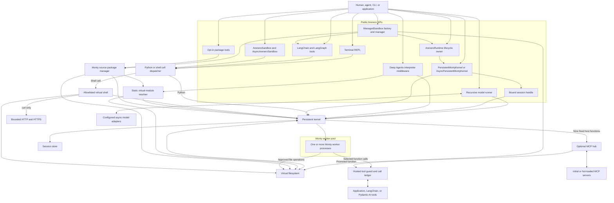
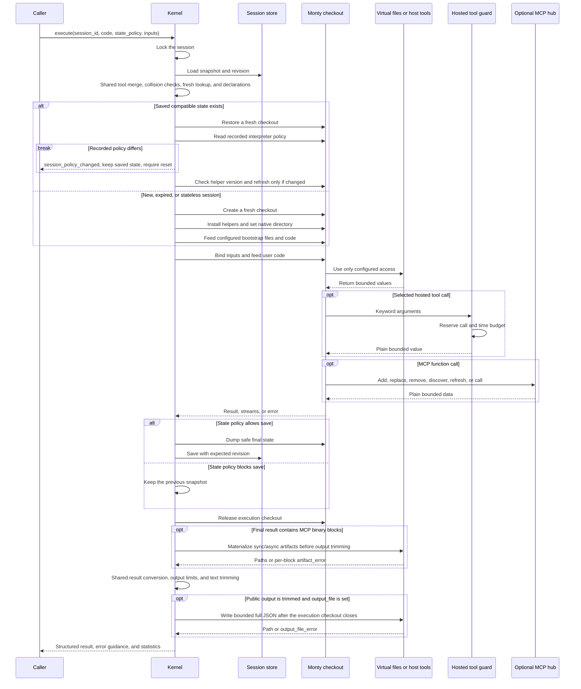
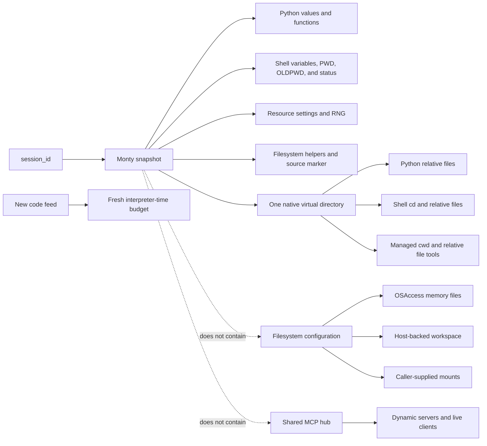
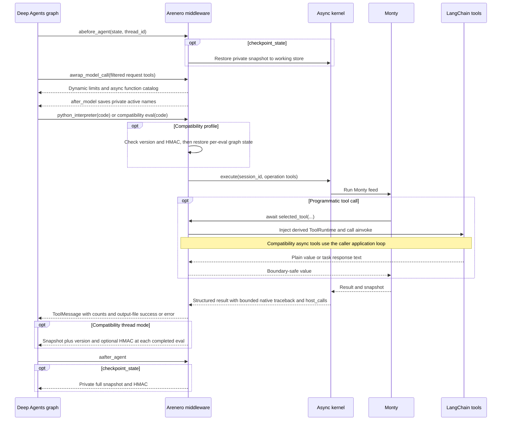
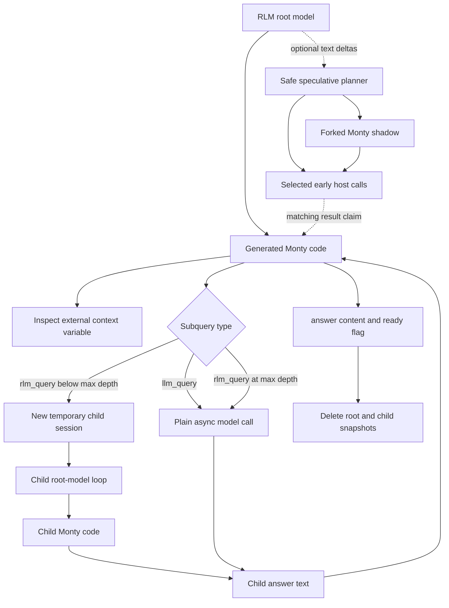
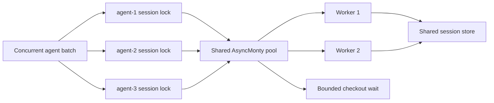

# Arenero architecture and components

Arenero gives an application one small persistent execution service. It adds
session storage, virtual files, a limited shell, agent adapters, and application
limits around Monty. Monty remains the only Python runtime.

This architecture uses pinned Monty `1.1.0`. The
[migration guide](monty-updates.md) describes per-feed limits, native directories,
OS policy, snapshot constraints, and unreleased import APIs.

## System map

The cell dispatcher chooses Python or virtual shell execution before a Monty feed
starts. This prevents a hosted function from entering the same persistent session
again.

## Components

| Component | Main module | Responsibility |
| --- | --- | --- |
| Managed sandbox | `easy.py` | Build one complete owned runtime from presets and expose a bound session, relative files, common results, total quotas, checkpoints, and multi-session managers. |
| Managed LangChain tools | `langchain_managed_tools.py` | Bind selected Python, shell, file, and package tools to one managed sandbox without model-supplied session IDs. |
| Terminal REPL | `cli.py` | Parse CLI options, select a store, and run or administer a session. |
| Cell dispatcher | `cell.py` | Route percent commands, normal Python, `!COMMAND`, and `%%shell` cells and return common result fields. |
| Capability report | `capabilities.py` | Report active limits, commands, storage, network, MCP, bootstrap, and sync or async rules and generate model instructions. |
| Bound session | `session.py` | Keep one trusted session ID with execute, inputs, file, read-only names, reset, info, and fork operations. |
| Static virtual modules | `modules.py` | Resolve bounded top-level imports, build isolated module objects, and generate one Monty feed. |
| Monty source packages | `packages.py` | Create the fixed dependency-free layout, check source and revisions, test in a fresh Monty session, and export a deterministic source ZIP. |
| Runtime owner | `runtime.py` | Close a kernel and its optional MCP hub in dependency order. |
| Event records | `events.py` | Send safe execution, session, file, network, MCP, RLM, speculation, and runtime metadata to one callback. |
| Hosted tools | `hosted_tools.py` | Generate function catalogs, apply per-operation budgets and sequencing, convert boundary values, and record nested calls. |
| Framework adapters | `langchain_hosted_tools.py` and `pydantic_ai_hosted_tools.py` | Keep public framework validation and callbacks, inject current runtime values, and document which parent dispatch middleware is bypassed. |
| Recursive model runner | `rlm.py` | Keep context in Monty, run bounded root-model loops, expose plain and recursive model calls, isolate child sessions, and report shared usage. |
| Speculative call coordinator | `speculation.py` | Inspect streamed code, run selected calls early, use a forked Monty shadow, and let real execution claim matching results. |
| LangChain RLM adapter | `langchain_rlm.py` | Call or stream chat models through `ainvoke()` and `astream()`, then normalize text and reported usage. |
| Doctor | `doctor.py` | Check Monty, worker startup, optional packages, workspace access, and MCP status. |
| Persistent sync kernel | `kernel.py` | Restore, execute, limit, save, reset, and inspect Monty sessions. |
| Persistent async kernel | `async_kernel.py` | Run Python, percent cells, binary transfer, overflow output, files, and static modules on native `AsyncMonty` workers; keep the shell on the sync surface. |
| Session stores | `store.py` | Keep opaque snapshots in memory, SQLite, or nowhere. Apply revision checks and expiry. |
| Filesystem helpers | `filesystem.py` | Implement bounded `read`, `write`, `edit`, `mkdir`, `delete`, `ls`, `glob`, and `grep`. |
| Result conversion | `values.py` | Use one JSON representation, text-trimming marker, and error-text reader across kernels, cells, shell, and sandbox results. |
| Persistent workspace | `workspace.py` | Own one confined read-write host directory mount. |
| Virtual shell | `shell.py` | Parse and dispatch the documented command allowlist without starting host processes. |
| Network policy | `network.py` | Check URLs, addresses, methods, redirects, time, headers, and byte limits for virtual `curl`. |
| Sandbox facade | `sandbox.py` | Group execution, files, binary transfer, and a stable sandbox ID in one framework-neutral API. |
| Media bridge | `media.py` | Read virtual binary files and create data URLs or image content blocks. |
| Agent adapters | `langchain_tools.py` and `langchain_filesystem_tools.py` | Build thread-scoped LangChain and LangGraph tools. |
| Package agent adapter | `langchain_package_tools.py` | Give an agent explicit package initialization, check, test, and export tools with active limits. |
| Deep Agents middleware | `deepagents.py` | Add async interpreter tools, live prompts, PTC runtime injection, three state modes, subagent calls, and private checkpoint snapshots. |
| Optional integration loader | `integrations.py` | Keep LangChain out of the core import path until tools are requested. |
| MCP hub | `mcp.py` | Keep a mutable set of async MCP clients on a host event loop and expose bounded sync or async discovery, mutation, and call functions to Monty. |
| MCP artifacts | `mcp_artifacts.py` | Decode supported MCP Base64 blocks and write them through a supplied virtual-file writer. |

## Python execution lifecycle

`execute_file()` reads one virtual Python file in a trusted unchecked read feed,
feeds its complete source under the configured type policy, then
feeds optional follow-up code. It saves the session once after the last successful
feed. It does not perform a Python import.
Inputs bind once after bootstrap, before the file source, not again for follow-up
code. Direct code, static modules, and Python/`%run` cells use the same rule.
Both kernels support full bounded output files for direct/file/module execution.
Flat file inputs also bind the absolute `__file__` and script-style `__name__`.
Static loaders expose their local metadata on module objects and copy only
actually bound public names, including unpacking and supported compound blocks.

`execute_module()` reads and parses a bounded static file graph on the host. It
rewrites supported top-level imports into simple isolated module objects and runs
the complete generated source as one Monty feed. The generated feed is not type
checked because its module objects need dynamic attributes. User source never
executes in the host parser. See [Static virtual modules](virtual-modules.md).
Nested imports of bundled standard modules stay in the generated source. Nested
imports of virtual files still fail before execution.
Explicit `from . import sibling` forms use the same bounded resolver. Each module
loader binds its own virtual `__file__` for asset reads, without an import runtime.

Filesystem helpers and their private source-version marker live in the snapshot.
The next call reuses them unless the source or helper limits change. Bootstrap
runs only for a new session. This removes repeated helper compilation without a
live interpreter cache or another persistence format.
The recorded interpreter policy lives in the same snapshot. New known policy
changes require an explicit reset; legacy snapshots report unknown provenance.
The stable stub hash is calculated from configured declarations when needed.
It uses the same format as before the cleanup, without a second stored stub-text
copy. Operation-only and promoted tools do not enter that stable hash.
Selected value/policy inspection uses the existing disposable checkout path and
saves nothing. Python-only `filesystem=False` operations retain the session
lock but skip direct files and the shared file lock. See [utility boundaries](quality-of-life.md).

`variables()` and the managed `cwd` property inspect a disposable copy of the
last saved snapshot. They attach no files or host tools, run no bootstrap, and
save nothing. They can observe the previous commit during an active feed. These
APIs need a free worker; do not call them from the active interpreter itself.

Normal code errors can leave useful changes. Arenero saves the valid state that
exists after the error. A time limit, memory limit, or worker failure makes the
session unsafe, so Arenero removes its saved state.

The `success` state policy keeps the previous snapshot after a normal code error.
The `never` policy does not save the operation. Neither policy rolls back file,
network, or MCP side effects. Session forking copies the opaque Monty snapshot,
including its native directory and RNG state, but does not copy files or host
tools. The next feed starts a new duration clock.

## State ownership

Python state and file state are intentionally separate:

| State | Owner | Persistence |
| --- | --- | --- |
| Python globals, functions, classes, native directory, RNG, and resource configuration | Monty snapshot in the selected `SessionStore` | Follows memory, SQLite, or stateless mode. Feed time resets for each new feed. |
| Virtual shell variables, previous directory, and last status | Reserved values in the Monty session | Follow the Python session. `PWD` uses Monty's native directory. |
| Filesystem helper definitions and source-version marker | Monty snapshot | Reuse after restore; refresh once when generated helper source changes. |
| `OSAccess` memory files | The caller-owned `OSAccess` object | Lives while that object lives. It is not in SQLite. |
| `WorkspaceConfig` files | Dedicated host directory through `MountDir` | Survives process restarts. It is not in SQLite. |
| Caller-supplied mounts | Caller-owned `MountDir` objects | Follows the selected mount mode and host directory. |
| Host functions | `external_lookup` on each kernel checkout | Never stored in a snapshot. The application supplies them again. |
| Hosted tool catalog, callbacks, and call budgets | Host process and one execution scope | Catalog configuration is process memory. Call budgets and records reset for each operation. |
| Deep Agents graph snapshot | Private LangGraph state when enabled | Full Monty bytes and optional HMAC; the compatibility profile also records and signs the package version. No files or host resources. |
| Network policy | `NetworkConfig` in the host process | Never enters Monty state. |
| MCP clients, credentials, dynamic server config, and catalog | Shared `McpHub` in the host process | Live while the hub is active. Recreate after restart. Never enters a snapshot or SQLite. |

Resetting a session removes Python state, shell variables, shell directories, and
the last shell status. It does not delete shared files. Applications must define
file cleanup separately.

## Deep Agents execution path

Nested PTC calls bypass the parent ToolNode. Parent per-tool approval middleware
does not run for them. The outer interpreter call, the called tool, or the
subagent must enforce the required approval policy.

`CodeInterpreterMiddleware` adds an owned loop bridge for sync graph calls.
Async tools, real task subgraphs, and RLM model callbacks return to the graph's
caller loop. The same filtered request inventory supplies instructions and
dispatch. Private name lists survive interrupt/resume; live tool references do
not enter snapshots. Explicit host grants remain separate. Shared
backend modules, startup files, and output files use the existing backend's raw
bounded transfers, with direct guest files disabled. Guest wrappers are refreshed
before startup and user code. The original middleware still accepts a
caller-owned kernel. See the [profile guide](deepagents-compatibility.md).

Both kernels use Monty's native runtime error display for optional traceback
data. The shared result formatter keeps the old error message and caps message
plus stack together. The compatibility text formatter exposes the bounded stack,
original output counts, and file-write status; full details remain in artifacts
or bounded output files. It does not reconstruct Python stacks in the host.

## Recursive model execution path

The model adapter runs on the host. It receives only the prompt assembled by the
RLM. The full external context enters Monty through a plain feed input and then
becomes persistent session state for that temporary RLM node.

A parent Monty checkout remains active while `rlm_query` runs. Each recursive
level therefore needs another worker. Child sessions use different session IDs
and the same shared model-call ledger. Direct kernel filesystem access is disabled
for recursive children because the parent holds the kernel filesystem lock. An
application can explicitly inherit hosted file tools when children must share
files.

## Storage modes

| Store | Later calls | Later human turns | Process restart | Main use |
| --- | --- | --- | --- | --- |
| `InMemorySessionStore` | Yes | Yes, while the application remains active | No | Services with short-lived process memory. |
| `SQLiteSessionStore` | Yes | Yes | Yes | Durable local agents and terminal sessions. |
| `StatelessSessionStore` | No | No | No | Independent calculations and low-state tasks. |

The store holds opaque Monty bytes, the Monty version, a revision, and an update
time. It does not understand user variables. Snapshots from a different Monty
version require a reset.

## Concurrency and consistency

Arenero uses these controls:

1. A per-session thread lock or async lock keeps calls for one session in order.
2. The configured Monty worker pool lets different sessions run at the same time.
3. `worker_checkout_timeout_seconds` applies bounded backpressure when all
   workers are busy.
4. A process-local filesystem lock serializes filesystem-capable calls when one
   kernel shares files between sessions.
5. A store revision check detects a save based on stale state. SQLite also uses a
   transaction.

`min_worker_processes`, `max_worker_processes`,
`worker_checkout_timeout_seconds`, and `max_checkouts_per_worker` configure both
kernel types. The native async kernel must stay on one application event loop.
Its async host functions do not block that loop while they wait.
Both kernel lock maps use weak values: active owners and waiters keep their
session lock, while idle entries disappear without a cleanup task.

The shared filesystem lock is still a batch bottleneck by design. A kernel with
`OSAccess`, mounts, or `WorkspaceConfig` serializes complete filesystem-capable
operations. Use separate filesystems or kernels when agents need independent file
throughput.

These controls do not create a distributed lock. Two application processes that
write the same host workspace still need external coordination. A custom store
also needs shared revision semantics when many processes use it.

## Security boundary

Monty has no ambient filesystem, environment, socket, subprocess, package, or host
object access. Access enters through explicit configuration:

- `inputs` for ordinary eager values.
- `external_lookup` for narrow lazy values and sync or async host functions.
  Async functions require `AsyncPersistentMontyKernel` and `await` in Monty code.
- `HostedToolSet` for schema-aware selected tools with call budgets, generated
  declarations, boundary conversion, and a bounded nested-call ledger.
- `OSAccess` or `MountDir` for virtual files.
- The host-side virtual shell for its fixed command handlers.
- `NetworkConfig` for the virtual `curl` handler.
- An optional `McpHub` for nine fixed discovery, server-mutation, promotion, and
  tool-call functions.

Hosted functions execute with host authority. Validate all arguments and return
only supported plain values. Keep secrets in narrow host functions or trusted
header providers. Do not place secrets in sandbox inputs, virtual files, or
prompts.

MCP tools keep the authority of their server. Monty limits model code, but it does
not limit what an MCP process or remote tool can do. The dynamic API lets the
model select commands, URLs, environment values, and headers. Applications that
need a stricter boundary must not expose a hot-loadable hub. See
[MCP tools inside the REPL](mcp.md).

Hosted tools keep the authority of their source framework. Arenero does not make
a broad application tool safe. It keeps the source framework's public invoke
path and adds operation limits around it. See
[Hosted tools and code-mode composition](hosted-tools.md).

The default network policy permits bounded requests to public HTTP and HTTPS URLs.
It blocks private and non-global addresses. Use narrow URL prefixes when an agent
can access sensitive data because it can send data that it knows to a public
service.

## Extension points

| Need | Extension point | Rule |
| --- | --- | --- |
| Another persistence backend | Implement `SessionStore` | Keep Monty version data, revisions, expiry, and safe metadata listing. |
| Domain actions | Add `HostedToolSet` or narrow `external_lookup` callables | Prefer hosted tools when schemas, budgets, records, or framework adapters are useful. |
| Tenant-aware state | Set `session_id` or provide `session_id_resolver` | Include a trusted tenant key outside model control. |
| Tenant-aware files | Create one `OSAccess` or workspace per tenant | Do not use a shared mount when file isolation is required. |
| A smaller shell | Set `KernelConfig.allowed_shell_commands` | Include aliases separately, such as `python3`. |
| Restricted network access | Set `NetworkConfig` | Prefer exact public origins and path prefixes; disable `curl` when unused. |
| Another agent framework | Wrap `AreneroSandbox` and adapt its tools to `HostedTool` | Keep its result, path, persistence, nested-call, and execution limits visible to the model. |
| A new application that needs a complete sandbox | Start with `open_sandbox()` or `open_sandbox_manager()` | Use presets first. Drop to the kernel only for custom assembly. |
| Another model image format | Convert `MediaFile.content` on the host | The model cannot read a path or Base64 text as an image without a content block. |
| Initial or agent-selected MCP tools | Add `McpHub` with the `mcp` extra | Start with configured servers or an empty hub. Use fixed `mcp_*` functions so the outer agent tool schema stays stable. |

Do not add a broad `run_shell(command)` host function. It would give model-written
code the host process's command authority and remove the main product boundary.

## Useful products to build on top

- A conversation-scoped calculation notebook.
- A report agent that keeps intermediate text and JSON artifacts.
- A constrained HTTP data collector with an exact endpoint allowlist.
- A domain assistant that combines Monty calculations with narrow business APIs.
- A shared virtual workspace for collaborating agents in one trusted tenant.
- A framework adapter that maps another agent SDK to `AreneroSandbox`.
- A local assistant that recovers state and files after an application restart.
- An agent that creates reviewable dependency-free Monty source packages.

Use a real execution sandbox for standard Python package builds, repository
coding agents, system tests, browser automation, native libraries, or arbitrary
command-line tools. Arenero supports only its documented Monty source ZIP flow.

## Related references

- [Usage and capabilities](usage-and-capabilities.md)
- [Virtual shell reference](virtual-shell.md)
- [Sandbox compatibility](sandbox-compatibility.md)
- [Managed sandbox API](managed-sandbox.md)
- [Design decisions](design-decisions.md)
- [MCP tools inside the REPL](mcp.md)
- [Hosted tools and code-mode composition](hosted-tools.md)
- [Quality-of-life APIs](quality-of-life.md)
- [Monty-compatible source packages](monty-source-packages.md)
