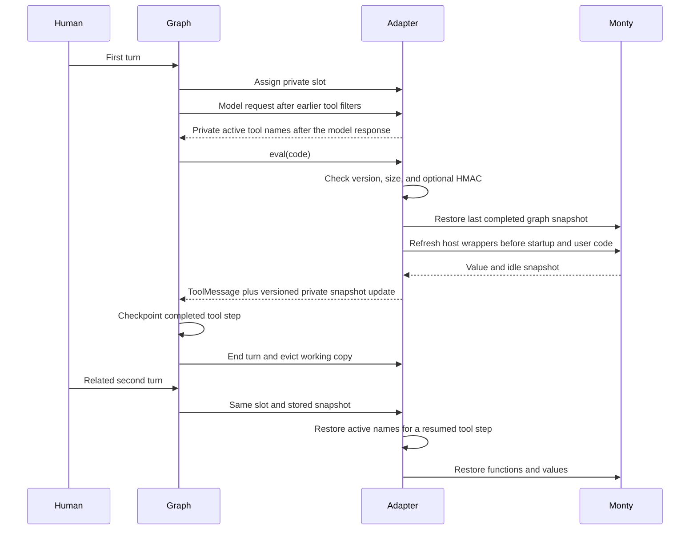
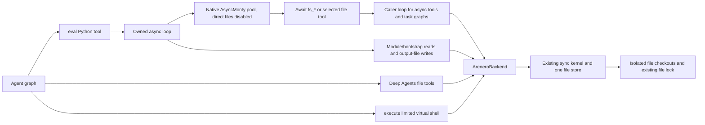
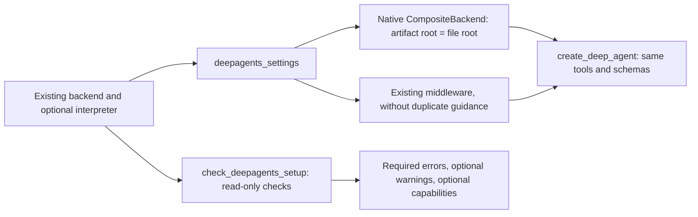
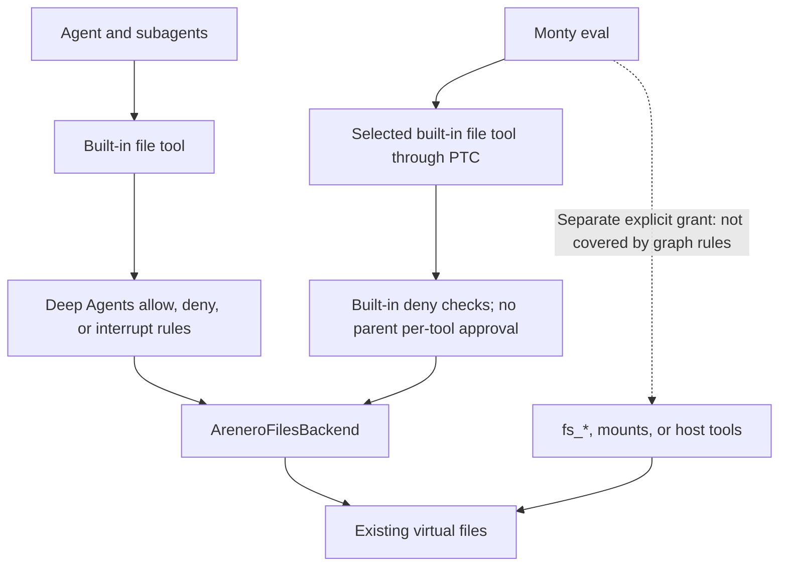
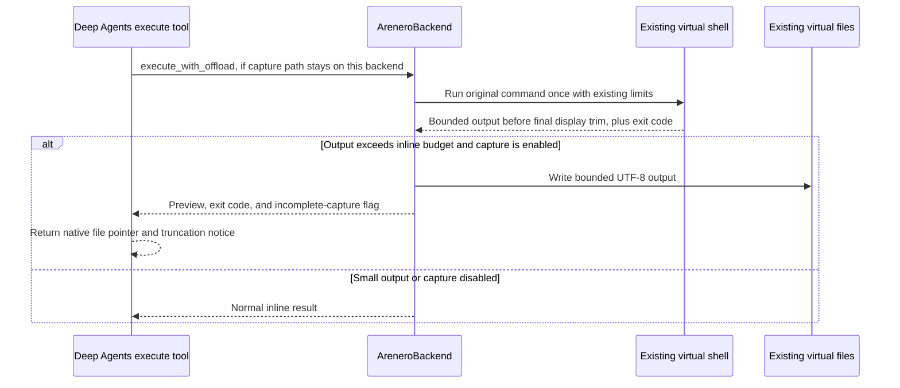

# Python interpreter and sandbox adapters for Deep Agents

Use `CodeInterpreterMiddleware` when you want the Deep Agents interpreter
interface with Python instead of JavaScript. Use `AreneroBackend` when you also
want shared files and the limited virtual shell. Use `AreneroFilesBackend` for
files without shell execution, including Deep Agents path permissions. All use
the same optional extra:

```console
uv add 'arenero[deepagents]'
```

The existing `AreneroInterpreterMiddleware`, factories, kernels, and sandbox
facades keep their public APIs and defaults. The new profile does not replace
them. It does not accept JavaScript, QuickJS snapshots, arbitrary CPython
packages, or general Bash commands.
Use one interpreter middleware per graph. Do not stack the existing and
compatibility profiles; they use the same private snapshot fields.

## Small interpreter setup

```python
from arenero.deepagents import CodeInterpreterMiddleware
from deepagents import create_deep_agent
from langgraph.checkpoint.memory import InMemorySaver

with CodeInterpreterMiddleware(ptc=("search_web",)) as interpreter:
    agent = create_deep_agent(
        model=model,  # Your configured LangChain model.
        tools=[search_web],
        middleware=[interpreter],
        checkpointer=InMemorySaver(),
    )
    config = {"configurable": {"thread_id": "conversation-42"}}
    first = agent.invoke(
        {
            "messages": [
                {"role": "user", "content": "Calculate and remember 37 squared."}
            ]
        },
        config,
    )
    second = agent.invoke(
        {"messages": [{"role": "user", "content": "Now add one to that result."}]},
        config,
    )
```

The model sees one `eval(code=...)` tool by default. The code is Monty Python:

```python
value = 37**2
value
```

Use `async with`, `await agent.ainvoke(...)`, or `agent.astream(...)` for an async
application. Monty work from `invoke`, `stream`, `ainvoke`, and `astream` uses
one owned event loop. With async graph calls, selected LangChain tools,
configured hosted tools, task subgraphs, task events, and RLM model callbacks use
the caller's application loop. They can reuse loop-bound clients, locks, and futures.
With sync graph calls there is no caller loop; async tools use the owned loop.
Do not run `interpreter.kernel` directly from another loop. Close
the middleware after graph work finishes. It closes its own kernel and loop,
but not a caller-supplied backend or MCP hub. Host callbacks are cancelled and
drained when a feed is cancelled. A sync host function already running in a
worker thread cannot be forcibly stopped. Its completed effects remain.

## The ten additions

| Addition | Behavior |
| --- | --- |
| Compatibility entry point | Common QuickJS-style settings and one Python `eval` tool. The module tool is opt-in. |
| Result blocks and console capture | Escaped `<stdout>`, `<stderr>`, `<result>`, and `<error type="...">` blocks. The existing rich result is `ToolMessage.artifact`. |
| Graph-owned persistence | Private slot and full Monty snapshot in graph state by default. No shared missing-thread fallback. |
| Graph interrupts | Cancel the outer feed and pass the original graph control signal back to LangGraph. Guest exception handlers cannot turn approval into normal execution. |
| Subagent bridge | Optional response schemas and labels, custom lifecycle events, replay-stable IDs, and separate task call/concurrency caps. |
| Tool namespace | Both `await search_web(query=...)` and `await tools.search_web(query=...)`. Plain Monty wrappers are rebuilt from live tools. |
| Sync graph calls | One loop thread bridges synchronous calls to native async Monty. No event loop is created for each cell. |
| Native backend adapter | `AreneroBackend` implements `SandboxBackendProtocol`, native result records, and inherited `a*` file and execute methods. |
| Shared file authority | Interpreter host calls and outer Deep Agents file tools use the same backend. File operations use isolated checkouts, not the active interpreter session. |
| Shell deadlines | `execute(timeout=...)` accepts a cooperative wall deadline. Expiry returns exit `124` and stops later commands. |

## Settings and limits

The profile now includes these ten follow-up changes:

| Change | Use and limits |
| --- | --- |
| Application-loop tools | Async PTC and real task graphs use the caller loop. Sync invocation uses the owned loop. Cancellation and graph interrupts cross the bridge. |
| Configuration guards | Empty signing keys, reserved aliases, duplicate aliases, and explicit `ptc=("task",)` fail early. Use `subagents=True` for task dispatch. |
| Tool result values | Messages become their content. A `Command` uses its last usable message content, or returns its update data when there is no content. For an envelope list, use the last envelope. Plain values stay typed. Parent graph updates are not applied. |
| Bounded console collection | Keep a UTF-8 prefix of each stream; discard excess and count original characters. Console overflow alone does not discard Python state. |
| Error guidance | Existing error blocks also include code, hint, retry flag, and recovery action. The rich artifact keeps the same fields. |
| Existing configuration | Pass kernel/hosted-tool config, hosted tools, MCP, RLM, bootstrap, OS handler, and event sink. No second configuration system. |
| Shared source and output | Modules, bootstrap files, and output files use the shared backend's existing bounded transfers. No direct guest filesystem access is enabled. |
| Snapshot version guard | Record the exact Monty package version. Reject a known mismatch before load. New HMACs bind version, slot, and bytes. |
| Idle lock cleanup | Sync and async session locks remain while owned or awaited; idle entries disappear. Completed private slots do not accumulate lock entries. |
| Compatibility tests | CI runs locked and newer allowed dependencies, fake-model real subgraphs, and a core-only wheel smoke test. No real model call is used. |

| Setting | Default | Meaning |
| --- | --- | --- |
| `memory_limit` | 64 MiB | Monty allocator cap, not host process RSS. |
| `timeout` | 5 seconds | Interpreter time per feed. Host waits are excluded. This is not a full eval wall deadline. |
| `max_ptc_calls` | 256 | Selected ordinary tool and shared-backend fs_* calls per eval. `None` removes this adapter cap, not Monty's suspension cap. |
| `max_result_chars` | 4000 | Hard character cap for each raw result, stream, and error field. JSON/XML escaping and tags can add characters. |
| `capture_console` | `True` | Collect stdout/stderr. `False` discards chunks before collection; they do not go to the host terminal. |
| `tool_name` | `eval` | External interpreter tool name. |
| `subagents` | `True` | Expose a live Deep Agents `task` tool with the required task fields. |
| `max_subagent_concurrency` | 32 | Active subagents in one eval, separate from the regular PTC concurrency gate of 10. |
| `max_subagent_calls` | 100 | Task calls in one eval, separate from `max_ptc_calls`. |
| `ptc` | `None` | Explicit tool names or tool objects; no ordinary tools are exposed by default. |
| `mode` | `thread` | `thread`, `turn`, or `call`; `None` also means `thread`. |
| `max_snapshot_bytes` | `memory_limit` | Snapshot acceptance and kernel state-save cap. Oversized new state is not committed. |
| `snapshot_signing_key` | `None` | Optional nonempty HMAC key; binds version, snapshot, and private slot. |
| `tools_namespace` | `True` | Generate `tools.NAME(**kwargs)` as well as bare function access. |
| `module_tool` | `False` | Add `eval_module(entry_path, code=None, ...)` for the existing static module workaround. |
| `workspace` | `None` | Optional direct `WorkspaceConfig` mount, without a shared backend. |
| `backend` | `None` | Optional caller-owned `AreneroBackend` or `AreneroFilesBackend`; enables direct fs_* grants. Mutually exclusive with direct workspace and OS handler, not the module tool. |
| `kernel_config` | `None` | Existing `KernelConfig` for resource, pool, clock/OS policy, and type-check settings. |
| `hosted_tool_config` | `None` | Existing aggregate call/time/concurrency and record settings. |
| `hosted_tools` | `None` | Existing `HostedToolSet`, included in the per-eval PTC scope and live namespace. |
| `mcp_hub` | `None` | Caller-owned `McpHub`; discovery, call, promotion, and reload functions. |
| `rlm` | `None` | Existing `RLM` runner and its own model/recursion limits. |
| `bootstrap_code`, `bootstrap_files` | `None`, `()` | Trusted startup sources, once per new session, after guest wrappers are installed. |
| `os_handler` | `None` | Direct virtual file/clock handler, instead of shared-backend files. |
| `event_sink` | `None` | Existing kernel event callback. |

The kernel still enforces its other defaults: 1000 suspensions per checkout,
10 seconds of system sleep per checkout, a 10-second worker request timeout,
1 MB retained for each console stream, and bounded recursion and file transfers. Hosted
calls share a 30-second operation wall budget. Task and regular call counts are
separate, but tasks do not bypass that aggregate host budget or native limits.
The stream collection cap and the returned-text cap are different limits.
The compatibility collector discards excess instead of raising `MemoryError`.
`stats.original_output_chars` records the full printed character counts, and
`truncated.stdout` / `truncated.stderr` report omitted text. Discarded text is
not recoverable through `output_file`. The low-level kernels keep their existing
strict stream collector unless this compatibility profile owns them.
Disabling console capture does not disable interpreter memory/time limits.

`eval` also accepts `output_limit_chars` to lower the response cap and
`output_file` to offload larger bounded JSON through direct files or the shared
backend. Check the rich artifact for `output_file_error`. Only retained console
prefixes can be saved. Result values remain subject to the existing transfer
byte cap. The backend checks its root before each source read or output write.

### Reuse configuration

```python
from arenero import HostedToolConfig, KernelConfig
from arenero.deepagents import CodeInterpreterMiddleware

interpreter = CodeInterpreterMiddleware(
    kernel_config=KernelConfig(
        max_memory_bytes=32 * 1024 * 1024,
        max_feed_duration_seconds=2,
        max_worker_processes=4,
        max_stream_bytes=64_000,
    ),
    hosted_tool_config=HostedToolConfig(max_total_call_seconds=20),
    max_result_chars=2000,
    bootstrap_code="def twice(value):\n    return value * 2",
    # mcp_hub=hub, rlm=runner, hosted_tools=toolset,
)
```

When `kernel_config` is supplied, it sets interpreter and pool limits;
`memory_limit` and `timeout` do not override it. The adapter display cap still
applies, bounded by the config's output hard cap. The effective snapshot cap is
the smaller of `max_snapshot_bytes` (when supplied) and the config's state cap.
Without a config, all existing defaults stay the same. Keep the config fixed
after construction, as with the native kernel.

Selected tools, configured hosted tools, and shared file bridges share the PTC
count. Their merged `HostedToolConfig` uses the existing stricter limits. Task
counts have a separate adapter cap but still share the aggregate hosted wall
budget. `timeout` is guest execution time, not a model/tool wall budget.
MCP and RLM also retain their own budgets and native worker requirements.
MCP calls use the hub's own loop. In async compatibility calls, RLM model calls,
stream creation, reads, and close use the caller's application loop. Each eval
gets a bound view of the runner; the supplied runner and client are not changed
or closed. RLM orchestration, usage accounting, speculation, and child kernels
stay on the Monty loop. Sync graph calls have no caller loop and use the owned
loop for model callbacks too; use `ainvoke` for clients tied to an async app. RLM children
need free Monty workers. The caller opens/closes the hub; the adapter owns only
its kernel and bridge. Trusted startup code can use the active hosted namespace.
Bootstrap effects run again in call mode, after a reset, or after a rejected
snapshot starts a fresh session; they are not exactly-once effects.

## State, checkpoints, and replay



- `thread` saves a full idle snapshot after each completed eval, including normal
  Python errors under the existing `state_policy="always"` rule. A graph
  checkpointer and stable `thread_id` preserve it between human turns and across
  middleware recreation. Without a checkpointer, reuse the returned private
  graph state if the application manages state itself.
- With no graph thread ID and a fresh input state, each invocation gets a new
  private slot. Unrelated users do not share a middleware fallback session.
- `turn` retains Python only during one graph invocation. `call` starts each
  eval empty. Files have a separate lifetime in all modes.
- The private fields do not enter the model's public state. Middleware node
  trace payloads are omitted. This is not full trace redaction: root runs,
  tools, rich artifacts, checkpointers, and external logs need their own policy.
- HMAC checks bind a snapshot to its slot. Missing or wrong signatures and
  oversized snapshots are not restored. Keep the same signing key when a graph
  resumes in a new middleware instance. Snapshots still require exact Monty
  versions and compatible execution policy.
- A known version mismatch returns `SessionVersionError` without loading or
  replacing the graph snapshot. Start a new graph slot, or explicitly clear
  `_arenero_snapshot`, `_arenero_snapshot_hmac`, and `_arenero_monty_version`
  in application-managed graph state before retry. Resetting only the working
  kernel cannot remove a graph-owned checkpoint.
- Old checkpoints without version metadata still use native format/policy checks.
  Their original package version cannot be proved. Old signed tags remain valid;
  after a successful feed, the new snapshot records the current package version.
  Removing version metadata from a newly signed checkpoint invalidates its tag.
- A nested graph interrupt cancels the checkout without saving partial Python
  state. Resume replays that eval from its last completed graph checkpoint.
  Earlier file, network, or provider effects are not rolled back. Make those
  calls idempotent when replay is possible.
- Send **one eval tool call per model step**. Multiple evals in one tool batch
  return `ConcurrentEval` before execution. Do not run simultaneous graph
  invocations against the same checkpoint thread. Different threads can run
  concurrently within the worker-pool limits.

## Programmatic tools and subagents

```python
found = await tools.search_web(query="Monty sandbox")
titles = [item["title"] for item in found]
titles[:5]
```

The namespace uses Python keyword arguments, not JavaScript input objects or
automatic camelCase conversion. `tools`, `_AreneroTools`, `_arenero_*`, and `fs_*`
and Python `__dunder__` names are reserved tool aliases, including after
Python-safe alias conversion. Do not
select `task` through `ptc` or configure a hosted `task`; use `subagents` instead.
Bare aliases remain available. The wrappers are refreshed after snapshot
restore; they do not depend on host object registrations surviving a dump.
Tool selection and instructions use the current agent inventory. A removed
tool is no longer callable, even if a saved wrapper refers to its old name.

### Active tool filters

Place request-filter middleware before Arenero:

```python
agent = create_deep_agent(
    model=model,
    tools=[search_web, lookup_record],
    middleware=[tool_filter, interpreter],
)
```

Named `ptc` entries and automatic `task` dispatch use the request inventory seen
by Arenero, not the ToolNode's complete registry. Put each visibility filter
before Arenero; a later filter cannot change the inventory already captured.
An empty selection does not keep old guest tool bindings. Saved helpers cannot
call a removed host function.

Both middleware profiles checkpoint only the names in private
`_arenero_active_tools`; they do not save live tool objects. This keeps the
selection across interrupts and adapter recreation. Host references are cleared
at turn completion or close. The application must still supply tool objects
after restart. Direct host tool calls and old checkpoints with no captured
inventory retain their original runtime-inventory fallback.

Explicit `BaseTool` objects in `ptc` are standalone host grants, even when absent
from the agent registry. Configured `HostedToolSet`, backend `fs_*`, MCP, and RLM
functions are also separate host grants. A model tool filter does not revoke
them and does not add per-call approval to PTC.

```python
report = await task(
    description="Count the matching records",
    subagent_type="analyst",
    label="Count records",
    response_schema={
        "type": "object",
        "properties": {"count": {"type": "integer"}},
        "required": ["count"],
    },
)
report["count"]
```

The bridge puts an `AutoStrategy` in the child runtime configuration for the
real Deep Agents task tool to consume. It supplies a default schema title.
Schemas are bounded to 4096 UTF-8 bytes, 5 container levels, and 32 properties.
The child agent enforces its response format; the bridge parses returned JSON
text but does not add a second JSON Schema validator. Invalid returned JSON is
an execution error, not an accepted structured response.

Custom stream events have `type="subagent"`, `phase="start"`, `"complete"`, or
`"error"`, plus `id` and `eval_id`. Start events include bounded description,
label, and subagent type. Completion/error events include `duration_ms`.
Interrupts do not emit a false error event. Events are best effort.

Dispatch IDs hash the parent eval call ID, dispatch ordinal, and arguments.
An unchanged replay gets the same ID. Changed requests or call order get new
IDs. Consumers should upsert start events by ID. These IDs are not a guarantee
of exactly-once external effects. Schema and labels use Python names:
`response_schema`, `subagent_type`, and `label`.

PTC still bypasses the parent ToolNode and parent per-tool approval middleware.
A graph interrupt raised by the called tool itself does propagate. Arbitrary
`Command.update` fields from nested tools are not applied to the parent graph;
the compatibility profile extracts the final response only for all selected
tools. `AIMessage`, `ToolMessage`, and serialized message dictionaries inside a
command return their last usable content. Empty/absent message lists return the
command's update data instead of silently returning `None`; a command with no
update still returns `None`. This data is only a return value. It is not applied
to the parent graph. Plain dictionaries, numbers, booleans, and ordinary lists stay typed.

Error blocks include stable codes such as `ptc_call_limit`,
`subagent_call_limit`, `hosted_tool_time_limit`, `feed_time_limit`,
`turn_time_limit`, and `session_version_error`.
Use the hint and recovery action instead of retrying every error. A busy worker
may succeed later; an exhausted per-eval count needs less work in that eval.

### Tracebacks and output-file status

Runtime failures add optional `error.traceback` in both kernels. It uses Monty's
native frame display, including source lines. Existing `error.message`, type,
code, hint, retry flag, and recovery action keep their meanings. Message plus
traceback share the existing error character cap. `truncated.error` covers both;
the original error character count includes both. A zero cap hides both texts.
Native generated-module/helper frames are not remapped to original source files.

The compatibility tool adds escaped `<traceback>`, `<output_file>`, and
`<output_file_error>` blocks when present. Truncation blocks include original
character counts, so the model does not need access to `ToolMessage.artifact`
to see important status. File status uses at most `max(256, output_limit_chars)`
characters per field, with the normal trim marker. It remains visible at a zero
result cap, as do the existing error code and hint. These metadata blocks and
escaping are not part of a strict whole-message character budget.

```text
<output_file>/output.json</output_file>
```

If a write fails, the model sees `output_file_error` instead of a success path.
The failure does not undo saved Python state. When output is offloaded, its JSON
can include the full native traceback under the existing transfer limit. Console
text already discarded by the collector cannot be recovered.

## Shared sandbox setup

```python
from arenero import AreneroSandbox, PersistentMontyKernel
from arenero.deepagents import CodeInterpreterMiddleware
from arenero.deepagents_backend import AreneroBackend
from deepagents import create_deep_agent
from pydantic_monty import OSAccess

with PersistentMontyKernel(os_handler=OSAccess()) as file_kernel:
    backend = AreneroBackend(AreneroSandbox(file_kernel))
    with CodeInterpreterMiddleware(backend=backend, ptc=("read_file",)) as interpreter:
        agent = create_deep_agent(
            model=model,
            backend=backend,
            middleware=[interpreter],
        )
        result = agent.invoke(
            {
                "messages": [
                    {
                        "role": "user",
                        "content": "Create a report and check its contents.",
                    }
                ]
            }
        )
```

The model can use the outer Deep Agents file tools or these async guest calls:

```python
await fs_write(file_path="/report.txt", content="42")
page = await fs_read(file_path="/report.txt", offset=0, limit=10)
page["file_data"]["content"]
await tools.read_file(file_path="/report.txt")
```

`fs_read`, `fs_write`, `fs_edit`, `fs_delete`, `fs_ls`, `fs_glob`, and `fs_grep`
return dictionaries with the native backend result fields. Their signatures
are included in the live instructions. These are **async backend bridges**,
not the synchronous kernel `fs_*` helpers. Direct `open()` and `pathlib` access
are disabled in this mode. The `tools.fs_*` aliases also work.



Two existing pools are used: one for async Python, one for sync files/shell.
The file kernel has no active parent Python checkout, so its own worker pool
can serve nested file calls without needing a spare worker in the interpreter
pool. Do not call a bound interpreter session from a hosted file function.
The backend does not own or close its supplied kernel. Close the middleware
first, then the file kernel, as the nested contexts show. File locks coordinate
one kernel, not separate processes that share a host directory.

Use `CodeInterpreterMiddleware(backend=backend, module_tool=True,
bootstrap_files=("/startup.py",))` for shared helper files. The model can call
`eval_module(entry_path="/helpers/main.py", code="value + 1",
output_file="/output.json")`. Source reads are raw UTF-8, not paged/numbered
backend text records. Missing files, decoding failures, root violations, and
unsupported imports fail under the existing static resolver. No second module
loader or guest `importlib` is added. Loading a module without follow-up code
also installs the current host namespace first.

For backend-only use, add `AreneroBackendMiddleware(backend)` from
`arenero.deepagents_backend`. It adds the existing backend instructions and
corrects the standard `execute` and `grep` descriptions. In particular, it does
not suggest unavailable `rg` commands. When execute is visible, regex guidance
uses virtual `grep -E` with Python regex syntax, if that command is enabled.
Earlier tool filters stay in effect; hidden tools are not added again. Schemas,
callbacks, and explicit custom descriptions are unchanged. Put filters before
this middleware and before the interpreter. Do not stack the backend middleware
with `CodeInterpreterMiddleware(backend=backend)`: the combined setup already
adds the same guidance. The previous `system_prompt=backend.instructions()`
setup still works, but does not rewrite tool descriptions.

### Root-aware settings and setup checks

Use the optional `arenero.deepagents_setup` helpers when you do not need custom
composite routes. They reuse the existing adapters and native CompositeBackend:

```python
from arenero import WorkspaceConfig
from arenero.deepagents_setup import check_deepagents_setup, deepagents_settings

with PersistentMontyKernel(workspace=WorkspaceConfig("./agent-files")) as file_kernel:
    backend = AreneroBackend(AreneroSandbox(file_kernel))  # /workspace
    with CodeInterpreterMiddleware(backend=backend) as interpreter:
        settings = deepagents_settings(
            backend, interpreter=interpreter, capture_output=True
        )
        report = check_deepagents_setup(
            backend,
            artifacts_root=settings["backend"].artifacts_root,
            interpreter=interpreter,
        )
        assert report["ok"], report["checks"]
        agent = create_deep_agent(model=model, **settings)
        # Invoke inside the contexts. Close interpreter before file_kernel.
```

`deepagents_settings(backend, interpreter=None, permissions=None,
capture_output=False)` returns a plain dictionary for `create_deep_agent`:

- `backend` is `CompositeBackend(default=backend, routes={},
  artifacts_root=backend.root)`. Native output files stay inside the file root.
  It adds no routes, mounts, or shell authority.
- `middleware` contains backend guidance and the optional interpreter. If that
  interpreter already uses this backend, the guidance is not added twice.
- `permissions` is passed through unchanged when supplied. Choose
  `AreneroFilesBackend` for these rules; the helper does not silently replace
  an execution-capable backend or remove rules that Deep Agents rejects.
- `capture_output=True` sets the existing `enable_capture_offload` flag on an
  `AreneroBackend`. A file-only backend raises ValueError. False leaves an
  existing flag unchanged. Configure once before agent calls, not during them.

The helper does not create the agent, own resources, install a checkpointer,
grant direct interpreter files, or add extra agent tools. Add other native agent
options to `create_deep_agent` as usual. To use filters or other middleware,
edit the returned middleware list before graph construction. Put tool filters
before the backend guidance and interpreter. For custom routes, keep the manual
CompositeBackend setup; pass its underlying Arenero backend to the middleware.

`check_deepagents_setup(backend, artifacts_root="/", interpreter=None,
permissions=None)` uses the doctor check format: `ok`, `checks`, and current
kernel `capabilities`. Unlike `run_doctor(kernel)`, it does not run a worker,
connect MCP servers, read files, or write a test file. Supply the actual root,
interpreter, and permissions from your setup. It does not discover the agent's
settings automatically or run automatically during graph creation.
If the file kernel has an MCP hub, the normal capability report could connect
servers. This check instead sets `capabilities=None` and
`capabilities_deferred=True`. Call `kernel.capabilities()` explicitly when those
connections are acceptable. Without an MCP hub, capabilities are included and
the deferred flag is false.

| Check | Result when the check fails |
| --- | --- |
| `deepagents:artifacts_root` | Required failure: root is invalid or outside the file backend. Use the settings helper or set the composite artifact root explicitly. |
| `deepagents:backend_profile` | Required failure: filesystem permissions were supplied for an executing backend. Use the file-only profile. |
| `deepagents:direct_files` | Optional warning: direct backend, workspace, or OS-handler access bypasses the supplied graph file rules. Omit those interpreter grants and use selected built-in file tools through PTC when rules must apply. |
| `deepagents:shared_backend` | Optional warning: interpreter and graph use different backend objects. This can be intentional; confirm that they should see different files. |

Required failures set `ok=False`; optional warnings do not. Inspect all checks,
not only `ok`. The report does not revoke direct grants or enforce permissions.
It checks the default backend only, not custom routes, tool-specific approvals,
hosted/MCP tool authority, directory existence, or write permissions. Use the
existing doctor and normal error results for runtime access checks.



### File-only backend and permissions

```python
from arenero.deepagents_backend import AreneroBackendMiddleware, AreneroFilesBackend
from deepagents import FilesystemPermission

with PersistentMontyKernel(os_handler=OSAccess()) as file_kernel:
    files = AreneroFilesBackend(AreneroSandbox(file_kernel))
    with CodeInterpreterMiddleware(ptc=("read_file", "write_file")) as interpreter:
        agent = create_deep_agent(
            model=model,
            backend=files,
            permissions=[
                FilesystemPermission(
                    operations=["write"], paths=["/policies/**"], mode="deny"
                )
            ],
            middleware=[AreneroBackendMiddleware(files), interpreter],
        )
        # Run agent.invoke or agent.ainvoke here.
```

`AreneroFilesBackend(sandbox, root=None)` has the same file methods, native
records, binary transfers, root checks, and thread-based async methods as
`AreneroBackend`. It is a `BackendProtocol`, not a `SandboxBackendProtocol`.
Deep Agents hides `execute`; this class has no execute method. It owns no kernel
or store and closes nothing. Both profiles can use the same underlying files.

Rules come from Deep Agents, not a second Arenero permission engine:

- Rules use first-match order and allow unmatched operations. Deny a directory
  itself as well as its descendants when its name must also be hidden, for
  example `paths=["/secret", "/secret/**"]`.
- The built-in read/list/glob/grep and write/edit/delete tools enforce their
  rules. Directory deletion is refused when a protected descendant can overlap.
- `mode="interrupt"` needs a graph checkpointer. The reviewer can approve or
  reject an outer file call before the change happens.
- Subagents inherit parent permissions unless their own rules replace them.
- Selected built-in file tools called through PTC keep their built-in deny
  checks. Parent per-tool approval wrappers do not run inside PTC. Use
  `interrupt_on={"eval": True}` to review the whole outer program, or keep
  approval-required file operations as outer tool calls.
- Host transfers, mounts, custom/MCP tools, and directly granted `fs_*`
  functions are outside these rules. For the example above, leave the
  interpreter's `backend`, `workspace`, and `os_handler` unset. Passing
  `CodeInterpreterMiddleware(backend=files)` deliberately grants direct `fs_*`
  access and module/output transfers; it does **not** apply graph permissions.
- Deep Agents rejects path rules over an execution-capable `AreneroBackend`.
  A `CompositeBackend` can apply rules to known non-sandbox routes. Routes do not
  become shell mounts: execute uses only its default backend's files. Choose
  separate storage when route data must not be visible to that default backend.



### File contracts

- `read` returns raw text, not numbered gutters. Negative offsets start at zero.
  Nonpositive limits do not inspect a file. Empty/past-end windows do not carry
  invalid pagination fields. Non-UTF-8 bytes are Base64. Unknown FileData dates
  are omitted, not generated from the time of a read.
- `glob` and grep include-globs reuse the Deep Agents matcher: basename matching
  at any depth, anchored/root-relative patterns, `**`, classes, braces, and dot
  rules. Only regular files are returned and paths are absolute. This does not
  change the core shell's smaller glob grammar.
- `grep` uses literal, case-sensitive text, one-based line numbers, and a total
  match cap. An exact cap with no omitted match is complete. File/character/scan
  limits can still mark results incomplete. Binary files are skipped.
- Listings and searches use existing filesystem scan, depth, result, and
  transfer bounds. An incomplete listing has an error; incomplete glob/grep
  results set `truncated`. File edits keep the existing shared lock.
- Upload/download batches retain input order and partial success, preserve raw
  bytes, and normalize common errors to `file_not_found`, `permission_denied`,
  `is_directory`, or `invalid_path`.
- File operations accept only absolute paths within `root` and reject `..`.
  `root` defaults to the file kernel's workspace root. It is not an extra shell
  confinement boundary: `execute` keeps that kernel's existing mounted authority.
- Native `a*` methods offload the sync backend to worker threads. Cancelling a
  caller does not undo a completed file change or forcibly stop an active thread.

#### Optional real metadata

`ls` entries and `glob` matches include `size` in bytes when available. Direct
read-only/read-write mounts also include `modified_at`, in UTC ISO format.
`read().file_data` includes that same real modification time. No creation date is
reported: Monty's stat does not supply a portable creation time, and ctime is not
creation time. File content, result types, and public method signatures do not
change. Both backend profiles and their async methods share this behavior.

| Storage | Size | Modification time |
| --- | --- | --- |
| Direct mounted host directory, including WorkspaceConfig | Native stat bytes | Real native stat mtime |
| Overlay mount | Native stat bytes | Omitted; not a reliable saved-overlay clock |
| Standard OSAccess with MemoryFile | Native stat bytes | Omitted; default OSAccess dates are synthetic |
| CallbackFile, custom OS handler, or OSAccess subclass | Omitted | Omitted; no new callback/metadata contract is assumed |

The adapter stats only the bounded returned paths, in one disposable Monty
checkout. It uses the existing mounts and file handler, not host Path.stat on a
joined virtual path. Metadata does not enter saved Python state. It remains
best-effort: a failed stat omits metadata without failing successful file content
or listing results. Existing file errors and scan truncation are unchanged.
An unsafe symlink can still cause Monty to refuse a native directory scan;
optional metadata does not bypass that refusal.
Scans, reads, and stats are separate operations, not a filesystem snapshot; a
concurrent edit can change metadata between them. Known callback files are not
read just to populate a listing. This adds no filesystem stat tool or timestamps
to the core shell/file-helper result schemas.

### Limited execute and deadlines

`backend.execute(command, timeout=...)` and `backend.aexecute(...)` return the
native `ExecuteResponse`. The command grammar remains the
[limited virtual shell](virtual-shell.md), not Bash. File methods do not call
shell wrappers. `AreneroBackend` now subclasses `BaseSandbox` only to enter Deep
Agents' native capture path. All public sync/async file operations and capture
use Arenero implementations; no OS-dependent helper script is used. The
file-only base remains independent of `BaseSandbox`.

A positive timeout sets a call-local cooperative wall deadline. It is checked
before and after commands and pipelines, after DNS, and after an HTTP body read.
The remaining time lowers curl's network timeout. `None` or `0` adds no call
deadline; all normal kernel/network limits remain. Negative or nonfinite values
fail with exit `2`. Expiry returns exit `124`, stops later commands, and retains
completed effects. Partial console output need not be returned after expiry.

This does **not** preempt an active worker operation, system sleep, DNS lookup,
host callback, file operation, or slow body read at the exact deadline. It does
not change saved Monty policy or apply unsafe shared configuration mutations.
Use the native interpreter/request/network limits too. A strict full-command
wall-time kill needs a disposable process/container boundary, not an abandoned
background thread.

### Opt-in execute output capture

```python
from arenero.deepagents_backend import AreneroBackend, AreneroBackendMiddleware

backend = AreneroBackend(AreneroSandbox(file_kernel))
backend.enable_capture_offload = True  # Configure before graph calls.
agent = create_deep_agent(
    model=model,
    backend=backend,
    middleware=[AreneroBackendMiddleware(backend)],
)
```

Existing execute behavior and constructor defaults are unchanged; capture is off
by default. When enabled and Deep Agents' normal output eviction is enabled,
the native execute tool can save output under `/large_tool_results/CALL_ID`,
return a head/tail preview and file pointer, and let a later `read_file` inspect
the output. Exit codes, including nonzero command exits, are preserved.

The same host operation is available directly:

```python
capture = backend.execute_with_offload(
    "cat /report.txt",
    "/output/report.txt",
    max_inline_bytes=4000,
    max_capture_bytes=100_000,
    timeout=5,
)
# Async equivalent: await backend.aexecute_with_offload(...).
```

The virtual shell runs once. A private observer keeps its bounded output before
the final display trim. After the shell finishes, the existing raw upload saves
UTF-8 bytes. No command wrapping, rerun, CPython execution, or global limit
mutation is used. Small results remain inline and do not create a capture file.

Limits and failure rules:

- `max_inline_bytes` and `max_capture_bytes` are nonnegative byte limits. The
  inline budget also cannot exceed `KernelConfig.default_output_limit_chars`
  bytes, a conservative bound below its character cap. None for capture uses
  `FilesystemConfig.max_transfer_bytes`; an explicit cap can only lower it.
- Existing command, pipeline, result, stream, shell, transfer, and worker caps
  remain. Capture cannot recover text already removed by a hard limit, including
  Python-command output clipped before it reaches the shell observer.
- UTF-8 prefixes and previews omit incomplete edge characters. `truncated=True`
  reports incomplete captured output, not just a shortened saved-output preview.
  Deep Agents marks an incomplete saved file in the model-visible message.
- A failed capture write returns no successful file pointer, reports truncation,
  and retains a bounded failure message. Completed command effects remain. The
  command is not retried. A timeout retains the usual cooperative exit 124 rules.
- Capture paths must be inside `backend.root`; invalid paths and negative byte
  budgets fail before command execution when capture is enabled. With capture
  disabled, the method delegates unchanged to normal execute.
- Deep Agents attempts capture only if its artifact path resolves to this
  executing backend. `deepagents_settings(backend, capture_output=True)` wires
  this for you. For manual setup with a root such as `/workspace`, use
  `CompositeBackend(default=backend, routes={}, artifacts_root=backend.root)` so
  `/workspace/large_tool_results/...` is inside that root. If an artifact path
  routes to different storage, Deep Agents skips native capture and uses its
  normal bounded execute/eviction path.
- Files keep their normal backend lifetime. No automatic capture-file cleanup is
  added. Async capture uses a worker thread; cancelling the await does not kill
  that thread or undo a completed command or file write.



## Workarounds and remaining differences

- Default interpreter-only mode can call selected Deep Agents file tools through
  PTC. Those tools retain their own file authority. Add `backend` when you want
  the explicit shared `fs_*` interface and the limited shell.
- For small dependency-free helpers, set `module_tool=True` with either
  `workspace=WorkspaceConfig(...)` or the shared backend. The static module
  resolver remains bounded and rejects dynamic, wildcard, nested virtual-file,
  circular, and third-party imports. It is not ES module resolution or importlib.
- `AreneroInterpreterMiddleware` remains the API for caller-owned native kernels
  and store-owned persistence. The compatibility profile reuses configuration
  objects and MCP/RLM hooks, but always owns its kernel and graph slots.
- Full Monty snapshots are used, not QuickJS heap dumps or binary deltas. Python
  functions and plain guest classes survive compatible snapshots. Direct host
  object registrations and external connections do not.
- Monty's default time/random policy remains. This is not QuickJS's exact clock
  environment. Memory is an allocator cap; hard host RSS limits need OS support.
- There are no processes, pip, Git, shell executables, C extensions, third-party
  imports, JavaScript promises, or general Python/JavaScript source compatibility.

See the [pinned source review](deepagents.md#compatibility-review-2026-10-18),
[Monty limitations](monty-updates.md), and
[sandbox comparison](sandbox-compatibility.md). The compatibility suite in
`tests/test_deepagents_compat.py` and `tests/test_deepagents_hardening.py` use
scripted fake models, real local Monty workers, and real local child graphs as
well as mock task tools. They include graph restart, both invocation
styles, interruption/resume, cancellation, task limits/events, file sharing,
backend records, binary transfers, matching, and deadline behavior.
`tests/test_deepagents_backends.py` adds full mocked graph checks for stock tool
descriptions, file-only profiles, permission ordering, bulk-result filtering,
approval/rejection, real child graphs, PTC boundaries, binary image blocks,
native capture/readback, capture failures, byte caps, and sync/async entry points.
