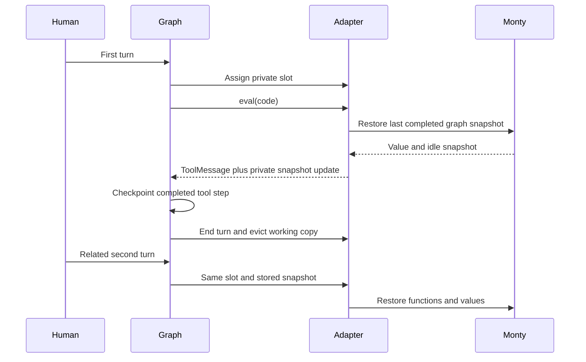
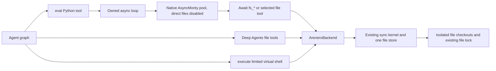

# Python interpreter and sandbox adapters for Deep Agents

Use `CodeInterpreterMiddleware` when you want the Deep Agents interpreter
interface with Python instead of JavaScript. Use `AreneroBackend` when you also
want shared files and the limited virtual shell. Both need the optional extra:

```console
uv add 'arenero[deepagents]'
```

The existing `AreneroInterpreterMiddleware`, factories, kernels, and sandbox
facades keep their public APIs and defaults. The new profile does not replace
them. It does not accept JavaScript, QuickJS snapshots, arbitrary CPython
packages, or general Bash commands.
Use one interpreter middleware per graph. Do not stack the existing and
compatibility profiles; they use the same private snapshot fields.

## Small interpreter setup

```python
from arenero.deepagents import CodeInterpreterMiddleware
from deepagents import create_deep_agent
from langgraph.checkpoint.memory import InMemorySaver

with CodeInterpreterMiddleware(ptc=("search_web",)) as interpreter:
    agent = create_deep_agent(
        model=model,  # Your configured LangChain model.
        tools=[search_web],
        middleware=[interpreter],
        checkpointer=InMemorySaver(),
    )
    config = {"configurable": {"thread_id": "conversation-42"}}
    first = agent.invoke(
        {"messages": [{"role": "user", "content": "Calculate and remember 37 squared."}]},
        config,
    )
    second = agent.invoke(
        {"messages": [{"role": "user", "content": "Now add one to that result."}]},
        config,
    )
```

The model sees one `eval(code=...)` tool by default. The code is Monty Python:

```python
value = 37 ** 2
value
```

Use `async with`, `await agent.ainvoke(...)`, or `agent.astream(...)` for an async
application. `invoke`, `stream`, `ainvoke`, and `astream` all use the same owned
event loop. Do not run `interpreter.kernel` directly from another loop. Close
the middleware after graph work finishes. It closes its own kernel and loop,
but not a caller-supplied backend.

## The ten additions

| Addition | Behavior |
| --- | --- |
| Compatibility entry point | Common QuickJS-style settings and one Python `eval` tool. The module tool is opt-in. |
| Result blocks and console capture | Escaped `<stdout>`, `<stderr>`, `<result>`, and `<error type="...">` blocks. The existing rich result is `ToolMessage.artifact`. |
| Graph-owned persistence | Private slot and full Monty snapshot in graph state by default. No shared missing-thread fallback. |
| Graph interrupts | Cancel the outer feed and pass the original graph control signal back to LangGraph. Guest exception handlers cannot turn approval into normal execution. |
| Subagent bridge | Optional response schemas and labels, custom lifecycle events, replay-stable IDs, and separate task call/concurrency caps. |
| Tool namespace | Both `await search_web(query=...)` and `await tools.search_web(query=...)`. Plain Monty wrappers are rebuilt from live tools. |
| Sync graph calls | One loop thread bridges synchronous calls to native async Monty. No event loop is created for each cell. |
| Native backend adapter | `AreneroBackend` implements `SandboxBackendProtocol`, native result records, and inherited `a*` file and execute methods. |
| Shared file authority | Interpreter host calls and outer Deep Agents file tools use the same backend. File operations use isolated checkouts, not the active interpreter session. |
| Shell deadlines | `execute(timeout=...)` accepts a cooperative wall deadline. Expiry returns exit `124` and stops later commands. |

## Settings and limits

| Setting | Default | Meaning |
| --- | --- | --- |
| `memory_limit` | 64 MiB | Monty allocator cap, not host process RSS. |
| `timeout` | 5 seconds | Interpreter time per feed. Host waits are excluded. This is not a full eval wall deadline. |
| `max_ptc_calls` | 256 | Selected ordinary tool and shared-backend fs_* calls per eval. `None` removes this adapter cap, not Monty's suspension cap. |
| `max_result_chars` | 4000 | Hard character cap for each raw result, stream, and error field. JSON/XML escaping and tags can add characters. |
| `capture_console` | `True` | Collect stdout/stderr. `False` discards chunks before collection; they do not go to the host terminal. |
| `tool_name` | `eval` | External interpreter tool name. |
| `subagents` | `True` | Expose a live Deep Agents `task` tool with the required task fields. |
| `max_subagent_concurrency` | 32 | Active subagents in one eval, separate from the regular PTC concurrency gate of 10. |
| `max_subagent_calls` | 100 | Task calls in one eval, separate from `max_ptc_calls`. |
| `ptc` | `None` | Explicit tool names or tool objects; no ordinary tools are exposed by default. |
| `mode` | `thread` | `thread`, `turn`, or `call`; `None` also means `thread`. |
| `max_snapshot_bytes` | `memory_limit` | Snapshot acceptance and kernel state-save cap. Oversized new state is not committed. |
| `snapshot_signing_key` | `None` | Optional HMAC over the full snapshot and private slot identity. |
| `tools_namespace` | `True` | Generate `tools.NAME(**kwargs)` as well as bare function access. |
| `module_tool` | `False` | Add `eval_module(entry_path, code=None, ...)` for the existing static module workaround. |
| `workspace` | `None` | Optional direct `WorkspaceConfig` mount, without a shared backend. |
| `backend` | `None` | Optional caller-owned `AreneroBackend`; mutually exclusive with direct workspace and module tool. |

The kernel still enforces its other defaults: 1000 suspensions per checkout,
10 seconds of system sleep per checkout, a 10-second worker request timeout,
1 MB of collected streams, and bounded recursion and file transfers. Hosted
calls share a 30-second operation wall budget. Task and regular call counts are
separate, but tasks do not bypass that aggregate host budget or native limits.
The stream collection cap and the returned-text cap are different limits.
Disabling console capture does not disable interpreter memory/time limits.

`eval` also accepts `output_limit_chars` to lower the response cap and
`output_file` to offload larger bounded JSON when a direct workspace is present.
Check the rich artifact for `output_file_error`. Shared-backend mode disables
direct kernel files, including this native output-file route. Use `fs_write`
for explicit shared-backend output instead.

## State, checkpoints, and replay



- `thread` saves a full idle snapshot after each completed eval, including normal
  Python errors under the existing `state_policy="always"` rule. A graph
  checkpointer and stable `thread_id` preserve it between human turns and across
  middleware recreation. Without a checkpointer, reuse the returned private
  graph state if the application manages state itself.
- With no graph thread ID and a fresh input state, each invocation gets a new
  private slot. Unrelated users do not share a middleware fallback session.
- `turn` retains Python only during one graph invocation. `call` starts each
  eval empty. Files have a separate lifetime in all modes.
- The private fields do not enter the model's public state. Middleware node
  trace payloads are omitted. This is not full trace redaction: root runs,
  tools, rich artifacts, checkpointers, and external logs need their own policy.
- HMAC checks bind a snapshot to its slot. Missing or wrong signatures and
  oversized snapshots are not restored. Keep the same signing key when a graph
  resumes in a new middleware instance. Snapshots still require exact Monty
  versions and compatible execution policy.
- A nested graph interrupt cancels the checkout without saving partial Python
  state. Resume replays that eval from its last completed graph checkpoint.
  Earlier file, network, or provider effects are not rolled back. Make those
  calls idempotent when replay is possible.
- Send **one eval tool call per model step**. Multiple evals in one tool batch
  return `ConcurrentEval` before execution. Do not run simultaneous graph
  invocations against the same checkpoint thread. Different threads can run
  concurrently within the worker-pool limits.

## Programmatic tools and subagents

```python
found = await tools.search_web(query="Monty sandbox")
titles = [item["title"] for item in found]
titles[:5]
```

The namespace uses Python keyword arguments, not JavaScript input objects or
automatic camelCase conversion. `tools` and `_arenero_*` are reserved names.
Bare aliases remain available. The wrappers are refreshed after snapshot
restore; they do not depend on host object registrations surviving a dump.
Tool selection and instructions use the current agent inventory. A removed
tool is no longer callable, even if a saved wrapper refers to its old name.

```python
report = await task(
    description="Count the matching records",
    subagent_type="analyst",
    label="Count records",
    response_schema={
        "type": "object",
        "properties": {"count": {"type": "integer"}},
        "required": ["count"],
    },
)
report["count"]
```

The bridge puts an `AutoStrategy` in the child runtime configuration for the
real Deep Agents task tool to consume. It supplies a default schema title.
Schemas are bounded to 4096 UTF-8 bytes, 5 container levels, and 32 properties.
The child agent enforces its response format; the bridge parses returned JSON
text but does not add a second JSON Schema validator. Invalid returned JSON is
an execution error, not an accepted structured response.

Custom stream events have `type="subagent"`, `phase="start"`, `"complete"`, or
`"error"`, plus `id` and `eval_id`. Start events include bounded description,
label, and subagent type. Completion/error events include `duration_ms`.
Interrupts do not emit a false error event. Events are best effort.

Dispatch IDs hash the parent eval call ID, dispatch ordinal, and arguments.
An unchanged replay gets the same ID. Changed requests or call order get new
IDs. Consumers should upsert start events by ID. These IDs are not a guarantee
of exactly-once external effects. Schema and labels use Python names:
`response_schema`, `subagent_type`, and `label`.

PTC still bypasses the parent ToolNode and parent per-tool approval middleware.
A graph interrupt raised by the called tool itself does propagate. Arbitrary
`Command.update` fields from nested tools are not applied to the parent graph;
the task bridge extracts the final response only.

## Shared sandbox setup

```python
from arenero import AreneroSandbox, PersistentMontyKernel
from arenero.deepagents import CodeInterpreterMiddleware
from arenero.deepagents_backend import AreneroBackend
from deepagents import create_deep_agent
from pydantic_monty import OSAccess

with PersistentMontyKernel(os_handler=OSAccess()) as file_kernel:
    backend = AreneroBackend(AreneroSandbox(file_kernel))
    with CodeInterpreterMiddleware(backend=backend, ptc=("read_file",)) as interpreter:
        agent = create_deep_agent(
            model=model,
            backend=backend,
            middleware=[interpreter],
        )
        result = agent.invoke({"messages": [{
            "role": "user", "content": "Create a report and check its contents."
        }]})
```

The model can use the outer Deep Agents file tools or these async guest calls:

```python
await fs_write(file_path="/report.txt", content="42")
page = await fs_read(file_path="/report.txt", offset=0, limit=10)
page["file_data"]["content"]
await tools.read_file(file_path="/report.txt")
```

`fs_read`, `fs_write`, `fs_edit`, `fs_delete`, `fs_ls`, `fs_glob`, and `fs_grep`
return dictionaries with the native backend result fields. Their signatures
are included in the live instructions. These are **async backend bridges**,
not the synchronous kernel `fs_*` helpers. Direct `open()` and `pathlib` access
are disabled in this mode. The `tools.fs_*` aliases also work.



Two existing pools are used: one for async Python, one for sync files/shell.
The file kernel has no active parent Python checkout, so its own worker pool
can serve nested file calls without needing a spare worker in the interpreter
pool. Do not call a bound interpreter session from a hosted file function.
The backend does not own or close its supplied kernel. Close the middleware
first, then the file kernel, as the nested contexts show. File locks coordinate
one kernel, not separate processes that share a host directory.

For backend-only use, pass `system_prompt=backend.instructions()` to
`create_deep_agent`. The combined middleware adds these instructions for you.
Do not give the model the general Bash contract of a full OS sandbox.

### File contracts

- `read` returns raw text, not numbered gutters. Negative offsets start at zero.
  Nonpositive limits do not inspect a file. Empty/past-end windows do not carry
  invalid pagination fields. Non-UTF-8 bytes are Base64. FileData timestamps
  describe record creation, not preserved underlying file metadata.
- `glob` and grep include-globs reuse the Deep Agents matcher: basename matching
  at any depth, anchored/root-relative patterns, `**`, classes, braces, and dot
  rules. Only regular files are returned and paths are absolute. This does not
  change the core shell's smaller glob grammar.
- `grep` uses literal, case-sensitive text, one-based line numbers, and a total
  match cap. An exact cap with no omitted match is complete. File/character/scan
  limits can still mark results incomplete. Binary files are skipped.
- Listings and searches use existing filesystem scan, depth, result, and
  transfer bounds. An incomplete listing has an error; incomplete glob/grep
  results set `truncated`. File edits keep the existing shared lock.
- Upload/download batches retain input order and partial success, preserve raw
  bytes, and normalize common errors to `file_not_found`, `permission_denied`,
  `is_directory`, or `invalid_path`.
- File operations accept only absolute paths within `root` and reject `..`.
  `root` defaults to the file kernel's workspace root. It is not an extra shell
  confinement boundary: `execute` keeps that kernel's existing mounted authority.
- Native `a*` methods offload the sync backend to worker threads. Cancelling a
  caller does not undo a completed file change or forcibly stop an active thread.

### Limited execute and deadlines

`backend.execute(command, timeout=...)` and `backend.aexecute(...)` return the
native `ExecuteResponse`. The command grammar remains the
[limited virtual shell](virtual-shell.md), not Bash. File methods do not call
shell wrappers. The adapter does not inherit `BaseSandbox`'s OS-dependent
capture/offload scripts.

A positive timeout sets a call-local cooperative wall deadline. It is checked
before and after commands and pipelines, after DNS, and after an HTTP body read.
The remaining time lowers curl's network timeout. `None` or `0` adds no call
deadline; all normal kernel/network limits remain. Negative or nonfinite values
fail with exit `2`. Expiry returns exit `124`, stops later commands, and retains
completed effects. Partial console output need not be returned after expiry.

This does **not** preempt an active worker operation, system sleep, DNS lookup,
host callback, file operation, or slow body read at the exact deadline. It does
not change saved Monty policy or apply unsafe shared configuration mutations.
Use the native interpreter/request/network limits too. A strict full-command
wall-time kill needs a disposable process/container boundary, not an abandoned
background thread.

## Workarounds and remaining differences

- Default interpreter-only mode can call selected Deep Agents file tools through
  PTC. Those tools retain their own file authority. Add `backend` when you want
  the explicit shared `fs_*` interface and the limited shell.
- For a direct mounted workspace and small dependency-free helpers, set
  `workspace=WorkspaceConfig(...)` and `module_tool=True`. The static module
  resolver remains bounded and rejects dynamic, wildcard, nested virtual-file,
  circular, and third-party imports. It is not ES module resolution or importlib.
- `AreneroInterpreterMiddleware` remains the API for caller-configured native
  kernels, store-owned persistence, RLM, MCP, and other existing advanced options.
  The small compatibility constructor does not duplicate every kernel setting.
- Full Monty snapshots are used, not QuickJS heap dumps or binary deltas. Python
  functions and plain guest classes survive compatible snapshots. Direct host
  object registrations and external connections do not.
- Monty's default time/random policy remains. This is not QuickJS's exact clock
  environment. Memory is an allocator cap; hard host RSS limits need OS support.
- There are no processes, pip, Git, shell executables, C extensions, third-party
  imports, JavaScript promises, or general Python/JavaScript source compatibility.

See the [pinned source review](deepagents.md#compatibility-review-2026-10-18),
[Monty limitations](monty-updates.md), and
[sandbox comparison](sandbox-compatibility.md). The compatibility suite in
`tests/test_deepagents_compat.py` uses scripted fake models, real local Monty
workers, and mocked child agents. It includes graph restart, both invocation
styles, interruption/resume, cancellation, task limits/events, file sharing,
backend records, binary transfers, matching, and deadline behavior.
