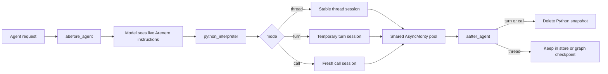

# Deep Agents interpreter middleware

There are two optional interfaces. This page describes the existing
`AreneroInterpreterMiddleware`. For a single `eval` tool, sync and async graph
calls, graph-owned state, and an optional shared backend, use
[`CodeInterpreterMiddleware`](deepagents-compatibility.md). Existing APIs and
defaults have not changed.

`AreneroInterpreterMiddleware` gives a Deep Agents or LangChain agent one
asynchronous Monty interpreter. The model gets two tools:

- `python_interpreter` runs one Monty Python cell.
- `python_interpreter_module` resolves and runs a bounded static virtual module
  graph, with optional follow-up code in the same call.

The middleware also adds current limits and hosted-function signatures to every
model request. It reads the live tool list after other middleware changes it, so
the instructions match the functions that the next interpreter call can use.

Both interpreter tools accept optional `output_file`, an absolute virtual path
for full bounded JSON when public output is trimmed. This reuses the native
kernel writer; it does not change the tool names or add an extra agent call.
Check `output_file_error` separately from Python success. No filesystem means the
write fails, not that the kernel gains file access. Stream and transfer caps still
apply. Inputs and the Python-only filesystem flag remain host options.

Install the optional integration:

```console
uv add "arenero[deepagents]"
```

## Minimal setup

```python
from arenero import AsyncPersistentMontyKernel, create_deepagents_middleware
from deepagents import create_deep_agent

kernel = AsyncPersistentMontyKernel()
interpreter = create_deepagents_middleware(kernel=kernel, mode="thread")
agent = create_deep_agent(
    model="openai:gpt-5.5",
    middleware=[interpreter],
)

async with kernel:
    result = await agent.ainvoke(
        {"messages": [{"role": "user", "content": "Calculate 37 squared."}]},
        {"configurable": {"thread_id": "conversation-42"}},
    )
```

Use `ainvoke()` or `astream()`. Async Monty can suspend while it waits for a host
tool, and different session IDs can use different worker processes. A synchronous
agent call can see the tools, but an interpreter call returns
`AsyncInvocationRequired` with a hint to use the async API.

The caller owns a supplied kernel and must close it. If the middleware creates
its default kernel, call `await interpreter.aclose()` or use the middleware as an
async context manager.

## State lifetime modes

| Mode | Same interpreter call | Later call in one agent turn | Later human turn with the same thread ID |
| --- | --- | --- | --- |
| `thread` | Yes | Yes | Yes, while its selected store remains available |
| `turn` | Yes | Yes | No; `aafter_agent` deletes the turn session |
| `call` | Yes | No | No; the tool deletes state in `finally` |

`thread` is the default. A stable hash of `configurable.thread_id` becomes the
kernel session key. `session_prefix` separates two graphs that share one store.
When no thread ID exists, one middleware-instance fallback is used. Production
agents should always supply a thread ID.



Virtual files do not follow these modes. Files belong to the configured virtual
filesystem or workspace and can be shared by sessions and agents. Resetting or
restoring Python state does not undo file, network, MCP, or application-tool side
effects.

## Programmatic tool composition

Use `ptc` as an allowlist of current tool names or explicit `BaseTool` objects:

```python
interpreter = create_deepagents_middleware(
    kernel=kernel,
    ptc=("search", "lookup_customer"),
)
```

The model receives exact async declarations, such as:

```python
async def search(*, query: str) -> list[dict]: ...
```

It can compose calls in one cell:

```python
found = await search(query="Arenero")
names = [item["name"] for item in found]
names[:5]
```

The adapter supplies the same hidden values that LangGraph ToolNode normally
injects: `ToolRuntime`, state, store, context, configuration, stream writer, and
a synthetic child tool-call ID. It still uses each tool's public `invoke()` or
`ainvoke()` path for validation and callbacks.

Programmatic calls do not pass through the parent ToolNode because Monty calls
them from inside one interpreter tool execution. This has important effects:

- Parent per-tool human approval or `interrupt_on` middleware does not run for
  each nested call. Approve the outer interpreter, put approval inside the
  called tool or subagent, or do not expose that tool.
- A returned LangGraph `Command` is not applied to parent graph state. For the
  Deep Agents `task` tool, Arenero returns the final subagent message to Monty.
- Side effects are real and are not transactional.
- `HostedToolConfig` limits calls, total call time, overlap, and returned records
  for each interpreter operation.
- Interpreter tools and other code-execution tools are always excluded from the
  nested catalog. This prevents recursive interpreter calls.

## Recursive model calls

Configure an `RLM` when Monty code must call a model or create child RLMs:

```python
from langchain.chat_models import init_chat_model
from arenero import RLM, RLMConfig, adapt_langchain_model

model = init_chat_model("openai:gpt-5.5")
rlm = RLM(
    adapt_langchain_model(model),
    config=RLMConfig(max_depth=1, max_model_calls=32),
)
interpreter = create_deepagents_middleware(
    kernel=kernel,
    rlm=rlm,
    mode="thread",
)
```

The interpreter receives five async functions:

```python
summary = await llm_query(prompt="Summarize: " + context_part)
summaries = await llm_query_batched(prompts=prompts)
answer = await rlm_query(prompt=child_task)
answers = await rlm_query_batched(prompts=child_tasks)
usage = await rlm_usage()
```

Plain model calls do not create a REPL. Recursive calls create separate temporary
Monty sessions. At `max_depth`, a recursive call becomes a plain call. The active
agent interpreter never calls itself and its Python state is not copied into
children.

Each interpreter operation gets a new shared RLM call, token, cost, concurrency,
and wall-time ledger. Token and cost limits depend on adapter-reported usage.
Configure enough Monty workers for the parent and recursive children. A chain of
depth `N` needs at least `N + 1` workers.

Direct kernel filesystem mounts are disabled in recursive child sessions because
the parent feed holds the shared filesystem lock. Child RLMs can use hosted file
tools inherited through normal `ptc` selection. See
[Recursive Language Models](rlm.md) for the full API and limits.

The direct interpreter functions do not speculate because the parent agent owns
model streaming. An application can use `SpeculativeTurn` in that outer stream,
or use speculation in the separate `RLM.complete()` controller. See
[Speculative programmatic tool calling](speculative-tool-calling.md).

## Subagent bridge

When `subagents=True`, the middleware detects a live Deep Agents `task` tool with
`description` and `subagent_type` fields. It exposes this async function even
when normal PTC is disabled:

```python
answer = await task(
    description="Check the calculation independently.",
    subagent_type="reviewer",
)
```

The subagent receives a derived runtime with a child tool-call ID. Arenero
returns the task tool's final `ToolMessage.content`. It does not merge the task
tool's `Command.update` into the parent graph. Set `subagents=False` when each
dispatch must use the normal parent tool path.

## Checkpoint-backed Python snapshots

Arenero normally stores snapshots in the kernel's `SessionStore`. Set
`checkpoint_state=True` to put the full opaque Monty snapshot in private
LangGraph state instead:

```python
interpreter = create_deepagents_middleware(
    kernel=kernel,
    mode="thread",
    checkpoint_state=True,
    max_snapshot_bytes=5_000_000,
    snapshot_signing_key=application_secret,
)
```

Before the agent starts, the middleware restores private snapshot bytes into the
working kernel store. After the agent ends, it copies the current bytes back to
private state and removes the working copy. A LangGraph checkpointer can then
persist and time-travel the Python snapshot with the graph state.

Set a high-entropy HMAC key when checkpoint storage is not fully trusted. The
signature includes the stable Arenero session ID, so a snapshot cannot be moved
to a different thread. A missing, changed, or oversized signed snapshot is
rejected and cleared.

This feature stores full snapshots. It does not implement snapshot deltas.
Monty's resource settings, native directory, and RNG state are part of the
snapshot. A new feed resets the duration clock; it is not a session-lifetime
budget. Checkpoint time travel does not restore virtual files or undo external
tool effects. Old Monty-version snapshots require a reset.

## Dynamic instructions

`interpreter.instructions(tools)` returns the same content added before a model
call. It includes:

- active kernel limits, persistence, filesystem, MCP, and async rules;
- exact selected hosted-function signatures;
- optional RLM function signatures, recursion rules, and limits;
- current persistence mode;
- virtual-module limits;
- explicit warnings about CPython gaps, ToolNode bypass, approvals, and side
  effects.

This report is generated from configuration. Do not copy a stale prompt into an
agent when the kernel or tool list can change.

## Limits and non-goals

- This middleware is async-only for execution.
- It is not a replacement for a container, VM, or full CPython sandbox.
- It does not add subprocesses, sockets, package installation, native modules,
  or ambient host access.
- Host calls pause Monty's interpreter-time budget. The hosted-tool wall-time
  budget limits those waits separately.
- One session runs one operation at a time. Different session IDs can run in
  parallel up to the worker-pool limit.
- Recursive child sessions need free workers and do not receive direct kernel
  filesystem mounts.
- The full runtime injection uses LangGraph's current injection metadata. Keep
  the pinned LangChain, LangGraph, and Deep Agents versions covered by tests.

The output-file and module-export tests run a complete mocked model-driven graph
over two human turns. The second call keeps Python state and loads a module, then
writes its full result through the same two fixed interpreter tool names.

## Compatibility review: 2026-10-18

This section records the pinned sources used to build the optional Python
compatibility profile and file/sandbox backend. It is not JavaScript source compatibility,
QuickJS snapshot compatibility, or full CPython.

### Reference versions and sources

Arenero was reviewed at `f8e63a64e4f7c4958f2768bc8e72349c624e1d79`, with Monty
`1.1.0`. The project lockfile has Deep Agents `0.7.11`, LangChain `1.3.18`, and
LangGraph `1.2.11`. A separate test environment used Deep Agents `0.7.28`,
LangChain `1.4.6`, and LangGraph `1.2.16`; the project environment was not changed.

The reference middleware package was `langchain-quickjs==0.3.9` and its runtime
was `quickjs-rs==0.2.5`. Current main source was pinned for later comparison:

- [Deep Agents interpreter guide](https://docs.langchain.com/oss/python/deepagents/interpreters)
  and the supplied [Markdown endpoint](https://docs.langchain.com/oss/python/deepagents/interpreters.md).
- [Deep Agents source at `4bf5022`](https://github.com/langchain-ai/deepagents/tree/4bf50225d9f2bd777c1b2aa722e76273eb772ab0/libs/partners/quickjs).
- [Middleware API and lifecycle](https://github.com/langchain-ai/deepagents/blob/4bf50225d9f2bd777c1b2aa722e76273eb772ab0/libs/partners/quickjs/langchain_quickjs/middleware.py).
- [REPL execution and callback bridge](https://github.com/langchain-ai/deepagents/blob/4bf50225d9f2bd777c1b2aa722e76273eb772ab0/libs/partners/quickjs/langchain_quickjs/_repl.py).
- [Subagent schemas, events, and replay IDs](https://github.com/langchain-ai/deepagents/blob/4bf50225d9f2bd777c1b2aa722e76273eb772ab0/libs/partners/quickjs/langchain_quickjs/_subagent.py).
- [Result formatter](https://github.com/langchain-ai/deepagents/blob/4bf50225d9f2bd777c1b2aa722e76273eb772ab0/libs/partners/quickjs/langchain_quickjs/_format.py)
  and [snapshot delta encoding](https://github.com/langchain-ai/deepagents/blob/4bf50225d9f2bd777c1b2aa722e76273eb772ab0/libs/partners/quickjs/langchain_quickjs/_snapshot.py).
- [Deep Agents backend contract](https://github.com/langchain-ai/deepagents/blob/4bf50225d9f2bd777c1b2aa722e76273eb772ab0/libs/deepagents/deepagents/backends/protocol.py)
  and [shell-based BaseSandbox](https://github.com/langchain-ai/deepagents/blob/4bf50225d9f2bd777c1b2aa722e76273eb772ab0/libs/deepagents/deepagents/backends/sandbox.py).
- [quickjs-rs repository](https://github.com/langchain-ai/quickjs-rs), pinned at
  [commit `278cf32`](https://github.com/langchain-ai/quickjs-rs/tree/278cf32d17b07a9ba2951ebc826256eef703182d).

Keep documentation and implementation versions separate. The interpreter guide
still warns that restored functions become inaccessible, but the reviewed
runtime uses full WebAssembly heap snapshots. Its source and examples preserve
functions and closures. Do not claim that callable-state persistence is unique
to Arenero. Some partner README descriptions also still mention a native PyO3
runtime; the reviewed runtime package uses WebAssembly and Wasmtime.

### Implementation

The ten recommended additions are now available through
`CodeInterpreterMiddleware` and `AreneroBackend`. See the
[Python compatibility guide](deepagents-compatibility.md) for setup, settings,
examples, diagrams, checkpoint behavior, and remaining differences.

The original middleware keeps its public constructor, two-tool interface,
JSON results, async-only execution, and store-backed default. Nested graph
control signals now propagate instead of becoming Monty error envelopes.

The adapters reuse Monty, the existing sandbox, file transfers, runtime injection,
and the Deep Agents glob matcher. They do not add another interpreter, an import
engine, a filesystem, or shell-based `BaseSandbox` wrappers. Full snapshots are
used instead of adding a binary-delta dependency.

Validation uses fake models and local workers. It covers two human turns with a
new middleware instance, sync and async graph calls, interruption and replay,
subagent schemas/events/budgets, shared file calls, backend records, and shell
deadlines. Both the locked dependencies and the separate current dependency set
are covered. No real LLM calls are needed.
