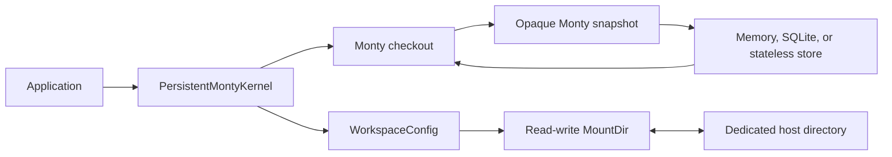
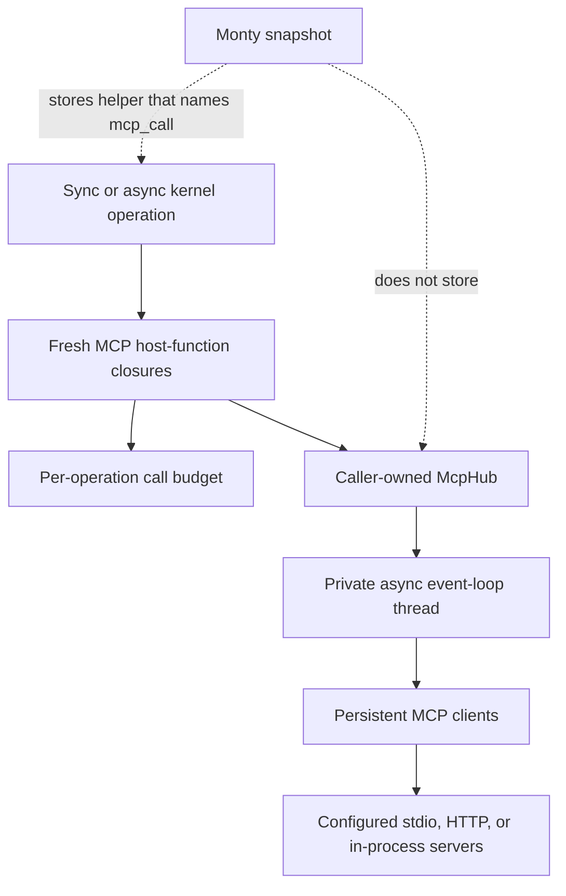
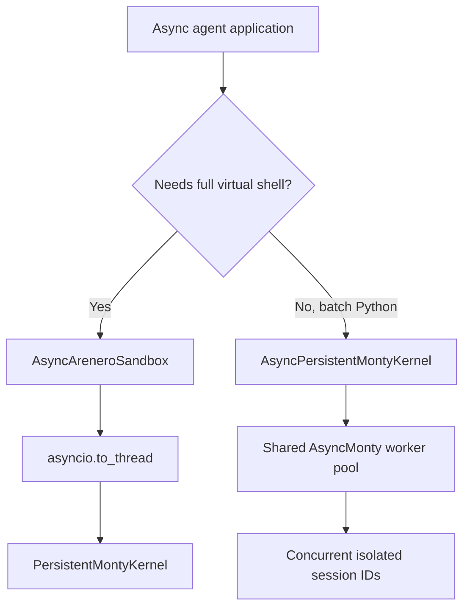
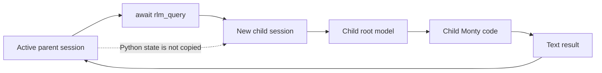
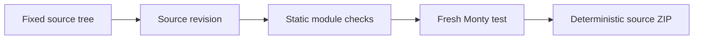

# Arenero design decisions

The interpreter state and file state have separate persistence paths:

SQLite stores interpreter snapshots and session metadata. Workspace files use a
Monty mount and remain outside SQLite.

## Persistent workspaces use Monty mounts

`WorkspaceConfig` creates one kernel-owned, read-write `MountDir`. Files go to a
dedicated host directory and appear at `/workspace` by default. SQLite continues
to store only Monty session snapshots.

This design uses Monty's existing path confinement and avoids a second virtual
filesystem implementation. The kernel opens and closes the mount. A new shell
session starts in the workspace.

## LangChain is optional

The core package does not import LangChain. The public
`create_python_repl_tools()` function loads the integration only when called and
reports how to install the `langchain` extra when it is missing.

This keeps the REPL, kernel, shell, and sandbox usable in small applications.

## MCP clients are optional and stay on the host

The core package does not import the MCP SDK. Applications import
`arenero.mcp` only when they install the `mcp` extra.

`McpHub` owns a private async event-loop thread so each client has one stable
event loop for its complete lifetime. The sync kernel waits for calls on that
loop. The native async kernel wraps the same submitted future and awaits it
without blocking its caller event loop. Monty receives only six plain host
functions. It never receives a client, transport, credential, or async object.

The kernel asks the hub for a fresh function set for each outer operation. This
makes `max_calls_per_operation` cover direct code, an executed virtual file, and
follow-up code as one operation. It also lets restored Monty functions resolve
the newly attached `mcp_call` host function after a process restart.

Server configuration is caller-owned. The model can discover and call configured
tools, but it cannot select a process command, endpoint, environment, header, or
allowlist. Automatic transport retry is off because an uncertain failed reply can
hide a completed side effect.

## Hosted tools keep framework execution paths

Arenero uses one framework-neutral `HostedTool` shape instead of teaching the
kernel about each agent framework. LangChain adapters call `BaseTool.invoke()` or
`ainvoke()`. They also inject the state, store, context, and call identity that
ToolNode normally supplies. Pydantic AI adapters call the current `ToolManager`.
MCP promotion uses the existing bounded hub call. This keeps validation,
callbacks, and tool-specific policy in their source framework.

A LangChain call made from Monty still bypasses the parent ToolNode. Parent
middleware that wraps ToolNode dispatch, including per-call human approval, does
not run. The application must approve the outer interpreter call, put approval in
the tool or subagent, or exclude the tool. Arenero states this in the generated
model instructions instead of claiming that nested calls are normal graph calls.

Each outer kernel operation creates new wrappers, budgets, and records. It does
not persist a framework context or callback in Monty. Operation tool sets are
merged with configured tools by using the lowest limits. Code-execution and
control tools are excluded from normal selection to avoid accidental recursive
execution.

Monty type-check state is part of a saved session. Arenero predeclares configured
tools. It does not load every MCP schema because that would defeat progressive
discovery. A promoted MCP tool or operation tool can need `restart=True` before
an older type-checked snapshot knows the new name. Arenero does not rebuild or
edit opaque Monty snapshots.

The call ledger is bounded and omits values by default. A tool error is marked as
possibly having side effects because the host can fail after it completed work.
Arenero does not automatically retry such calls.

## Type checking is explicit

`KernelConfig.type_check` is off by default. When enabled, Monty checks each user
feed before execution. Arenero supplies declarations for its `fs_*` helpers. The
application supplies declarations for hosted functions through
`type_check_stubs`.

Generated filesystem support code skips checking. Normal user code and flat
virtual Python files do not skip it. A generated static module bundle also skips
checking because its simple module objects need dynamic attributes.

## Cell results add common fields without removing detailed fields

Python and shell cells keep their earlier mode-specific fields. Both modes also
return common output, error, truncation, retry, state, exit-code, and output-file
fields. Adapters can use the common fields while existing callers keep the
detailed data.

## Output offloading is caller-selected

Arenero writes a larger bounded result only when output is trimmed and the caller
supplies an absolute `output_file` path. Python output uses JSON. Shell output uses
UTF-8 text. Existing stream, result, shell, and file-transfer hard limits still
apply.

Arenero does not choose hidden output paths or create unrequested files.

## Session administration does not expose snapshots

`list_sessions()` and `get_session_info()` return identifiers, versions,
revisions, timestamps, and byte sizes. They do not return Monty's opaque snapshot
bytes. Raw snapshots remain an internal persistence detail.

## Two async paths have separate purposes

`AsyncAreneroSandbox` uses `asyncio.to_thread()` around `AreneroSandbox`. It does
not create a second pool or a second state model. Use it when an async application
needs the complete virtual shell and sandbox facade with the sync kernel.

`AsyncPersistentMontyKernel` uses Monty's native async pool. It is for batches of
agents that have separate persistent session IDs. A per-session `asyncio.Lock`
keeps one session ordered. The Monty pool runs different sessions at the same
time and supplies checkout backpressure. The session store remains synchronous,
so the async kernel moves its short store calls to worker threads.

The native async LangChain adapter stays small. It exposes Python execution,
flat Python-file execution, static module execution, and reset. It does not
duplicate the virtual shell or all host-side filesystem tools. Monty code can use
the existing `fs_*` helpers. This keeps one shell implementation and makes the
smaller tool scope explicit. The native kernel includes bounded download for
module resolution. It still omits host upload, full session listing, output-file
offloading, the virtual shell, and automatic MCP artifact materialization. It
supports bound sessions, current-session info, forking, bootstrap, state policies,
capability reports, statistics, and events. The full sync facade remains the one
complete sandbox API.

## Shared-file locking is process-local

A kernel with a shared filesystem serializes filesystem-capable executions across
its sessions. Virtual shell command lists and facade edits hold the same reentrant
lock for their full read-modify-write operation.

The lock cannot coordinate two application processes. Applications that mount the
same host directory in separate processes must supply external coordination.

## Monty compatibility is a tested range

The package currently accepts `pydantic-monty>=0.0.21,<0.0.22`. Monty is
experimental, and session snapshots are version-specific. A new Monty release
must pass the unit tests, static type check, clean build, and clean core install
before the dependency range changes.

## Control APIs stay outside Monty

Capability reports, percent commands, state policies, session forks, bootstrap,
doctor checks, runtime ownership, event delivery, and artifact materialization
are host control features. They are not new Monty language features. The cell
dispatcher handles percent commands before a feed. Artifact materialization runs
after a checkout ends, so it does not re-enter the active persistent session.

The event sink receives metadata only and cannot change an operation result. A
failed observer call is ignored. This keeps logging and audit integration small
without creating a plugin lifecycle or giving model code access to the sink.

## Deep Agents uses async middleware and explicit state modes

The Deep Agents integration uses `AsyncPersistentMontyKernel`. An interpreter
cell can await application tools without blocking the agent event loop, and
independent graph threads can use the shared worker pool. The integration does
not duplicate a synchronous execution path. A sync call returns direct guidance
to use `ainvoke()` or `astream()`.

`thread`, `turn`, and `call` modes only change Python snapshot lifetime. They do
not change virtual-file ownership. Optional checkpoint state stores full Monty
bytes in private graph state. Full snapshots are simpler and easier to verify
than a custom delta format. An optional HMAC binds bytes to one stable thread
session. This provides integrity, not confidentiality.

The middleware builds its prompt from the current model request tool list. It
does not cache a broad startup catalog because upstream middleware can filter
tools. Explicit PTC selection is therefore checked again at execution time.
Nested interpreter and control tools are excluded.

## RLM recursion uses new sessions, not interpreter re-entry

`llm_query` calls one configured async model on the host. `rlm_query` creates a
new temporary Monty session and runs another bounded root-model loop. It does not
call the active interpreter tool. This keeps parent Python state stable and avoids
waiting on the parent's per-session lock.

All recursive branches share one model-call ledger. Depth, calls, overlap,
reported tokens, reported cost, prompt size, response size, transcript size, and
wall time have explicit limits. At the depth limit, `rlm_query` becomes a plain
model call. This gives every recursive path a fixed end condition without a
second control system.

A recursive call starts while the parent Monty checkout is suspended. It needs
another worker. Direct kernel filesystem access is disabled for recursive child
sessions because the parent owns the process-local filesystem lock. Explicitly
inherited hosted file tools can still share files. This narrow rule avoids a
reentrant filesystem lock and keeps the kernel's existing serialization model.

The framework-neutral RLM accepts an async model callback and an optional async
delta stream. Provider adapters stay optional. The LangChain adapter uses public
`ainvoke()` and `astream()` and reports only usage that returned messages supply.

## Speculative execution uses Monty for the shadow

Arenero does not copy the reference CPython `exec` shadow used by some
speculative tool-calling prototypes. Generated code must not gain a second,
less-restricted runtime. A safe host evaluator resolves only a small expression
allowlist. A forked Monty snapshot handles the remaining state-dependent
statements. The shadow has no direct filesystem mount and is deleted after the
turn.

Only host-approved tool policies can run early. Nondeterministic identical calls
keep FIFO multiplicity. Deterministic policies can reuse one result. Failed bets
fall back to the original real call, and unused pending bets are cancelled. This
keeps speculation an optional performance layer instead of a new result model.

Sequential hosted tools are not eligible. They declare that calls must not
overlap, which conflicts with early execution. Recursive RLM calls are also not
in the default policy because a wrong-path recursive branch can use many model
calls and Monty workers.

See [Speculative programmatic tool calling](speculative-tool-calling.md).

## Static virtual modules are bounded source transformation

Arenero does not emulate `importlib`, `sys.path`, or site-packages. The host parses
user source with `ast`, resolves only configured virtual roots, rejects dynamic
or cyclic forms, and writes one dependency-first Monty feed. Each file runs in a
loader function and exports public names through a simple object. Functions keep
their file-local closure values instead of sharing one flat global namespace.

This design adds useful helper modules without placing CPython execution in the
sandbox or writing an import runtime in Monty. The tradeoff is an explicit small
feature set: no wildcard or nested imports, reload, namespace packages, third-
party packages, or type checking of the generated feed. File reads remain under
the existing filesystem transfer limit, plus module count, depth, source-byte,
root, and cycle checks.

## Monty packages use one source-only format

Arenero does not emulate `pip`, a build backend, wheels, or Python source
distributions. `MontyPackageManager` uses one JSON manifest, one fixed package
layout, an empty dependency list, and the existing static module resolver. This
keeps the package contract small and makes it visible to an agent.

Package verification runs in a fresh temporary session and reads the current
virtual files. This prevents a persistent REPL from hiding a source edit with old
definitions. The verification module exports `passed = True` because a module's
last expression is not the result of Arenero's generated module bundle.

Export runs verification again and writes a deterministic source ZIP. It excludes
`dist` from the source revision and archive. The archive is useful for transfer,
review, and storage. It is not installable by Python. A source digest supports an
`expected_revision` check between edit, test, and export operations.

## Related references

- [Architecture and components](architecture.md)
- [Usage and capabilities](usage-and-capabilities.md)
- [Virtual shell reference](virtual-shell.md)
- [Sandbox compatibility](sandbox-compatibility.md)
- [MCP tools inside the REPL](mcp.md)
- [Hosted tools and code-mode composition](hosted-tools.md)
- [Quality-of-life APIs](quality-of-life.md)
- [Deep Agents interpreter middleware](deepagents.md)
- [Recursive Language Models](rlm.md)
- [Static virtual modules](virtual-modules.md)
- [Monty-compatible source packages](monty-source-packages.md)
