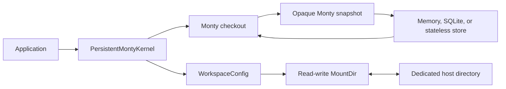
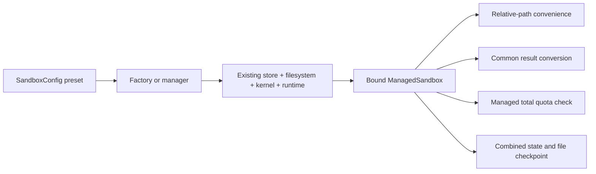
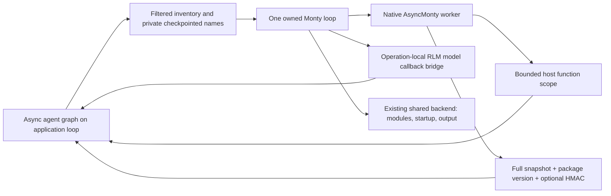
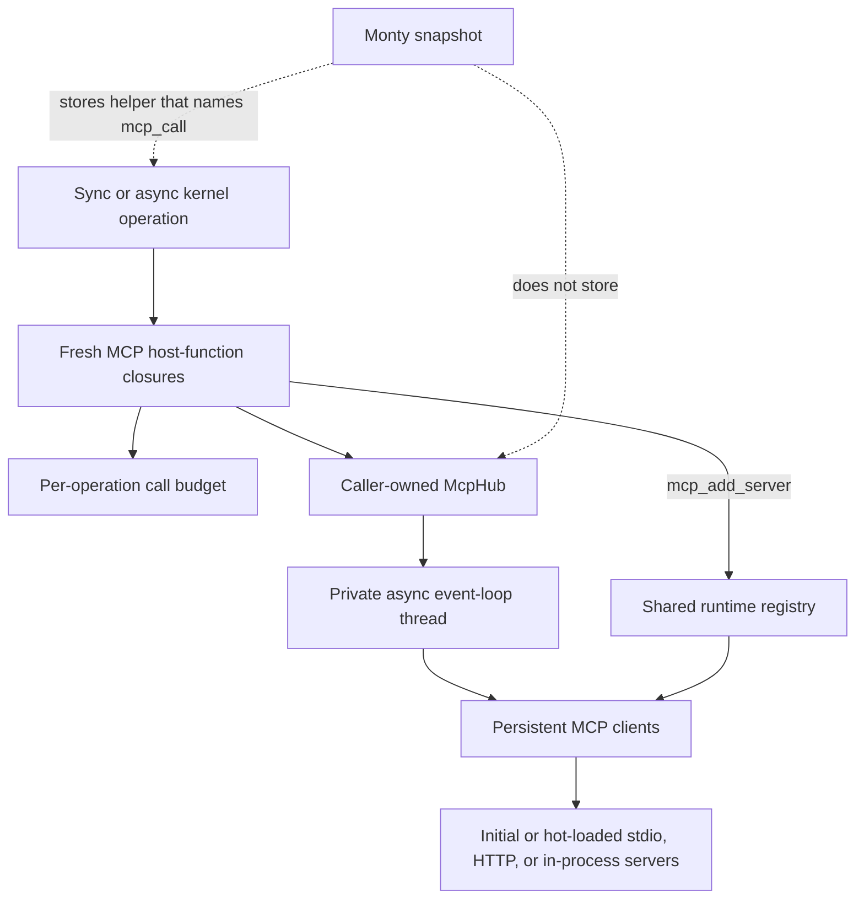
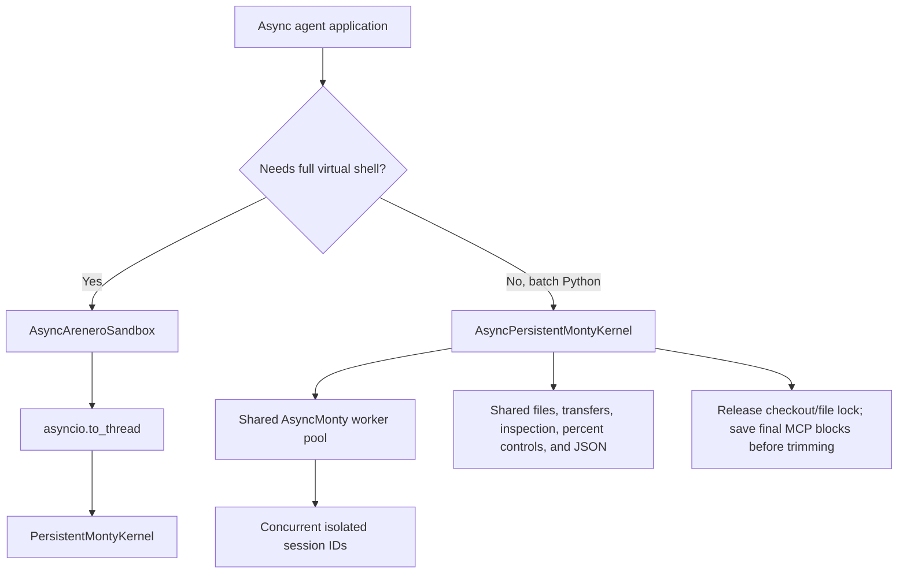
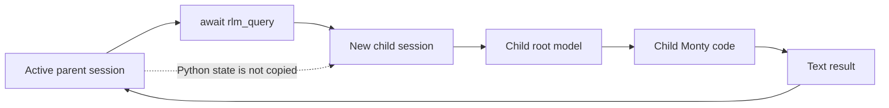
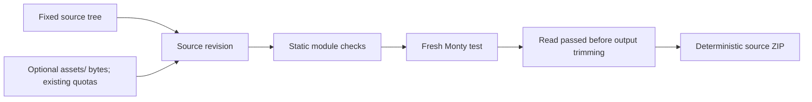

# Arenero design decisions

The interpreter state and file state have separate persistence paths:

SQLite stores interpreter snapshots and session metadata. Workspace files use a
Monty mount and remain outside SQLite.

## The managed layer composes existing parts

`open_sandbox()` is a thin composition layer. It selects an existing session
store, virtual filesystem, network policy, synchronous kernel, and
`AreneroRuntime`. It does not add another interpreter or filesystem.

`SandboxConfig` presets make lifetime choices explicit. `ManagedSandbox` owns a
runtime only when the factory created it. Handles opened by `SandboxManager`
borrow one manager-owned runtime. This keeps shutdown order in one place and
prevents one handle from closing a shared worker pool.

The total workspace quota uses a simple bounded tree capture. Direct writes are
checked before mutation. Code, shell, and package calls are checked after the
call. Arenero restores the old managed files when those calls exceed the quota.
It cannot roll back Python state or external side effects. This is intentionally
not described as a transaction.

Portable checkpoints combine the opaque snapshot and bounded files because
their normal persistence planes are separate. Restore requires the same Monty
version and execution policy. It permits another storage backend because memory
versus SQLite does not change code authority.

The managed async API uses `asyncio.to_thread()` over this complete synchronous
surface. It reuses the synchronous kernel's subprocess pool. This keeps one
implementation for files, shell, packages, quotas, and checkpoints. The native
async kernel remains available for applications that need native async hosted
functions.

## Persistent workspaces use Monty mounts

`WorkspaceConfig` creates one kernel-owned, read-write `MountDir`. Files go to a
dedicated host directory and appear at `/workspace` by default. SQLite continues
to store only Monty session snapshots.

This design uses Monty's existing path confinement and avoids a second virtual
filesystem implementation. The kernel opens and closes the mount. A new shell
session starts in the workspace.

## LangChain is optional

The core package does not import LangChain. The public
`create_python_repl_tools()` function loads the integration only when called and
reports how to install the `langchain` extra when it is missing.

This keeps the REPL, kernel, shell, and sandbox usable in small applications.

## Share small helpers, not a kernel base class

The sync and native async kernels share plain tool merging, alias collision
checks, generated declarations, and checking-policy decisions. Each operation
still creates fresh host wrappers, budgets, and call records. Worker execution,
locking, cancellation, and file writes stay on their existing separate paths.
There is no common kernel base class or new dependency.

The output-limit calculation is shared by both kernels, cell dispatch, and the
shell. Python calls clamp negative limits to zero; the shell still rejects them.
`values.py` owns the common text-trimming marker and error-text reader. This
changes neither the result conversion nor the hard caps.

The previous `_type_check_stubs` field was not completely unused: snapshot
policy hashing read it. The cleanup removes the retained text copy, not the
policy check. The hash uses the same configured declarations and encoding as
before. Temporary operation tools and promoted MCP tools remain outside it.
No snapshot format or store migration is needed.

Normal async hosted calls and speculative calls use one invocation helper. It
prefers an async callback, or runs a sync-only callback through
`asyncio.to_thread()`. Errors and cancellation still reach the caller. Their
existing guards, budgets, and side-effect rules remain separate.

Thread-scoped LangChain Python and filesystem tools use one missing-thread error
builder in the optional integration loader. File errors now include the same
`code`, `hint`, and `recovery` fields as Python errors. Names, argument schemas,
and previous error fields stay unchanged. Missing thread IDs do not run work.
The native async no-file execution and reset paths use standard
`contextlib.nullcontext()` instead of a custom no-op context manager.

## The Python compatibility profile reuses native components

The compatibility middleware still owns one native async Monty kernel and one
loop thread. Async graph tools and task subgraphs return to the application
loop; synchronous graph calls use the owned loop. One small loop helper forwards
results, errors, and cancellation. Feed cleanup drains unfinished host callbacks.
It does not stop a sync function already running in a thread or undo effects.

Advanced options use existing `KernelConfig`, `HostedToolConfig`, `HostedToolSet`,
`McpHub`, `RLM`, bootstrap, OS handler, and event callback types. The middleware
does not create a second config model, file store, module loader, or MCP registry.
Configured hosted tools join the operation scope so they use the current caller
loop and budgets. Native kernel defaults and the original middleware APIs remain.

The model request, not the ToolNode registry, defines the active named PTC and
automatic task inventory. Both middleware profiles keep live references only in
a slot-scoped host cache and save names in private graph state after each model
response. Restart/resume can reconstruct registered tools by name. Historical
saved names take precedence over a newer host cache. Direct calls and legacy
state without inventory metadata keep their prior runtime-inventory fallback.
Explicit tool objects and other configured host functions remain separate grants.
This is a small selection fix, not a new approval or authorization system.

Nested commands return their last usable message content, including serialized
message dictionaries, or their update data when there is no message. The normal
boundary converter handles that data. No nested graph update is applied. Native
`MontyRuntimeError.display()` supplies optional tracebacks; one existing error
cap bounds message plus stack. Output status and original counts are exposed in
escaped model text without a new result type or logging dependency.

An operation-local shallow view of the RLM wraps only model callbacks through
the same loop helper. It preserves runner configuration, shared accounting,
and child execution on the kernel loop. Streaming opens, advances, and closes
the original iterator on its owner loop. A pending read is drained before close;
no queue, client copy, or second RLM execution engine is added.

Private kernel hooks let the compatibility profile keep a bounded console
prefix, read module/startup bytes and write output through a shared backend, and
refresh guest wrappers before startup and user code. Direct guest file access
stays disabled with a shared backend. This avoids holding the interpreter's file
lock while a nested file operation needs it. All transfers retain existing byte
and root checks. Discarded console text cannot be restored by output offloading.

New graph snapshot signatures bind package version, slot, and bytes. A known
version mismatch is rejected before native load. Legacy version-less dumps keep
their existing native format/policy checks and old tag format; their original
package provenance is unknown. New dumps gain version metadata after execution.
This adds a guard, not a new snapshot format or a store migration.

Session lock maps in both kernels use weak values. An owner or waiter keeps a
strong lock reference. When no operation refers to a lock, its map entry can
disappear. This removes idle bookkeeping without manual deletion races or a
background cleanup task. Store lifetime and worker-pool lifetime do not change.

## MCP clients are optional and stay on the host

The core package does not import the MCP SDK. Applications import
`arenero.mcp` only when they install the `mcp` extra.

`McpHub` owns a private async event-loop thread so each client has one stable
event loop for its complete lifetime. The sync kernel waits for calls on that
loop. The native async kernel wraps the same submitted future and awaits it
without blocking its caller event loop. Monty receives nine plain host
functions. It never receives a client, transport, or async object.

The kernel asks the hub for a fresh function set for each outer operation. This
makes `max_calls_per_operation` cover direct code, an executed virtual file, and
follow-up code as one operation. It also lets restored Monty functions resolve
the newly attached `mcp_call` host function after a process restart.

The hub registry is mutable. Host code can add every supported server config.
Monty can add stdio and Streamable HTTP configs made from plain values. It can
also replace or remove a server. This keeps the outer agent interface fixed while
the inner tool catalog changes. The hub rejects removal, replacement, and refresh
while that server has an active call. A failed add is removed, and a failed
replacement tries to restore the previous config. Automatic tool-call retry is
off because an uncertain failed reply can hide a completed side effect.

Dynamic server configuration belongs to the hub, not to a Monty session. All
sessions that share the hub see the change. It lasts until the hub closes and is
not written to SQLite. Starting with `McpHub()` ensures the fixed function names
exist before any type-checked session snapshot is created.

## Hosted tools keep framework execution paths

Arenero uses one framework-neutral `HostedTool` shape instead of teaching the
kernel about each agent framework. LangChain adapters call `BaseTool.invoke()` or
`ainvoke()`. They also inject the state, store, context, and call identity that
ToolNode normally supplies. Pydantic AI adapters call the current `ToolManager`.
MCP promotion uses the existing bounded hub call. This keeps validation,
callbacks, and tool-specific policy in their source framework.

A LangChain call made from Monty still bypasses the parent ToolNode. Parent
middleware that wraps ToolNode dispatch, including per-call human approval, does
not run. The application must approve the outer interpreter call, put approval in
the tool or subagent, or exclude the tool. Arenero states this in the generated
model instructions instead of claiming that nested calls are normal graph calls.

Each outer kernel operation creates new wrappers, budgets, and records. It does
not persist a framework context or callback in Monty. Operation tool sets are
merged with configured tools by using the lowest limits. Code-execution and
control tools are excluded from normal selection to avoid accidental recursive
execution.

Monty type-check state is part of a saved session. Arenero predeclares configured
tools. It does not load every MCP schema because that would defeat progressive
discovery. A promoted MCP tool or operation tool can need `restart=True` before
an older type-checked snapshot knows the new name. Arenero does not rebuild or
edit opaque Monty snapshots.

The call ledger is bounded and omits values by default. A tool error is marked as
possibly having side effects because the host can fail after it completed work.
Arenero does not automatically retry such calls.

## Type checking is explicit

`KernelConfig.type_check` is off by default. When enabled, Monty checks each user
feed before execution. Arenero supplies declarations for its `fs_*` helpers. The
application supplies declarations for hosted functions through
`type_check_stubs`.

Generated filesystem support code skips checking. Normal user code and flat
virtual Python files do not skip it. A generated static module bundle also skips
checking because its simple module objects need dynamic attributes.

## Cell results add common fields without removing detailed fields

Python and shell cells keep their earlier mode-specific fields. Both modes also
return common output, error, truncation, retry, state, exit-code, and output-file
fields. Adapters can use the common fields while existing callers keep the
detailed data.

## Output offloading is caller-selected

Arenero writes a larger bounded result only when output is trimmed and the caller
supplies an absolute `output_file` path. Python output uses JSON. Shell output uses
UTF-8 text. Existing stream, result, shell, and file-transfer hard limits still
apply.

Arenero does not choose hidden output paths or create unrequested files.

## Session administration does not expose snapshots

`list_sessions()` and `get_session_info()` return identifiers, versions,
revisions, timestamps, and byte sizes. They do not return Monty's opaque snapshot
bytes. Raw snapshots remain an internal persistence detail.

## Two async paths have separate purposes

`AsyncAreneroSandbox` uses `asyncio.to_thread()` around `AreneroSandbox`. It does
not create a second pool or a second state model. Use it when an async application
needs the complete virtual shell and sandbox facade with the sync kernel.

`AsyncPersistentMontyKernel` uses Monty's native async pool. It is for batches of
agents that have separate persistent session IDs. A per-session `asyncio.Lock`
keeps one session ordered. The Monty pool runs different sessions at the same
time and supplies checkout backpressure. The session store remains synchronous,
so the async kernel moves its short store calls to worker threads.

The native async LangChain adapter stays small. It exposes Python execution,
flat Python-file execution, static module execution, and reset. It does not
duplicate the virtual shell or all host-side filesystem tools. Monty code can use
the existing `fs_*` helpers. This keeps one shell implementation and makes the
smaller tool scope explicit. The native kernel reuses binary transfer source,
store metadata, shared percent parsing/results, and JSON overflow preparation.
It supports host upload/download, session listing, percent cells, and output-file
offloading, structured file calls, ordered batch transfers, expiry cleanup,
and MCP artifact materialization. It still omits the virtual shell. It
supports bound sessions, current-session info, forking, bootstrap, state policies,
capability reports, statistics, and events. The full sync facade remains the one
complete sandbox API.

## Shared-file locking is process-local

A kernel with a shared filesystem serializes filesystem-capable executions across
its sessions. Virtual shell command lists and facade edits hold the same reentrant
lock for their full read-modify-write operation.

The lock cannot coordinate two application processes. Applications that mount the
same host directory in separate processes must supply external coordination.
Both kernels accept `filesystem=False` for direct Python calls. They detach
mounts/OS callbacks and skip file bootstrap/locking. Managed Python calls also
skip workspace quota scans. Session ordering remains mandatory. This is an
explicit host choice, not source inspection or a per-path scheduler. Hosted tools
keep their authority and cached Python data is not removed.

## Monty compatibility is an exact tested version

The package pins `pydantic-monty==1.1.0`, including its matched client and worker
dependencies. The [2026-10-14 migration](monty-updates.md) records breaking limit
changes and new features. A new Monty release
must pass the unit tests, static type check, clean build, and clean core install
before the dependency pin changes.

Monty's old cumulative duration setting is removed. We use an explicit
`max_feed_duration_seconds` field, not an alias with a different meaning. A
five-second feed limit and ten-second total system-sleep limit remain bounded
defaults. The optional turn limit is off. We reuse one `KernelConfig.resource_limits()`
method in both kernels and keep Monty's default one-second duration backstops.
We do not add a host-side cumulative session budget.

Both kernels pass `KernelConfig.os_policy` to Monty. Python and the virtual shell
use one native virtual directory. Shell state and directory are read in one host
callback, so output trimming cannot damage internal directory data. This removes
the duplicate directory global and one shell setup execution. New mounted
workspace sessions enter their virtual root before bootstrap.

Managed handles use the same directory from the snapshot. `cwd` is read-only;
managed `chdir` performs native `os.chdir`. Shell calls need no hidden prefix.
Setup and quota scans use isolated raw file checkouts, not model-output-trimmed
session calls. This avoids extra bootstrap work and prevents small output limits
from corrupting internal metadata.

We install the large generated filesystem prelude once, then save a hash of its
source in a private session marker. Restore checks the marker with native
`locals()` and refreshes only when source or helper limits changed. No new cache,
store field, or live interpreter owner is needed. Regular feeds still allocate
compilation data, so helper reuse does not make session size constant.

Both kernels forward `inputs=` for direct, file, and module execution. Bound
handles, facades, and managed Python/file/module/cell calls forward the same
mapping. It binds after bootstrap, once before the first user-code feed; follow-up
code sees file mutations instead of rebinding the original values. Shell and
non-run percent cells reject nonempty inputs. We do not generate
assignments, infer types, or disable checking for inputs. Stable input names need
stubs when type checking is enabled. The outer agent tool schema stays unchanged.
Native async and sync module tools gain only the optional overflow path.

Native async defers result formatting until the worker and file lock are
released, while the session lock remains held. It first materializes final MCP
blocks through the shared decoder and async upload, then uses the common
formatter once and writes any overflow. This preserves raw artifact data under
tiny output caps without a second format or a reentrant async lock.
Write errors stay separate from execution and state-save outcomes.

One small result converter replaces separate kernel and managed conversion
rules. Bytes use Base64 records, complex values use real/imaginary records,
dates use ISO text, and Monty instances use copied attributes and a class name.
This is a result format, not live host-object support or a round-trip serializer.
Conversion happens before result trimming, length statistics, and offload. Raw
file transfers remain bytes.

Native `eval`, `exec`, Base64, copying, random, time, formatting, and complex
numbers need no extra wrapper. The static resolver passes the new built-in
modules through. We keep `execute_file` and the resolver because native exec does
not add file imports, return the last expression from a file, or resolve host
names under an explicit namespace. We do not add live host-object wrappers or
unreleased `ExternalModule` APIs; their restore behavior needs a separate design.

Old snapshots require an explicit reset. No conversion is attempted. A released
1.1.0 dump keeps its resource configuration, except for the current stricter
suspension cap. New sessions record configured interpreter policy in a reserved
snapshot global. Known drift returns `session_policy_changed` before bootstrap
or user code; reset is explicit and old state is kept. Legacy snapshots remain
usable with unknown provenance until reset. The record contains limits, OS
policy, checking configuration and a declaration hash, not stub text, secrets,
or live resources. Host-side caps remain changeable. This avoids a SQLite
migration and custom-store API changes. Managed checkpoint checks stay broader.
The marker is not a security barrier against code that edits its own globals.

## Control APIs stay outside Monty

Capability reports, percent commands, state policies, session forks, bootstrap,
doctor checks, runtime ownership, event delivery, and artifact materialization
are host control features. They are not new Monty language features. The cell
dispatcher handles percent commands before a feed. Artifact materialization runs
after a checkout ends, so it does not re-enter the active persistent session.

Name/type and managed-directory inspection load a disposable saved snapshot.
They run small trusted metadata feeds without bootstrap, file access, or host
tools, then discard the copy. They do not save or change a revision. This keeps
inspection read-only without adding a Monty protocol extension. It reads the
last commit, not an in-progress namespace, and needs a free worker.

The event sink receives metadata only and cannot change an operation result. A
failed observer call is ignored. This keeps logging and audit integration small
without creating a plugin lifecycle or giving model code access to the sink.

## Deep Agents uses async middleware and explicit state modes

The Deep Agents integration uses `AsyncPersistentMontyKernel`. An interpreter
cell can await application tools without blocking the agent event loop, and
independent graph threads can use the shared worker pool. The integration does
not duplicate a synchronous execution path. A sync call returns direct guidance
to use `ainvoke()` or `astream()`.

`thread`, `turn`, and `call` modes only change Python snapshot lifetime. They do
not change virtual-file ownership. Optional checkpoint state stores full Monty
bytes in private graph state. Full snapshots are simpler and easier to verify
than a custom delta format. An optional HMAC binds bytes to one stable thread
session. This provides integrity, not confidentiality.

The middleware builds its prompt from the current model request tool list. It
does not cache a broad startup catalog because upstream middleware can filter
tools. Explicit PTC selection is therefore checked again at execution time.
Nested interpreter and control tools are excluded.

## Deep Agents backend profiles share file code and keep capture opt-in

`AreneroFilesBackend` holds the existing direct file operations. It is a native
file backend without execute. `AreneroBackend` adds the current virtual shell.
The old constructor, file signatures, execute result, and defaults stay the same.
Deep Agents already provides path rules, first-match ordering, inherited
subagent rules, and approval interrupts for file tools, so we reuse those rules
instead of writing another permission engine. Host transfers, mounts, and direct
interpreter file grants are separate authority. PTC still bypasses parent
per-tool approval wrappers.

Deep Agents gates native execute capture on `BaseSandbox`, not a structural
capture protocol. The executing profile therefore subclasses `BaseSandbox`,
but overrides capture and every sync/async file path that would otherwise use
its scripts. Capture stays disabled by default. A private shell observer retains
one already-bounded result before final display trimming; the existing raw upload
then writes its UTF-8 bytes. We add no Bash wrapper, new execution engine,
temporary host file, global limit mutation, or command retry. Native records
carry the preview, exit code, and incomplete-capture flag. Earlier hard-limit
losses remain losses. Failed writes keep completed effects and return no success
pointer. Capture files use the normal file lifetime, without a new cleanup job.

One small `AreneroBackendMiddleware` adds current backend instructions and adjusts
only standard execute/grep descriptions. The combined interpreter reuses its
request helper. Tool filters, schemas, callbacks, and custom descriptions remain
unchanged. This fixes unavailable `rg` guidance without replacing Deep Agents'
filesystem middleware or changing the external agent tools.

`deepagents_settings` returns a plain kwargs dictionary, not another agent or
resource owner. A native CompositeBackend with no routes sets artifacts_root to
the Arenero file root. This prevents native capture from requesting
`/large_tool_results` outside a `/workspace` backend. A directly configured
interpreter still receives the underlying backend, not a composite that lacks
its private file bridges. Existing manual construction and capture defaults stay unchanged.
Native permissions are passed through; we do not silently drop execution or
change the backend profile.

`check_deepagents_setup` reuses doctor records and existing kernel capabilities.
It checks explicit adapter settings without worker probes or side effects.
When an MCP hub is configured, it defers the normal capability report because
that report can connect servers. No live kernel settings are changed to hide it.
Invalid roots and executing-backend permission rules are required failures.
Direct file grants and different interpreter/graph backends are warnings, not
new restrictions. Routes and custom host authority remain the application's job.

Native Path.stat already has mount confinement, so metadata reuses an isolated
Monty feed instead of a second host-path resolver. Only bounded returned entries
are inspected. Mounted mtime is real; default OSAccess dates are generated at
stat time and must not be presented as file history. Memory files therefore
report size only, callback/custom metadata remains unknown, and read records no
longer invent creation dates. No sidecar timestamp store, new stat tool, or
creation-time guess is added. Optional metadata failure does not invalidate
successful content reads. Read/scan/stat operations are not an atomic snapshot.
For standard OSAccess, a small pinned tree lookup identifies active MemoryFile
entries under the existing file lock. Its registration list can be stale after
rename/delete, so that list must not decide whether stat can trigger a callback.

## RLM recursion uses new sessions, not interpreter re-entry

`llm_query` calls one configured async model on the host. `rlm_query` creates a
new temporary Monty session and runs another bounded root-model loop. It does not
call the active interpreter tool. This keeps parent Python state stable and avoids
waiting on the parent's per-session lock.

All recursive branches share one model-call ledger. Depth, calls, overlap,
reported tokens, reported cost, prompt size, response size, transcript size, and
wall time have explicit limits. At the depth limit, `rlm_query` becomes a plain
model call. This gives every recursive path a fixed end condition without a
second control system.

A recursive call starts while the parent Monty checkout is suspended. It needs
another worker. Direct kernel filesystem access is disabled for recursive child
sessions because the parent owns the process-local filesystem lock. Explicitly
inherited hosted file tools can still share files. This narrow rule avoids a
reentrant filesystem lock and keeps the kernel's existing serialization model.

The framework-neutral RLM accepts an async model callback and an optional async
delta stream. Provider adapters stay optional. The LangChain adapter uses public
`ainvoke()` and `astream()` and reports only usage that returned messages supply.

## Speculative execution uses Monty for the shadow

Arenero does not copy the reference CPython `exec` shadow used by some
speculative tool-calling prototypes. Generated code must not gain a second,
less-restricted runtime. A safe host evaluator resolves only a small expression
allowlist. A forked Monty snapshot handles the remaining state-dependent
statements. The shadow has no direct filesystem mount and is deleted after the
turn.

Only host-approved tool policies can run early. Nondeterministic identical calls
keep FIFO multiplicity. Deterministic policies can reuse one result. Failed bets
fall back to the original real call, and unused pending bets are cancelled. This
keeps speculation an optional performance layer instead of a new result model.

Sequential hosted tools are not eligible. They declare that calls must not
overlap, which conflicts with early execution. Recursive RLM calls are also not
in the default policy because a wrong-path recursive branch can use many model
calls and Monty workers.

See [Speculative programmatic tool calling](speculative-tool-calling.md).

## Static virtual modules are bounded source transformation

Arenero does not emulate `importlib`, `sys.path`, or site-packages. The host parses
user source with `ast`, resolves only configured virtual roots, rejects dynamic
or cyclic forms, and writes one dependency-first Monty feed. Each file runs in a
loader function and exports public names through a simple object. Functions keep
their file-local closure values instead of sharing one flat global namespace.

This design adds useful helper modules without placing CPython execution in the
sandbox or writing an import runtime in Monty. The tradeoff is an explicit small
feature set: no wildcard or nested virtual-file imports, reload, namespace
packages, third-party packages, or type checking of the generated feed. File reads remain under
the existing filesystem transfer limit, plus module count, depth, source-byte,
root, and cycle checks.

Nested imports of bundled standard modules are passed through because Monty
already implements them in supported scopes. No lazy virtual loader or new
import cache is needed. Unsupported standard APIs still fail at runtime.
Explicit `from . import sibling` forms use the same dependency resolver, root
checks, and generated module bindings. Each loader binds its virtual `__file__`
so code can find nearby assets. Module objects expose `__file__` and a small
filename/package-stem `__name__`, but not full import metadata. Flat file feeds
bind metadata through native inputs because module-level Python assignments to
these names are read-only. Export collection stops at function/class scopes and
checks actual binding before copying names. This fixes unpacking and compound
statements without an import runtime or implicit parent loading.

## Monty packages use one source-only format

Arenero does not emulate `pip`, a build backend, wheels, or Python source
distributions. `MontyPackageManager` uses one JSON manifest, one fixed package
layout, an empty dependency list, and the existing static module resolver. This
keeps the package contract small and makes it visible to an agent.

Package verification runs in a fresh temporary session and reads the current
virtual files. This prevents a persistent REPL from hiding a source edit with old
definitions. The verification module exports `passed = True` because a module's
last expression is not the result of Arenero's generated module bundle.
Package inventory uses raw isolated file scans, not model-trimmed session calls.
The verifier flag crosses one private hosted callback before trimming. This
keeps even zero-output checks correct without saving a temporary Python snapshot.
The callback occupies one existing hosted-call budget slot.

Binary assets use an opt-in boolean in existing package and managed configs.
Only non-Python files under project-level `assets/` bypass UTF-8/suffix checks.
The same inventory, byte caps, revision digest, verifier, and deterministic ZIP
handle them. No resource loader, installer, or second quota system is added.

Export runs verification again and writes a deterministic source ZIP. It excludes
`dist` from the source revision and archive. The archive is useful for transfer,
review, and storage. It is not installable by Python. A source digest supports an
`expected_revision` check between edit, test, and export operations.

## The virtual shell is a bounded Bash-like language

The virtual shell uses its own quote-aware lexer and command dispatcher. It does
not invoke Bash or search the host `PATH`. This keeps all file access on the
configured virtual filesystem and lets the kernel apply the same command, output,
scan, transfer, and network limits on each call.

The supported language includes persistent virtual variables, `$?`, `PWD`,
`OLDPWD`, `HOME`, tilde paths, bounded `*`, `?`, and `**` expansion, comments,
line continuation, UTF-8 pipes and redirection, here documents, and straight-line
files through `source`. Shell state is stored in reserved Monty globals so memory,
SQLite, stateless, reset, and session isolation rules match Python state. Files
remain separate.

Arenero deliberately does not add a Bash AST or subprocess runtime. Control flow,
command substitution, field splitting, brace expansion, descriptor redirection,
binary pipes, job control, and arbitrary executables stay outside the contract.
Directory copy and move are bounded host operations and are not transactional.
This is enough for common agent file workflows without making the shell a second
general execution engine. See the [virtual shell reference](virtual-shell.md) for
the exact command and grammar limits.

## Related references

- [Architecture and components](architecture.md)
- [Usage and capabilities](usage-and-capabilities.md)
- [Virtual shell reference](virtual-shell.md)
- [Sandbox compatibility](sandbox-compatibility.md)
- [MCP tools inside the REPL](mcp.md)
- [Hosted tools and code-mode composition](hosted-tools.md)
- [Quality-of-life APIs](quality-of-life.md)
- [Deep Agents interpreter middleware](deepagents.md)
- [Recursive Language Models](rlm.md)
- [Static virtual modules](virtual-modules.md)
- [Monty-compatible source packages](monty-source-packages.md)
