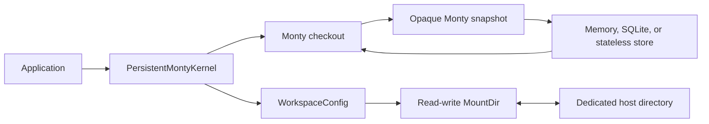
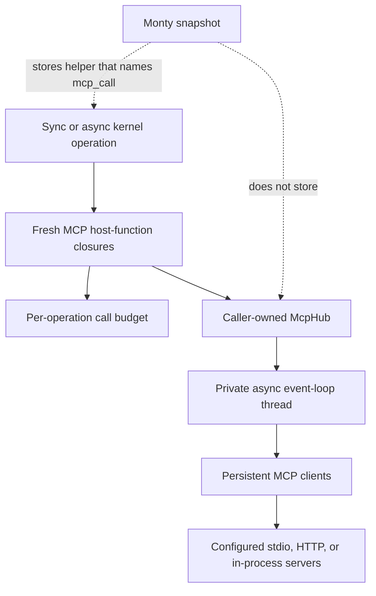
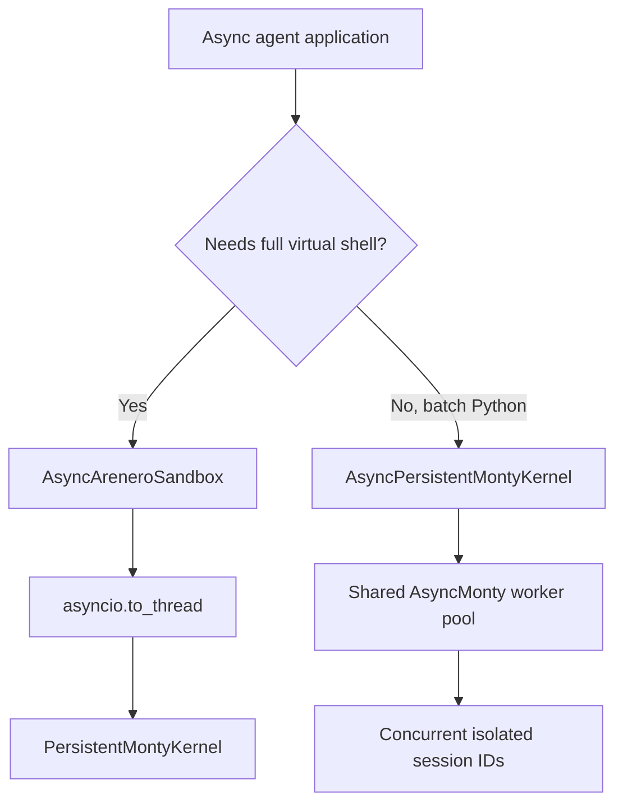

# Arenero design decisions

The interpreter state and file state have separate persistence paths:

SQLite stores interpreter snapshots and session metadata. Workspace files use a
Monty mount and remain outside SQLite.

## Persistent workspaces use Monty mounts

`WorkspaceConfig` creates one kernel-owned, read-write `MountDir`. Files go to a
dedicated host directory and appear at `/workspace` by default. SQLite continues
to store only Monty session snapshots.

This design uses Monty's existing path confinement and avoids a second virtual
filesystem implementation. The kernel opens and closes the mount. A new shell
session starts in the workspace.

## LangChain is optional

The core package does not import LangChain. The public
`create_python_repl_tools()` function loads the integration only when called and
reports how to install the `langchain` extra when it is missing.

This keeps the REPL, kernel, shell, and sandbox usable in small applications.

## MCP clients are optional and stay on the host

The core package does not import the MCP SDK. Applications import
`arenero.mcp` only when they install the `mcp` extra.

`McpHub` owns a private async event-loop thread so each client has one stable
event loop for its complete lifetime. The sync kernel waits for calls on that
loop. The native async kernel wraps the same submitted future and awaits it
without blocking its caller event loop. Monty receives only five plain host
functions. It never receives a client, transport, credential, or async object.

The kernel asks the hub for a fresh function set for each outer operation. This
makes `max_calls_per_operation` cover direct code, an executed virtual file, and
follow-up code as one operation. It also lets restored Monty functions resolve
the newly attached `mcp_call` host function after a process restart.

Server configuration is caller-owned. The model can discover and call configured
tools, but it cannot select a process command, endpoint, environment, header, or
allowlist. Automatic transport retry is off because an uncertain failed reply can
hide a completed side effect.

## Type checking is explicit

`KernelConfig.type_check` is off by default. When enabled, Monty checks each user
feed before execution. Arenero supplies declarations for its `fs_*` helpers. The
application supplies declarations for hosted functions through
`type_check_stubs`.

Generated filesystem support code skips checking. User code and virtual Python
files do not skip it.

## Cell results add common fields without removing detailed fields

Python and shell cells keep their earlier mode-specific fields. Both modes also
return common output, error, truncation, retry, state, exit-code, and output-file
fields. Adapters can use the common fields while existing callers keep the
detailed data.

## Output offloading is caller-selected

Arenero writes a larger bounded result only when output is trimmed and the caller
supplies an absolute `output_file` path. Python output uses JSON. Shell output uses
UTF-8 text. Existing stream, result, shell, and file-transfer hard limits still
apply.

Arenero does not choose hidden output paths or create unrequested files.

## Session administration does not expose snapshots

`list_sessions()` and `get_session_info()` return identifiers, versions,
revisions, timestamps, and byte sizes. They do not return Monty's opaque snapshot
bytes. Raw snapshots remain an internal persistence detail.

## Two async paths have separate purposes

`AsyncAreneroSandbox` uses `asyncio.to_thread()` around `AreneroSandbox`. It does
not create a second pool or a second state model. Use it when an async application
needs the complete virtual shell and sandbox facade with the sync kernel.

`AsyncPersistentMontyKernel` uses Monty's native async pool. It is for batches of
agents that have separate persistent session IDs. A per-session `asyncio.Lock`
keeps one session ordered. The Monty pool runs different sessions at the same
time and supplies checkout backpressure. The session store remains synchronous,
so the async kernel moves its short store calls to worker threads.

The native async LangChain adapter stays small. It exposes Python execution,
Python-file execution, and reset. It does not duplicate the virtual shell or all
host-side filesystem tools. Monty code can use the existing `fs_*` helpers. This
keeps one shell implementation and makes the smaller tool scope explicit. The
native kernel also omits host upload, download, session listing, and output-file
offloading methods. The full sync facade remains the one complete sandbox API.

## Shared-file locking is process-local

A kernel with a shared filesystem serializes filesystem-capable executions across
its sessions. Virtual shell command lists and facade edits hold the same reentrant
lock for their full read-modify-write operation.

The lock cannot coordinate two application processes. Applications that mount the
same host directory in separate processes must supply external coordination.

## Monty compatibility is a tested range

The package currently accepts `pydantic-monty>=0.0.21,<0.0.22`. Monty is
experimental, and session snapshots are version-specific. A new Monty release
must pass the unit tests, static type check, clean build, and clean core install
before the dependency range changes.

## Related references

- [Architecture and components](architecture.md)
- [Usage and capabilities](usage-and-capabilities.md)
- [Virtual shell reference](virtual-shell.md)
- [Sandbox compatibility](sandbox-compatibility.md)
- [MCP tools inside the REPL](mcp.md)
