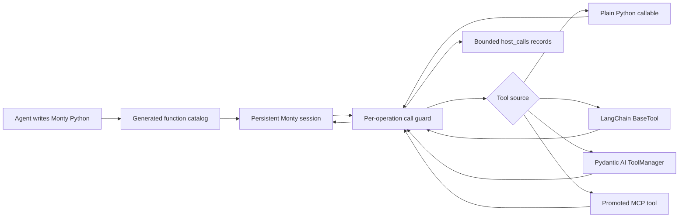

# Hosted tools and code-mode composition

Arenero can expose approved host tools as normal-looking functions inside the
Monty REPL. This lets an agent use Python for progressive discovery, loops,
filtering, and composition while each real tool call still goes through its
normal host framework.

This feature does not put framework objects inside Monty. Arenero exposes a
small schema, a Python name, and a guarded host callback for each selected tool.



## Plain Python tools

Use annotated functions for the smallest setup:

```python
from arenero import HostedToolConfig, HostedToolSet, PersistentMontyKernel


def lookup_price(product_id: str) -> float:
    """Return the current product price."""

    return 12.5


hosted = HostedToolSet.from_callables(
    [lookup_price],
    config=HostedToolConfig(max_calls_per_operation=20),
)

with PersistentMontyKernel(hosted_tools=hosted) as kernel:
    result = kernel.execute(
        "agent-1",
        'price = lookup_price(product_id="sku-1")\nprice * 3',
    )
```

`HostedTool.from_callable()` derives a small JSON Schema from common Python type
annotations. Use `HostedTool(...)` directly when another system already supplies
JSON Schema or when the tool needs a different Python alias.

All calls use keyword arguments. Tool and schema rules are:

- The external tool name can contain punctuation. Arenero creates a stable
  Python-safe alias, such as `crm.lookup` to `crm_lookup`.
- An explicit `python_name` must be a valid non-keyword Python identifier.
- Every input property must also be a valid Python identifier because it becomes
  a keyword argument.
- Input Schema must describe an object.
- Missing or unsupported schema types become `Any` in the generated catalog.
- Missing return schemas are allowed and are shown in `schema_warnings`.
- Arguments and results must cross Monty's host-function value boundary.
  Arenero converts mappings, lists, tuples, dataclasses, and Pydantic models to
  plain values when possible.

## Catalog and tool selection

`kernel.capabilities()["hosted_tools"]` reports the active aliases, schemas,
limits, warnings, and call style. `kernel.instructions()` includes the same live
report for a model.

```python
print(hosted.catalog(async_mode=False))
```

Example output:

```python
def lookup_price(*, product_id: str) -> float: ...
```

Use `HostedToolSet.select()` to choose tools by exact external names or simple
metadata values. Tools marked as `kind="code-execution"` are excluded by
default, and control tools are always excluded. This prevents a REPL from
recursively calling another code-execution tool or an agent-loop control tool.
Set `include_code_execution=True` only for a deliberate nested execution design.

An operation can add a temporary tool set:

```python
result = kernel.execute(
    "agent-1",
    "lookup_price(product_id='sku-1')",
    hosted_tools=request_tools,
)
```

Operation tools are reattached for that call only. A Python helper that refers
to one can remain in the session, but a later call must attach that tool again.
Host callbacks and credentials are never stored in the Monty snapshot.

## Call limits and records

`HostedToolConfig` applies to the combined configured, operation, and promoted
MCP tool set. When sets have different limits, Arenero uses the lowest limits.

| Setting | Meaning |
| --- | --- |
| `max_calls_per_operation` | Calls that can start in one `execute` or `execute_file` operation. |
| `max_total_call_seconds` | Wall-time window in which hosted calls can start. The async bridge also cancels a wait at this deadline. |
| `max_parallel_calls` | Maximum overlapping async hosted calls in one operation. |
| `max_recorded_calls` | Maximum records returned in `host_calls.items`. The exact count is still returned. |
| `preview_chars` | Maximum size of each optional argument, result, or error preview. |
| `include_value_previews` | Add bounded previews. The default is `False`. |

The sync bridge cannot stop a synchronous host function after it starts. The
host function must enforce its own I/O timeout. The async bridge uses the
remaining operation deadline with `asyncio.wait_for()`.

Every execution result includes a bounded ledger:

```python
{
    "host_calls": {
        "count": 1,
        "items": [
            {
                "call_id": "...__host_1",
                "tool": "lookup_price",
                "python_name": "lookup_price",
                "status": "success",
                "duration_seconds": 0.01,
                "may_have_side_effects": False,
            }
        ],
        "truncated": False,
    }
}
```

If a tool raises, the record uses `status="error"` and
`may_have_side_effects=True`. Arenero cannot know if the host completed a side
effect before the error. Do not retry non-idempotent tools without an application
request ID or another deduplication method.

Call-limit errors use stable codes such as `hosted_tool_call_limit`, a hint, and
a `recovery` action. External side effects are not rolled back by
`state_policy`.

## Sync and async rules

The synchronous kernel accepts only tools with a synchronous `invoke` callback.
An async-only tool returns `hosted_tool_configuration_error` with a hint to use
the native async kernel. It does not escape as an application exception.
The native async kernel exposes every hosted function as awaitable:

```python
result = await kernel.execute(
    "agent-1",
    "value = await lookup_price(product_id='sku-1')\nvalue",
)
```

An async kernel runs a sync-only tool with `asyncio.to_thread()`. A tool marked
`sequential=True` does not overlap other hosted calls in the same operation.
Other tools share the `max_parallel_calls` limit. Normal Monty code often awaits
one call at a time, so this rule is most visible in code that starts overlapping
awaitables.

## LangChain and LangGraph

Pass ordinary LangChain `BaseTool` objects to the REPL factory:

```python
from langchain_core.tools import tool

from arenero import create_python_repl_tools


@tool
def multiply(a: int, b: int) -> int:
    """Multiply two integers."""

    return a * b


tools = create_python_repl_tools(kernel, hosted_tools=(multiply,))
```

The adapter calls the public `BaseTool.invoke()` or `BaseTool.ainvoke()` method.
LangChain validation, callbacks, tags, and the current Runnable configuration
therefore stay in the tool's public call path. The factory rebuilds operation
wrappers for each REPL call. It injects the active `ToolRuntime`, state fields,
store, context, stream writer, configuration, and a synthetic child tool-call ID
when the tool declares them.

The nested call does not pass through the parent ToolNode. Parent middleware that
wraps tool dispatch, including per-tool approval or `interrupt_on`, does not run
for the nested call. Approve the outer REPL tool, enforce approval inside the
called tool or subagent, or do not select that tool. A nested LangGraph `Command`
is not applied to parent state. The Deep Agents task bridge returns the final
subagent message text instead.

For a complete async agent setup, state modes, dynamic prompts, and checkpoint
rules, see [Deep Agents interpreter middleware](deepagents.md).

Use `adapt_langchain_tools()` when an application wants a `HostedToolSet`
directly. Metadata can set `python_name`, `sequential`, `output_schema`, or mark a
tool as code execution.

## Pydantic AI

Pydantic AI tools need the current `RunContext`, so adaptation is async and
operation-scoped:

```python
from arenero import adapt_pydantic_ai_tools

hosted = await adapt_pydantic_ai_tools(toolset, ctx)
result = await kernel.execute(
    session_id,
    "await lookup_customer(customer_id='cus_1')",
    hosted_tools=hosted,
)
```

The adapter uses the current `ToolManager`. It keeps Pydantic AI validation,
availability checks, approval decisions, retries, and wrapper hooks. A denied
tool becomes a host-call error. Do not keep this `HostedToolSet` after its agent
run ends because it holds the run context.

## MCP promotion

MCP keeps progressive discovery. The model first searches and describes a tool,
then promotes only the tool it wants:

```python
mcp_promote("crm__find_customer", python_name="find_customer")
```

The result contains sync and async declarations. The alias is available on the
next kernel operation:

```python
customer = find_customer(email="person@example.com")
```

The promoted function still uses the MCP client's validation, limits, result
envelope, and connection. Promotion is process memory; it is not in SQLite. The
application must recreate promotions after a process restart.

Arenero does not predeclare every MCP schema. That would load the full catalog
and defeat progressive discovery. In an existing type-checked session, call a
new promoted alias with `restart=True`, or use a fresh or forked session.

## Type-check and restart limitation

Monty stores type-check state inside a session snapshot. A restored snapshot
cannot always learn a new function name that was not declared when that session
started. Configured tools are stable and do not have this problem. Promoted MCP
tools and operation tools are dynamic.

For a newly added operation tool in an existing type-checked session, use the
atomic restart form if Monty reports an unresolved reference:

```python
result = kernel.execute(
    "agent-1",
    "new_tool(value=1)",
    hosted_tools=new_tools,
    restart=True,
)
```

Restart deletes the old Python snapshot under the same session lock and then
runs bootstrap and user code. It does not delete shared files. If preserving the
old Python state matters, configure the tool on the kernel before the session
starts or fork the session before the experiment.

## Observability

Use a normal callback for process-local events or the optional OpenTelemetry
adapter:

```python
from arenero import OpenTelemetryEventSink, PersistentMontyKernel

kernel = PersistentMontyKernel(event_sink=OpenTelemetryEventSink())
```

The sink adds safe event metadata to the active span. If there is no active
recording span, it creates a short span. Install `arenero[observability]` for the
OpenTelemetry API. Arenero does not install an SDK, exporter, or collector.

Events and default call records omit arguments and results. Enable previews only
when the application accepts the data exposure risk.

## What this feature does not do

- It does not add ambient host access, package imports, sockets, or subprocesses.
- It does not make a broad or dangerous host tool safe.
- It does not store host functions, framework contexts, or credentials in a
  session snapshot.
- It does not make tool calls transactional or automatically idempotent.
- It does not interrupt a blocking synchronous function.
- It does not support positional hosted-tool arguments.
- It does not expose control tools. It exposes code-execution tools only through
  an explicit selection.
- It does not run parent ToolNode middleware for a programmatic nested call.
- It does not merge a nested tool's `Command.update` into parent graph state.
- It does not make every JSON Schema feature a precise Monty type. Unsupported
  schema details become `Any`.
