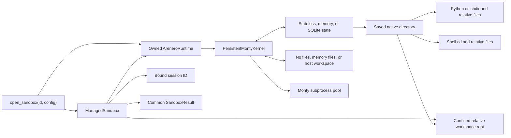
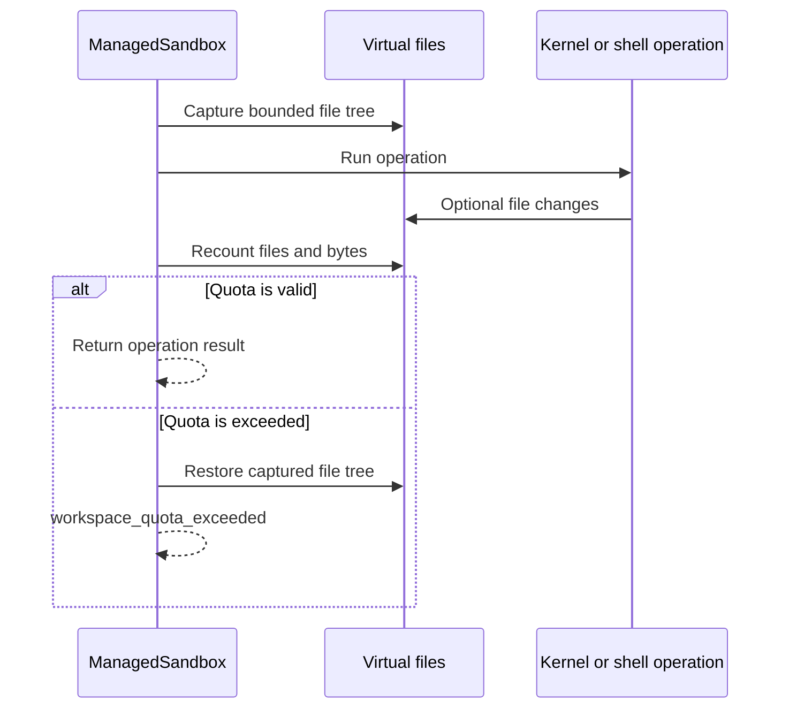
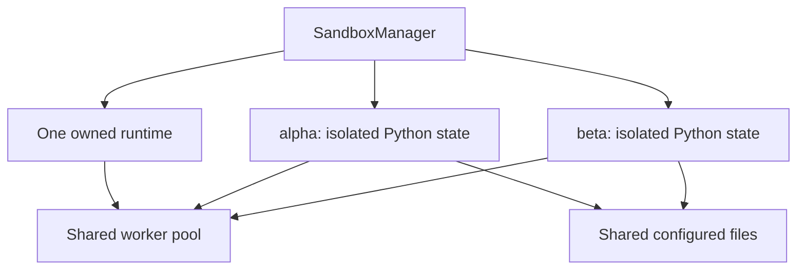

# Managed sandbox API

The managed API is the shortest path from an application to a ready Arenero
sandbox. It selects the state store, filesystem, network policy, worker pool,
runtime owner, bound session, relative workspace, quotas, and agent tools.

Use the lower-level kernel and facade APIs when an application must assemble
these parts itself. Existing low-level APIs remain supported.

## Start with one sandbox

```python
from arenero import open_sandbox

with open_sandbox("agent-1") as sandbox:
    sandbox.run_python("values = [2, 4, 8]")
    result = sandbox.run_python("sum(values)")
    assert result.value == 14

    sandbox.write("notes/result.txt", "14")
    assert sandbox.run_shell("cat notes/result.txt").value == "14"
```

`open_sandbox()` owns all resources that it creates. The context manager closes
its worker pool and optional MCP hub. The default `conversation` preset keeps
Python state and files until that owned runtime closes.



## Presets

`SandboxConfig` has four constructors. All limits can still be set on the
returned configuration.

| Preset | Python state | Files | Main use |
| --- | --- | --- | --- |
| `ephemeral()` | Discarded after each call | Memory for the runtime lifetime | Independent calculations with shared scratch files |
| `conversation()` | Memory for the runtime lifetime | Memory for the runtime lifetime | One agent across several human turns |
| `durable(directory)` | SQLite | Mounted host directory | State and files across process restarts |
| `batch(workers=N)` | Memory | None by default | Concurrent Python-only agents with separate session IDs |

Examples:

```python
from arenero import SandboxConfig, open_sandbox

config = SandboxConfig.conversation(
    max_workspace_files=250,
    max_workspace_bytes=5_000_000,
    network="off",
)

with open_sandbox("private-agent", config=config) as sandbox:
    ...
```

```python
config = SandboxConfig.durable(".arenero/team")
with open_sandbox("thread-42", config=config) as sandbox:
    ...
```

The durable directory contains `sessions.db` and a `workspace` directory.
SQLite stores opaque Monty snapshots only. It does not store files.

### Custom configuration fields

| Field | Values | Effect |
| --- | --- | --- |
| `persistence` | `stateless`, `memory`, `durable` | Selects the Python snapshot store. |
| `filesystem` | `none`, `memory`, `workspace` | Selects virtual file access. |
| `directory` | Host path or `None` | Required for durable state or a mounted workspace. |
| `workspace_root` | Normalized absolute virtual path | Confines managed relative paths. Default: `/workspace`. |
| `network` | `public`, `off`, or `NetworkConfig` | Controls virtual `curl`. Public bounded access is the default. |
| `kernel` | `KernelConfig` | Sets execution, state, output, shell, worker, and TTL limits. |
| `filesystem_limits` | `FilesystemConfig` | Sets per-operation file and scan limits. |
| `bootstrap_code` | Trusted source or `None` | Runs once when each new Python session starts. |
| `bootstrap_files` | Absolute virtual paths | Runs existing workspace files once for each new session. |
| `mcp_artifact_directory` | Absolute virtual path or `None` | Writes supported final MCP binary blocks to this directory. |
| `max_workspace_files` | Positive integer | Sets the managed total regular-file quota. |
| `max_workspace_bytes` | Positive integer | Sets the managed total file-byte quota. |
| `max_active_sandboxes` | Positive integer | Bounds handles opened by one manager. |

The batch preset uses `filesystem="none"` so separate Python sessions can use
the worker pool at the same time. Set `filesystem="memory"` if agents must share
files. Filesystem-capable operations are then serialized by the shared kernel.

`filesystem="none"` is for Python-only use. File, package, shell-file, tree, and
checkpoint-file operations cannot work without a filesystem.

## One common result

Managed operations return `SandboxResult`:

```python
result = sandbox.run_python("1 / 0")
assert not result.ok
print(result.error.code)
print(result.error.hint)
print(result.stats)
```

The fields are:

- `ok`, `value`, `stdout`, `stderr`, and optional `exit_code`;
- a stable `SandboxError` with `code`, `message`, `hint`, and `retryable`;
- `truncated`, virtual `artifacts`, and operation or execution `stats`.

Call `to_dict()` at an agent boundary. It uses the same JSON converter as kernel
output. Binary values become this explicit record:

```json
{"encoding": "base64", "content": "..."}
```

`run_python()` values are already normalized by the kernel: bytes use Base64
records, complex values use `{"type": "complex", "real": 1.0, "imag": 2.0}`,
dates use ISO text, and Monty instances use copied attributes without methods.
File methods such as `read(path, encoding=None)` keep raw bytes in `result.value`;
only `to_dict()` encodes those bytes. See
[result handling](usage-and-capabilities.md#result-handling) for the full contract.

## Explicit execution methods

| Method | Purpose |
| --- | --- |
| `run_python(code, inputs=None)` | Bind plain host values and run one Monty feed with bound Python state. |
| `run_shell(command)` | Run the allowlisted virtual shell in the current directory. |
| `run_cell(code)` | Dispatch Python, `!command`, `%%shell`, or a supported `%` command. |
| `run_file(path, code=None)` | Run one virtual Python file and optional follow-up code. |
| `run_module(path, code=None)` | Resolve and run one bounded static module graph. |

These names make the runtime boundary clear. `run_shell()` is not a host shell.
It cannot start processes, call arbitrary binaries, run Git, install packages,
or run full Bash scripts. It can run the documented straight-line virtual shell
files with `source`. See [Virtual shell reference](virtual-shell.md).

`run_cell()` supports `%run FILE`, `%reset`, `%limits`, `%sessions`, `%mcp`,
`%who`, and `%whos`.
Managed `%run` resolves relative paths from the current directory.
Inspection commands return saved names or name/type mappings without a state
save. `inputs=` is available on `run_python()`, not `run_cell()` or the agent tool
schema. With type checking, declare input names in the configured stubs.

## Relative files and revisions

Managed file methods accept paths relative to `sandbox.cwd` or absolute paths
below `sandbox.root`:

```python
sandbox.mkdir("project")
sandbox.chdir("project")
created = sandbox.write("helper.py", "value = 42\n")

current = sandbox.read("helper.py")
sandbox.edit(
    "helper.py",
    "42",
    "43",
    expected_revision=current.stats["revision"],
)
```

There is one native directory, not a separate handle-level path base.
`sandbox.chdir()`, Python `os.chdir()`, and shell `cd` change that directory.
`sandbox.cwd` is a read-only property that reads the last saved directory without
model output trimming. `run_shell()` does not insert a hidden `cd` command.

New file-enabled managed sessions start at `sandbox.root`, before bootstrap.
`filesystem="none"` starts at `/`. State policies also apply to the directory:
`never` and a failed `success` operation do not save its changes. Forks and
checkpoints copy the saved directory; reset returns new calls to the initial
root. Stateless calls always start at that root, so a separate `chdir()` call
does not carry into the next call. Use absolute paths or change directory and do
the work in one Python/shell call in that mode.

Managed file paths remain confined below `sandbox.root`. Direct Python and shell
operations can reach any other configured virtual paths. If Python moves
outside the managed root, relative managed file methods reject that path. Use an
absolute managed path or `sandbox.chdir(sandbox.root)` to return. No change
affects the host process directory.

Earlier same-version managed snapshots can still contain `/` because the old
handle-level path base was not saved in Monty. Call
`sandbox.chdir(sandbox.root)` once if needed. Checkpoint `cwd` metadata is an
informational copy; the restored Monty snapshot is now the authority.

The complete high-level file surface is:

- `read`, `write`, `edit`, `mkdir`, `delete`, `copy`, and `move`;
- `ls`, `glob`, `grep`, `exists`, and `stat`;
- `upload_tree`, `download_tree`, `export_tree`, and `import_tree`.

`read()` returns a SHA-256 revision. `write()` and `edit()` can reject stale
content with `file_revision_conflict`. This is an application edit guard. It is
not a cross-process transaction.

`grep()` is literal and UTF-8 only. `glob()` follows Arenero's bounded virtual
glob rules. Tree imports accept safe regular ZIP entries only. Absolute paths
and `..` entries are rejected. Tree uploads reject symbolic links. Host tree
transfer is an application-side operation and must use trusted host paths.

## Workspace quotas

The managed total quotas supplement existing per-call file limits. Direct
writes and tree imports are checked before mutation. Python, virtual shell, and
package operations are checked after the operation while Arenero holds its
in-process filesystem lock.



Important limits:

- The rollback covers managed workspace files only.
- It does not roll back Python state, MCP calls, network requests, or other host
  function side effects. The error hint states this limitation.
- The lock coordinates sessions in one kernel. It does not coordinate two
  processes that mount the same host directory.
- Capturing a tree is intentionally bounded by `max_scan_entries`,
  `max_workspace_files`, `max_workspace_bytes`, depth, and transfer limits.
- Large workspaces make pre- and post-execution quota checks more expensive.

Setup and quota scans use short isolated file checkouts. They do not run session
bootstrap, save session state, or use trimmed model output. Lowering an output
limit cannot hide files from a quota check.

Use a dedicated workspace directory for each independent trust domain.

## Portable checkpoints

`checkpoint()` returns one ZIP with:

- `metadata.json` for format, Monty version, policy digest, root, current
  directory, and state presence;
- `state.bin` when the current store has saved Python state;
- `files/` with the bounded managed workspace tree.

`restore()` replaces both Python state and managed files. It first validates the
format, exact Monty version, workspace root, active execution policy, file
count, total bytes, and archive paths. If the local replacement fails, it tries
to restore the old local state and files.

```python
checkpoint = sandbox.checkpoint().value
sandbox.run_python("answer = 0")
sandbox.restore(checkpoint)
```

The policy digest permits movement between memory and durable storage because
storage location is not an execution capability. It rejects a change to the
network, kernel limits, file limits, workspace root, workspace availability,
managed quotas, bootstrap, hosted-tool catalog and limits, or MCP availability
and limits. The current dynamic MCP server list is not part of the policy digest
because it belongs to the shared hub and is not part of the checkpoint. Approved
`external_lookup` names must also match. It stores safe
capability metadata, not tool values, credentials, or connections.

Checkpoints contain opaque Monty snapshots. Do not restore an untrusted
checkpoint into a worker that you cannot discard. Snapshots are exact-version
data, not a long-term language-neutral format. Checkpoints can also contain
sensitive file and state data, so applications must protect them.

## Several sandboxes

Use `SandboxManager` or `open_sandbox_manager()` when several session IDs must
share one runtime and worker pool:

```python
from arenero import SandboxConfig, open_sandbox_manager

with open_sandbox_manager(SandboxConfig.batch(workers=4)) as manager:
    alpha = manager.open("alpha")
    beta = manager.open("beta")
    alpha.run_python("private = 1")
    beta.run_python("private = 2")
```



Python state is isolated by session ID. Files are shared by design. This lets
agents exchange artifacts. Use separate managers and workspaces when agents
must not share files.

The manager supplies `open()`, `list()`, `delete()`, and `cleanup_expired()`.
`delete()` removes Python state, not shared files. `max_active_sandboxes` bounds
opened handles. Cleanup removes only handles whose saved state expired; a new
open handle with no snapshot stays open.

`ManagedSandbox.fork(new_id)` copies the current opaque Python snapshot and
returns a child handle in `result.value`. The child shares files and the runtime.
It does not outlive a parent-owned runtime. Native directory, RNG, and resource
settings are also copied. The next feed starts a new duration clock.

## Async applications

`open_async_sandbox()` and `open_async_sandbox_manager()` provide the complete
managed surface without blocking the event loop:

```python
import asyncio

from arenero import SandboxConfig, open_async_sandbox_manager


async def main() -> None:
    config = SandboxConfig.batch(2, filesystem="memory")
    async with open_async_sandbox_manager(config) as manager:
        first, second = await asyncio.gather(
            manager.open("first"),
            manager.open("second"),
        )
        results = await asyncio.gather(
            first.run_python("40 + 2"),
            second.run_python("20 + 2"),
        )
        file_result = await first.call("write", "shared.txt", "ready")


asyncio.run(main())
```

The async managed API uses `asyncio.to_thread()` over the synchronous managed
API. The synchronous kernel already runs Monty code in its subprocess pool.
The default `SandboxConfig.batch()` preset gives distinct Python-only sessions
enough workers for real overlap.
Use `run_python()`, `run_shell()`, and `run_cell()` directly. Use
`call(method, ...)` for all other managed methods.

When a batch uses a shared virtual filesystem, Arenero serializes
filesystem-capable calls to keep the Monty filesystem handler safe. This includes
Python calls because they can call `fs_*` helpers. Use Python-only batch mode for
overlap, or separate managers and workspaces for concurrent file workloads.

This is full managed feature parity, not Monty's native async interpreter path.
Use `AsyncPersistentMontyKernel` when native async hosted functions are more
important than the complete managed file, shell, package, and checkpoint API.

## Agent tool bundle

Install the `langchain` extra, then create the tools and matching instructions in
one call:

```python
bundle = sandbox.agent_bundle()
tools = bundle.tools
instructions = bundle.instructions
```

Select only needed groups:

```python
bundle = sandbox.agent_bundle({"python", "files"})
```

When `filesystem="none"`, the default bundle contains only `python_repl`.
Explicitly requesting a file, shell, or package group returns a configuration
error instead of giving the model a tool that cannot work.

| Group | Tools |
| --- | --- |
| `python` | `python_repl` |
| `shell` | `execute` |
| `files` | `read_file`, `write_file`, `edit_file`, `delete_file`, `list_files`, `glob_files`, `grep_files` |
| `packages` | `package_init`, `package_check`, `package_test`, `package_export` |

`langchain_tools()` and `instructions()` remain available as separate methods.
Every tool is fixed to the handle's session and workspace. The model does not
supply a session ID. Every tool returns `SandboxResult.to_dict()`. The `execute`
description states that it is a limited virtual shell. Package paths can be
relative and package limits cannot exceed managed workspace limits.

Give `sandbox.instructions()` to the model. It includes the exact active kernel
limits, commands, network and MCP policy, session ID, current directory,
workspace quotas, separate state and file lifecycles, and shared-file fork rule.

## What works and what does not

Works:

```python
sandbox.run_python("items = [1, 2, 3]")
sandbox.run_python("sum(items)")
sandbox.run_shell("grep -n two notes.txt | head -n 5")
sandbox.run_file("helper.py", code="helper_result")
sandbox.run_module("app/main.py")
sandbox.package_init("smalllib")
```

Does not work:

```python
sandbox.run_python("import requests")  # No third-party packages.
sandbox.run_python("compile('1 + 1', '<cell>', 'eval')")  # No code-object compiler.
sandbox.run_shell("python -m helper")  # No normal module runner.
sandbox.run_shell("pip install requests")  # No package installer.
sandbox.read("../../secret")  # Managed paths cannot escape.
```

The managed layer improves setup and lifecycle safety. It does not change
Monty's language, import, runtime, host-boundary, or security constraints. Read
the [upstream version review](monty-updates.md) before applying newer Monty
features to this API. Read
[Usage and capabilities](usage-and-capabilities.md) and
[Sandbox compatibility](sandbox-compatibility.md) before production use.

## Production checklist

1. Choose a preset from the required state and file lifetime.
2. Set `KernelConfig`, `FilesystemConfig`, workspace quotas, and manager count
   limits for the workload.
3. Narrow public network access with `NetworkConfig` when possible.
4. Give each trust domain a dedicated manager and durable directory.
5. Expose only agent tool groups that the agent needs.
6. Give generated `instructions()` to the model.
7. Treat host functions, MCP calls, host tree paths, and checkpoints as trusted
   application configuration boundaries.
8. Close every owned sandbox or manager with a context manager.
9. Run real Monty integration tests for required syntax and limits.
10. Use a container, VM, or managed CPython sandbox when this documented surface
    is too small.
