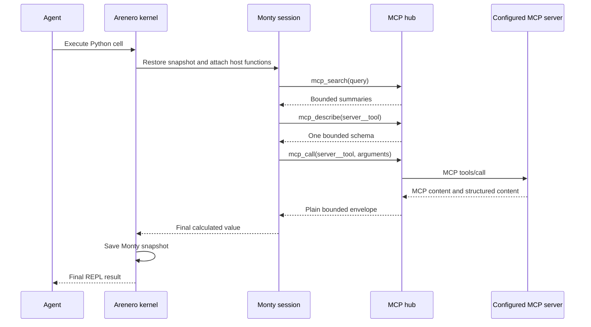
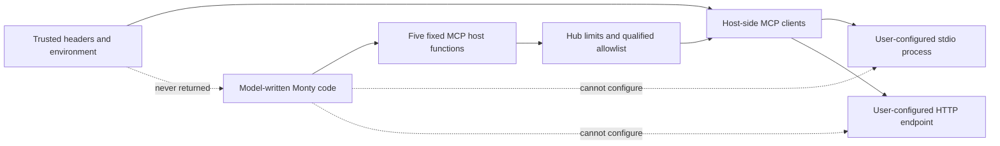

# MCP tools inside the Arenero REPL

Arenero can connect user-configured MCP servers to Monty as an optional feature.
This lets model-written Python discover and call tools without putting every tool
schema or intermediate result in the model context.

Install the optional client:

```console
uv add "arenero[mcp]"
```

The bridge uses the MCP Python SDK 2.x. It supports configured `stdio`, Streamable
HTTP, and in-process servers. SSE is not part of this API.

## Basic setup

This example starts one trusted local server process:

```python
import sys

from arenero import PersistentMontyKernel
from arenero.mcp import McpHub, McpServerConfig

server = McpServerConfig.stdio(
    "local",
    sys.executable,
    args=["server.py"],
)

with (
    McpHub([server]) as mcp,
    PersistentMontyKernel(mcp_hub=mcp) as kernel,
):
    result = kernel.execute(
        "agent-thread-1",
        """tools = mcp_search("weather")
tool_name = tools["tools"][0]["name"]
schema = mcp_describe(tool_name)
mcp_call(tool_name, {"city": "Asuncion"})
""",
    )
```

For a remote server, keep its URL and credentials in trusted host configuration:

```python
from arenero.mcp import McpServerConfig

server = McpServerConfig.http(
    "crm",
    "https://mcp.example.com/mcp",
    headers={"Authorization": "Bearer HOST_SECRET"},
)
```

Headers never enter Monty or MCP discovery results. Do not put the token in a
prompt, REPL variable, or virtual file.

### Native async kernel

The same hub works with `AsyncPersistentMontyKernel`. MCP functions are awaitable
in this mode:

```python
from arenero import AsyncPersistentMontyKernel


async def call_tool() -> dict:
    with McpHub([server]) as mcp:
        async with AsyncPersistentMontyKernel(mcp_hub=mcp) as kernel:
            return await kernel.execute(
                "agent-thread-1",
                "response = await mcp_call('local__add', {'a': 20, 'b': 22})\n"
                "response['value']",
            )
```

Use `await` with all five MCP functions in the native async kernel. The hub keeps
its clients on one private event loop and the kernel awaits submitted calls. One
slow MCP call therefore does not block other async kernel sessions. Hub limits,
allowlists, result envelopes, and per-operation budgets are the same in both
modes.

## REPL functions

| Function | Result | Use |
| --- | --- | --- |
| `mcp_servers()` | Server status and tool counts | Check which configured servers connected. |
| `mcp_search(query, server=None, limit=20)` | Small ranked tool summaries | Discover only relevant tools. An empty query lists tools. |
| `mcp_describe(name)` | One bounded input schema | Read exact arguments before a call. |
| `mcp_call(name, arguments=None)` | Bounded result envelope | Call one tool from Python. |
| `mcp_refresh(server=None)` | Updated server and catalog status | Reconnect and reload tool lists. |

Search returns qualified names such as `crm__find_customer`. A short tool name
also works when it is unique. Arenero rejects an ambiguous short name and returns
the matching qualified names.

The LangChain and LangGraph `python_repl` description includes the correct sync
or async forms when its kernel has an MCP hub. Other agent adapters can give
`mcp.instructions` or `mcp.async_instructions` to the model.

## Progressive discovery and composition

Do not load all schemas into the model prompt. Search, describe one selected
tool, and then call it:

```python
matches = mcp_search("open support tickets", server="support", limit=5)
selected = matches["tools"][0]["name"]
details = mcp_describe(selected)
result = mcp_call(selected, {"customer_id": "cus_123"})
```

Monty code can keep intermediate data inside one cell:

```python
customers = mcp_call("crm__list_customers", {"status": "active"})
ids = [item["id"] for item in customers["value"]]
scores = []
for customer_id in ids[:10]:
    score = mcp_call("risk__score_customer", {"id": customer_id})
    if score["ok"]:
        scores.append(score["value"])
scores
```

Calls in the sync kernel run in order. Native async code must await each call and
can use Monty async composition. There is no `mcp_call_many` operation in this
version. The per-operation call limit prevents an unbounded loop.

## Persistent helpers and skills

A Monty function that uses `mcp_call` remains in the session snapshot:

```python
def customer_summary(customer_id):
    customer = mcp_call("crm__get_customer", {"id": customer_id})
    tickets = mcp_call("support__list_tickets", {"customer_id": customer_id})
    return {"customer": customer["value"], "tickets": tickets["value"]}
```

A later human turn can call `customer_summary(...)` with the same `session_id`.
Arenero reattaches fresh MCP host functions when it restores the Monty snapshot.

The agent can also write the helper to a virtual `.py` file and load it with
`execute_file()`. This is a small skill-building pattern, but it is not a package
or module system. There is no dynamic import, `eval`, or `exec` inside Monty.

Live MCP connections are not in the snapshot. Keep the `McpHub` active for later
turns. After an application restart, create a new hub with the same configured
servers. SQLite can restore the Monty helper, and the new hub supplies the live
tool connection.



## Result envelope

`mcp_call` always returns a plain dictionary:

```python
{
    "ok": True,
    "server": "crm",
    "tool": "crm__get_customer",
    "value": {"id": "cus_123"},
    "content": [{"type": "text", "text": "..."}],
    "blobs": [],
    "error": None,
    "truncated": False,
}
```

`value` contains MCP structured content when the server supplies it. `content`
contains MCP content blocks. `blobs` describes image and audio blocks without
copying their Base64 data a second time. The original Base64 data stays in its
content block when the complete result fits the limit.

If a result is too large, Arenero removes large structured values and binary data
and keeps a small text preview when possible. Always check `truncated`. Arenero
does not yet write an MCP blob to the virtual filesystem automatically.

MCP tool errors use `ok=False` and `error.type="McpToolError"`. Lookup, argument,
limit, timeout, and transport failures also return structured errors. A host wall
timeout can still end the outer REPL operation with a host-function error.

## Limits and allowlists

Use `McpHubConfig` to set hard host limits:

```python
from arenero.mcp import McpHubConfig

config = McpHubConfig(
    connect_timeout_seconds=10,
    call_timeout_seconds=20,
    max_calls_per_operation=12,
    max_total_call_seconds_per_operation=60,
    max_concurrent_calls=4,
    max_argument_bytes=50_000,
    max_result_bytes=500_000,
    max_schema_bytes=50_000,
    max_tools=200,
    max_search_results=20,
    allowed_tools=frozenset({"crm__get_customer", "crm__list_customers"}),
    retry_transport_errors=False,
)
```

The model can request a smaller search result count. It cannot raise a hard
maximum. The call budget is new for every `kernel.execute()` or
`kernel.execute_file()` operation, including all feeds in that operation.
The total call-time limit covers all `mcp_call` waits in that operation. MCP wait
time does not consume Monty's interpreter-duration budget.

Automatic retries are off by default. A connection can fail after a server
completed a side effect but before it returned the reply. An automatic retry
could repeat that side effect. Set `retry_transport_errors=True` only when the
allowed tools are idempotent or handle request deduplication.

## Security boundary

The MCP client and server processes run outside Monty with host authority:



This bridge limits code execution, discovery size, and result transfer. It does
not make an MCP tool safe. A configured tool can read data, send a message,
delete a record, charge money, or run code according to that server's authority.

The application, not the model, must select server commands, URLs, environment,
headers, and tool allowlists. A model-selected `stdio` command would be arbitrary
host process execution. A model-selected URL can create server-side request
forgery and data-exfiltration risks.

Treat tool names, descriptions, schemas, and results as untrusted data. MCP tool
annotations are descriptive hints. Arenero does not use them as policy or as an
approval decision.

## Current limits

- Tools are supported. MCP resources and prompts are not exposed.
- Sampling, roots, elicitation, and multi-round input-required flows are not
  bridged into the active Monty feed.
- The model cannot add, remove, or change configured servers.
- Calls are synchronous. There is no parallel batch call API.
- Catalog data changes only after `mcp_refresh()` or a reconnect.
- Live connections, authentication state, and catalog data do not persist in a
  Monty snapshot or SQLite.
- There is no approval callback, audit sink, result cache, or automatic virtual
  file materialization in this version.
- SSE is not supported. Use Streamable HTTP for remote servers.
- Closing a kernel does not close a shared hub. Close both context managers.

## Related references

- [Architecture and components](architecture.md)
- [Usage and capabilities](usage-and-capabilities.md)
- [Design decisions](design-decisions.md)
- [Sandbox compatibility](sandbox-compatibility.md)
