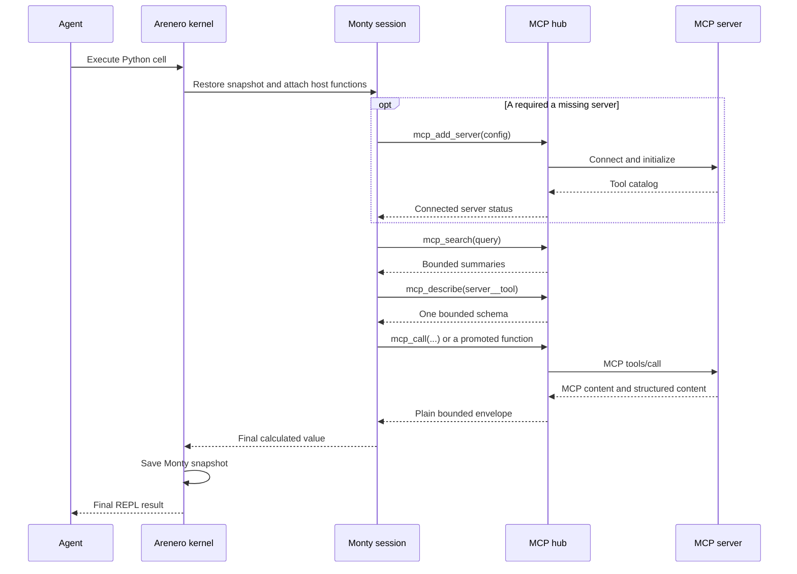
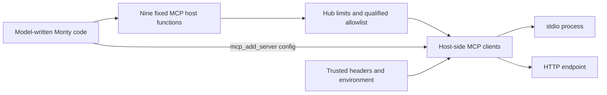

# MCP tools inside the Arenero REPL

Arenero can connect MCP servers to Monty as an optional feature. Servers can be
present when the hub starts, or model-written Python can add, replace, and remove
them while the hub is running. This lets an agent repair a missing tool setup
without changing its LangChain tool schema or losing its persistent REPL state.

Install the optional client:

```console
uv add "arenero[mcp]"
```

The bridge uses the MCP Python SDK 2.x. Host code supports `stdio`, Streamable
HTTP, and in-process servers. Agent-supplied plain configuration supports
`stdio` and Streamable HTTP. SSE is not part of this API.

## Basic setup

This example starts one trusted local server process:

```python
import sys

from arenero import PersistentMontyKernel
from arenero.mcp import McpHub, McpServerConfig

server = McpServerConfig.stdio(
    "local",
    sys.executable,
    args=["server.py"],
)

with (
    McpHub([server]) as mcp,
    PersistentMontyKernel(mcp_hub=mcp) as kernel,
):
    result = kernel.execute(
        "agent-thread-1",
        """tools = mcp_search("weather")
tool_name = tools["tools"][0]["name"]
schema = mcp_describe(tool_name)
mcp_call(tool_name, {"city": "Asuncion"})
""",
    )
```

For a remote server, keep its URL and credentials in trusted host configuration:

```python
from arenero.mcp import McpServerConfig

server = McpServerConfig.http(
    "crm",
    "https://mcp.example.com/mcp",
    headers={"Authorization": "Bearer HOST_SECRET"},
)
```

Headers supplied by host code never enter Monty or MCP discovery results.
Headers supplied through `mcp_add_server()` necessarily pass through Monty and
can appear in model-generated source or application logs.

## Start with an empty hot-loadable hub

Attach an empty hub before the first REPL session. This declares the fixed MCP
host functions in Monty's type-check context even though no server exists yet:

```python
from arenero import PersistentMontyKernel
from arenero.mcp import McpHub

with McpHub() as mcp, PersistentMontyKernel(mcp_hub=mcp) as kernel:
    result = kernel.execute(
        "agent-thread-1",
        """connected = mcp_add_server({
    "name": "late-tools",
    "transport": "stdio",
    "command": "uv",
    "args": ["run", "server.py"],
    "cwd": "/srv/my-agent",
})
answer = mcp_call("late-tools__calculate", {"value": 21})
{"connected": connected["ok"], "answer": answer}
""",
    )
```

The server is ready before `mcp_add_server()` returns, so the same cell can
search, describe, or call it. A failed addition is removed from the registry.
Use the same `McpHub` object for later agent and human turns.

### Native async kernel

The same hub works with `AsyncPersistentMontyKernel`. MCP functions are awaitable
in this mode:

```python
from arenero import AsyncPersistentMontyKernel


async def call_tool() -> dict:
    with McpHub([server]) as mcp:
        async with AsyncPersistentMontyKernel(mcp_hub=mcp) as kernel:
            return await kernel.execute(
                "agent-thread-1",
                "response = await mcp_call('local__add', {'a': 20, 'b': 22})\n"
                "response['value']",
            )
```

Use `await` with all nine MCP functions in the native async kernel. The hub keeps
its clients on one private event loop and the kernel awaits submitted calls. One
slow MCP call therefore does not block other async kernel sessions. Hub limits,
allowlists, result envelopes, and per-operation budgets are the same in both
modes.

## REPL functions

| Function | Result | Use |
| --- | --- | --- |
| `mcp_servers()` | Server status and tool counts | Check which configured servers connected. |
| `mcp_search(query, server=None, limit=20)` | Small ranked tool summaries | Discover only relevant tools. An empty query lists tools. |
| `mcp_describe(name)` | One bounded input schema | Read exact arguments before a call. |
| `mcp_promote(name, python_name=None)` | A direct-call declaration | Add one selected tool as a Python function on the next operation. |
| `mcp_add_server(config)` | Added server status | Connect a new stdio or HTTP server and publish its tools. |
| `mcp_remove_server(name)` | Removal status | Disconnect the server and remove its tools and promotions. |
| `mcp_replace_server(config)` | Replacement status | Reconnect one namespace with new details; restore the old config if the change fails. |
| `mcp_call(name, arguments=None)` | Bounded result envelope | Call one tool from Python. |
| `mcp_refresh(server=None)` | Updated server and catalog status | Reconnect and reload tool lists. |

Search returns qualified names such as `crm__find_customer`. A short tool name
also works when it is unique. Arenero rejects an ambiguous short name and returns
the matching qualified names.

The LangChain and LangGraph `python_repl` description includes the correct sync
or async forms when its kernel has an MCP hub. Other agent adapters can give
`mcp.instructions` or `mcp.async_instructions` to the model.

## Dynamic server configuration

Agent-supplied configuration is a plain dictionary. These are the accepted
forms:

```python
mcp_add_server({
    "name": "local",
    "transport": "stdio",
    "command": "python",
    "args": ["server.py"],
    "env": {"MODE": "agent"},
    "cwd": "/srv/tools",
})

mcp_add_server({
    "name": "remote",
    "transport": "streamable-http",
    "url": "https://example.com/mcp",
    "headers": {"Authorization": "Bearer token"},
})
```

`transport="http"` is a short alias for `"streamable-http"`. Unknown fields,
wrong field types, duplicate names, and the `in-process` transport return a
structured error. In-process servers contain a live Python object, so only host
code can add them:

```python
mcp.add_server(McpServerConfig.in_process("embedded", server_object))
```

Host code can use `add_server()`, `remove_server()`, and `replace_server()`, or
their `async_add_server()`, `async_remove_server()`, and
`async_replace_server()` forms. These methods return the same plain structured
results as the REPL functions.

Replace or remove a server by its stable namespace:

```python
changed = mcp_replace_server({
    "name": "remote",
    "transport": "http",
    "url": "https://new.example.com/mcp",
})
removed = mcp_remove_server("remote")
```

An add that cannot connect leaves no configured server. A failed replacement
tries to reconnect the previous configuration and reports whether it was
restored. Remove, replace, and refresh return `McpServerBusy` when that server
already has an active call. Retry after the call ends.

The hub is shared. A server added by one session is visible to every kernel and
agent session that uses the same hub. Python variables remain isolated by
`session_id`; MCP server configuration does not.

### Stable LangChain and LangGraph interface

Keep `python_repl` as the model's code-action interface. Do not add each MCP tool
to the LangChain tool list:

```python
tools = create_python_repl_tools(kernel)
agent = create_agent(model, tools, checkpointer=checkpointer)
```

The agent calls `mcp_add_server()` and `mcp_call()` inside `python_repl`. The
outer tool names and schemas stay unchanged when the MCP catalog changes, so a
compiled graph and its model binding do not need to be rebuilt.

Generate `kernel.instructions()` again when an application wants an updated
server-status report. A LangChain tool description created earlier still has
the complete dynamic API, but its embedded list of active servers is a snapshot
from tool creation time. `mcp_servers()` is always the current source of truth.

### Promote a selected tool

After discovery, an agent can promote one tool instead of keeping the generic
name-and-dictionary call form:

```python
mcp_promote("crm__find_customer", python_name="find_customer")
```

The result contains the exact sync and async declarations. The new function is
available on the next `execute()` operation:

```python
customer = find_customer(email="person@example.com")
```

The function still returns the normal MCP result envelope and still uses all MCP
limits. Promotion fails when the selected JSON Schema cannot become a valid
keyword-only Python signature. Promoted names live in the host process and must
be recreated after a process restart. Arenero does not predeclare the full MCP
catalog. When a saved type-checked session does not know the new alias, run its
first call with `restart=True`, or use a fresh or forked session. See
[Hosted tools and code-mode composition](hosted-tools.md#mcp-promotion).

## Progressive discovery and composition

Do not load all schemas into the model prompt. Search, describe one selected
tool, and then call it:

```python
matches = mcp_search("open support tickets", server="support", limit=5)
selected = matches["tools"][0]["name"]
details = mcp_describe(selected)
result = mcp_call(selected, {"customer_id": "cus_123"})
```

Monty code can keep intermediate data inside one cell:

```python
customers = mcp_call("crm__list_customers", {"status": "active"})
ids = [item["id"] for item in customers["value"]]
scores = []
for customer_id in ids[:10]:
    score = mcp_call("risk__score_customer", {"id": customer_id})
    if score["ok"]:
        scores.append(score["value"])
scores
```

Calls in the sync kernel run in order. Native async code must await each call and
can use Monty async composition. There is no `mcp_call_many` operation in this
version. The per-operation call limit prevents an unbounded loop.

## Persistent helpers and skills

A Monty function that uses `mcp_call` remains in the session snapshot:

```python
def customer_summary(customer_id):
    customer = mcp_call("crm__get_customer", {"id": customer_id})
    tickets = mcp_call("support__list_tickets", {"customer_id": customer_id})
    return {"customer": customer["value"], "tickets": tickets["value"]}
```

A later human turn can call `customer_summary(...)` with the same `session_id`.
Arenero reattaches fresh MCP host functions when it restores the Monty snapshot.

The agent can also write one flat helper to a virtual `.py` file and load it with
`execute_file()`. For a small static helper graph, it can use `execute_module()`.
This remains host-side bounded source resolution, not Monty importlib. There is
no dynamic import, `eval`, or `exec` inside Monty.

Live MCP connections are not in the snapshot. Keep the `McpHub` active for later
turns. After an application restart, create a new hub with the same configured
servers. SQLite can restore the Monty helper, and the new hub supplies the live
tool connection.



## Result envelope

`mcp_call` always returns a plain dictionary:

```python
{
    "ok": True,
    "server": "crm",
    "tool": "crm__get_customer",
    "value": {"id": "cus_123"},
    "content": [{"type": "text", "text": "..."}],
    "blobs": [],
    "error": None,
    "truncated": False,
}
```

`value` contains MCP structured content when the server supplies it. `content`
contains MCP content blocks. `blobs` describes image and audio blocks without
copying their Base64 data a second time. The original Base64 data stays in its
content block when the complete result fits the limit.

If a result is too large, Arenero removes large structured values and binary data
and keeps a small text preview when possible. Always check `truncated`.

The synchronous kernel can write image, audio, and embedded-resource Base64 blocks
to virtual files. Use `kernel.materialize_mcp_artifacts(result, directory)` for a
host-side MCP result. Set `mcp_artifact_directory="/mcp-artifacts"` on the kernel
to materialize supported blocks that become the final Python result. Written
blocks contain `virtual_path` and `size_bytes`, and the execution result contains
`mcp_artifacts`.

Automatic materialization happens after the Monty checkout ends. It does not
re-enter an active persistent session. It scans only the final Python value, not
intermediate MCP calls. Data already removed by the MCP result limit cannot be
written. The filesystem transfer limit also applies. See
[Quality-of-life APIs](quality-of-life.md#mcp-artifact-materialization).

MCP tool errors use `ok=False` and `error.type="McpToolError"`. Lookup, argument,
limit, timeout, and transport failures also return structured errors. A host wall
timeout can still end the outer REPL operation with a host-function error.

## Limits and allowlists

Use `McpHubConfig` to set hard host limits:

```python
from arenero.mcp import McpHubConfig

config = McpHubConfig(
    connect_timeout_seconds=10,
    call_timeout_seconds=20,
    max_calls_per_operation=12,
    max_total_call_seconds_per_operation=60,
    max_concurrent_calls=4,
    max_argument_bytes=50_000,
    max_result_bytes=500_000,
    max_schema_bytes=50_000,
    max_tools=200,
    max_search_results=20,
    allowed_tools=frozenset({"crm__get_customer", "crm__list_customers"}),
    retry_transport_errors=False,
)
```

The model can request a smaller search result count. It cannot raise a hard
maximum. The call budget is new for every `kernel.execute()` or
`kernel.execute_file()` operation, including all feeds in that operation.
The total call-time limit covers all `mcp_call` waits in that operation. MCP wait
time does not consume Monty's interpreter-duration budget.

Automatic retries are off by default. A connection can fail after a server
completed a side effect but before it returned the reply. An automatic retry
could repeat that side effect. Set `retry_transport_errors=True` only when the
allowed tools are idempotent or handle request deduplication.

## Security boundary

The MCP client and server processes run outside Monty with host authority:



This bridge limits code execution, discovery size, and result transfer. It does
not make an MCP tool safe. A configured tool can read data, send a message,
delete a record, charge money, or run code according to that server's authority.

Dynamic configuration intentionally lets model-written code select stdio
commands, URLs, environment values, and headers. A stdio command is a real host
process, and an HTTP URL is a real host network destination. `McpHubConfig`
limits tool discovery and calls after connection; it does not confine the MCP
server process or URL. Applications that need a stricter boundary must not give
untrusted code an MCP hub with dynamic configuration.

Treat tool names, descriptions, schemas, and results as untrusted data. MCP tool
annotations are descriptive hints. Arenero does not use them as policy or as an
approval decision.

## Current limits

- Tools are supported. MCP resources and prompts are not exposed.
- The kernel must receive an `McpHub` when it is created. Use `McpHub()` when no
  initial servers are known. A running kernel that has no hub cannot add its
  first MCP through the REPL.
- Sampling, roots, elicitation, and multi-round input-required flows are not
  bridged into the active Monty feed.
- Agent-supplied setup supports stdio and Streamable HTTP, not in-process server
  objects.
- Sync calls run in order, and native async calls must be awaited. There is no
  parallel batch-call helper.
- Catalog data changes only after `mcp_refresh()` or a reconnect.
- Live connections, dynamic configuration, authentication state, promotions,
  and catalog data do not persist in a Monty snapshot or SQLite. Recreate or
  reload them after process restart.
- There is no approval callback or result cache. The existing event sink records
  safe server mutation and call metadata.
- SSE is not supported. Use Streamable HTTP for remote servers.
- Closing a kernel does not close a shared hub. Close both context managers.

## Related references

- [Architecture and components](architecture.md)
- [Usage and capabilities](usage-and-capabilities.md)
- [Design decisions](design-decisions.md)
- [Sandbox compatibility](sandbox-compatibility.md)
