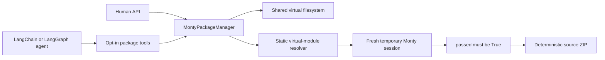
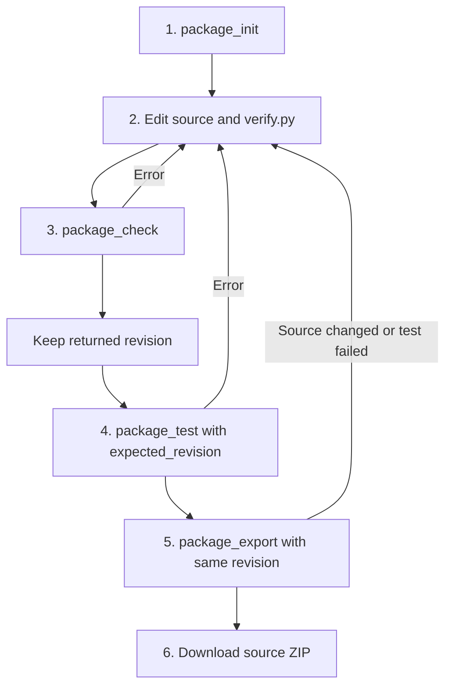
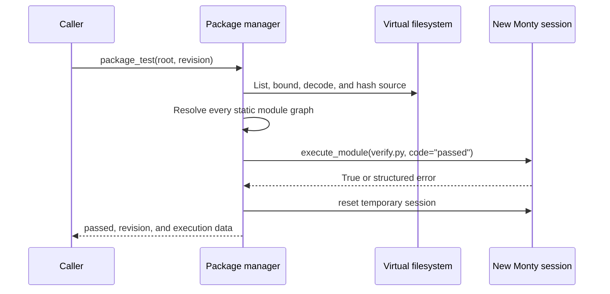

# Monty-compatible source packages

Arenero can create, check, test, and export a small dependency-free source
package. The result is a deterministic ZIP of source files. It is not a wheel,
a Python source distribution, or an installed package.

Use this workflow when code must run through Arenero's static virtual-module
resolver. Use a CPython build environment when you need PyPI dependencies,
`pip`, a build backend, native extensions, or standard Python packaging tools.

## What the workflow guarantees

The package manager applies one small contract:

- The project is below a host-configured virtual root. The default is
  `/workspace`.
- The package name is a Python identifier.
- The manifest uses format `1` and has no dependencies.
- All source files are bounded UTF-8 `.py`, `.json`, `.md`, or `.txt` files.
- Each Python file has valid syntax and a supported static import graph.
- `verify.py` runs in a new temporary Monty session.
- `verify.py` exports the boolean variable `passed` with value `True`.
- Export runs the test again and refuses to archive a failing package.
- The ZIP has stable file order, timestamps, paths, and permissions.

These checks show that the source works with the current Monty and Arenero
module rules. They do not show CPython or PyPI compatibility.

## Components



`MontyPackageManager` is in the core package. The LangChain adapter is loaded
only when `create_package_tools()` is called. Package tools are separate from
the normal REPL tools. An application must opt in to package creation.

## Standard layout

`package_init("mathkit")` creates this tree:

```text
/workspace/mathkit/
├── arenero-package.json
├── README.md
├── mathkit/
│   ├── __init__.py
│   └── core.py
└── verify.py
```

The manifest is:

```json
{
  "format": 1,
  "name": "mathkit",
  "version": "0.1.0",
  "entry": "mathkit/__init__.py",
  "verify": "verify.py",
  "dependencies": []
}
```

The layout is intentionally fixed. `entry` must be
`NAME/__init__.py`, and `verify` must be `verify.py`. Extra source modules and
text documentation are allowed within the configured limits.

## The required process



Follow these steps in order:

1. Call `package_init`. Do not create a custom manifest or layout.
2. Edit the scaffold with Arenero filesystem operations. Keep all code within
   Monty's supported Python subset. Use only supported top-level static imports.
3. Call `package_check`. Keep its `revision` value.
4. Call `package_test` with `expected_revision`. Fix any error, check again, and
   use the new revision.
5. Call `package_export` with the tested revision. Export runs the test again.
6. Download `archive_path` if the result has `ok: true`.

The revision is a SHA-256 digest of every included relative path and file byte.
It detects an edit between check, test, and export. The `dist` directory is not
part of the digest and is never put inside a new archive.

## Human API example

```python
from pydantic_monty import OSAccess

from arenero import MontyPackageManager, PersistentMontyKernel

with PersistentMontyKernel(os_handler=OSAccess()) as kernel:
    packages = MontyPackageManager(kernel)

    created = packages.init("mathkit")
    assert created["ok"]

    kernel.upload_file(
        "/workspace/mathkit/mathkit/core.py",
        b"def double(value):\n    return value * 2\n",
    )
    kernel.upload_file(
        "/workspace/mathkit/mathkit/__init__.py",
        b"from .core import double\n",
    )
    kernel.upload_file(
        "/workspace/mathkit/verify.py",
        (b"from mathkit import double\n\nassert double(21) == 42\npassed = True\n"),
    )

    checked = packages.check("/workspace/mathkit")
    assert checked["ok"]
    revision = checked["revision"]

    tested = packages.test("/workspace/mathkit", revision)
    assert tested["ok"] and tested["passed"]

    exported = packages.export("/workspace/mathkit", revision)
    assert exported["ok"]
    source_zip = kernel.download_file(exported["archive_path"])
```

Use the same configured filesystem type that the application uses. `OSAccess()`
in this example is Monty's in-memory virtual filesystem. A configured workspace
can keep source files between kernel instances.

## Agent setup

Give the agent both filesystem tools and package tools:

```python
from langchain.agents import create_agent
from pydantic_monty import OSAccess

from arenero import (
    PersistentMontyKernel,
    create_package_tools,
    create_python_repl_tools,
)

kernel = PersistentMontyKernel(os_handler=OSAccess())
tools = [
    *create_python_repl_tools(kernel),
    *create_package_tools(kernel),
]
agent = create_agent(model, tools)
```

The agent receives four package tools:

| Tool | Purpose |
|---|---|
| `package_init` | Create the standard manifest, package directory, source, test, and README. |
| `package_check` | Check paths, manifest, limits, UTF-8, syntax, imports, and revision. |
| `package_test` | Check the tree and run `verify.py` in a fresh session. |
| `package_export` | Check, test, and write the deterministic ZIP under `dist/`. |

Each tool description includes the active limits and the unsupported operations.
The agent should still receive a short instruction to follow the required process
and to pass `expected_revision` after `package_check`.

The current package adapter uses `PersistentMontyKernel`. An asynchronous agent
can still call these synchronous LangChain tools through LangChain's normal tool
executor. `AsyncPersistentMontyKernel` does not yet have a native package manager.

## How verification works



The new session is required. A long-lived REPL can contain an older function
definition after a file edit. A package test must read the current files and must
not use old REPL state. The temporary session uses `state_policy="never"` and is
removed after the test, whether the test succeeds or fails.

Write `verify.py` with plain assertions and one final public assignment:

```python
from mathkit import double

assert double(21) == 42
assert double(0) == 0
passed = True
```

Do not use `pytest`, `unittest`, test discovery, fixtures, subprocesses, or a test
command. `passed = True` must occur after the assertions. If an assertion fails,
execution stops. If `passed` is absent, false, or not a boolean, the package test
fails.

## Supported code

These patterns work:

- small pure functions and classes supported by Monty;
- top-level relative imports such as `from .core import double`;
- top-level absolute imports from the same project such as
  `from mathkit import double`;
- supported partial Monty standard-library modules;
- several package source files within module graph and package limits;
- JSON, Markdown, and text data included as source artifacts.

See [Static virtual modules](virtual-modules.md) and
[Usage and capabilities](usage-and-capabilities.md) for the exact language and
standard-library limits.

## Unsupported code and packaging operations

These patterns do not work:

- any non-empty `dependencies` list;
- PyPI packages, wheels, standard sdists, `pip`, or virtual environments;
- `pyproject.toml`, `setup.py`, or build backend execution;
- `pytest`, host test runners, Git hooks, compilers, or native extensions;
- dynamic imports, wildcard imports, virtual-file imports inside a function,
  circular imports, namespace packages, import hooks, reload, or `sys.path` changes;
- CPython-only syntax, built-ins, standard-library APIs, or object behavior;
- binary package resources;
- filesystem paths outside the configured package root;
- package code that depends on state from an existing REPL session.

The archive can be extracted and inspected by normal host tools. It is intended
for transfer, review, storage, or later loading into a compatible Arenero virtual
filesystem. It is not directly installable by Python.

## Configuration

```python
from arenero import MontyPackageManager, PackageConfig

packages = MontyPackageManager(
    kernel,
    PackageConfig(
        allowed_root="/projects",
        max_files=50,
        max_file_bytes=128_000,
        max_total_bytes=1_000_000,
        max_archive_bytes=1_250_000,
    ),
)
```

| Setting | Default | Meaning |
|---|---:|---|
| `allowed_root` | `/workspace` | Parent virtual directory for package projects. A project cannot equal this path. |
| `max_files` | `100` | Maximum included source files. |
| `max_file_bytes` | `256000` | Maximum bytes read from one source file. |
| `max_total_bytes` | `2000000` | Maximum bytes in all included source files. |
| `max_archive_bytes` | `2500000` | Maximum final ZIP size. |

For agent tools, pass the same `PackageConfig` to `create_package_tools()`.
These are host limits. Package code and the model cannot increase them.

## Error handling

All operations return a mapping with `ok`. A failure includes `error.code`,
`error.message`, and `error.hint`. Important codes are:

| Code | Meaning |
|---|---|
| `invalid_package_name` | The name is not a usable Python identifier. |
| `invalid_package_root` | The project is outside `allowed_root`. |
| `package_exists` | A manifest already exists at the requested root. |
| `invalid_package_manifest` | The manifest is missing, unreadable, or invalid JSON. |
| `package_dependencies_not_supported` | `dependencies` is not an empty list. |
| `unsupported_package_module` | Syntax or a static import graph is not supported. |
| `too_many_package_files` | The tree exceeds its bounded file scan or file count. |
| `package_file_too_large` | One file exceeds `max_file_bytes`. |
| `package_source_too_large` | All source exceeds `max_total_bytes`. |
| `package_revision_conflict` | Files changed after the supplied revision. |
| `package_verification_failed` | An assertion or Monty execution failed. |
| `invalid_verification_result` | `passed` did not evaluate to boolean `True`. |
| `package_archive_too_large` | The final ZIP exceeds `max_archive_bytes`. |

After an edit, always run `package_check` again. Do not retry a revision conflict
with the old revision.

## Tests that enforce this process

`tests/test_packages.py` validates:

- the exact scaffold, check, fresh-session test, and export order;
- archive contents and deterministic bytes;
- revision conflicts after an edit;
- rejection of dependencies and missing virtual imports;
- root, file count, and archive size limits;
- detection of a changed file despite an old persistent REPL;
- one complete model-driven agent flow that edits, checks, tests, and exports.

Run only these tests with:

```bash
uv run python -m unittest tests.test_packages -v
```
