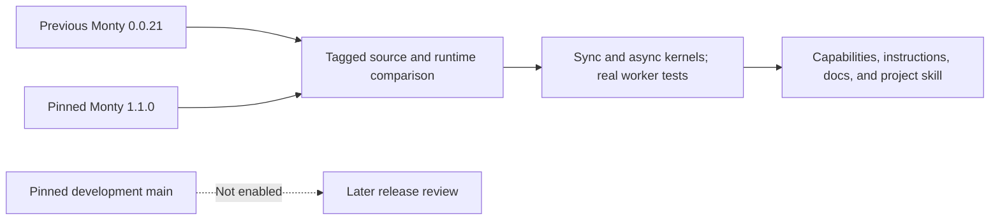
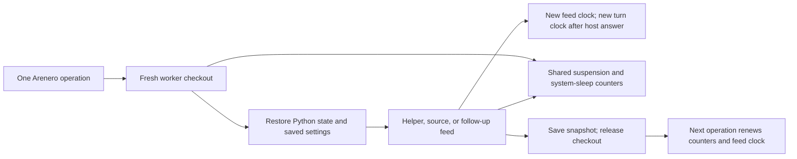

# Monty 1.1.0 migration and runtime reference

This 2026-10-14 review compares Arenero's previous Monty `0.0.21` with the published
release, `1.1.0`, and with upstream `main` at commit
`4246aa75724b133e55f8a82e2cf5dfc0120e62e8`. The last project review used the
`0.0.21` runtime. Some of its reference text also described then-current `main`,
which was ahead of that runtime.

Arenero now pins `pydantic-monty==1.1.0`. Both kernels, limits, shell directories,
capability reports, instructions, docs, and the project-local skill use this
release. Generated agent code still runs only in Monty, not CPython.

The evidence includes tagged source, current source, release notes, public Python
API signatures, and 48 bounded checks run against both installed versions. The
initial comparison used a separate environment. The migration updates the
project environment and lockfile and adds integration tests through real workers.

## Three versions to keep separate

| Version | Status on the review date | What it means for Arenero |
| --- | --- | --- |
| `0.0.21` | Previous dependency | Historical comparison only. Old snapshots require an explicit reset. |
| `1.1.0` | Installed and pinned; released 2026-10-05 | The runtime contract for current code, instructions, and tests. |
| Pinned `main` commit above | Development source reviewed on 2026-10-14 | Useful design input. Do not describe these additions as available in a released wheel. |

The public documentation can track development ahead of PyPI. Use a release tag
when deciding what an installed runtime supports. Link to a pinned commit when
recording an unreleased feature.

The `1.1.0` Python package is now a metapackage that pins separate client and
worker-runtime distributions. A deployment must keep the client and worker
versions aligned, including when an explicit `binary_path` is used. See the
[tagged Python quickstart](https://github.com/pydantic/monty/blob/v1.1.0/docs/quickstart/python.md).



## Changes already released

### Release history

- `0.0.22`, dated 2026-09-04: Base64, dataclass `eq`/`frozen` options,
  `functools.reduce`, more iterator adapters, `__index__` dispatch, and several
  worker, async, and container fixes. Unknown resource-limit keys now fail.
- `0.0.23`, dated 2026-09-05: a small release following `0.0.22`.
- `1.0.0`, dated 2026-09-25: Monty left its experimental release framing.
  It added native dynamic source execution, OS policy, virtual current directory,
  `copy`, `random`, `time`, complete `itertools`, formatting, stderr printing,
  revised duration limits, suspension limits, object wrappers, and new snapshot
  support. The snapshot encoding changed to CBOR.
- `1.1.0`, dated 2026-10-05: complex numbers and fixes for boolean arithmetic,
  regex octal escapes, closure capture in exception expressions, and cleanup of
  failed dictionary construction.

See the [release history](https://github.com/pydantic/monty/releases),
[0.0.22 notes](https://github.com/pydantic/monty/releases/tag/v0.0.22),
[1.0.0 notes](https://github.com/pydantic/monty/releases/tag/v1.0.0), and
[1.1.0 notes](https://github.com/pydantic/monty/releases/tag/v1.1.0).

### Language and standard library

| Feature | Arenero's `0.0.21` | Released `1.1.0` | Use after a migration |
| --- | --- | --- | --- |
| `eval`, `exec`, `locals` | Absent | Present | Run generated Monty source and inspect a namespace snapshot. |
| `format`, string and bytes `%` formatting | Selected forms absent | Present | Common output and prompt formatting. |
| Complex numbers and imaginary literals | Absent | Present | Small numeric programs. |
| `base64`, `binascii`, ASCII85 | Absent | Present | Encode, decode, and check binary data inside Monty. |
| `functools.reduce`, `partial` | Absent | Present | Small reusable operations; host calls cannot suspend inside a reduce callback. |
| `copy.copy`, `deepcopy` | Absent | Present | Copy supported plain values and sandbox objects. |
| `random`, `Random`, explicit seeding | Absent | Present | Reproducible sampling; generator state survives feeds and dumps. |
| `time`, `asyncio.sleep` | Absent | Present | Policy-controlled time and waiting. |
| `itertools.tee`, `batched`, remaining adapters | Absent or partial | Present | Bound and combine iterator work. |
| Dataclass `eq` and `frozen` options | Rejected | Present | Small typed records. |
| `print(file=sys.stderr)` | Rejected | Present | A separate Python error-output stream. |
| Native `os.getcwd` and `os.chdir` | Absent | Present | Virtual relative paths inside Monty. |

`iter()`, `next()`, and a sandbox class's `__iter__` already worked in `0.0.21`.
They are not new. Also, `enumerate`, `zip`, `map`, `filter`, `reversed`, and
generator expressions still produce eager lists. Adding `itertools.count()` does
not make `map(f, count())` bounded. Use `islice` before an eager consumer.

Other released improvements include math aggregation functions and `fma`,
datetime/time-zone operations, runtime generic aliases and unions, broader
unpacking targets, and more CPython-compatible string and integer operations.
These do not add NumPy, pandas, arbitrary third-party modules, or a complete
Python standard library.

### Native dynamic source execution

`eval()` and `exec()` run inside Monty's own VM. They do not introduce CPython.
In a `1.1.0` session, this now works:

```python
exec("def double(value):\n    return value * 2\n")
double(21)

namespace = {}
exec("answer = 42", namespace)
namespace["answer"]
```

Source must be a string or UTF-8 bytes. Code objects, `compile()`, non-`None`
closure arguments, and general mapping objects for namespaces are absent.
`locals()` at module scope returns a fresh dictionary; changing that dictionary
does not change the module globals. Explicit namespace dictionaries have their
own rules: code under one does not ask the host to resolve an unknown global.

Source compiled by `eval` or `exec` bypasses Monty's static type checker, even
when the outer feed is checked. It still uses Monty's language subset, host
boundary, and resource limits. Started snippets retain source and bytecode for
the session lifetime, including when execution raises. Repeated dynamic programs
can therefore grow state. See the
[tagged dynamic-execution reference](https://github.com/pydantic/monty/blob/v1.1.0/docs/limitations/eval_exec.md).

With `type_check=True`, later checked code cannot see names defined only inside
an `exec` string, although the values exist at runtime. Use `execute_file` for a
checked helper feed, declare appropriate stubs, keep definition and use inside
the dynamic source, or use a session with checking disabled. Reset is not a fix
for that static namespace gap.

This is available to helper execution and RLM programs now. It does not
by itself add a filesystem import loader, package installation, or Python module
caching. Arenero keeps `execute_file` and `execute_module`: the first retains a
file's final-expression result and optional follow-up; the second resolves a
bounded static file graph. Native `exec` returns `None`, not that file result.

### Host objects and boundary values

`ClassInstance` exposes selected eager attributes, lazy attributes, and methods of
a host object. `ClassType(init=True)` can grant construction of a host class.
Each access or method that reaches the host is a host operation. Sandbox objects
can return as `MontyClassProxy` values rather than losing all structure to text.

This can later provide namespaced SDK-style tools. The lifetime matters:

- Eager attributes are copied; sandbox attribute writes do not change the host.
- Lazy reads and allowed methods reach the live host object.
- The host instance store is outside Monty's heap limit.
- The instance store does not survive a dump and restore. Restored method calls,
  lazy reads, and constructors need a deliberate reattachment strategy.
- Bare arbitrary objects are not an automatic supported boundary format.

Arenero restores snapshots between operations. A wrapper that works within one
direct Monty checkout is therefore not proof that it works across Arenero calls.
See [host objects at 1.1.0](https://github.com/pydantic/monty/blob/v1.1.0/docs/host-objects.md).

### Time, randomness, and resource limits

`1.1.0` replaces `max_duration_secs` with `max_feed_duration_secs` and
`max_turn_duration_secs`. Both measure interpreter execution time and pause for
host work. The first resets at each feed; the second resets at each host answer.
There is no native cumulative session-lifetime duration budget.

It also adds `max_suspensions`, `max_total_sleep_secs`, and duration grace options
on the worker pool. Suspensions have a default cap of 1,000 per checkout; restores
reset the used count. System sleeps are charged separately. Memory and time
failures still require the host to discard the session; a caught `RecursionError`
does not. See the
[tagged limits reference](https://github.com/pydantic/monty/blob/v1.1.0/docs/resource-limits.md).

`OSPolicy` controls clocks, time zone, sleeping, process time, and the initial
random seed. Defaults now expose the system wall clock in UTC, use system entropy
for random seeding, cap each system sleep at ten seconds, and report zero process
time. For deterministic tests, use a fixed instant, a seed, and zero sleep.
Host waiting requires its own deadline; interpreter time limits do not count it.

Arenero removes the old `max_duration_seconds` field. Use
`max_feed_duration_seconds` instead, with the new meaning described below. We do
not add a cumulative host-side counter or an alias with a changed meaning.

### Files, snapshots, and diagnostics

Released Monty has a native virtual working directory and rejects overlapping
host mount directories. It still has one-shot file operations, cached full-file
reads, no live descriptors, no `+` or `x` file modes, and no file iteration.
Python and the virtual shell now share Monty's saved virtual directory. We
removed the separate shell-directory global. New `WorkspaceConfig` sessions enter
the mounted virtual root before bootstrap. No host process directory is changed.

Snapshot source positions identify the suspending expression with UTF-8 byte
offsets. This can later improve tool-call records and speculative-call debugging.
Print callbacks now receive buffered chunks rather than a stable one-call or
one-line unit. `print_flush_interval` controls batching; `flush=` is ignored.
Keep size limits based on collected bytes, not callback count.
Dumps use a format version; upstream can retain compatibility for some format
changes. Arenero currently applies the stricter rule of exact Monty package
version matching. Keep that rule until cross-version restore is tested.

Remote WebSocket clients also gained server session IDs, ephemeral sessions,
forking, and automatic resume. Those refer to a server's stored sessions; they
are not a replacement for Arenero's SQLite store or its local session IDs.

## Additions in development main only

These additions were found in source after `1.1.0`. They are absent from the
released wheel used by this review. Links below pin the reviewed commit.

| Development feature | Capability and important limit |
| --- | --- |
| `ExternalModule` and `external_modules` | Unknown imports can request explicitly provided host modules, nested modules, and optional `.pyi` stubs. This serves selected host values and functions; it does not auto-import virtual `.py` files. |
| Live module mapping and lazy factories | A newly added module is available to later imports. A bound module and its first cached type stub have their own lifetimes. Reattach module providers after restore. |
| `os.path` and `posixpath` | Virtual POSIX path operations; incomplete metadata and descriptor APIs remain absent. |
| `Path.glob`, `rglob`, `walk`; `os.scandir`, `walk` | Native directory scans. They read a bounded subtree snapshot in one host call rather than stream it. Hidden files, character classes, and pattern semantics differ from Arenero's smaller glob helper. |
| File iteration and `newline` | `for` loops and `next()` can load an unread file. Other iterator consumers need the cached buffer loaded first. Reads still cache the complete file. |
| `dataclasses.field`, `default_factory`, `MISSING`, `__post_init__` | Small native data-record helpers. Factories and post-init hooks cannot suspend to a host function. `fields`, `asdict`, and `replace` remain absent. |
| `hashlib` | Guaranteed hash algorithms and hash state in snapshots; no `file_digest`, `scrypt`, or general `hmac` module. |
| Restored resource-limit caps | The restoring checkout caps all stored resource limits. `1.1.0` carries the dump's limits, apart from its existing suspension-limit cap. |

The host-module work is especially relevant to Arenero's progressive tool
discovery and MCP bridge: it could let code use `import tools` with a live host
catalog. That is a future integration choice, not a capability enabled by this
documentation change.

Development references:

- [Host modules](https://github.com/pydantic/monty/blob/4246aa75724b133e55f8a82e2cf5dfc0120e62e8/docs/host-functions.md#importing-host-modules)
- [Directory scans](https://github.com/pydantic/monty/blob/4246aa75724b133e55f8a82e2cf5dfc0120e62e8/docs/limitations/pathlib.md)
- [Files and iteration](https://github.com/pydantic/monty/blob/4246aa75724b133e55f8a82e2cf5dfc0120e62e8/docs/limitations/open.md)
- [Dataclasses](https://github.com/pydantic/monty/blob/4246aa75724b133e55f8a82e2cf5dfc0120e62e8/docs/limitations/dataclasses.md)
- [Hashing](https://github.com/pydantic/monty/blob/4246aa75724b133e55f8a82e2cf5dfc0120e62e8/docs/limitations/hashlib.md)
- [Snapshot restore](https://github.com/pydantic/monty/blob/4246aa75724b133e55f8a82e2cf5dfc0120e62e8/docs/snapshots.md)

## Constraints that still apply

There is no arbitrary package installation, site-packages, `sys.path`, process
runner, socket API, thread API, native extension, class inheritance, method
decorator, generator function, `match`, `del`, `async for`, `async with`, wildcard
import, `compile`, `globals`, or `__import__` in the reviewed runtime.

Host callbacks cannot suspend when used inside synchronous interpreter callbacks,
such as sort keys, iterator predicates, and implicit class protocols. Write an
explicit loop when each item needs a tool call.

Passing static type checking does not prove runtime support. `eval` and `exec`
source is not checked; some vendored stubs describe names that cannot run. Several
upstream summary notes also lag specific implementations: the builtins and async
references contain older print restrictions, while `1.1.0` does accept
`print(file=sys.stderr)`. Runtime evidence and the specific feature reference
take precedence over a contradictory general summary.

Arenero's own shell, locks, filesystem limits, output trimming, MCP lifetimes,
state policy, and source-package format remain separate product decisions.
Upstream feature growth does not automatically change them.

## Configure the new limits

```python
from arenero import KernelConfig, PersistentMontyKernel

config = KernelConfig(
    max_feed_duration_seconds=5,
    max_turn_duration_seconds=1,  # Optional; default None.
    max_suspensions=1_000,
    max_total_sleep_seconds=10,
    os_policy={"sleep": "zero", "random_start": {"seed": 42}},
)
with PersistentMontyKernel(config=config) as kernel:
    session = kernel.session("agent-1")
    assert session.execute("eval('20 + 22')")["result"] == 42
    session.execute("exec('def double(x):\\n    return x * 2')")
    assert session.execute("double(21)")["result"] == 42
```

The same configuration works with `AsyncPersistentMontyKernel`.

| Arenero setting | Default | Scope and behavior |
| --- | --- | --- |
| `max_feed_duration_seconds` | 5 s | Interpreter work in one feed, across host round trips. Restarts at each feed. |
| `max_turn_duration_seconds` | `None` | Optional interpreter work between host answers. The tighter time limit fires first. |
| `max_suspensions` | 1,000 | Host functions, OS calls, name lookups, and future events in one checkout. Not only business-tool calls. |
| `max_total_sleep_seconds` | 10 s | Sum of capped system sleep delays in one checkout. `zero` sleep uses neither this budget nor a suspension. |
| `max_memory_bytes` | 64 MiB | Worker allocator requests, not RSS or host memory. |
| `max_recursion_depth` | 100 | Monty call depth. A caught recursion error is not terminal. |
| `request_timeout_seconds` | 10 s | Worker protocol-turn wall deadline. Restarts after a host answer, not a whole agent-operation deadline. |

Suspension and used system-sleep counts reset when Arenero opens a fresh checkout
and restores state for the next operation. Helper setup, bootstrap, file reads,
file source, and follow-up code can be separate feeds in the same checkout. Each
has its own duration clock, but they share that checkout's suspension and sleep
allowance. A shell pipeline can make several kernel operations; it is not one
Monty duration budget.

Initial feed compilation is outside interpreter time. Runtime `eval`/`exec`
compilation is charged. Monty's worker duration backstops keep their default
one-second grace. Host functions, mount I/O, MCP calls, model requests, and
network work need their own limits. Neither interpreter duration nor the worker
request timeout is a full-operation deadline.

Time and memory failures discard the saved Python session under every state
policy. A suspension-limit failure ends cleanly: `error.code` is
`suspension_limit`, and `state_policy="always"` can save earlier changes. The next
operation renews the suspension count. Normal state-save rules still apply.
No policy undoes files or external side effects.



## Configure clocks, sleep, and randomness

`KernelConfig.os_policy` accepts Monty's `OSPolicy` dictionary. `None` keeps
system UTC wall time, system random seeding, system sleep capped at 10 seconds
per delay, and zero process time. To make time and randomness repeatable:

```python
from datetime import datetime, timezone

config = KernelConfig(
    os_policy={
        "datetime": datetime(2026, 1, 2, tzinfo=timezone.utc),
        "timezone": "UTC",
        "sleep": "zero",
        "random_start": {"seed": 42},
        "process_time": "zero",
    }
)
```

`datetime.now()` is naive by default; pass `timezone.utc` for an aware value.
`process_time="elapsed"` exposes interpreter execution time when that is useful.
`sleep="call_host"` and clock/random call-host modes require the relevant OS
callbacks; they do not add an automatic host implementation or a deadline.
Host-side sleep in call-host mode is not charged to the system-sleep limit.
`OSAccess.max_sleep` is separate from `OSPolicy.sleep_system_max`.
Random seeds can be integers, floats, strings, or bytes. Capability reports use
ISO text for fixed datetimes and an explicit Base64 record for byte seeds.
Reporting does not change the runtime policy.

Native RNG state, dynamically defined functions, and the virtual directory
survive a same-version restore or fork. The RNG seed policy applies when a new
generator starts; it does not reseed saved state on every operation. Python and
shell state remain isolated by session ID. Files can still be shared.

```python
# Inside the REPL, with /data present in the configured virtual filesystem:
import os

os.chdir("/data")
exec(open("helper.py").read())
double(21)
```

Shell `pwd` in that session now reports `/data`; shell `cd` also changes relative
Python file access. Managed file tools use the same saved directory.
`ManagedSandbox.cwd` is read-only, and `sandbox.chdir()` changes Monty's directory
instead of a second host-side base. New file-enabled managed sessions start at
their root before bootstrap. Stateless calls return to that initial root each
time. This is not host filesystem access.

## Upgrade existing sessions

1. Run `uv sync --frozen` to install the matched 1.1.0 client and worker.
2. Replace `max_duration_seconds` with `max_feed_duration_seconds` in host code.
   Do not assume the old cumulative meaning.
3. Reset previous-version sessions with `kernel.reset(session_id)`,
   `restart=True`, or `arenero --session ID --reset`. The version guard rejects
   old state before decoding; it does not delete it until reset is requested.
4. Recreate MCP hubs, callbacks, and mounts after an application restart.
   Their live resources are not in a Python snapshot.

A 1.1.0 dump carries its own resource settings. Restoring it does **not** apply
new memory or duration settings from the checkout. Only a stricter suspension
cap is applied. Reset low-level sessions after changes to limits, OS policy, or
type-check settings. Capability reports describe the configured new-session
policy, not an inspection of limits inside each saved dump. Managed checkpoint
restore still checks its configuration digest. Old signed graph snapshots also
require a reset; there is no cross-version state conversion.

## What we kept small

The dependency change needs one shared limit builder, policy forwarding, native
directory use, and three additions to the resolver's built-in module list.
Native language and library features require no new runtime wrappers. A single
small output converter now keeps bytes, complex values, dates, and returned
Monty instance attributes as JSON data instead of flattening the whole result
to text. Print buffers still use the existing byte-limited collector.

The next six small changes reuse native features: filesystem helpers are
installed once and checked by a saved source marker; managed paths use native
directory state; results share the converter; `variables()` and `%who`/`%whos`
inspect disposable snapshots; sync `execute()` accepts native `inputs=`; and the
static resolver keeps nested bundled-standard-module imports unchanged.
Input names still need stubs in typed sessions. Inspection returns names and
types only. Nested virtual-file imports remain rejected. See
[quality-of-life APIs](quality-of-life.md) and [static modules](virtual-modules.md).

The next API-completion changes are Arenero features, not new Monty syntax:
inputs now reach file/module/Python-cell APIs; module and native async calls can
offload full bounded JSON; native async gains upload, listing, and percent cells;
the static resolver supports explicit sibling imports and virtual `__file__`;
packages use raw inventory and verifier data and can opt into `assets/` bytes.
The trusted file-reading feed skips checking, but file source still follows its
configured type policy. No runtime upgrade, full import engine, or second shell
is added.

The static resolver, filesystem helpers, source-package workflow, RLM, speculation,
stores, and fixed agent tool schemas remain in place. We do not add a remote
worker service, a live host-object registry, CPython, or development-only APIs.
Consider native host modules and directory scans only when a release includes
them and tests show that a replacement reduces code.

## Reproduce the runtime checks

The probe script uses host Python only to submit source to Monty. Generated probe
source never executes in CPython. Each case has a fresh checkout, a one-second
interpreter limit, a five-second worker timeout, a 64 MiB heap limit, and only a
small memory filesystem. It makes no LLM calls or external service calls.

```console
uv run --frozen python scripts/monty_feature_probe.py
```

Run the same script with the Python executable of a separate environment
containing the previous `pydantic-monty==0.0.21` to compare versions. Do not remove Arenero's
dependency pin just to run a probe.

[Saved probe evidence](monty-compatibility.json) records all 48 results and API
differences. Twenty-two previously failing checks succeed in `1.1.0`. This is a
targeted historical comparison, not proof of complete CPython compatibility.
Before migration, a kernel smoke test failed on the removed `max_duration_secs`
key. The current limits use 1.1.0 keys. `tests/test_monty_110.py` and the complete
test suite validate the migrated kernels and integrations; no live LLM is used.
