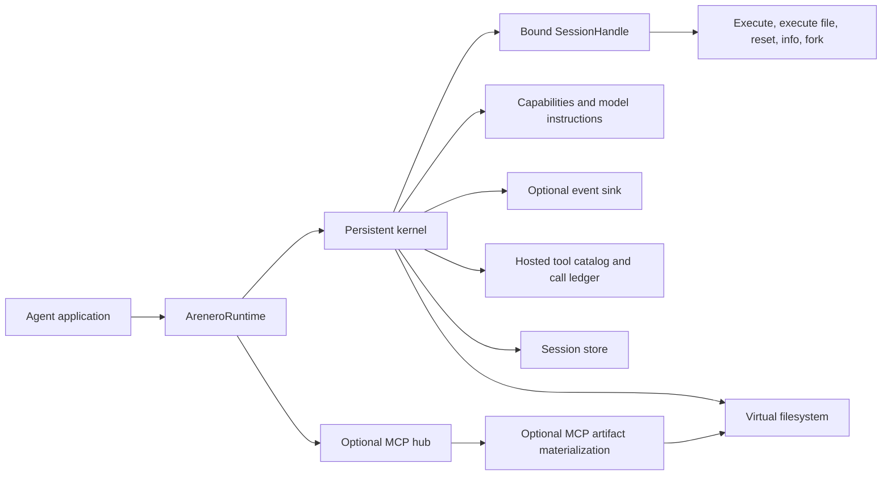

# Quality-of-life APIs

Arenero provides small host APIs that make agent integrations easier to inspect,
operate, and debug. They do not change Monty's Python limits.

## Overview



| Mechanism | Public API | Main purpose |
| --- | --- | --- |
| Dynamic capability report | `kernel.capabilities()` | Give code and agents the active limits and features. |
| Generated model instructions | `kernel.instructions()` | Describe the active configuration in a prompt-ready form. |
| Bound session handle | `kernel.session(session_id)` | Remove repeated session IDs from application code. |
| Better errors | `error.code` and `error.hint` | Give machines a stable category and people a next action. |
| Recovery action | `error.recovery` | Tell an agent to revise code, retry, restart, wait, or stop. |
| Hosted call records | `result["host_calls"]` | Show bounded nested-call identity, status, timing, and possible side effects. |
| Execution statistics | `result["stats"]` | Show operation identity, timing, state sizes, and original output sizes. |
| REPL commands | `%run`, `%reset`, `%limits`, `%sessions`, `%mcp` | Perform common control actions before Monty parses the cell. |
| State save policy | `state_policy=` | Select when Python state is saved. |
| Session forking | `kernel.fork_session()` or `handle.fork()` | Copy Python state for an isolated experiment. |
| Session bootstrap | `bootstrap_code=` and `bootstrap_files=` | Install trusted helpers in each new session. |
| Runtime owner | `AreneroRuntime` and `AsyncAreneroRuntime` | Close the kernel and MCP hub in the correct order. |
| Doctor | `arenero --doctor` or `run_doctor()` | Check the installed and configured runtime. |
| Event sink | `event_sink=` | Send safe metadata to logs, metrics, or audit storage. |
| MCP artifacts | `mcp_artifact_directory=` or `materialize_mcp_artifacts()` | Write returned image, audio, and resource bytes to virtual files. |

## Capability report and model instructions

The report is generated from the kernel object. It includes the Monty version,
sync or native async mode, store mode, state policies, filesystem limits, active
shell commands, network policy, MCP functions, static virtual-module rules,
worker limits, bootstrap status, and REPL commands. It does not include network
headers, MCP credentials, code, or file contents.

```python
report = kernel.capabilities()
print(report["shell"]["commands"])
print(report["network"]["allowed_methods"])

system_text = kernel.instructions()
```

The LangChain and LangGraph REPL tool includes these generated instructions in
its tool description. Rebuild the tools after you change the kernel
configuration.

## Bound sessions

```python
session = kernel.session("agent-1")
session.execute("values = [10, 20, 30]")
result = session.execute("sum(values)")
info = session.info()

experiment = session.fork("agent-1-experiment")
experiment.execute("values.append(40)")
```

`SessionHandle` provides `execute()`, `execute_file()`, `execute_module()`,
`execute_cell()`, `reset()`, `info()`, and `fork()`. `AsyncSessionHandle`
provides awaitable execution, file execution, module execution, reset, info, and
fork methods.

A fork copies only the opaque Monty snapshot. It keeps the remaining cumulative
Monty duration budget because that budget is part of the snapshot. It does not
copy virtual files, mounts, host functions, MCP connections, or credentials.
Files can still be shared when both sessions use the same filesystem. The target
session must not exist.

## Errors and statistics

Every kernel error has these fields:

```python
{
    "type": "WorkerCheckoutTimeout",
    "code": "worker_checkout_timeout",
    "message": "...",
    "hint": "Retry later or increase the worker pool size.",
    "retryable": True,
    "recovery": "retry_later",
}
```

Use `code` for program logic. Show `message` and `hint` to the model or operator.
Use `recovery` for the next control decision. Its values are `retry_same_call`,
`revise_code`, `restart_session`, `retry_later`, `stop`, and `none`.
The code `unsupported_import` tells the agent that direct Monty import cannot
load that name. Use `execute_file()` or `%run` for one flat helper. Use
`execute_module()` only for the documented bounded static module graph. General
package imports still do not work.

Each Python result also includes:

```python
{
    "execution_id": "host-generated-id",
    "wall_time_seconds": 0.012,
    "checkout_wait_seconds": 0.001,
    "state_before_bytes": 210,
    "state_after_bytes": 245,
    "original_output_chars": {
        "result": 2,
        "stdout": 0,
        "stderr": 0,
        "error": 0,
    },
}
```

Wall time includes locks, store access, worker checkout, Monty execution, and
result preparation. Checkout wait is the measured worker-pool wait. Output sizes
are measured before Arenero trims the public fields. Shell and control command
results use the same common response shape, but their `stats` value is `None`.

## State save policy

The default is `always`, which keeps the existing Arenero behavior.

| Policy | Successful code | Normal code error | Terminal time, memory, or worker failure |
| --- | --- | --- | --- |
| `always` | Save | Save valid changes made before the error | Delete unsafe saved state |
| `success` | Save | Do not save this operation | Delete unsafe saved state |
| `never` | Do not save | Do not save | Delete unsafe saved state when required |

```python
kernel.execute("agent", "x = 1", state_policy="never")
kernel.execute("agent", risky_code, state_policy="success")
```

This policy applies only to Python snapshots. It does not provide transactions.
File writes, network requests, and MCP side effects are not rolled back.
LangChain tools expose the same three values to the model.

## Bootstrap code and files

```python
kernel = PersistentMontyKernel(
    os_handler=OSAccess(),
    bootstrap_files=("/helpers.py",),
    bootstrap_code="DEFAULT_LIMIT = 100",
)
```

Arenero installs filesystem helpers first. For a session with no saved snapshot,
it then executes each bootstrap file in order, executes bootstrap code, and runs
the requested cell. Names become normal session globals. Bootstrap does not use
Python module imports.

Bootstrap sources are trusted host configuration. A missing or invalid bootstrap
source returns `session_bootstrap_error`, and Arenero does not save the partial
new session. Bootstrap does not run again after a valid snapshot exists. Resetting
the session makes the next call a new session, so bootstrap runs again.

## Small REPL commands

The cell dispatcher handles these commands before Monty execution:

| Command | Result |
| --- | --- |
| `%run FILE` | Execute a virtual Python file in the current session. |
| `%reset` | Delete the current Python snapshot. Files remain. |
| `%limits` | Return the full active capability report. |
| `%sessions` | Return metadata for the current bound session only. |
| `%mcp` | Return configured MCP server status, or a structured unavailable error. |

Commands must use one line. `%run` accepts one shell-quoted path. Use
`execute_file(file_path, follow_up_code)` when the same call must also execute
follow-up code. `%sessions` does not list other session IDs. Use the trusted host
method `kernel.list_sessions()` for administration.

## Runtime owner

```python
hub = McpHub(servers)
kernel = PersistentMontyKernel(mcp_hub=hub)

with AreneroRuntime(kernel) as runtime:
    result = runtime.session("agent-1").execute("1 + 1")
```

The runtime closes the kernel first and then closes the attached MCP hub. Pass
`close_mcp_hub=False` when another owner shares the hub. The kernel still owns
its worker pool and a workspace mount that it created. `AsyncAreneroRuntime`
provides the same lifecycle for `AsyncPersistentMontyKernel`.

## Doctor

```console
uv run arenero doctor
```

```python
report = run_doctor(kernel)
```

Doctor checks the installed Monty version, starts a worker and evaluates a small
expression, reports optional LangChain, MCP, Pydantic AI, and OpenTelemetry
packages, tests a configured workspace, and loads configured MCP server status. The worker check uses
`state_policy="never"`. Optional package checks are informative and do not fail
the overall report. The CLI returns exit status 1 when a required check fails.
`--doctor` is also accepted for compatibility with the other administrative
flags.

Doctor can connect configured MCP servers and can create a short test file in a
configured workspace. Run it only when these diagnostic actions are acceptable.

## Event sink

```python
events = []
kernel = PersistentMontyKernel(event_sink=events.append)
```

The callback receives immutable `AreneroEvent` records for execution, session,
filesystem, network, MCP, RLM, speculation, and runtime actions. Events contain metadata such as
IDs, sizes, status, and timing. They do not contain executed code, file content,
HTTP headers or bodies, MCP arguments or results, or credentials. Event callback
errors are ignored, so an observer cannot change an execution result.

Pass the same sink to `McpHub(event_sink=...)` when MCP call events are required.
The event sink is intentionally one callback, not a plugin system.

`OpenTelemetryEventSink` is an optional adapter for the same event stream. It
adds safe attributes to the current recording span or creates a short span when
needed. Install `arenero[observability]`. The package supplies only the
OpenTelemetry API adapter; the application owns its SDK, exporter, sampling, and
collector configuration.

## MCP artifact materialization

Use explicit materialization for an MCP result called by host code:

```python
mcp_result = hub.call("images__render", {"prompt": "small chart"})
value, paths = kernel.materialize_mcp_artifacts(mcp_result, "/artifacts")
```

Or set an automatic destination for binary MCP content that becomes the final
Python result:

```python
kernel = PersistentMontyKernel(
    os_handler=OSAccess(),
    mcp_hub=hub,
    mcp_artifact_directory="/mcp-artifacts",
)
```

Arenero recognizes MCP image and audio `data` fields and embedded resource
`blob` fields. It decodes Base64, writes bytes through the configured virtual
filesystem, removes the Base64 field from the copied result, and adds
`virtual_path` and `size_bytes`. The execution result also lists paths in
`mcp_artifacts`.

Automatic materialization runs after Monty releases its worker checkout. This is
important: a hosted MCP function must not re-enter the active persistent session.
Only binary blocks present in the final returned Python value are materialized.
Intermediate MCP results are not scanned. Data removed by `McpHubConfig` result
limits cannot be materialized. Each file must also fit
`FilesystemConfig.max_transfer_bytes`. The native async kernel has bounded
download for module resolution, but it does not have host upload or automatic
artifact materialization. Automatic materialization is a synchronous kernel
feature.

## What these APIs do not add

- They do not add full CPython, package imports, subprocesses, or a real shell.
- State policies do not roll back files or external side effects.
- A session fork does not create a filesystem branch.
- Bootstrap files are source feeds, not Python modules.
- Static virtual modules are bounded source rewriting, not CPython importlib.
- Event records are process-local callback calls unless the sink stores them.
- Doctor is a diagnostic check, not a security certification.
- MCP materialization does not make untrusted MCP data safe.

Hosted tool catalogs, nested-call budgets, framework adapters, MCP promotion,
and OpenTelemetry behavior are documented in
[Hosted tools and code-mode composition](hosted-tools.md).
