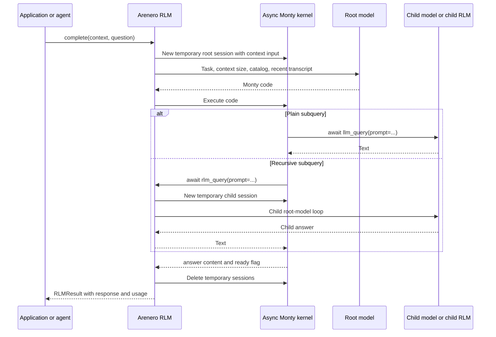
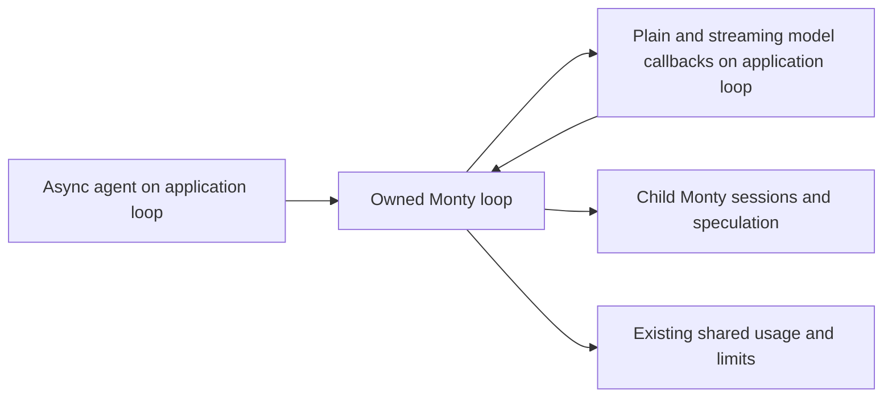

# Recursive Language Models

Arenero can run a Recursive Language Model (RLM) with Monty as the external
environment. The complete input stays in the Monty variable `context`. The root
model receives its size, the task, current limits, available function signatures,
and a bounded recent transcript. It writes code that examines selected context
parts and can call models on those parts.

This is an inference utility. It does not train a model and does not require one
specific model provider.

## Execution model



`llm_query` makes one model call. `rlm_query` starts a child root-model loop with
its own Monty session. At `max_depth`, `rlm_query` becomes a plain model call.
This gives recursion a fixed end condition.

The active parent interpreter never invokes itself. Separate sessions avoid the
parent session lock and prevent child Python variables from entering parent
state.

## Standalone use

The core API accepts any async function with this signature:

```python
async def model_call(prompt: str, model: str | None): ...
```

It must return `str` or `RLMModelResponse`. Use `RLMModelResponse` when the model
provider reports token or cost data.

```python
from arenero import AsyncPersistentMontyKernel, KernelConfig, RLM, RLMConfig

rlm = RLM(
    model_call,
    config=RLMConfig(
        max_depth=1,
        max_model_calls=32,
        max_parallel_calls=4,
        max_context_chars=10_000_000,
        max_total_tokens=200_000,
        timeout_seconds=120,
    ),
)
kernel = AsyncPersistentMontyKernel(
    config=KernelConfig(
        max_worker_processes=4,
        worker_checkout_timeout_seconds=5,
    )
)

async with kernel:
    result = await rlm.complete(
        kernel,
        long_text,
        "Find the claims that disagree and explain why.",
    )

print(result.response)
print(result.usage.to_dict())
```

The RLM deletes all root and child session snapshots when the operation ends,
including after an error. The returned `session_id` is for logs and event
correlation. It is not a persistent session handle.

## LangChain model adapter

Install the LangChain extra and adapt one default model. Named models are
optional.

```python
from langchain.chat_models import init_chat_model
from arenero import RLM, adapt_langchain_model

root_model = init_chat_model("openai:gpt-5.5")
small_model = init_chat_model("openai:gpt-5-mini")

rlm = RLM(
    adapt_langchain_model(
        root_model,
        models={"small": small_model},
    )
)
```

Monty code can then request `model="small"`. An unknown name returns an error.
The adapter uses LangChain's public `ainvoke()` path. It reads token usage from
`AIMessage.usage_metadata`. It reads cost only when the model puts a numeric
`cost` value in response metadata.

For speculative tool calls, also pass the public streaming adapter:

```python
from arenero import (
    SpeculationConfig,
    adapt_langchain_model,
    adapt_langchain_model_stream,
)

rlm = RLM(
    adapt_langchain_model(root_model),
    model_stream=adapt_langchain_model_stream(root_model),
    speculation_config=SpeculationConfig(mode="stream"),
)
```

This adapter uses `BaseChatModel.astream()`. Without it, `stream` mode safely
falls back to planning the complete response before real execution.

## Deep Agents use

Pass the configured RLM to `AreneroInterpreterMiddleware`:

```python
from arenero import create_deepagents_middleware

interpreter = create_deepagents_middleware(
    kernel=kernel,
    rlm=rlm,
    mode="thread",
)
```

The middleware adds the RLM signatures and rules to its dynamic model
instructions. Each interpreter operation gets a new shared RLM budget ledger.
Persistent parent Python state stays active before and after nested model calls.

The RLM functions call model providers directly through the configured adapter.
They do not pass through the parent LangGraph `ToolNode`. Parent per-tool human
approval does not run for each model call.

## Event-loop ownership in the compatibility middleware

`CodeInterpreterMiddleware(rlm=rlm)` can use existing async model clients:

```python
from arenero.deepagents import CodeInterpreterMiddleware
from deepagents import create_deep_agent

async with CodeInterpreterMiddleware(rlm=rlm) as interpreter:
    agent = create_deep_agent(model=model, middleware=[interpreter])
    result = await agent.ainvoke(
        {"messages": [{"role": "user", "content": "Use subqueries"}]}
    )
```

For `ainvoke`/`astream`, plain and batched model calls, recursive controller model
calls, and stream creation/advance/close run on the application's caller loop.
Child Monty sessions, usage accounting, shared limits, and speculative planning
stay on the owned kernel loop. A per-operation runner view uses the existing
loop bridge; it does not modify the supplied `RLM` or close its model client.
Different applications can share a runner only if its callback supports their
respective loops; a client tied to one loop must still be called from that loop.

Stream reads use backpressure without an extra queue. Cancellation reaches the
client and drains a pending read before closing an iterator that supports
`aclose`. Model errors and the existing RLM/host deadlines still apply. An
uncooperative host callback is not forcibly stopped, and effects are not undone.
Sync graph calls have no application loop; callbacks use the owned loop.
Standalone RLM and the original native async middleware stay on their caller
loop as before. No public RLM settings or call signatures change.



## Functions available inside Monty

Hosted functions accept keyword arguments only and must be awaited:

```python
one = await llm_query(prompt="Summarize this section: " + context[:5000])

many = await llm_query_batched(
    prompts=[
        "Extract names: " + context[:5000],
        "Extract dates: " + context[5000:10000],
    ]
)

child = await rlm_query(
    prompt="Analyze this independent part:\n" + context[10000:30000]
)

children = await rlm_query_batched(
    prompts=["Analyze:\n" + part for part in selected_parts]
)

usage = await rlm_usage()
```

Batch results keep input order. Actual overlap cannot exceed
`max_parallel_calls`. The global `max_model_calls`, token, cost, and wall-time
budgets are shared by all branches.

## Configuration and limits

| Setting | Meaning |
| --- | --- |
| `max_depth` | Largest child RLM level. Zero changes all recursive calls to plain model calls. |
| `max_iterations` | Root-model and REPL iterations for each node. |
| `max_errors` | Consecutive Monty errors before one node stops. |
| `max_model_calls` | Model calls for the complete recursion tree. |
| `max_parallel_calls` | Model calls that can overlap. |
| `max_context_chars` | Characters stored in one node's `context`. |
| `max_prompt_chars` | Characters sent in one model request. |
| `max_response_chars` | Characters accepted from one model response. Oversized code is not partly executed. |
| `max_transcript_chars` | Recent root-model and REPL history included in the next root request. |
| `max_repl_output_chars` | Characters returned for each Monty result, stdout, stderr, or error field. |
| `max_total_tokens` | Optional total of adapter-reported input and output tokens. |
| `max_cost` | Optional total of adapter-reported cost. |
| `timeout_seconds` | Wall time for the complete recursion tree. |

`RLM.capabilities()` returns these active values, the five function names, and
the main session and filesystem boundaries. It also returns the active
speculation mode, policies, and limits. `rlm_usage()` returns the live ledger to
Monty code.

Token and cost limits can enforce only values reported by the adapter. Keep a
provider-side budget when hard billing control is required.

`HostedToolConfig.max_total_call_seconds` is a second limit. It bounds the time
spent in RLM functions during one parent Monty feed. The default RLM tool config
uses `timeout_seconds`. Merging RLM functions with an application tool set uses
the stricter hosted-tool limit.

## Worker and filesystem rules

A parent Monty feed remains checked out while it waits for `rlm_query`. A child
RLM needs another worker. Configure at least `max_depth + 1` workers for one
recursive chain. Concurrent branches can need more workers. Set
`worker_checkout_timeout_seconds` so a full pool returns a retryable error instead
of waiting without a limit.

The kernel serializes direct virtual-filesystem access across sessions. A child
RLM starts while its parent feed is still active, so direct kernel mounts and
`fs_*` callbacks are disabled in recursive child sessions. This avoids waiting
on the parent's filesystem lock.

Child sessions can still receive explicitly inherited hosted file tools. This is
the supported way to share files with recursive children. The Deep Agents
middleware inherits only tools selected through its normal PTC rules.

Root calls made with `RLM.complete()` can use the kernel filesystem. A recursive
child cannot depend on `bootstrap_files`; those files are skipped because its
direct mount is disabled. Trusted `bootstrap_code` still runs.

## What works

- External contexts that do not fit in one model request, subject to Monty state
  and `max_context_chars` limits.
- Model-selected slicing, searching, filtering, aggregation, and decomposition.
- Plain and recursive calls in the same code block.
- Concurrent batches with ordered results.
- Different model names through an adapter registry.
- Application hosted tools inherited by all RLM nodes.
- Root and child usage, depth, cost, token, call, and wall-time accounting.
- Use from a standalone application or from Deep Agents middleware.

## What does not work

- A recursive child does not reuse or mutate the active parent Python namespace.
- The parent interpreter tool cannot call itself.
- Recursive child sessions do not get direct kernel mounts or virtual
  `bootstrap_files`.
- This RLM uses Monty `1.1.0`; native `eval` and `exec` run in Monty. They bypass
  static checking. The RLM does not add CPython packages, dynamic imports, sockets,
  subprocesses, or arbitrary shell commands to Monty.
- Output that exceeds `max_response_chars` is rejected. Arenero does not execute
  a truncated code block.
- Model calls are not transactional. A provider call or inherited hosted tool
  can have an external effect even if later Monty code fails.

## Speculative calls

Arenero can start selected calls while controller code streams. It uses a safe
host-side AST planner for known plain arguments and a forked Monty shadow for
state-dependent arguments. Real code still runs only in Monty. Speculation is
off by default and normal execution remains the fallback.

The default policy includes only `llm_query` and `llm_query_batched`. It does
not include recursive calls, filesystem, network, MCP, or application tools.
`RLMResult.usage.speculation` reports early work and claim results.

See [Speculative programmatic tool calling](speculative-tool-calling.md) for the
standalone API, stream contract, policy rules, limits, failure behavior, and
SpecTC-style integration.

Stable RLM limit messages start with `RLMCallLimitExceeded`,
`RLMTokenLimitExceeded`, `RLMCostLimitExceeded`, `RLMPromptTooLarge`,
`RLMResponseTooLarge`, `RLMResultTooLarge`, or `RLMTimeout`.
