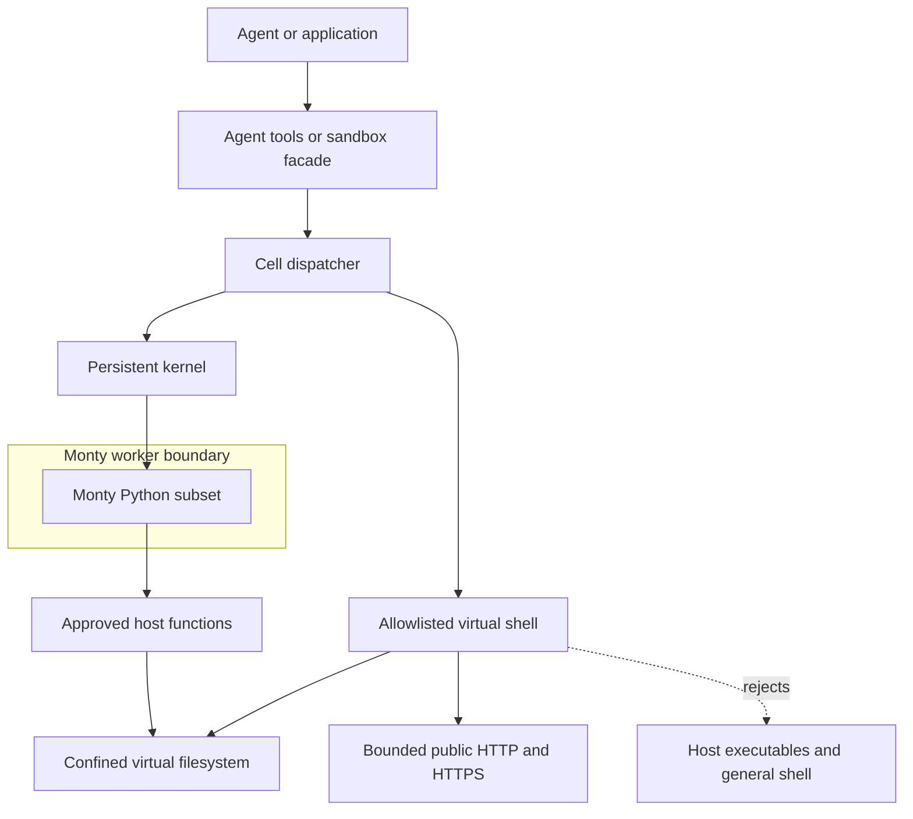

# Arenero sandbox compatibility

This report compares Arenero with the utilities described in the LangChain
[Deep Agents sandbox documentation](https://docs.langchain.com/oss/python/deepagents/sandboxes).
Arenero does not implement a Deep Agents backend. It provides the independent
parts needed to build an adapter later.

Only the approved edges cross the Monty boundary. The virtual shell can use its
documented commands, virtual files, and bounded `curl`; it cannot run host
executables.

## Implemented

| Capability | Arenero support |
| --- | --- |
| Isolated execution | Monty runs in worker subprocesses and has no ambient host access. |
| Persistent execution | Memory, SQLite, and stateless session modes are available. `WorkspaceConfig` adds host-backed files that survive restarts with SQLite state. |
| Thread or assistant scoping | The application selects the persistent `session_id`. |
| Shared files | Sessions can share one `OSAccess` object or mount set. One kernel serializes filesystem-capable execution across sessions. |
| `read`, `write`, `edit`, `delete`, `ls`, `glob`, `grep` | Available inside Monty, as LangChain tools, and through `AreneroSandbox`. `mkdir` is also available inside Monty and through the virtual shell. |
| Minimal virtual shell | Configurable allowlisted file commands, Monty Python, text pipes, conditional command lists, redirection, and a persistent virtual working directory. |
| One-tool REPL bridge | `python_repl` accepts normal Python, one-line `!COMMAND` cells, and multiline `%%shell` cells with the same session and files. |
| Binary upload and download | `upload_file`, `download_file`, `upload_files`, and `download_files` preserve bytes. |
| Image input bridge | `read_media_file` creates a Base64 data URL or LangChain image block. |
| Output bounds | Kernel, stream, filesystem, search, state, binary transfer, and network limits are configurable. |
| Output offloading | Python and shell calls can save larger bounded output to an explicit virtual path when the response is trimmed. |
| Common cell result | Python and shell cells expose common result, output, error, truncation, retry, state, and output-file fields. |
| Type checking | Optional Monty checking rejects invalid user feeds before execution and accepts host-function stubs. |
| Async facade | `AsyncAreneroSandbox` runs the synchronous facade through worker threads while keeping the same locks and state. |
| Native async Python | `AsyncPersistentMontyKernel` runs independent session IDs on a shared `AsyncMonty` pool. Its small agent adapter does not include the virtual shell. |
| Session administration | Stores and kernels list safe session metadata and delete expired sessions without exposing snapshot bytes. |
| Stable sandbox identifier | `AreneroSandbox.id` is available. |
| Secrets outside execution | Narrow host functions can use credentials without exposing them to Monty. |
| Bounded network access | The virtual `curl` command allows public HTTP and HTTPS URLs by default. `NetworkConfig` can restrict exact URL prefixes and methods or disable the command. DNS targets, redirects, time, and byte sizes are checked. Monty code has no direct network access. |
| Configured MCP tools | The optional `McpHub` gives Monty progressive tool discovery and bounded tool calls. The application owns server configuration and authority. |

## Limited execution

Deep Agents defines `execute` as arbitrary shell execution. Monty cannot provide
that contract because it has no shell, processes, system Python, third-party
packages, or direct network access.

`AreneroSandbox.execute` provides a smaller virtual shell contract:

- Allowlisted virtual file commands.
- `python -c CODE` and `python FILE.py` for Monty's Python subset.
- Bounded text pipes and virtual-file redirection.
- Sequential and exit-code conditional command lists with `;`, `&&`, and `||`.
- Small text, Base64 encoding, and SHA-256 utilities.
- Default bounded public HTTP and HTTPS requests with `curl`.
- A working directory stored with the selected interpreter session.

It returns combined output, an exit code, and a truncation flag. It rejects every
other command and shell operator. The application must give
`MONTY_SANDBOX_INSTRUCTIONS` to the model so the model does not plan unsupported
commands.

This limited form is useful for calculations, short text pipelines, file changes,
and virtual helper files. It is not suitable for coding agents that build packages,
run system test commands, install dependencies, use Git, or call executables.
See [the virtual shell reference](virtual-shell.md) for its exact grammar, command
flags, limits, exit codes, and unsupported features.

## Feasible next adapters

These additions are practical if direct Deep Agents compatibility becomes useful:

| Addition | Difficulty | Notes |
| --- | --- | --- |
| Deep Agents result conversion | Low | Convert Arenero result dataclasses to the matching Deep Agents classes. |
| Deep Agents tool names and schemas | Low | Wrap the existing facade methods without changing filesystem behavior. |
| File metadata | Low to medium | Add byte size and timestamps where the selected filesystem backend can supply them. |
| Per-call lower timeout | Medium | Requires a new disposable checkout policy or a worker request deadline per call. It must not restore unsafe state. |
| More complete glob rules | Medium | Add brace expansion and the exact hidden-file rules used by Deep Agents. |
| Permission or approval hooks | Medium | Add callbacks before mutation or execution, or use agent middleware. |

Do not let a shell-based `BaseSandbox` send commands outside Arenero's documented
allowlist. A future adapter must implement filesystem methods directly and must
not claim that Arenero can run arbitrary shell commands.

## Not feasible without changing the product

These capabilities need a container, VM, managed sandbox, or another runtime:

- Arbitrary shell commands and executables.
- Git, package managers, compilers, system test runners, and Docker.
- Full CPython and third-party Python packages such as NumPy or pandas.
- Agent-in-sandbox deployment, because LangChain and the model client cannot run
  inside the Monty VM.
- Arbitrary sockets, inbound connections, and protocols other than bounded HTTP
  and HTTPS requests.
- Process, thread, socket, device, or operating-system APIs.

An MCP server can provide an approved external action, but it does not make the
Monty VM a general sandbox. The server runs on the host or remotely and keeps its
own authority. MCP tools do not add operating-system commands inside Monty.

Adding these through broad host functions would remove the main security boundary.
For example, a `run_shell(command)` hosted function would give model-written code
the host process's full command authority. Do not use hosted functions to imitate a
general shell.

The `curl` command does not change this conclusion. It is a narrow host-side HTTP
handler with method limits, checked and pinned DNS results, redirect checks, and
resource caps. A configured policy can also require exact URL prefixes. It is not
a socket API or a general network bridge. A host header provider can add a secret
after the URL check, so the secret does not need to appear in an agent command.

## Security notes

- Treat every file and value produced by Monty as untrusted input.
- Keep credentials out of files, mounts, inputs, and environment mappings.
- The default allows requests to all public HTTP and HTTPS URLs. An agent can send
  data that it knows to a public service. Configure narrow URL prefixes when the
  agent can access sensitive data.
- Private and non-global addresses must stay blocked unless a trusted local test
  or service needs them.
- Use both Monty's cumulative duration limit and the pool request timeout.
- A time limit, memory limit, or worker crash invalidates the affected persistent
  session. Arenero deletes its saved state in these cases.
- Read-write mounts change real host files. Mount only a dedicated data directory
  that is outside import, configuration, and execution paths.
- The current Monty release is experimental. Store the Monty version with every
  snapshot and reset incompatible sessions.

## Related references

- [Architecture and components](architecture.md)
- [Usage and capabilities](usage-and-capabilities.md)
- [Virtual shell reference](virtual-shell.md)
- [Design decisions](design-decisions.md)
- [MCP tools inside the REPL](mcp.md)
