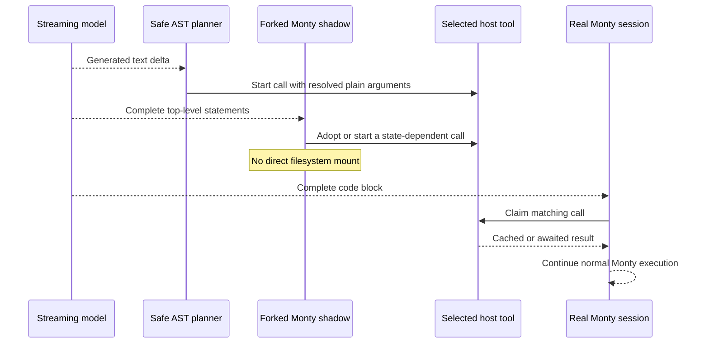

# Speculative programmatic tool calling

Arenero can start selected hosted-tool calls while a model is still generating
Monty code. The real Monty execution later claims matching work. This can remove
part of the model-to-tool delay without adding a CPython code sandbox.

Speculation is off by default. It is an optimization. Correct code must produce
the same answer when speculation is off, when a bet fails, or when no bet can be
made.

## Execution model



There are two discovery paths:

- The host planner uses `ast.parse()` only to inspect generated source. A small
  allowlist evaluates literals, known plain values, slices, simple arithmetic,
  string methods, conditions, bounded loops, and simple comprehensions. It does
  not execute generated code.
- A forked Monty snapshot executes complete generated statements. This resolves
  values that depend on existing REPL state or generated helper functions. The
  shadow is deleted after the turn and cannot change the real Python state.

The real code always runs in Monty. Arenero does not call CPython `exec`, `eval`,
or `compile` for generated code.

## RLM use

Supply the normal async model call, an optional stream adapter, and an explicit
speculation configuration:

```python
from arenero import (
    RLM,
    RLMConfig,
    SpeculationConfig,
    adapt_langchain_model,
    adapt_langchain_model_stream,
)

rlm = RLM(
    adapt_langchain_model(model),
    model_stream=adapt_langchain_model_stream(model),
    config=RLMConfig(max_parallel_calls=8, timeout_seconds=120),
    speculation_config=SpeculationConfig(
        mode="stream",
        max_inflight=8,
        max_calls_per_turn=32,
    ),
)
```

The built-in default policy allows only `llm_query` and
`llm_query_batched`. Recursive `rlm_query`, filesystem, network, MCP, and
application tools do not run early unless the host adds an explicit policy.

`mode="stream"` plans each model delta when `model_stream` is available. If it
is not available, Arenero safely plans the complete response before real
execution. `mode="lazy"` always uses this full-response path. `mode="off"` does
no speculative work.

The stream callback has this framework-neutral shape:

```python
from collections.abc import AsyncIterator
from arenero import RLMModelResponse

async def model_stream(
    prompt: str,
    model: str | None,
) -> AsyncIterator[str | RLMModelResponse]:
    ...
```

Each item is a text delta. Usage values in `RLMModelResponse` must describe that
item only, not a cumulative stream total. The LangChain adapter uses public
`BaseChatModel.astream()` and normalizes its chunks.

## Standalone SpecTC-style use

`SpeculativeTurn` lets another controller use the same planner, result store,
claim wrappers, and Monty shadow without using `RLM.complete()`:

```python
from arenero import SpeculationConfig, SpeculativeTurn

turn = SpeculativeTurn(
    kernel,
    session_id="agent-1",
    tools=hosted_tools,
    config=SpeculationConfig(mode="stream"),
    known_values={"context": context, "question": question},
)
await turn.start()

try:
    async for delta in model_stream(prompt, None):
        await turn.feed(delta)
        response_parts.append(delta)

    await turn.finish_generation()
    result = await kernel.execute(
        "agent-1",
        extracted_code,
        hosted_tools=turn.real_tools,
    )
finally:
    usage = await turn.close()
```

The caller must create the real session before `start()`, extract the final code
block, and call `close()` in `finally`. A state-saving store is needed for the
shadow. Static planning still works with a stateless store.

## Tool policies

Each early tool needs an explicit `SpeculativeToolPolicy`:

```python
from arenero import SpeculationConfig, SpeculativeToolPolicy

config = SpeculationConfig(
    mode="stream",
    tools=(
        SpeculativeToolPolicy("search"),
        SpeculativeToolPolicy("read_record", deterministic=True),
        SpeculativeToolPolicy(
            "fetch_public",
            gate=lambda args: args["url"].startswith("https://docs.example.com/"),
        ),
    ),
)
```

The name can be the hosted-tool name or its Python alias.

- The default is nondeterministic. Repeated identical calls get separate FIFO
  bets and keep call count and order.
- `deterministic=True` lets repeated identical calls share one result. Use it
  only when the same arguments always mean the same result for the complete
  turn.
- `gate` can reject a concrete argument set. A rejected call uses the normal
  path.
- `key` can provide stable identity material when normal argument equality is
  not sufficient.
- A hosted tool marked `sequential=True` is not speculated because early overlap
  would violate its execution contract.

Speculative calls bypass a parent agent framework's ToolNode and approval
middleware. The host policy is the approval boundary. Prefer read-only,
idempotent, or provider-inference tools. A wrong-path call can still consume
money, rate limits, or external capacity. Do not opt in a write, payment, delete,
message, or other irreversible tool.

## Matching and failures

Arenero identifies a call from its Python tool alias and a SHA-256 hash of
canonical arguments. Bytes use a Base64 identity form. The real wrapper claims
only a matching tool and argument set.

If a bet fails, the real call uses the original tool path. This preserves the
normal result but can make a second external call. An opted-in tool must tolerate
that retry or use its own idempotency key. Pending unused calls are cancelled by
default. Completed unused calls are counted as waste.

The shadow can adopt a statically planned call. This does not consume the real
claim. A nondeterministic call can be claimed once by real execution. A
deterministic result can be claimed more than once.

## Limits and statistics

| Setting | Meaning |
| --- | --- |
| `max_inflight` | Early calls that can run at the same time. |
| `max_calls_per_turn` | Early dispatches in one model turn. |
| `max_argument_chars` | Largest canonical argument record for one bet. |
| `max_code_chars` | Generated response text retained for planning. |
| `max_loop_unroll` | Static iterations inspected in one simple loop or comprehension. |
| `shadow` | Enable the forked Monty path. |
| `shadow_output_chars` | Output retained for one shadow statement. |
| `shadow_drain_seconds` | Maximum shadow drain time after generation. |
| `cancel_unclaimed` | Cancel unfinished unused work at cleanup. |

`RLMResult.usage.speculation` and `SpeculativeTurn.close()` report turns,
dispatches, hits, misses, ready hits, failures, cancellations, waste, shadow
executions, shadow errors, and real wait time. The event sink also receives
`speculation` events for dispatch, claim, shadow, cleanup, and failures.

These limits are in addition to RLM call, token, cost, response, concurrency, and
wall-time limits. An early `llm_query` uses the same shared RLM ledger as a normal
call. It is not a free call.

## Supported generated forms

The static path can resolve examples such as:

```python
part = context[:1000]
summary = await llm_query(prompt="Summarize:\n" + part)

results = []
for start in range(0, 2000, 500):
    result = await llm_query(prompt=context[start:start + 500])
    results.append(result)
```

The Monty shadow can resolve forms such as:

```python
def make_prompt(text):
    return "Find names:\n" + text

result = await llm_query(prompt=make_prompt(context[:2000]))
```

## Deliberate limits

- Planning recognizes fenced `python` and `repl` blocks only.
- The host evaluator does not call generated functions, access arbitrary
  attributes, import modules, perform I/O, or execute source.
- Static sequence multiplication above 1,000,000 items is left to the Monty
  shadow. Iterator inspection stops at `max_loop_unroll` without materializing
  the remaining items.
- Dynamic control flow that the host cannot prove is left to the Monty shadow or
  normal execution.
- A shadow is a copy of Python state only. It does not copy files, host
  connections, or framework run contexts.
- The shadow disables direct virtual filesystem access and `bootstrap_files`.
  Eligible hosted tools remain available because they are reattached by the
  host.
- Speculation does not support `rlm_query` by default. Starting recursive agent
  loops on a path that may never run has high cost and worker demand.
- A model adapter that does not provide deltas cannot overlap calls with token
  generation. Full-response planning can still overlap independent calls and
  avoid duplicate calls through the claim store.
- Cancellation is best effort. A synchronous host function already running in a
  thread or a remote provider request may finish after cancellation.
- Speculation does not make external effects transactional and does not roll
  them back.

Use `RLM.capabilities()` to show the active mode, policy names, and limits to an
agent or operator.
