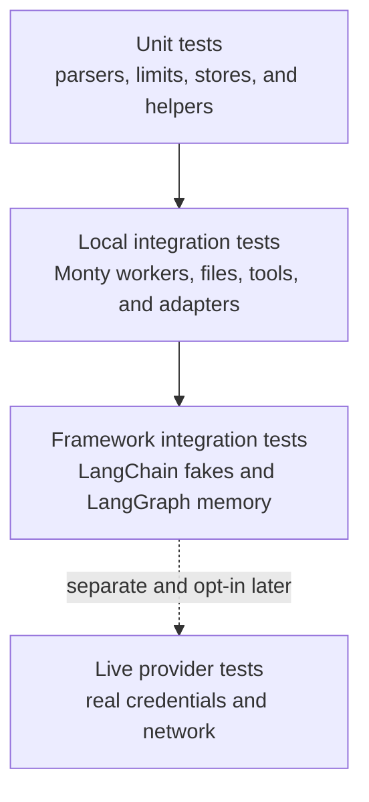
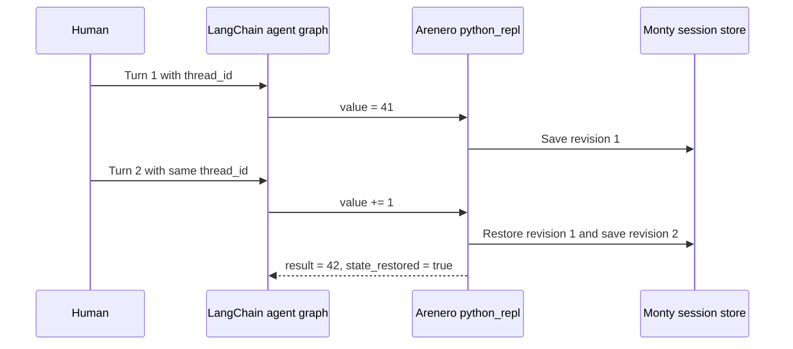
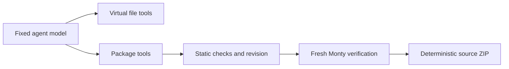

# Testing Arenero

Arenero uses deterministic tests by default. The test suite does not need an API
key and does not call a real language model. This keeps failures repeatable and
makes the suite suitable for local runs and continuous integration.

## Test layers



The current suite includes the first three layers. Live provider tests are not
part of the suite.

`tests/test_monty_110.py` tests native dynamic source, standard modules, complex
values, eager iterators, unsupported features, virtual helper execution, saved
RNG and functions, directory sharing and restore, workspace bootstrap, fixed OS
policy, native stderr, feed and turn limits, sleep and suspension limits, old
snapshot rejection, and sync/async parity. It uses real Monty workers and no LLM.
The full suite also tests mocked LangGraph agents, MCP reload, source packages,
RLM recursion, speculative calls, cancellation, and checkpoints on this version.

`tests/test_runtime_simplifications.py` checks helper reuse and refresh, native
inputs and typed declarations, read-only name/type inspection, one directory
across Python/shell/managed files, reset/fork/checkpoint/durable directory state,
small output limits, shared JSON formats, nested standard-module imports and
rejected nested virtual imports, and native async parity. Its complete mocked
LangChain graph spans two human turns and reuses supplied values, a saved helper,
and a directory. Inspection must not change snapshot bytes or revisions.

`tests/test_api_completion.py` checks the next six changes: raw package metadata
at a zero-character output cap; once-only file/module/cell inputs across bound,
facade, and managed APIs; typed file reads; sync and native async overflow JSON;
native async uploads, listing, controls, failures, and a one-worker write path;
relative sibling imports and graph limits; opt-in binary assets, virtual
`__file__`, revisions, deterministic ZIPs, and existing quotas. A complete mocked
native async agent runs `%run`, inspects state on the second human turn, and uses
the existing module tool to write full output. No live model is called.

`tests/test_small_sandbox_gaps.py` validates all ten small sandbox changes through
real workers: compound/unpacking exports and scope isolation; flat/module
metadata; facade and agent grep options; bounded non-mutating value inspection;
strict opt-in decoding; concurrent sync Python-only calls with denied files;
managed forwarding; native async file helpers, partial batch transfers, expiry
cleanup; one-worker MCP artifact extraction before trimming, failures and
cancellation; saved-policy restore, fork, SQLite, drift rejection and legacy
unknown status. Its complete mocked Deep Agents graph uses both unchanged
interpreter names across two human turns and writes full output files.
The native Monty restore-limit test stays separate from Arenero's new guard.
Speculative wait timing starts at the observed real claim, not task creation;
MCP budget tests accept exhaustion before or during the next call.

`tests/test_cleanup.py` checks the shared missing-thread error through real
LangGraph tool nodes, default/zero/capped/negative output limits, the common trim
marker and error-text fallback, prior stable-stub hashes and saved-state restore,
sync/async tool merging and collision errors, fresh call budgets, async callback
priority, sync thread offloading, error/cancellation propagation, and native async
execution/reset while the file lock is held. These checks use no live model.

`tests/test_deepagents_compat.py` covers the optional Python compatibility
profile and backend with fake models and real local Monty workers. It checks
two human turns across middleware recreation, private slots without thread IDs,
sync invoke/stream and async invoke/custom streams, result blocks, print discard,
snapshot authentication and size, all state modes, graph interrupt/resume and
cancellation, stable task IDs, schema bounds, separate task budgets/concurrency,
events, live tool namespaces, and the optional module workaround. A complete
mocked Deep Agents graph writes through outer file tools and reads/writes from
Python through the same backend, including a file pool with one worker. Backend
checks cover a* methods, native records, paging, binary batches and errors, root
bounds, upstream glob rules, exact grep caps, scan limits, and cooperative shell
deadlines. The suite is tested with the locked dependencies and an isolated
Deep Agents 0.7.28 / LangChain 1.4.6 / LangGraph 1.2.16 environment. It uses no
provider credentials or real LLM calls. See the
[compatibility guide](deepagents-compatibility.md).

`tests/test_deepagents_hardening.py` adds regression checks for all ten adapter
follow-ups. A fake-model graph calls a loop-bound async tool across two human
turns. Real Deep Agents child graphs use fake models for a structured response,
a loop-bound child tool, and interrupt/resume. Other tests cover cancellation
of pending callbacks, message/command result values, discarded large console
output with saved state, snapshot version rejection before load, old HMAC tags,
metadata tampering, config precedence, startup code and files, configured hosted
tools, an in-process MCP server, fake RLM responses, shared module/output files,
namespace setup before module code, error codes, host deadlines, and idle locks
with active waiters. No test calls a real model or remote server.

CI runs the full suite in two dependency lanes: the checked-in `uv.lock` with
`--frozen`, and a fresh resolution of newer allowed releases with `--upgrade`.
The latter does not commit its generated lock file. Monty remains pinned to
1.1.0 in both lanes. Each lane builds the wheel, installs it in a clean core-only
environment, checks that Deep Agents is absent, and executes `20 + 22` in Monty.
The matrix tests compatibility, not every possible dependency combination.

`tests/test_interpreter_fixes.py` covers the next four fixes and RLM loop
ownership. Mocked complete graphs check named tool removal across human turns,
saved helpers, sync calls, concurrent slots, interrupt/resume in a new adapter,
historical names versus a newer host cache, and standalone explicit tool grants.
Nested commands exercise real messages, serialized messages, empty content, and
typed update fallbacks without parent-state changes. Other fake graphs check
native tracebacks, unchanged error messages, shared error caps, full overflow
JSON, model-visible output-file success/failure and original counts. Fake RLM
clients test plain, batch, recursive and speculative streaming calls, deadlines,
errors, cancellation cleanup, two application loops sharing a runner, and sync
fallback to the owned loop. No live provider or remote service is called.

| Layer | Purpose | Main examples |
| --- | --- | --- |
| Unit | Check one small component with no network. | Static planning, canonical call identity, limits, redaction, and error codes. |
| Local integration | Check real Monty workers and connected Arenero components. | Persistent sessions, concurrent turns, shadow sessions, virtual files, RLM budgets, cancellation, and cleanup. |
| Framework integration | Check public framework adapters with deterministic models and state. | `GenericFakeChatModel`, LangChain adapters, LangGraph nodes, and `InMemorySaver`. |
| Live integration | Check one real provider or remote service. | Not implemented. These tests must be separate and opt-in if added later. |

## Run the suite

For a version-specific language and API comparison, run
`uv run --frozen python scripts/monty_feature_probe.py`. Run that same script in
an isolated environment for a candidate Monty release. It is separate from the
Arenero suite: a successful native feature probe does not validate our adapters,
snapshots, or limit mapping. See [the reviewed comparison](monty-updates.md) and
[saved results](monty-compatibility.json).

Run all tests:

```console
uv run python -m unittest discover -s tests -v
```

Run the speculative execution tests only:

```console
uv run python -m unittest \
  tests.test_speculation \
  tests.test_speculation_edges \
  tests.test_speculation_rlm_edges \
  tests.test_speculation_frameworks -v
```

Run the complete mocked agent tests only:

```console
uv run python -m unittest \
  tests.test_langchain_agent \
  tests.test_langchain_agent_lifecycle \
  tests.test_langchain_agent_boundaries -v
```

Run the managed sandbox tests only:

```console
uv run python -m unittest tests.test_easy -v
```

Run the six runtime-change checks only:

```console
uv run --frozen python -m unittest tests.test_runtime_simplifications -v
```

Run the API-completion checks only:

```console
uv run --frozen python -m unittest tests.test_api_completion -v
```

Run the ten small sandbox change checks only:

```console
uv run --frozen python -m unittest tests.test_small_sandbox_gaps -v
```

Run the internal cleanup checks only:

```console
uv run --frozen python -m unittest tests.test_cleanup -v
```

Run the Python interpreter adapter checks only:

```console
uv run --frozen python -m unittest \
  tests.test_deepagents tests.test_deepagents_compat \
  tests.test_deepagents_hardening tests.test_interpreter_fixes -v
```

These tests use real Monty workers. They cover all presets, bound state, relative
files, file revisions, total quota rollback, deterministic and unsafe ZIPs,
binary host tree transfer, memory-to-durable checkpoint restore, durable
restart, package creation, manager file sharing and state isolation, async batch
execution, and the fixed-session LangChain tool bundle.

Run static checks:

```console
uv run ruff format --check .
uv run ruff check .
uv run ty check
```

## Speculative execution coverage

The expanded suite checks these boundaries:

1. Concurrent sessions cannot claim each other's calls.
2. Closing one turn does not cancel work owned by another turn.
3. `max_inflight` bounds active tool calls.
4. Character-by-character model output and incomplete code fences do not cause
   duplicate or early dispatch.
5. Call-count, argument-size, source-size, and loop-unroll limits stop excess
   planning.
6. Shadow timeouts, filesystem denial, failures, and cancellation remove all
   temporary sessions and tasks.
7. Canonical argument identity supports nested mappings, reordered keys, and
   bytes. Custom keys and eligibility gates are also checked.
8. Event order, event redaction, execution statistics, claimed failures, and
   wait time are checked.
9. RLM call, token, cost, and parallel-call ledgers remain shared when a call
   starts speculatively. Usage is counted once.
10. LangChain and LangGraph adapters work with deterministic fake messages and
    in-memory checkpoints.
11. A complete model-driven agent graph keeps one Monty REPL session across two
    human turns that use the same `thread_id`. The second tool call depends on a
    variable created by the first tool call.

These tests use the real Monty worker pool. They can find lifecycle and isolation
errors that a parser-only test cannot find.

## LangChain test pattern

Use `GenericFakeChatModel` when a test needs a model response. Give it an ordered
iterator of `AIMessage` values. One fake can supply a streamed controller response
and later nested responses without a provider call.

```python
model = GenericFakeChatModel(
    messages=iter(
        [
            AIMessage(content="```python\nanswer['ready'] = True\n```"),
            AIMessage(content="nested result"),
        ]
    )
)
```

For a complete agent-loop test, use a small subclass that accepts `bind_tools()`.
Script the sequence as tool call, final answer, tool call, final answer. Invoke
the agent twice with the same `thread_id`. This checks all of these connections:



## Complete mocked agent coverage

The complete-agent tests use a scripted tool-calling chat model. The agent graph,
LangGraph checkpoint operations, Arenero tools, Monty workers, stores, virtual
files, and in-process MCP calls are real. No provider or external service is
called.

| Area | Mocked workflow and assertions |
| --- | --- |
| Concurrent threads | Two agents run in parallel, restore separate values, and keep separate session IDs. |
| Kernel and graph restart | A new model, graph, kernel, worker pool, and SQLite store instance restore the same REPL session. |
| Independent lifetimes | Resetting the REPL keeps graph messages. Replacing the graph keeps saved REPL state. |
| Save policies | `always`, `success`, and `never` control whether a change before a normal error is visible next turn. |
| Interrupt and resume | `interrupt_before=["tools"]` creates no session until resume. Resume executes one tool call and creates revision 1 once. |
| Cancellation | Cancelling a graph while Monty waits for a hosted function releases the worker and session lock. A later call succeeds. |
| Pool pressure | A full worker pool returns `WorkerCheckoutTimeout`, `retryable=true`, and `recovery=retry_later`. A later turn succeeds. |
| Duplicate delivery | Delivering the same LangChain tool-call ID twice executes the state-changing cell twice. This confirms at-least-once behavior. |
| Trimmed output | The agent sees truncation, reads the full output file, and continues in the same loop. |
| Virtual files | Shell creation, Python reading, file-tool editing, and later Python reading share one virtual filesystem. |
| MCP | In-process and real stdio servers support search, Monty composition, same-cell hot loading, replace rollback, removal, an image result, and automatic virtual-file materialization. |
| Dynamic MCP CodeAct | A scripted model adds a missing stdio MCP through `python_repl` on one human turn, then uses it with restored Python state on the next turn. The LangChain tool names stay unchanged. |
| Code correction | The first Monty call rejects an unavailable package. The next model call uses supported code and returns the result. |
| Snapshot recovery | A wrong Monty version returns a structured error. The agent resets the REPL and retries successfully. |

Item 12 from the proposed list, a complete Deep Agents workflow, is intentionally
not included.

### Duplicate-delivery rule

Arenero does not use the LangChain tool-call ID as a durable idempotency key. A
graph checkpoint replay can therefore execute the same state-changing REPL cell
again. The test asserts this current at-least-once rule instead of hiding it.

Applications that need exactly-once effects must use an application idempotency
key, make the operation idempotent, or store completed operation IDs in durable
application state. This applies especially to hosted tools and MCP calls with
external side effects.

Assert exact output for deterministic fakes. For any future live integration
test, assert the response structure and required fields instead of exact natural
language. Keep live tests in a separate opt-in group because network and provider
behavior can change.

## LangGraph test pattern

Build a new graph and checkpointer inside each test. Use `InMemorySaver` for
multi-turn state. Test node functions directly when graph routing is not part of
the behavior under test.

The framework tests verify two different state lifetimes:

- LangGraph checkpoints keep graph answers between calls that use the same
  `thread_id`.
- RLM root and shadow Monty sessions are temporary and are removed after each
  call.

This separation prevents a graph checkpoint from hiding a leaked Monty session.

## Rules for future live tests

If live provider tests are added later:

- Mark them as opt-in and keep them out of the default command.
- Skip them when required credentials are absent.
- Use the smallest model and request that prove the adapter works.
- Assert stable structure, tool names, and types. Do not assert exact prose.
- Record enough request and response metadata to diagnose a provider failure.
- Never put credentials or full sensitive prompts in test output.

These rules follow the LangChain distinction between deterministic unit tests and
network integration tests. They also follow the LangGraph recommendation to use
fresh graphs and in-memory checkpointers for isolated state tests.

## Monty source package tests

`tests/test_packages.py` follows the same steps that a human or agent must use:

1. Initialize the fixed package layout.
2. Edit source through the virtual filesystem.
3. Check the manifest, source limits, syntax, imports, and revision.
4. Test `verify.py` in a fresh temporary Monty session.
5. Export only after the package passes the same test again.

The tests also change a file after `package_check` and assert a revision conflict.
One test first loads the old package into a persistent REPL, edits the source, and
then proves that `package_test` sees the current file instead of old REPL state.
A fixed LangChain model drives the complete package tool flow without a network
or model provider call.



Run this focused layer with:

```console
uv run python -m unittest tests.test_packages -v
```

See [Monty-compatible source packages](monty-source-packages.md) for the package
contract that these tests enforce.
