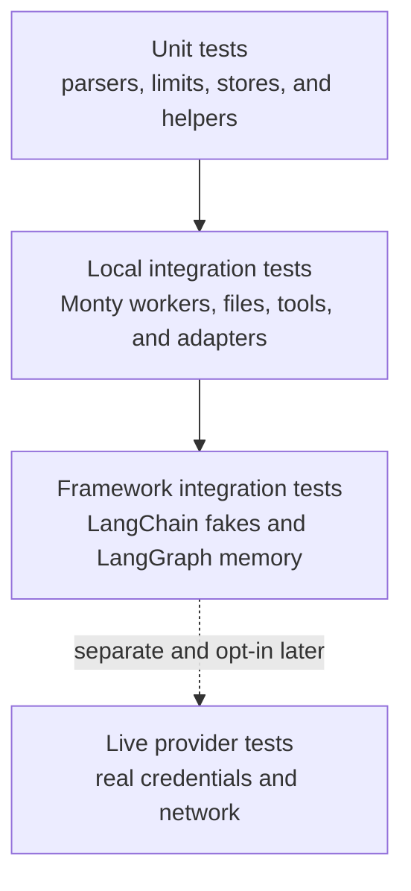
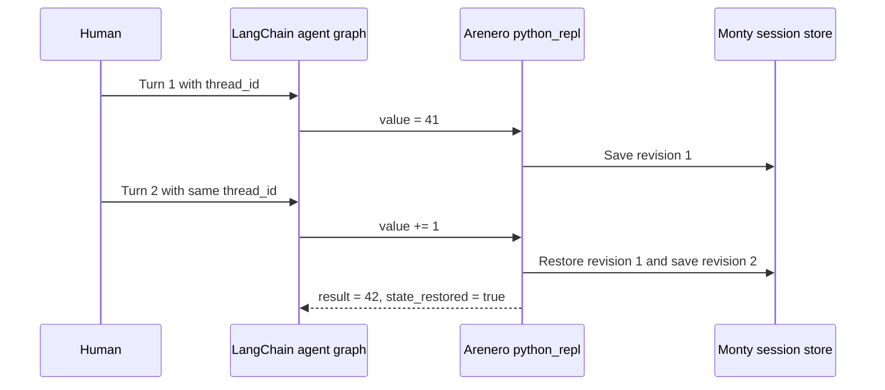

# Testing Arenero

Arenero uses deterministic tests by default. The test suite does not need an API
key and does not call a real language model. This keeps failures repeatable and
makes the suite suitable for local runs and continuous integration.

## Test layers



The current suite includes the first three layers. Live provider tests are not
part of the suite.

| Layer | Purpose | Main examples |
| --- | --- | --- |
| Unit | Check one small component with no network. | Static planning, canonical call identity, limits, redaction, and error codes. |
| Local integration | Check real Monty workers and connected Arenero components. | Persistent sessions, concurrent turns, shadow sessions, virtual files, RLM budgets, cancellation, and cleanup. |
| Framework integration | Check public framework adapters with deterministic models and state. | `GenericFakeChatModel`, LangChain adapters, LangGraph nodes, and `InMemorySaver`. |
| Live integration | Check one real provider or remote service. | Not implemented. These tests must be separate and opt-in if added later. |

## Run the suite

Run all tests:

```console
uv run python -m unittest discover -s tests -v
```

Run the speculative execution tests only:

```console
uv run python -m unittest \
  tests.test_speculation \
  tests.test_speculation_edges \
  tests.test_speculation_rlm_edges \
  tests.test_speculation_frameworks -v
```

Run static checks:

```console
uv run ruff format --check .
uv run ruff check .
uv run ty check
```

## Speculative execution coverage

The expanded suite checks these boundaries:

1. Concurrent sessions cannot claim each other's calls.
2. Closing one turn does not cancel work owned by another turn.
3. `max_inflight` bounds active tool calls.
4. Character-by-character model output and incomplete code fences do not cause
   duplicate or early dispatch.
5. Call-count, argument-size, source-size, and loop-unroll limits stop excess
   planning.
6. Shadow timeouts, filesystem denial, failures, and cancellation remove all
   temporary sessions and tasks.
7. Canonical argument identity supports nested mappings, reordered keys, and
   bytes. Custom keys and eligibility gates are also checked.
8. Event order, event redaction, execution statistics, claimed failures, and
   wait time are checked.
9. RLM call, token, cost, and parallel-call ledgers remain shared when a call
   starts speculatively. Usage is counted once.
10. LangChain and LangGraph adapters work with deterministic fake messages and
    in-memory checkpoints.
11. A complete model-driven agent graph keeps one Monty REPL session across two
    human turns that use the same `thread_id`. The second tool call depends on a
    variable created by the first tool call.

These tests use the real Monty worker pool. They can find lifecycle and isolation
errors that a parser-only test cannot find.

## LangChain test pattern

Use `GenericFakeChatModel` when a test needs a model response. Give it an ordered
iterator of `AIMessage` values. One fake can supply a streamed controller response
and later nested responses without a provider call.

```python
model = GenericFakeChatModel(
    messages=iter(
        [
            AIMessage(content="```python\nanswer['ready'] = True\n```"),
            AIMessage(content="nested result"),
        ]
    )
)
```

For a complete agent-loop test, use a small subclass that accepts `bind_tools()`.
Script the sequence as tool call, final answer, tool call, final answer. Invoke
the agent twice with the same `thread_id`. This checks all of these connections:



Assert exact output for deterministic fakes. For any future live integration
test, assert the response structure and required fields instead of exact natural
language. Keep live tests in a separate opt-in group because network and provider
behavior can change.

## LangGraph test pattern

Build a new graph and checkpointer inside each test. Use `InMemorySaver` for
multi-turn state. Test node functions directly when graph routing is not part of
the behavior under test.

The framework tests verify two different state lifetimes:

- LangGraph checkpoints keep graph answers between calls that use the same
  `thread_id`.
- RLM root and shadow Monty sessions are temporary and are removed after each
  call.

This separation prevents a graph checkpoint from hiding a leaked Monty session.

## Rules for future live tests

If live provider tests are added later:

- Mark them as opt-in and keep them out of the default command.
- Skip them when required credentials are absent.
- Use the smallest model and request that prove the adapter works.
- Assert stable structure, tool names, and types. Do not assert exact prose.
- Record enough request and response metadata to diagnose a provider failure.
- Never put credentials or full sensitive prompts in test output.

These rules follow the LangChain distinction between deterministic unit tests and
network integration tests. They also follow the LangGraph recommendation to use
fresh graphs and in-memory checkpointers for isolated state tests.
