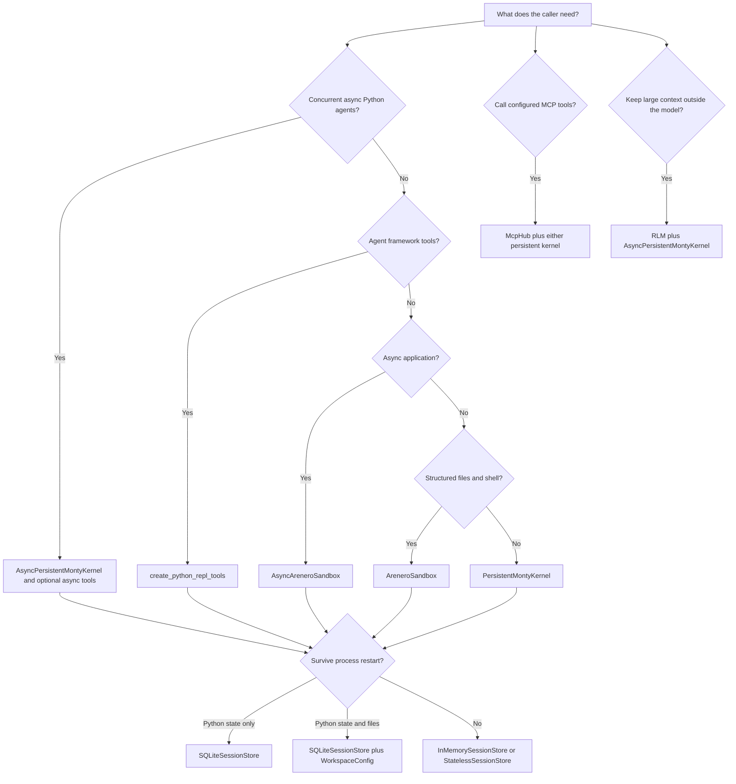

# Arenero usage and capabilities

This guide shows what Arenero can do, what it rejects, and how to select the right
API. The examples were checked with the project-pinned `pydantic-monty 0.0.21`.
Monty is experimental, so run the project tests before a Monty version update.

## Quick selection guide

| Requirement | Use |
| --- | --- |
| Direct persistent Python cells | `PersistentMontyKernel.execute()` |
| One virtual helper file and follow-up code | `PersistentMontyKernel.execute_file()` |
| Small static graph of virtual Python files | `execute_module()` or an agent module tool |
| Python, `!COMMAND`, and `%%shell` cells | `execute_repl_cell()` or `AreneroSandbox.execute_cell()` |
| Framework-neutral execution and file methods | `AreneroSandbox` |
| Full sandbox API in an async web service | `AsyncAreneroSandbox` |
| Concurrent async Python agents | `AsyncPersistentMontyKernel` |
| LangChain or LangGraph tools | `create_python_repl_tools()` with the `langchain` extra |
| Native async LangChain or LangGraph Python tools | `create_async_python_repl_tools()` |
| Deep Agents code-mode interpreter | `AreneroInterpreterMiddleware` with the `deepagents` extra |
| Large external context with recursive model calls | `RLM` with `AsyncPersistentMontyKernel` |
| Durable Python state | `SQLiteSessionStore` |
| Durable files and Python state | `SQLiteSessionStore` plus `WorkspaceConfig` |
| Process-only Python state | Default `InMemorySessionStore` |
| Fresh state on each call | `StatelessSessionStore` |
| Binary model input | `read_media_file()` and a provider content block |
| Progressive external tool use | `McpHub` with the `mcp` extra |



## Capability summary

| Area | Supported | Main limit |
| --- | --- | --- |
| Persistent Python | Variables, functions, closures, comprehensions, simple classes, dataclasses, control flow, and a partial standard library | Monty's Python subset, not CPython. |
| Type checking | Optional checks before each user feed, including filesystem and host-function declarations | A clean check does not prove that every partial runtime API exists. |
| Files | UTF-8 text, bytes, in-memory files, confined mounts, persistent workspaces, and bounded structured operations | No ambient host paths or live file descriptors. |
| Virtual shell | Fixed file and text commands, pipes, redirection, conditional lists, Monty Python, and bounded `curl` | No operating-system process or automatic expansion. |
| Persistence | Memory, SQLite, or stateless snapshots selected by `session_id` | Files have a separate lifecycle. Snapshots are Monty-version-specific. |
| Agent tools | Full sync tools, or a small native async Python, file, module, and reset set | LangChain is optional and the runtime thread selects the session. |
| Static virtual modules | Top-level absolute and relative imports, `.py`, `__init__.py`, roots, aliases, and follow-up code | No dynamic, wildcard, nested, cyclic, or third-party imports. Generated feeds skip type checking. |
| Deep Agents middleware | Async interpreter, dynamic catalog, PTC, subagent task bridge, three state modes, and private checkpoint snapshots | Nested calls bypass the parent ToolNode and its per-tool approvals. |
| Recursive model calls | External context, plain calls, child RLM sessions, ordered batches, shared depth, call, token, cost, and time limits | Child sessions need free workers and use hosted file tools instead of direct kernel mounts. |
| Speculative programmatic calls | Stream planning, safe static argument resolution, forked Monty shadows, result claims, fallback, cleanup, events, and statistics | Off by default. Only explicit non-sequential tools can run early. External effects are not transactional. |
| Host functions | Explicit sync functions, or async functions with the native async kernel | They run with host authority and must validate untrusted input. |
| Network | Host-side public HTTP and HTTPS through virtual `curl` | No direct Monty sockets or general network client. |
| Binary and images | Upload, download, Base64 data URL, and LangChain image block | The host must create the model content block. |
| Output control | Caller-selected lower limits, application hard caps, truncation data, and optional file offload | Offloaded output is still bounded. |
| Async use | Full thread-based sandbox facade or native async Python worker pool | The native adapter does not include the virtual shell. Shared files serialize work. |
| MCP tools | Configured stdio, Streamable HTTP, or in-process servers; progressive discovery; calls from persistent Python | Tools only; no resources, prompts, dynamic server configuration, or input-required flow. |

### Discover and compose MCP tools inside Python

Install `arenero[mcp]`, configure servers in trusted host code, and attach the hub
to the kernel:

```python
import sys

from arenero import PersistentMontyKernel
from arenero.mcp import McpHub, McpServerConfig

server = McpServerConfig.stdio("local", sys.executable, args=["server.py"])

with (
    McpHub([server]) as mcp,
    PersistentMontyKernel(mcp_hub=mcp) as kernel,
):
    found = kernel.execute("thread-1", "mcp_search('add')")
    called = kernel.execute(
        "thread-1",
        "mcp_call('local__add', {'a': 20, 'b': 22})",
    )
```

The model can search before it requests a full schema. It can call several tools
and calculate over their results in one Python cell. A helper function that uses
`mcp_call` persists with the session. Live server connections do not persist in
the snapshot. See [MCP tools inside the REPL](mcp.md) for the exact API, limits,
result envelope, and security boundary.

### Run independent agents in one async batch

Use one shared native kernel and one trusted session ID per agent:

```python
import asyncio

from arenero import AsyncPersistentMontyKernel, KernelConfig


async def run_batch() -> list[dict]:
    config = KernelConfig(max_worker_processes=4)
    async with AsyncPersistentMontyKernel(config=config) as kernel:
        return await asyncio.gather(
            kernel.execute("agent-a", "sum(range(10))"),
            kernel.execute("agent-b", "sum(range(20))"),
        )
```

Different session IDs can run at the same time. Repeated calls for one ID run in
order and restore that agent's state. Set `worker_checkout_timeout_seconds` to
return a retryable error instead of waiting without a deadline when the pool is
full.

Use `create_async_python_repl_tools(kernel)` for LangChain or LangGraph. It
returns `python_repl`, `python_repl_execute_file`,
`python_repl_execute_module`, and `reset_python_repl`.
Shell cells are not accepted by this adapter. Async host functions and native
async MCP functions must use `await` in Monty code. The native kernel has no
host upload, session listing, or output-file offloading methods. It has bounded
download support for module resolution. Use virtual `fs_*` helpers from Python,
or select the full sync facade when broader host operations are required.

## Working examples

### Keep calculations between turns

Use one trusted conversation or agent thread ID as the session key:

```python
from arenero import PersistentMontyKernel

with PersistentMontyKernel() as kernel:
    first = kernel.execute("conversation-42", "values = [2, 4, 6]\nsum(values)")
    assert first["result"] == 12

    later = kernel.execute(
        "conversation-42",
        "sum(value * value for value in values)",
    )
    assert later["result"] == 56
```

This works across separate human turns while the kernel or its in-memory store
remains active. Use SQLite when the process can restart.

### Transform plain data

Short value transformations are the main Monty workload:

```python
from arenero import PersistentMontyKernel

with PersistentMontyKernel() as kernel:
    result = kernel.execute(
        "transform",
        "records = [\n"
        "    {'name': 'Ada', 'score': 9},\n"
        "    {'name': 'Lin', 'score': 7},\n"
        "]\n"
        "[record['name'] for record in records if record['score'] >= 8]",
    )
    assert result["result"] == ["Ada"]
```

Lists, dictionaries, loops, comprehensions, functions, `json`, `math`, and other
supported Monty APIs are useful here. Large or unbounded data is not suitable.

### Load a virtual helper and use it in one call

Monty cannot import `helper.py`, but Arenero can feed it as source:

```python
from pydantic_monty import MemoryFile, OSAccess

from arenero import PersistentMontyKernel

filesystem = OSAccess(
    files=[
        MemoryFile(
            "/helper.py",
            "def double(value):\n    return value * 2\n",
        )
    ]
)

with PersistentMontyKernel(os_handler=filesystem) as kernel:
    result = kernel.execute_file(
        "conversation-42",
        "/helper.py",
        code="double(21)",
    )
    assert result["result"] == 42

    later = kernel.execute("conversation-42", "double(5)")
    assert later["result"] == 10
```

The helper's names enter the session. This has no module namespace, import cache,
relative import behavior, or package behavior.

### Resolve a small virtual module graph

Use `execute_module()` when helper files import each other:

```python
from pydantic_monty import MemoryFile, OSAccess

from arenero import PersistentMontyKernel

filesystem = OSAccess(
    files=[
        MemoryFile("/helper.py", "def double(x):\n    return x * 2\n"),
        MemoryFile("/main.py", "from helper import double\nANSWER = double(21)\n"),
    ]
)

with PersistentMontyKernel(os_handler=filesystem) as kernel:
    result = kernel.execute_module("conversation-42", "/main.py", "ANSWER")
    assert result["result"] == 42
```

This is a bounded host-side source resolver, not CPython import. See
[Static virtual modules](virtual-modules.md) for supported forms and all limits.

### Give Deep Agents one persistent interpreter

```python
from arenero import create_deepagents_middleware
from deepagents import create_deep_agent

interpreter = create_deepagents_middleware(
    mode="thread",
    ptc=("search",),
)
agent = create_deep_agent(
    model="openai:gpt-5.5",
    tools=[search],
    middleware=[interpreter],
)

answer = await agent.ainvoke(
    {"messages": [{"role": "user", "content": "Search, filter, and summarize."}]},
    {"configurable": {"thread_id": "conversation-42"}},
)
await interpreter.aclose()
```

The prompt includes live async signatures and active limits. Selected tools can
be awaited from Monty. These nested calls bypass the parent ToolNode, so parent
per-tool approval does not run. See
[Deep Agents interpreter middleware](deepagents.md).

### Keep large context outside the model

```python
from arenero import RLM, RLMConfig, adapt_langchain_model

rlm = RLM(
    adapt_langchain_model(chat_model),
    config=RLMConfig(max_depth=1, max_model_calls=32),
)

async with async_kernel:
    result = await rlm.complete(
        async_kernel,
        long_text,
        "Compare all claims and report conflicts.",
    )

print(result.response)
```

The root model writes Monty code that inspects `context`. It can await
`llm_query` for a plain subquery or `rlm_query` for a child with its own temporary
REPL. See [Recursive Language Models](rlm.md).

### Use Python and virtual shell cells through one API

```python
from pydantic_monty import OSAccess

from arenero import PersistentMontyKernel, execute_repl_cell

with PersistentMontyKernel(os_handler=OSAccess()) as kernel:
    execute_repl_cell(kernel, "thread-1", "total = 21 * 2")
    cell = execute_repl_cell(
        kernel,
        "thread-1",
        "%%shell\necho Alpha > /notes.txt\ngrep Alpha /notes.txt",
    )
    assert cell["mode"] == "shell"
    assert cell["exit_code"] == 0
    assert cell["output"].strip() == "Alpha"
```

Normal source is Monty Python. A first-character `!` selects one shell line. A
first-line `%%shell` selects a multiline shell cell.

### Use the framework-neutral sandbox facade

```python
from pydantic_monty import OSAccess

from arenero import AreneroSandbox, PersistentMontyKernel

with PersistentMontyKernel(os_handler=OSAccess()) as kernel:
    sandbox = AreneroSandbox(kernel, session_id="thread-1")
    sandbox.write("/notes.txt", "Alpha\nBeta\n")
    sandbox.edit("/notes.txt", "Beta", "Gamma")
    matches = sandbox.grep("Gamma", path="/")
    assert matches.error is None
    assert matches.matches[0]["text"] == "Gamma"
```

The facade also provides `execute`, `execute_python`, `execute_cell`,
`execute_file`, `delete`, `ls`, `glob`, `upload_files`, and `download_files`.

### Preserve Python and files after restart

```python
from arenero import PersistentMontyKernel, SQLiteSessionStore, WorkspaceConfig

store = SQLiteSessionStore(".arenero/sessions.db")
workspace = WorkspaceConfig(".arenero/workspaces/customer-42")

with PersistentMontyKernel(store, workspace=workspace) as kernel:
    kernel.execute("thread-1", "subtotal = 40")
    kernel.execute(
        "thread-1",
        "open('/workspace/note.txt', 'w').write('saved')",
    )

# A later process can create the same store and workspace configuration.
with PersistentMontyKernel(
    SQLiteSessionStore(".arenero/sessions.db"),
    workspace=WorkspaceConfig(".arenero/workspaces/customer-42"),
) as kernel:
    assert kernel.execute("thread-1", "subtotal + 2")["result"] == 42
    assert kernel.download_file("/workspace/note.txt") == b"saved"
```

Use a dedicated workspace per tenant when files must be isolated. Use external
coordination if separate processes can write the same workspace.

### Add a narrow domain function

```python
from arenero import KernelConfig, PersistentMontyKernel


def lookup_price(product_id: str) -> float:
    """Return a test product price.

    Args:
        product_id: Product identifier to validate and look up.

    Returns:
        Product price.
    """
    prices = {"item-42": 12.5}
    return prices[product_id]


with PersistentMontyKernel(
    config=KernelConfig(
        type_check=True,
        type_check_stubs="def lookup_price(product_id: str) -> float: ...",
    ),
    external_lookup={"lookup_price": lookup_price},
) as kernel:
    result = kernel.execute("thread-1", "lookup_price('item-42') * 2")
    assert result["result"] == 25.0
```

The function runs in the host process. A production function must validate its
arguments, limit its work, and avoid returning secrets.

### Let the caller select smaller output

```python
from pydantic_monty import OSAccess

from arenero import KernelConfig, PersistentMontyKernel

with PersistentMontyKernel(
    config=KernelConfig(
        default_output_limit_chars=1_000,
        max_output_limit_chars=10_000,
    ),
    os_handler=OSAccess(),
) as kernel:
    result = kernel.execute(
        "thread-1",
        "'x' * 5000",
        output_limit_chars=100,
        output_file="/large-result.json",
    )
    assert result["truncated"]["result"] is True
    assert result["output_file"] == "/large-result.json"
```

The output file is created only when output is trimmed. Stream, result, file, and
transfer hard caps still apply.

### Prepare an image for a model

```python
from pathlib import Path

from pydantic_monty import OSAccess

from arenero import PersistentMontyKernel, read_media_file

with PersistentMontyKernel(os_handler=OSAccess()) as kernel:
    kernel.upload_file("/images/ant.png", Path("ant-image.png").read_bytes())
    media = read_media_file(kernel, "/images/ant.png")
    image_block = media.as_langchain_image(detail="low")
```

Pass `image_block` in a model message content list. A path or Base64 string alone
does not make an image visible to a model.

## Examples that do not work

These failures are deliberate.

### Third-party packages and unavailable modules

```python
result = kernel.execute("thread-1", "import numpy")
assert result["ok"] is False

result = kernel.execute("thread-1", "import subprocess")
assert result["ok"] is False
```

There is no package installer or site-packages. Use plain supported values, add a
narrow host function, or choose a container when the package itself is required.

### Importing a virtual helper

```python
# This fails even when /helper.py exists.
kernel.execute("thread-1", "import helper")
```

Use `execute_file("thread-1", "/helper.py", code="...")` for one flat helper.
Use `execute_module("thread-1", "/main.py", code="...")` when a bounded static
graph needs supported imports. Direct `kernel.execute(..., "import helper")`
still cannot load virtual files.

### Dynamic execution and namespace inspection

```python
kernel.execute("thread-1", "eval('1 + 1')")
kernel.execute("thread-1", "exec('x = 1')")
kernel.execute("thread-1", "__import__('math')")
kernel.execute("thread-1", "globals()")
```

These operations are absent. Submit source as a new host-driven feed instead of
building source inside Monty.

### Real shell and process commands

```python
result = sandbox.execute("git status")
assert result.exit_code == 127

result = sandbox.execute("pip install pandas")
assert result.exit_code == 127
```

Arenero never searches `PATH` and never starts a host executable. Use a container,
VM, or managed execution sandbox for Git, package tools, builds, and system tests.

### Automatic shell expansion

```text
cat *.txt       # Looks for a file literally named *.txt.
echo $HOME      # Prints $HOME. There is no environment expansion.
echo $(pwd)     # Command substitution is rejected.
cd ~            # There is no home-directory expansion.
```

Use `glob '*.txt'` or `find / '*.txt'`, then send explicit paths in a later call.

### Regular-expression shell grep

```text
echo Alpha | grep 'A.*a'
```

Shell `grep` searches for the literal text `A.*a`, so this returns exit code `1`.
Use a direct Monty `re` operation or structured `fs_grep(..., regex=True)` when a
regular expression is needed. The `AreneroSandbox.grep()` facade stays literal.

### Normal file iteration and CPython modes

```python
[line for line in open("/notes.txt")]  # File iteration is unavailable.
open("/notes.txt", "r+")  # Plus modes are unavailable.
open("/notes.txt", "x")  # Exclusive mode is unavailable.
```

Use `read()`, `readline()`, or `readlines()`. Use the structured edit or write
operations instead of random-access update modes.

### Per-call execution timeout

```python
sandbox.execute("python -c '21 * 2'", timeout=1)
```

The facade returns exit code `2` because one persistent checkout cannot safely
change its cumulative Monty budget per call. Set
`KernelConfig.max_duration_seconds` and `request_timeout_seconds` when the kernel
is created. Virtual `curl --max-time` can only lower the network timeout.

## Verified Monty Python shape

The following forms work in the pinned runtime:

- Ordinary functions, closures, and lambdas.
- Lists, dictionaries, tuples, loops, and comprehensions.
- Simple classes without base classes and dataclasses.
- Exceptions from Monty's fixed exception set.
- Synchronous context managers.
- F-strings and common calculations.
- Generator expressions, but they are eager lists instead of lazy generators.

The following forms do not work:

- Inheritance, `super()`, metaclasses, descriptors, and method decorators.
- Generator functions and `yield`.
- `match`, `del`, `async with`, `async for`, and exception groups.
- User-defined exception subclasses.
- Wildcard imports, relative imports, packages, and dynamic imports.
- `eval`, `exec`, `compile`, `globals`, `locals`, `vars`, and `dir`.

`enumerate`, `zip`, `map`, `filter`, `reversed`, and generator expressions are
eager. Do not use them on large or unbounded inputs.

## Verified module imports

The table reports only whether the module imports in `pydantic-monty 0.0.21`.
Every successful module provides only part of the CPython API.

| Imports | Does not import |
| --- | --- |
| `asyncio`, `collections`, `dataclasses`, `datetime`, `itertools`, `json`, `math`, `os`, `pathlib`, `re`, `sys`, `typing`, `unicodedata` | `base64`, `binascii`, `csv`, `functools`, `hashlib`, `io`, `logging`, `pickle`, `random`, `socket`, `subprocess`, `tempfile`, `threading`, `time`, `traceback`, `urllib`, `uuid`, `zipfile` |

Do not infer API support from a successful import. For example, Monty's `os` has
no process API, normal current directory, or complete `os.path` behavior. Use a
small runtime test for an API that matters.

Arenero's virtual shell implements `base64`, `sha256sum`, and `curl` in the host.
This does not make the matching Python modules available inside Monty.

## Filesystem choices

| Choice | Files survive calls | Files survive process restart | Isolation and ownership |
| --- | --- | --- | --- |
| No filesystem configuration | No file access | No | Safest default. |
| `OSAccess` with `MemoryFile` | Yes, while the object lives | No | Caller owns the object. Share or separate it explicitly. |
| `WorkspaceConfig` | Yes | Yes | Kernel owns one dedicated read-write mount. |
| Read-only `MountDir` | Yes | Host files already persist | Caller owns the mount; Monty cannot change files. |
| Read-write `MountDir` | Yes | Yes | Caller owns the mount; changes affect the selected host directory. |
| Overlay `MountDir` | Only during one Monty feed | No writes survive | Each later feed starts with a clean overlay. |

All virtual paths use POSIX syntax. Only regular files are available. Mount path
checks prevent `..` and symlinks from escaping the selected directory. Text is
UTF-8. The first Monty read caches the complete file in that file object.

## Agent tool guidance

Agent integrations can also expose selected application, LangChain, Pydantic AI,
or promoted MCP tools as keyword-only functions inside the REPL. The generated
catalog gives the model exact aliases and common argument types. Per-operation
limits and `host_calls` records cover nested calls. Code-execution and control
tools are excluded by default. See
[Hosted tools and code-mode composition](hosted-tools.md).

The optional adapter returns these tools:

- `python_repl`
- `python_repl_execute_file`
- `python_repl_execute_module`
- `virtual_shell`
- `read_file`
- `write_file`
- `edit_file`
- `delete_file`
- `list_files`
- `glob_files`
- `grep_files`
- `reset_python_repl`

The runtime `thread_id` selects the default session. The model cannot pass a
different thread ID as a tool argument. Use a custom resolver to add a trusted
tenant or assistant key.

A useful model instruction is:

```text
Use python_repl for small calculations and plain-data transforms. It runs Monty's
Python subset, not CPython. State remains available in later calls in this thread.
Use python_repl_execute_file for one known flat virtual .py helper file. Use
python_repl_execute_module for a small bounded graph with supported static
imports. Direct Monty imports cannot load virtual files. Use !COMMAND or %%shell
only for the documented Arenero virtual shell. It
does not run host executables, Git, package tools, environment expansion, command
substitution, or automatic globs. Use file tools for structured file results. Use
small output_limit_chars values when full output is not needed, and use an
absolute output_file when a larger bounded result must remain available.
```

Also provide `MONTY_SANDBOX_INSTRUCTIONS` when the model can call the virtual
shell. Give the model the same type stubs used by `KernelConfig.type_check_stubs`.

## Result handling

Kernel results separate:

- `result`
- `stdout`
- `stderr`
- `error`
- stable `error.code`, `error.hint`, and `error.recovery`
- per-field `truncated` values
- state save and restore status
- requested `state_policy`
- session revision
- retry guidance
- output-file status
- execution ID, timing, state sizes, and original output sizes in `stats`
- materialized MCP paths in `mcp_artifacts`
- bounded nested hosted-tool records in `host_calls`

Cell results add common `mode`, `output`, `exit_code`, and `truncation` fields for
Python and shell calls. Applications should check `ok` or `exit_code` before they
use output. They must check truncation before they treat output as complete.

An error marked `retryable` can be corrected by the caller. A terminal resource
failure resets the saved session. A normal code error can preserve changes made
before the error.

Use `kernel.capabilities()` to get exact active commands, limits, persistence,
network, MCP, bootstrap, and sync or async rules. Use `kernel.instructions()` to
generate prompt-ready text from the same report. See
[Quality-of-life APIs](quality-of-life.md) for bound sessions, state policies,
forking, bootstrap, REPL commands, runtime ownership, doctor, events, and MCP
artifact materialization.
See [Hosted tools and code-mode composition](hosted-tools.md) for tool catalogs,
framework adapters, MCP promotion, budgets, restart behavior, and telemetry.

## Production checklist

- Select a trusted session key. Do not let the model choose another tenant's key.
- Select memory, SQLite, or stateless persistence deliberately.
- Give each isolated tenant a separate filesystem or workspace.
- Set duration, request, memory, recursion, stream, state, filesystem, transfer,
  output, shell, and network limits for the workload.
- Enable type checking and provide exact stubs when model retry quality matters.
- Keep host functions narrow, bounded, and free of returned secrets.
- Set hosted call, wall-time, concurrency, record, and preview limits.
- For RLMs, set depth, model-call, context, prompt, response, transcript, token,
  cost, concurrency, and wall-time limits. Provide enough Monty workers.
- Restrict or disable `curl` when the agent can access sensitive data.
- Give the model the exact shell and Monty limits.
- Check error, retry, and truncation fields in every adapter.
- Close kernels and caller-owned mounts.
- Prune expired SQLite sessions.
- Use external coordination for multiple processes that write one workspace.
- Test every required Monty syntax form and partial library API.
- Use a container or managed sandbox when the task moves beyond this boundary.

## Related references

- [Architecture and components](architecture.md)
- [Virtual shell reference](virtual-shell.md)
- [Sandbox compatibility](sandbox-compatibility.md)
- [MCP tools inside the REPL](mcp.md)
- [Hosted tools and code-mode composition](hosted-tools.md)
- [Recursive Language Models](rlm.md)
- [Design decisions](design-decisions.md)
