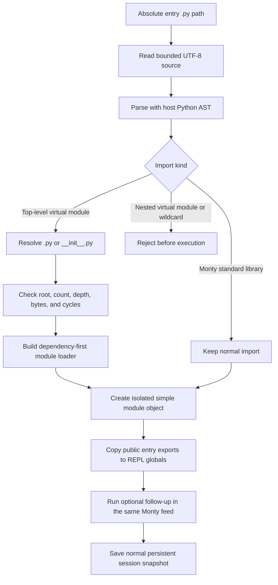

# Static virtual modules

Arenero's pinned Monty `1.1.0` has no `sys.path`, site-packages, file import
loader, or user module namespace.
Arenero therefore provides a small host-side resolver for user-owned Python
files in the virtual filesystem. It is useful for a few helper files. It is not
a CPython compatibility layer.

Released Monty `1.1.0` adds native `exec`, but does not add a source-file loader.
Development `main` adds explicitly supplied host modules. Neither change replaces
this resolver in the current project. See [the upstream review](monty-updates.md).

The resolver passes supported built-in modules through, including `base64`,
`binascii`, `copy`, `functools`, `random`, and `time`. Their APIs remain partial.
It does not enable development-only `hashlib`, `os.path`, or host module providers.

Use `execute_file()` for one flat helper. Use `execute_module()` only when files
need explicit static imports.

```python
from pydantic_monty import MemoryFile, OSAccess

from arenero import PersistentMontyKernel

filesystem = OSAccess(
    files=[
        MemoryFile(
            "/helper.py",
            "FACTOR = 2\ndef double(value):\n    return value * FACTOR\n",
        ),
        MemoryFile(
            "/main.py",
            "from helper import double\nANSWER = double(21)\n",
        ),
    ]
)

with PersistentMontyKernel(os_handler=filesystem) as kernel:
    result = kernel.execute_module(
        "conversation-42",
        "/main.py",
        code="ANSWER",
    )
    assert result["result"] == 42

    later = kernel.execute("conversation-42", "double(5)")
    assert later["result"] == 10
```

The async kernel and both LangChain adapters provide the same operation. Deep
Agents middleware exposes it as `python_interpreter_module`.

## Resolution flow



Each file runs inside a generated loader function. Its functions close over that
file's local values. A simple generated object holds public names. Import
statements become references to these objects. This avoids the unsafe flat-file
behavior where two modules can overwrite each other's globals.

The entry module object is available under its filename stem. Public entry names
are also copied into the REPL globals. For `/jobs/main.py`, follow-up code can use
both `main.run()` and `run()` when `run` is public.

## Supported forms

These forms work when files exist under an allowed root:

```python
import helper
import helper as h
from helper import calculate
from helper import calculate as run
from .helper import calculate
from package.values import VALUE
from pathlib import Path
```

Bundled standard-module imports also work inside functions or supported blocks:

```python
def distance(x, y):
    import math
    from functools import reduce

    return math.sqrt(reduce(lambda a, b: a + b, [x * x, y * y]))
```

These imports stay unchanged for Monty to run. They do not load virtual files.
Monty's syntax and partial module APIs still apply: passing a bundled root name
does not make an unsupported submodule such as `os.path` available in 1.1.0.
Imports in a class body remain unsupported by Monty.

Packages resolve through `package/__init__.py`. Absolute virtual names search
configured roots. Relative imports start at the importing file. A configured
alias maps its first name segment to a virtual directory:

```python
from arenero import VirtualModuleConfig

config = VirtualModuleConfig(
    roots=("/app",),
    aliases={"shared": "/libraries/shared"},
    max_modules=16,
    max_depth=6,
    max_source_bytes=500_000,
)

result = kernel.execute_module(
    "agent-1",
    "/app/main.py",
    module_config=config,
)
```

With this configuration, `from shared.math import add` reads
`/libraries/shared/math.py` or `/libraries/shared/math/__init__.py`.

The default limits are:

| Limit | Default | Meaning |
| --- | ---: | --- |
| `roots` | `("/",)` | Allowed virtual source roots. |
| `max_modules` | 32 | Maximum files in one graph. |
| `max_depth` | 8 | Maximum entry-plus-import depth. |
| `max_source_bytes` | 1,000,000 | Combined UTF-8 bytes across resolved files. |

The filesystem transfer limit is also enforced on each file.

## Deliberate limitations

The resolver rejects:

- `from module import *`;
- virtual-file imports inside functions, classes, `if`, loops, or other blocks;
- circular module graphs;
- `from . import helper`;
- a dotted `import package.helper` without an `as` name;
- paths outside configured roots or any path with `..`;
- non-UTF-8 source and files without a `.py` entry path;
- unresolved names that are not public exports;
- third-party packages, native extensions, dynamic imports, reload, custom import
  hooks, namespace packages, and `sys.path` changes.

Only Monty's documented partial standard-library modules remain normal imports.
A module name that is not in that set is treated as a virtual module.
For example, this still fails, even if `/helper.py` exists:

```python
def run():
    from helper import calculate  # Nested virtual import: rejected.

    return calculate()
```

Move that virtual import to the file's top level. Keep standard imports nested
only where Monty accepts the scope.

Generated support code uses dynamic attributes on a simple Monty class. Arenero
therefore disables Monty type checking for the complete generated module feed.
Direct `execute()` and `execute_file()` calls still follow `KernelConfig.type_check`.
Validate module files before an untrusted user can write them, or use direct
typed cells when pre-execution type checks are required.

AST parsing and source rewriting happen in the trusted host process. Source code
still executes only in Monty. The resolver does not execute user code on the
host.

## Persistence and side effects

The generated module objects, functions, closures, and public entry exports are
normal Monty values. They remain in a saved session and can be used by later
cells. Re-running the module creates new objects and overwrites the entry exports.
There is no import cache or automatic reload check.

Module source files stay in the separate virtual filesystem. A session reset
does not delete them. A graph checkpoint restores Python state but does not
restore old file bytes. File or hosted-tool changes made while a module loads are
not transactional and are not rolled back by `state_policy`.
