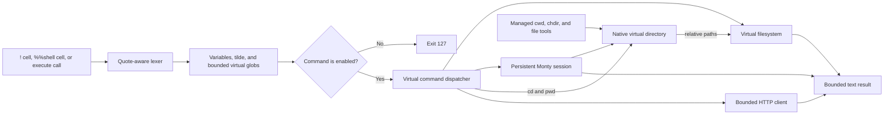
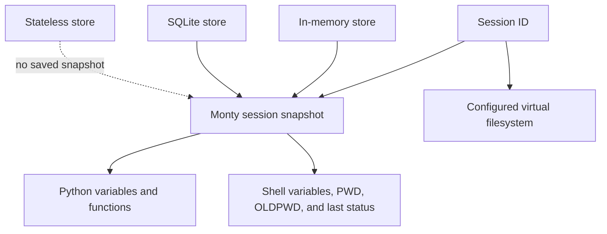

# Arenero virtual shell reference

## Scope

Arenero has a small Bash-like shell for work on its virtual filesystem. The
shell is an allowlisted command dispatcher. It is not Bash, an operating-system
shell, or a process runner. It never starts an arbitrary executable.

Use it for short, predictable file workflows:

- Create, read, find, copy, move, and delete virtual files.
- Connect UTF-8 text commands with pipes and redirection.
- Keep a small set of shell variables with the REPL session.
- Run straight-line command files with `source`.
- Run Monty-compatible Python with `python -c` or `python FILE.py`.
- Fetch bounded public HTTP or HTTPS resources with the virtual `curl` command.

Use a container or a managed operating-system sandbox when a task needs full
Bash, external programs, package installation, compilation, Git, or process
control.



The implementation is in `src/arenero/shell.py`. `AreneroSandbox.execute()`,
`ManagedSandbox.run_shell()`, the LangChain or LangGraph `virtual_shell` tool,
and REPL shell cells use this implementation.

## Entry points

Use a single-line notebook form:

```text
!grep -Ein 'error|warning' /logs/*.txt
```

Use `%%shell` for multiline source, comments, continuations, or here documents:

```text
%%shell
NAME=Arenero
cat <<EOF > /message.txt
Hello, $NAME
EOF
grep Hello /message.txt
```

The text after `%%shell` stays intact. Newlines are command separators unless
they are inside a quote, a here-document body, or escaped with a backslash.
A multiline `!` cell is invalid.

Python and shell cells use the same session ID and virtual filesystem. They also
use the same Monty snapshot for Python state and shell state. A shell cell can
run existing Python state with `python -c CODE`. Monty Python code can use the
`fs_read`, `fs_write`, `fs_edit`, `fs_mkdir`, `fs_delete`, `fs_ls`, `fs_glob`,
and `fs_grep` hosted functions. A running Monty feed cannot recursively call the
complete shell because that would re-enter its own session lock.

## Supported grammar

### Command lists

| Syntax | Meaning |
| --- | --- |
| `A ; B` | Run `B` after `A`, for all exit codes. |
| `A` newline `B` | Same as `A ; B`. |
| `A && B` | Run `B` only if `A` returns exit code `0`. |
| `A || B` | Run `B` only if `A` returns a nonzero exit code. |
| `A \| B` | Send the UTF-8 output of `A` to `B`. |
| `< FILE` | Read UTF-8 text from a virtual file. |
| `> FILE` | Replace a virtual text file with command output. |
| `>> FILE` | Append command output to a virtual text file. |
| `<<WORD` | Use a here-document body as command input. |

A failed command stops the current pipeline. This differs from normal Bash,
which usually reports the last command status unless `pipefail` is active.
Arenero then uses the failed status for `&&` and `||`.

Only one input and one output redirection are allowed for each command. Only one
here document is supported on one command line. Redirection has no file
descriptor syntax. There is no separate shell stderr stream.

### Quotes, escapes, and comments

- Single quotes preserve all characters.
- Double quotes expand `$NAME`, `${NAME}`, and `$?`.
- Outside quotes, a backslash quotes the next character.
- A backslash followed by a newline continues the current line.
- An unquoted `#` starts a comment only at a word boundary.
- Empty quoted strings are kept as empty arguments.

This is a small lexer, not a complete Bash parser. Escapes and edge cases can
differ from Bash outside the forms documented here.

### Variables and tilde

These forms are supported:

```text
NAME=value
export NAME=value
export NAME
unset NAME
echo "$NAME ${NAME} $?"
cd ~
cd ~/project
cd -
```

`PWD` and `OLDPWD` are managed by the shell. `HOME` defaults to the kernel's
initial working directory and can be changed. Undefined variables expand to an
empty string. Values are text. There is no Bash field splitting after variable
expansion, so one parsed word stays one argument.

An assignment must be the only item in its command. A prefix assignment such as
`MODE=test python task.py` is not supported. Exported variables are virtual shell
variables. They are not host process environment variables and are not passed to
HTTP, Monty, or an operating system.

### Wildcard expansion

Unquoted command arguments can expand `*`, `?`, and `**` against virtual paths:

```text
cat /reports/*.txt
grep -r TODO /project/**
echo "/reports/*.txt"   # literal wildcard
```

Expansion returns absolute virtual paths. Quoted wildcard characters stay
literal. An unmatched pattern also stays literal. Character classes such as
`[a-z]`, brace expansion such as `{a,b}`, extglob, and Bash hidden-file rules are
not supported. The shell rejects an expansion when its bounded filesystem scan
is incomplete or the expanded argument limit is exceeded.

### Here documents

An unquoted delimiter expands the supported variables in the body:

```text
NAME=world
cat <<EOF
hello $NAME
EOF
```

A single-quoted or double-quoted delimiter keeps the body literal:

```text
cat <<'EOF'
hello $NAME
EOF
```

The terminator must be alone on its line. Indented `<<-EOF`, here strings with
`<<<`, tab stripping, command substitution, and multiple here documents on one
command line are not supported.

## Supported commands

The application can reduce this set with
`KernelConfig.allowed_shell_commands`. Run `help` to see the active set.

| Command | Supported form | Main limitation |
| --- | --- | --- |
| `help` | `help [COMMAND]` | Reports virtual commands only. |
| `which` | `which COMMAND...` | Reports names, not executable paths. |
| `pwd` | `pwd` | No flags. |
| `cd` | `cd [PATH\|-]` | No physical/logical flags. |
| `env` | `env` | Prints virtual variables only. |
| `export` | `export [NAME[=VALUE] ...]` | Does not affect a host environment. |
| `unset` | `unset NAME...` | Variables only; no function mode. |
| `true`, `false` | no arguments | Fixed exit code only. |
| `test`, `[` | small expressions | No compound `-a`, `-o`, or nested expressions. |
| `ls` | `ls [-aA1ldR] [PATH...]` | `-l` shows type and path only. |
| `mkdir` | `mkdir [-p] PATH...` | No permission or mode flags. |
| `touch` | `touch FILE...` | Creates missing files; does not change timestamps. |
| `rm` | `rm [-r] [-f] PATH...` | No prompts or trash. |
| `cp` | `cp [-r] SOURCE... DESTINATION` | No metadata, links, or atomic transaction. |
| `mv` | `mv SOURCE... DESTINATION` | Copy then delete; not atomic. |
| `cat` | `cat FILE...` | UTF-8 text output only. |
| `head`, `tail` | `COMMAND [-n COUNT] [FILE]` | Lines only; no compact `-5` form. |
| `grep` | `grep [-EFinvcqlrR] PATTERN [FILE...]` | `-E` uses Python regex syntax. |
| `sort` | `sort [-r] [FILE]` | Unicode text order only. |
| `uniq` | `uniq [-c] [FILE]` | Adjacent duplicate lines only. |
| `rev` | `rev [FILE]` | Unicode character reversal only. |
| `wc` | `wc [-lwc] [FILE]` | One input; no filename in output. |
| `echo` | `echo [-n] [TEXT...]` | Does not interpret escapes. |
| `printf` | `printf FORMAT [ARGUMENT...]` | Small `%s`, `%d`, `%f`, `%b`, and `%%` subset. |
| `tee` | `tee [-a] FILE...` | Requires text pipeline input. |
| `find` | `find [PATH] [GLOB]` | Glob search only; no predicates or actions. |
| `glob` | `glob GLOB [PATH]` | Supports `*`, `?`, and `**` only. |
| `basename` | `basename PATH` | No suffix removal. |
| `dirname` | `dirname PATH` | Text path split only. |
| `base64` | `base64 [-d] [FILE]` | Decoded pipe output must be UTF-8. |
| `sha256sum` | `sha256sum [FILE...]` | No check mode. |
| `source`, `.` | `COMMAND FILE` | Straight-line virtual shell source only. |
| `curl` | documented options and one URL | Bounded HTTP client, not system curl. |
| `python` | `python -c CODE` or `python FILE.py` | Monty Python, not CPython. |
| `python3`, `monty` | same as `python` | Aliases only. |

For `cat`, `head`, `tail`, `grep`, `sort`, `uniq`, `rev`, `wc`, `base64`, and
`sha256sum`, `-` can select available pipeline input. Most commands also use
pipeline input when no file is given.

### `test` expressions

The following expressions are supported:

- One string, `! STRING`, `-n STRING`, or `-z STRING`.
- `-e PATH`, `-f PATH`, `-d PATH`, or `-s PATH`.
- `LEFT = RIGHT`, `LEFT == RIGHT`, or `LEFT != RIGHT`.
- Integer comparison with `-eq`, `-ne`, `-lt`, `-le`, `-gt`, or `-ge`.

`!` negates one string only. Boolean expression operators, parentheses, regex
comparison, file age comparison, permissions, and other Bash tests are not
supported.

### `grep` flags

- The default and `-F` use literal text.
- `-E` uses Python `re` syntax. It is not exact POSIX extended regex syntax.
- `-i`, `-n`, `-v`, `-c`, `-q`, `-l`, and `-r`/`-R` are supported.
- Recursive search reads UTF-8 regular files only and is bounded by filesystem
  entry, depth, result, and character limits.
- Exit code `1` means no selected line. Exit code `2` means invalid use.
- Context, word, whole-line, include/exclude, binary, and color flags are absent.

### `ls`, `cp`, and `mv`

`ls -a`, `-A`, and `-1` are accepted for familiar syntax. The virtual filesystem
does not hide dot files, and output is already one path per line. `ls -d` lists
the target itself. `ls -R` recurses. `ls -l` prints only `d PATH/` for a directory
or `- PATH` for a file; permissions, owner, timestamps, and size are not present.

`cp -r` copies bounded directory trees. Multiple sources require a directory
destination. `mv` supports files, directory trees, and multiple sources without a
`-r` flag. Both reject symbolic links. They do not preserve permissions,
ownership, timestamps, hard links, or sparse layout. A failure can leave partial
destination content. `mv` is copy then delete, so it is not atomic.

### `printf`

The supported conversions are `%s`, `%d`, `%f`, `%b`, and `%%`. The format repeats
when arguments remain. The supported escapes are `\n`, `\r`, `\t`, and `\\`.
Width, precision, positional arguments, locale behavior, `%q`, and most Bash
extensions are not supported.

### `source`

`source FILE` and `. FILE` read a UTF-8 virtual file and run it in the current
shell state. The script can use all supported commands, variables, comments,
newlines, pipes, redirections, here documents, `&&`, and `||`. Changes to
variables and the working directory remain available after it returns.

Source files share the outer call's command count, output cap, filesystem limits,
and session state. Nesting has its own configurable depth limit. There is no
shebang handling, argument list, `return`, positional parameter, startup file, or
full Bash control flow. Running `bash FILE` or `sh FILE` is not supported.

### `base64` and binary files

Encoding reads raw virtual file bytes and returns ASCII Base64. Decoding accepts
whitespace in the input. A decoded value can enter a pipe only when it is valid
UTF-8. To create or retrieve arbitrary binary data, use the structured filesystem
API with Base64 content or use `curl -o FILE`.

Pipes and `<`, `>`, and `>>` are text-only. `cp`, `mv`, `base64` encoding,
`sha256sum`, structured file operations, and `curl -o` can preserve binary bytes.

### `curl`

The virtual `curl` command supports:

| Option | Behavior |
| --- | --- |
| `-f`, `--fail` | Return exit code `22` for HTTP status 400 or higher. |
| `-L`, `--location` | Follow bounded redirects and recheck each target. |
| `-i`, `--include` | Include final response status and headers. |
| `-I`, `--head` | Send `HEAD`. |
| `-s`, `-S` | Accepted; there is no progress output to change. |
| `-X METHOD` | Select a method allowed by `NetworkConfig`. |
| `-H 'NAME: VALUE'` | Add a repeatable non-reserved request header. |
| `-d DATA` | Send one UTF-8 request body; defaults to `POST`. |
| `-o FILE` | Save response bytes to a virtual file. |
| `--max-time SECONDS` | Lower connection and between-read idle limits. |

Without an explicit `NetworkConfig`, public HTTP and HTTPS URLs are enabled.
Private, local, reserved, link-local, and multicast addresses are blocked by
default. A supplied policy can restrict URL prefixes, methods, request bytes,
response bytes, redirects, and time, or can remove `curl` with `enabled=False`.
Redirect targets repeat the URL and address checks.

This is not system curl. It has no uploads from files, cookies, proxy options,
certificate options, compression handling, multiple URLs, or unrestricted
network access. Normal response output must be UTF-8. Use `-o FILE` for binary
responses. `--max-time` is not a strict wall-clock deadline for DNS or a response
that keeps sending small data.

### Monty Python commands

These exact forms are supported:

```text
python -c CODE
python FILE.py
```

`python3` and `monty` are aliases. These commands use the persistent Monty
session. They do not accept pipeline input, script arguments, `-m`, an interactive
prompt, or normal CPython flags. `FILE.py` is submitted as source; it is not a
normal Python import.

Arenero's pinned Monty `1.1.0` has no `compile`, `globals`, `__import__`,
subprocesses, sockets,
threads, site-packages, or native extensions. Use Arenero's `execute_module()` for
a bounded Monty-compatible virtual source package.

Native `eval` and `exec` run Monty source, not CPython. Their strings bypass static
checking. Python `os.chdir()` and shell `cd` change the same saved virtual
directory; relative Python and managed file reads use it. Managed `run_shell()`
starts there without inserting an extra `cd`. New file-enabled managed sessions
start at their configured root; stateless calls return there for every call.
The host process directory is not changed. See
[the migration and limit guide](monty-updates.md).

## Examples that work

```console
# Variables, quotes, glob expansion, and status
NAME=report
touch /data/a.txt /data/b.txt
printf '%s\n' /data/*.txt
grep -q missing /data/a.txt || echo "$NAME has no match: $?"

# A text workflow
grep -rEin 'error|warning' /logs | sort | uniq -c > /summary.txt
cat /summary.txt

# A directory copy and a test
cp -r /project /backup
[ -f /backup/README.md ] && echo ready

# A straight-line script
source /scripts/prepare.sh

# A here document
cat <<'EOF' > /template.txt
$NAME stays literal here
EOF

# Public HTTP, subject to active NetworkConfig
curl -fL https://example.com/data.txt -o /downloads/data.txt
sha256sum /downloads/data.txt
```

## Examples that do not work

```console
# No command substitution
echo "$(pwd)"

# No loops or full Bash script grammar
for file in /data/*.txt; do cat "$file"; done

# No host executables
git status
pip install requests
bash /scripts/prepare.sh

# No stderr or descriptor redirection
python task.py 2> /errors.txt

# No prefix assignment
MODE=test python task.py

# No binary pipe
base64 -d /image.b64 | some-image-program
```

These calls return a nonzero exit code or an unsupported-command error. They do
not fall through to the host shell.

## State and persistence



- The in-memory store keeps shell and Python state across calls while the store
  object and process stay alive.
- SQLite keeps that state across kernel and process restarts.
- The stateless store starts shell and Python state again for each call.
- A reset removes Python state and shell state together.
- Session IDs isolate snapshots. Files can still be shared when sessions use the
  same filesystem.
- Virtual files are not inside the session snapshot. Their lifetime comes from
  `OSAccess`, mounts, or `WorkspaceConfig`.
- The filesystem lock is process-local. Separate host processes need their own
  coordination for writes to the same mounted directory.

## Limits

The shell uses existing kernel, filesystem, and network limit objects.

| Configuration | Default | Effect |
| --- | ---: | --- |
| `KernelConfig.max_shell_command_chars` | 20,000 | Raw call or sourced-file characters. |
| `KernelConfig.max_shell_commands` | 8 | Commands in the call, including sourced commands. |
| `KernelConfig.max_shell_expanded_args` | 1,000 | Arguments after wildcard expansion. |
| `KernelConfig.max_shell_variables` | 100 | Persistent virtual variables. |
| `KernelConfig.max_shell_script_depth` | 4 | Nested `source` calls. |
| `KernelConfig.default_output_limit_chars` | 8,000 | Default returned text. |
| `KernelConfig.max_output_limit_chars` | 50,000 | Hard result and pipeline text cap. |
| `FilesystemConfig.default_result_limit` | 100 | Normal list and grep result count. |
| `FilesystemConfig.max_result_limit` | 1,000 | Hard result count. |
| `FilesystemConfig.max_scan_entries` | 5,000 | Recursive scans. |
| `FilesystemConfig.max_grep_chars` | 2,000,000 | Text inspected by shell grep. |
| `FilesystemConfig.max_depth` | 20 | Recursive path depth. |
| `FilesystemConfig.max_transfer_bytes` | 10,000,000 | Binary or complete-file transfer. |
| `NetworkConfig.max_response_bytes` | 1,000,000 | HTTP response body. |
| `NetworkConfig.max_request_bytes` | 100,000 | HTTP request body. |

Monty's duration, request, memory, recursion, stream, and saved-state limits also
apply to Monty feeds used by shell state and Python commands. Applications can
lower or raise configured limits. A per-call `output_limit_chars` can only lower
the returned result limit below the hard maximum.

If a scan or output is incomplete, `truncated` is true or the command fails with
a limit message. Do not treat a truncated result as complete. `output_file` can
save the larger bounded shell output when only the returned view is trimmed.

## Result contract

`execute()` returns `output`, `exit_code`, and `truncated`:

- `0` means success.
- `1` means a command failed or `grep`/`test` found a false result.
- `2` means invalid syntax, invalid arguments, or a shell limit error.
- `127` means an unknown or disabled command.
- Errors use `output`; there is no separate shell stderr field.

The output is the combined output of each command list that ran. The exit code is
the last pipeline status that ran. Skipped `&&` or `||` branches do not replace
the previous status.

## Clear boundary: what is not supported

Arenero does not support these Bash or operating-system features:

- Arbitrary executables, subprocesses, Git, package managers, compilers, Docker,
  system utilities, or shell plugins.
- `if`, `for`, `while`, `until`, `case`, `select`, functions, aliases, arrays,
  traps, jobs, signals, process control, subshells, or grouped commands.
- `$(...)`, backticks, arithmetic expansion, process substitution, brace
  expansion, field splitting, pathname character classes, extglob, or advanced
  forms such as `${NAME:-default}`.
- Prefix assignments, positional parameters, script arguments, startup files,
  shebang execution, `sh FILE`, or `bash FILE`.
- stderr pipelines, `2>`, `2>&1`, arbitrary file descriptors, here strings,
  interactive input, terminals, or binary pipes.
- Exact Bash quoting in undocumented edge cases or exact POSIX command behavior.
- A virtual current time, file permissions, owners, groups, devices, links, or
  complete file metadata.
- Network access from Monty Python. Only the host-side virtual `curl` command and
  explicitly configured hosted tools or MCP tools can access a network.
- The virtual shell in the native async kernel. Use the synchronous kernel for
  shell cells; the async kernel is Python-only.

These are product boundaries, not commands that are waiting on the host PATH.
Arenero will not silently run them on the host.

## Related references

- [Architecture and components](architecture.md)
- [Usage and capabilities](usage-and-capabilities.md)
- [Sandbox compatibility](sandbox-compatibility.md)
- [Design decisions](design-decisions.md)
- [Monty constraints skill](../.agents/skills/monty-sandbox/SKILL.md)
