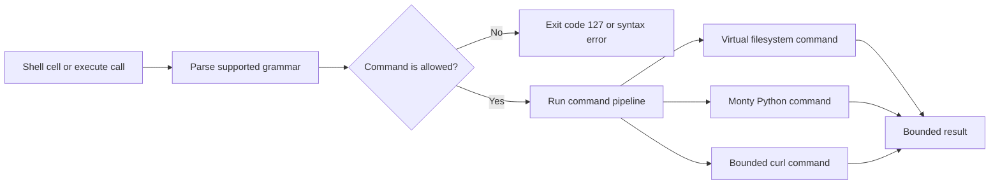

# Arenero virtual shell reference

## Purpose

The virtual shell gives agents a familiar command interface for short file tasks.
It is an allowlisted command dispatcher. It is not an operating-system shell and
does not start processes.

The implementation is in `src/arenero/shell.py`. `AreneroSandbox.execute()`, the
LangChain or LangGraph `virtual_shell` tool, and notebook-style REPL shell cells
use the same implementation.



Parsing and command selection happen before execution. Every output path uses
the configured response and file limits.

## REPL cell bridge

`execute_repl_cell()`, `AreneroSandbox.execute_cell()`, the `python_repl` agent
tool, and the terminal REPL accept these cell forms:

```text
!COMMAND
```

```text
%%shell
COMMAND ONE
COMMAND TWO
```

`!` accepts one shell line and must be the first character. A `%%shell` header must
be the first line; surrounding whitespace is accepted. Each later nonempty line
becomes one sequential shell command. Blank lines are ignored. Use the shell's
`;`, `&&`, or `||` operators when commands need different control flow.

The dispatcher checks the cell before Monty starts. It then runs either the Python
cell or the shell cell. Both modes use the same session ID, persistent Python
state, virtual shell working directory, and virtual filesystem. A shell cell can
use existing Python state through `python -c CODE`. Python code can use the
existing `fs_read`, `fs_write`, `fs_edit`, `fs_mkdir`, `fs_delete`, `fs_ls`,
`fs_glob`, and `fs_grep` helpers.

Do not mix Python and shell source in one cell. A multiline cell that starts with
`!` returns exit code `2`; use `%%shell`. Python results contain `mode=python` and
the normal kernel result fields. Shell results contain `mode=shell`, `ok`,
`output`, `exit_code`, and `truncated`.

## Supported commands

| Command | Syntax | Behavior |
| --- | --- | --- |
| `help` | `help [COMMAND]` | List enabled commands and operators, or show one command syntax. |
| `which` | `which COMMAND...` | Report enabled command names. It does not return host executable paths. |
| `pwd` | `pwd` | Print the current virtual directory. |
| `cd` | `cd [PATH]` | Change the current virtual directory. The default is `/`. |
| `ls` | `ls [PATH ...]` | List direct entries as absolute virtual paths. Directories end with `/`. |
| `mkdir` | `mkdir [-p] PATH...` | Create virtual directories. |
| `cat` | `cat FILE...` | Concatenate UTF-8 files. It also accepts pipeline input without file arguments. |
| `curl` | `curl [OPTIONS] URL` | Fetch one bounded public HTTP or HTTPS URL. `NetworkConfig` can restrict or disable it. |
| `head` | `head [-n COUNT] [FILE]` | Return the first lines of one file or pipeline input. |
| `tail` | `tail [-n COUNT] [FILE]` | Return the last lines of one file or pipeline input. |
| `grep` | `grep [-i] [-n] PATTERN [FILE ...]` | Find literal text. Exit code `1` means no match. |
| `find` | `find [PATH] [PATTERN]` | Find paths below a root. The default pattern is `**/*`. |
| `glob` | `glob PATTERN [PATH]` | Find paths with the existing Arenero glob rules. |
| `echo` | `echo [-n] [TEXT ...]` | Print literal arguments. |
| `sort` | `sort [-r] [FILE]` | Sort UTF-8 input lines. |
| `uniq` | `uniq [-c] [FILE]` | Remove adjacent duplicate UTF-8 input lines. `-c` adds counts. |
| `rev` | `rev [FILE]` | Reverse the characters in each UTF-8 input line. |
| `wc` | `wc [-lwc] [FILE]` | Count lines, words, or UTF-8 bytes. The default prints all three. |
| `basename` | `basename PATH` | Return the last part of a POSIX path. |
| `dirname` | `dirname PATH` | Return the directory part of a POSIX path. |
| `tee` | `tee [-a] FILE...` | Copy pipeline input to virtual files and return the same text. |
| `base64` | `base64 [FILE]` | Encode virtual file bytes or pipeline text as Base64. Decoding is not supported. |
| `sha256sum` | `sha256sum [FILE ...]` | Calculate SHA-256 hashes for virtual file bytes or pipeline text. |
| `rm` | `rm [-r] [-f] PATH...` | Delete files. `-r` is required for directories. |
| `cp` | `cp SOURCE DESTINATION` | Copy one regular file and preserve its bytes. |
| `mv` | `mv SOURCE DESTINATION` | Copy one regular file, then delete the source. It is not atomic. |
| `python` | `python -c CODE` | Run Monty-compatible Python in the persistent session. `python3` and `monty` are aliases. |
| `python` | `python FILE.py` | Load and run a virtual Python file in the persistent session. Relative paths work. |

## Command grammar

- `|` passes UTF-8 text to the next command.
- `;` always runs the next pipeline.
- `&&` runs the next pipeline only after exit code `0`.
- `||` runs the next pipeline only after a nonzero exit code.
- `< FILE` reads UTF-8 text from one virtual file.
- `> FILE` replaces one virtual text file.
- `>> FILE` appends to one virtual text file.
- Single quotes, double quotes, and backslash quoting follow Python `shlex` rules.
- `#` is plain text. It does not start a comment.

Each command can have at most one input redirection and one output redirection.
Redirection applies to virtual files only. A pipeline stops at its first failed
command. This is stricter than many operating-system shells, which often report
only the last pipeline command status.

The shell does not expand `*`, `?`, `**`, `$NAME`, `~`, or command substitutions
in arguments. Use `glob` or `find` to find paths, then use explicit paths in later
commands. The parser does not support grouping with parentheses.

## Command-specific limitations

### Discovery and paths

- `help` accepts zero or one command name. It rejects pipeline input. The output
  shows the active application allowlist, not every command Arenero can provide.
- `which` accepts one or more command names. It prints virtual command names, not
  executable paths. It returns exit code `1` when any name is unavailable.
- `pwd` accepts no options, arguments, or pipeline input.
- `cd` accepts zero or one directory. With no path it changes to `/`, not a home
  directory. There is no `cd -`, home directory, or `~` expansion.
- `basename` and `dirname` accept exactly one POSIX path. They only split text;
  they do not check whether the path exists. Suffix removal and other system-tool
  options are not supported.

### Files and directories

- `ls` accepts directory paths only. It has no flags, long format, sorting
  options, metadata, or automatic recursive mode. Output uses absolute virtual
  paths and adds `/` to directories.
- `mkdir` supports only `-p`, and `-p` must be the first argument.
- `rm` supports only `-r` and `-f`. Flags must come before paths. There is no
  `--`, prompt, trash, secure erase, or wildcard expansion. The virtual root `/`
  cannot be deleted. Recursive deletion fails if it exceeds filesystem scan or
  depth limits.
- `cp` copies exactly one regular file to one exact file path. It preserves bytes
  but does not copy directories, metadata, links, or multiple sources. It does
  not treat a directory destination as an instruction to keep the source name.
- `mv` has the same file limits as `cp`. It copies and then deletes, so it is not
  atomic and is not a directory rename operation.

### Text commands

- `cat` reads one or more UTF-8 files. With no file, it requires pipeline input.
  It has no flags and does not use `-` as a standard-input placeholder.
- `head` and `tail` support only `-n COUNT`, with a separate nonnegative integer.
  They accept at most one UTF-8 file or pipeline input. Byte counts and compact
  forms such as `-5` are not supported.
- `grep` does literal substring matching only. It supports only `-i` and `-n`,
  which can be combined. It has no regular expressions, invert mode, recursive
  mode, context lines, word mode, count mode, or automatic glob expansion. Exit
  code `1` means no match. Use the structured `grep_files` tool for bounded regex
  search when that tool is available.
- `echo` supports only a first `-n` flag. It does not process escape sequences or
  expand variables.
- `sort` supports only a first `-r` flag and at most one UTF-8 file or pipeline
  input. It uses direct Unicode string ordering. Numeric, field, locale, month,
  version, and stable-sort options are not supported.
- `uniq` supports only a first `-c` flag and at most one UTF-8 file or pipeline
  input. It removes adjacent duplicates only. Sort the input first when all equal
  lines must become adjacent.
- `rev` accepts at most one UTF-8 file or pipeline input. It reverses Unicode
  characters in each line and has no options.
- `wc` supports only `-l`, `-w`, and `-c`, which can be combined. It accepts at
  most one UTF-8 file or pipeline input. `-c` reports UTF-8 bytes. It does not
  print a filename.
- `tee` requires pipeline input and one or more exact file paths. It supports only
  a first `-a` flag. It creates missing parent directories and returns the same
  text to the next pipeline stage.

### Path search

- `glob` supports only `*`, `?`, and `**`. Character classes, brace expansion,
  extglob, and shell-style hidden-file rules are not supported. It scans below one
  root and is capped by filesystem result, scan, and depth limits.
- `find` is a short form of the same bounded glob search. It accepts only
  `[PATH] [PATTERN]`. It has no predicates, actions, type filters, expressions,
  deletion, or command execution. Its default pattern is `**/*`.

### Binary utilities

- `base64` only encodes. It accepts one virtual file as bytes or UTF-8 pipeline
  input. It does not decode, wrap lines, ignore invalid data, or accept multiple
  files. It fails when the complete encoded value exceeds the hard shell output
  limit, so it never returns invalid partial Base64 as a successful result.
- `sha256sum` accepts one or more virtual files as bytes, or UTF-8 pipeline input
  when no file is given. It has no check mode, tagged output, zero terminator, or
  other hash algorithms.

### Network command

`curl` is a small HTTP client. It is not the system curl program. It is registered
by default and allows public HTTP and HTTPS URLs. It supports these options:

| Option | Behavior |
| --- | --- |
| `-f`, `--fail` | Return exit code `22` and no body for HTTP status 400 or higher. |
| `-L`, `--location` | Follow redirects up to the configured limit. Each target is checked before use. |
| `-i`, `--include` | Include the final response status and headers. |
| `-I`, `--head` | Send a `HEAD` request. |
| `-s`, `--silent`, `-S`, `--show-error` | Accepted for familiar syntax. They do not change output because the virtual shell has no separate stderr. |
| `-X METHOD`, `--request METHOD` | Select an HTTP method that the host policy allows. |
| `-H 'NAME: VALUE'`, `--header 'NAME: VALUE'` | Add one request header. The option can be repeated. Arenero controls `Host`, `Content-Length`, `Connection`, `Transfer-Encoding`, and proxy authorization. |
| `-d DATA`, `--data DATA` | Send UTF-8 form data. It selects `POST` unless `-X` or `-I` was used. Only one data value is accepted. |
| `-o FILE`, `--output FILE` | Save response bytes to an exact virtual file path. With `-i`, a UTF-8 status and header block comes first. Missing parent directories are created. |
| `--max-time SECONDS` | Request a lower connection and between-read idle timeout. It cannot raise the host limit. |

Simple flags can be combined, for example `-fL` or `-si`. Options that take a
value must be separate arguments. Only one URL is accepted. Pipeline input,
uploads from virtual files, cookie jars, proxies, certificates, compressed output,
multiple URLs, progress meters, and the other system curl options are not
supported.

Normal output must be UTF-8. Use `-o FILE` for images and other binary responses.
The downloaded file uses the same virtual filesystem as all other commands and
agents that share that filesystem. The response-size limit also applies before a
file is written. The filesystem binary-transfer limit can apply a lower cap.

The host policy uses all these checks:

- When `NetworkConfig` is absent, `curl` allows all public HTTP and HTTPS URLs.
- An empty `allowed_url_prefixes` tuple also allows all public URLs. A nonempty
  tuple requires an allowed scheme, exact host, effective port, and segment-aware
  path prefix.
- `NetworkConfig(enabled=False)` removes `curl` from the command set.
- Only configured HTTP methods are accepted. The default is `GET` and `HEAD`.
- Private, loopback, link-local, reserved, multicast, and other non-global
  addresses are blocked by default.
- All DNS results are checked. The HTTP connection uses one checked address, which
  prevents a second DNS lookup from changing the target.
- Redirects are off unless `-L` is used. Each redirect target repeats the URL and
  DNS checks. Authorization and cookie headers are removed when the origin
  changes.
- Request bytes, response bytes, and redirect count have hard limits.
- An optional host `trusted_header_provider(url)` can add authorization or other
  headers after the URL check. Its case-insensitive values override agent headers.
  The provider must select secrets by URL without exposing them in the curl
  command. It must not return one secret for every public URL.
- System proxy settings and environment variables are not used.

Network time is host wall time. It is not Monty interpreter time. The timeout
limits connection waits and idle time between socket reads. Elapsed redirect time
reduces the next request timeout. It is not a strict end-to-end wall-clock limit:
DNS resolution and a server that continuously sends small amounts of data can make
the call take longer. The application should also set an outer agent-tool deadline
when it needs a strict wall-time bound.

### Monty Python commands

`python`, `python3`, and `monty` are aliases for the same Monty VM. They accept
only these exact forms:

```text
python -c CODE
python FILE.py
```

They do not accept pipeline input, extra script arguments, interactive input,
module mode, startup flags, or normal CPython options. `FILE.py` is read from the
virtual filesystem and submitted as source to the persistent session. It is not a
normal Python import.

Monty is not CPython. It has no package installer, `site-packages`, dynamic import,
`eval`, `exec`, `compile`, `__import__`, subprocesses, sockets, threads, or direct
network access. Only Monty's documented Python subset and partial standard-library
modules are available. The installed version is `pydantic-monty 0.0.21`; behavior
can change with a later version. See Monty's
[Python subset](https://pydantic.dev/docs/monty/reference/python-subset/) and
[complete limitations](https://github.com/pydantic/monty/tree/main/limitations).

## Examples

Examples:

```console
mkdir -p /work/data
cd /work
echo 'Alpha' > data/input.txt
echo 'beta' >> data/input.txt
cat data/input.txt | grep -i alpha > result.txt
sort data/input.txt | uniq -c | tee counts.txt
grep warning result.txt || echo 'No warnings'
python helpers.py
python -c 'answer = 21 * 2'
curl https://api.example.com/v1/items | grep active
curl -o /work/image.png https://cdn.example.com/images/item.png
```

## Result contract

`execute` returns `output`, `exit_code`, and `truncated`:

- Exit code `0` means success.
- Exit code `1` means a command failed or `grep` found no match.
- Exit code `2` means invalid syntax, invalid arguments, or a limit request below
  zero.
- Exit code `127` means the command is unknown or disabled by the allowlist.
- `output` combines the text produced by each pipeline that ran. Shell errors use
  the same output field; there is no separate shell `stderr` field.
- `truncated=true` means a configured limit shortened output. A model must not
  assume that a truncated value is complete.

Callers can also supply `output_file`. When output is trimmed, Arenero writes the
larger bounded text to that absolute virtual path and returns `output_file` or
`output_file_error`. The hard shell and transfer caps still apply.

Notebook-style cell results add common `result`, `stdout`, `stderr`, `error`,
`truncation`, `retryable`, state, and output-file fields for both Python and shell
modes. The original shell fields stay available.

The exit code is the code from the last pipeline that ran. A pipeline stops at its
first failure. Skipped `&&` or `||` branches do not change the previous exit code.

## Filesystem behavior

Every path is a POSIX virtual path. Relative paths resolve against the session's
virtual working directory. `..` cannot move above `/`.

Commands use the same `OSAccess` or `MountDir` configuration as Monty code and the
structured filesystem tools:

- Memory files stay in the shared `OSAccess` object.
- Read-only mounts reject changes.
- Read-write mounts change the selected host directory.
- Overlay mount writes last for one Monty feed only. A later shell command cannot
  depend on an overlay write from an earlier feed.

Text commands require UTF-8. `cp`, `mv`, `base64`, and `sha256sum` read file bytes
through the binary transfer API. Pipes and redirection are text-only. `base64`
rejects encoded output above `KernelConfig.max_output_limit_chars` instead of
returning invalid partial Base64.

## Persistence decision

The shell stores its current directory in the reserved Monty global
`__arenero_shell_cwd`. This keeps the implementation small and gives it the same
lifecycle as Python state:

- In-memory sessions preserve it while the process and store remain active.
- SQLite sessions preserve it after a process restart.
- Stateless sessions start at `/` for each call.
- A new session with `WorkspaceConfig` starts at the configured workspace path,
  `/workspace` by default.
- Resetting the Python session also resets the working directory.

Each session has its own working directory. Files can still be shared when sessions
use the same filesystem object or mounts. Arenero serializes filesystem-capable
execution across sessions that use one kernel. This lock is process-local; two
application processes still need external coordination when they write the same
host directory.

## Limits decision

The shell reuses existing configuration instead of adding another limit class:

- `KernelConfig.default_output_limit_chars` sets the default final output size.
- `KernelConfig.max_output_limit_chars` is the final hard cap and the cap between
  pipeline stages.
- `KernelConfig.max_shell_command_chars` limits command text before parsing.
- `KernelConfig.max_shell_commands` limits commands in the full command list.
- `KernelConfig.allowed_shell_commands` can enable only selected command names.
- `output_limit_chars` lets a caller or model request a smaller final result.
- `FilesystemConfig` limits reads, writes, scans, search results, depth, and binary
  transfers.
- `NetworkConfig` restricts or disables `curl` and limits allowed URLs, methods,
  time, redirects, request bytes, and response bytes.
- Monty's duration, request, memory, recursion, stream, and session-state limits
  still apply to Python and filesystem feeds.

The default hard limits are:

| Configuration | Default | Applies to |
| --- | ---: | --- |
| `KernelConfig.default_output_limit_chars` | 8,000 | Final output when no smaller request is given. |
| `KernelConfig.max_output_limit_chars` | 50,000 | Final output, pipeline stages, and Base64 encoded output. |
| `KernelConfig.max_shell_command_chars` | 20,000 | Raw command text before parsing. |
| `KernelConfig.max_shell_commands` | 8 | All commands across all pipelines in one call. |
| `FilesystemConfig.max_write_chars` | 1,000,000 | Redirection and `tee` text writes. |
| `FilesystemConfig.default_result_limit` | 100 | `ls`, `glob`, `find`, and shell `grep` results. |
| `FilesystemConfig.max_scan_entries` | 5,000 | Recursive path scans and deletion. |
| `FilesystemConfig.max_grep_chars` | 2,000,000 | Total UTF-8 characters searched by shell `grep`. |
| `FilesystemConfig.max_depth` | 20 | Recursive scan depth. |
| `FilesystemConfig.max_transfer_bytes` | 10,000,000 | Each binary or full-file upload and download. |
| `NetworkConfig.timeout_seconds` | 10 seconds | Connection and between-read idle timeout. Elapsed redirects reduce it. |
| `NetworkConfig.max_response_bytes` | 1,000,000 | Final HTTP response body. |
| `NetworkConfig.max_request_bytes` | 100,000 | HTTP request body. |
| `NetworkConfig.max_redirects` | 5 | Redirects followed with `curl -L`. |
| `KernelConfig.max_stream_bytes` | 1,000,000 | Captured Monty standard streams. |
| `KernelConfig.max_state_bytes` | 5,000,000 | Saved persistent Monty state. |
| `KernelConfig.max_duration_seconds` | 5 seconds | Cumulative Monty interpreter time for one session. |
| `KernelConfig.max_memory_bytes` | 64 MiB | Monty-tracked allocations. |
| `KernelConfig.max_recursion_depth` | 100 | Monty call depth. |
| `KernelConfig.request_timeout_seconds` | 10 seconds | Worker request wall time. |

Applications can change these defaults. The configured maximums remain hard caps.
The shell cannot increase a limit. A caller or model can only request a smaller
final `output_limit_chars` value.

The shell stops a pipeline at the first nonzero exit code. It uses that code for
`&&` and `||`. The final result has the last command list exit code and reports
whether output was shortened.

The command allowlist is optional. `None` enables the full virtual command set.
An empty `frozenset()` disables every command. Aliases such as `python3` must be
listed separately when an allowlist is active.

```python
KernelConfig(allowed_shell_commands=frozenset({"help", "which", "cat", "grep"}))
```

## Security decision

The dispatcher maps each command name to a Python handler. It never calls
`subprocess`, `os.system`, a system shell, or an arbitrary executable. Adding a
broad hosted `run_shell()` function would give sandbox code host command authority,
so Arenero does not provide one.

`curl` is also a host-side handler. By default, it has bounded access to all public
HTTP and HTTPS URLs. Monty code does not receive a socket, HTTP client, or host
function that can bypass the handler. An agent can send data that it knows to a
public service. Applications must use narrow URL prefixes when the agent can
access sensitive data. Do not put a broad public proxy in an allowlist.

Arenero does not expose the complete shell as a hosted function inside an active
Monty feed. The current shell reads and changes persistent session state. Calling
it through a hosted function would try to enter the same locked session again.
The outer REPL cell dispatcher avoids this nested call because it chooses shell or
Python before the Monty feed starts. Narrow hosted functions that do not re-enter
the session remain suitable for domain-specific operations.

The shell is also not called from inside a running Monty feed. A nested call into
the same persistent session could deadlock or corrupt session ordering. Monty code
already has `fs_read`, `fs_write`, `fs_edit`, `fs_mkdir`, `fs_delete`, `fs_ls`,
`fs_glob`, and `fs_grep` for the same virtual filesystem.

## Deliberate exclusions

The shell does not support:

- Arbitrary executables or shell scripts.
- Background jobs or process control.
- Environment variables, assignment, or expansion.
- Wildcard expansion in command arguments. Use `glob` or `find`.
- Command substitution, aliases, functions, or startup files.
- File descriptor redirection or binary pipelines.
- Standard input for Monty Python commands.
- Git, package managers, compilers, Docker, unrestricted network commands, or
  system test tools.

These exclusions keep the grammar small, predictable, and safe. Work that needs a
real shell must use a container, VM, or managed execution sandbox.

## Related references

- [Architecture and components](architecture.md)
- [Usage and capabilities](usage-and-capabilities.md)
- [Sandbox compatibility](sandbox-compatibility.md)
- [Design decisions](design-decisions.md)
